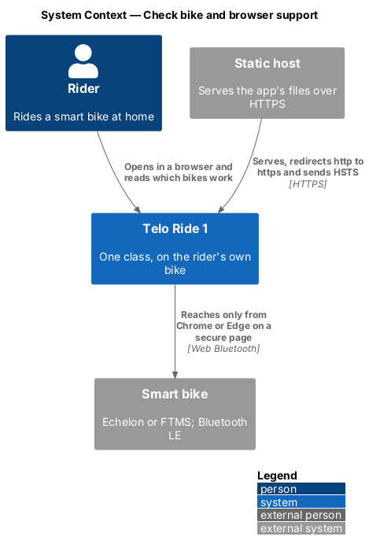
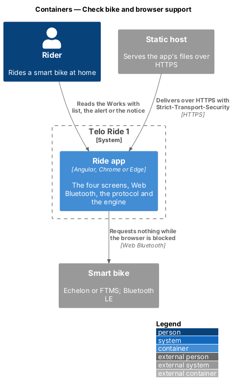
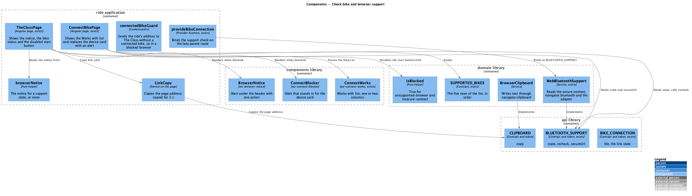
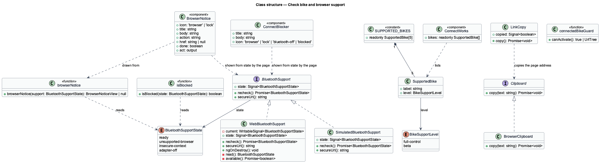
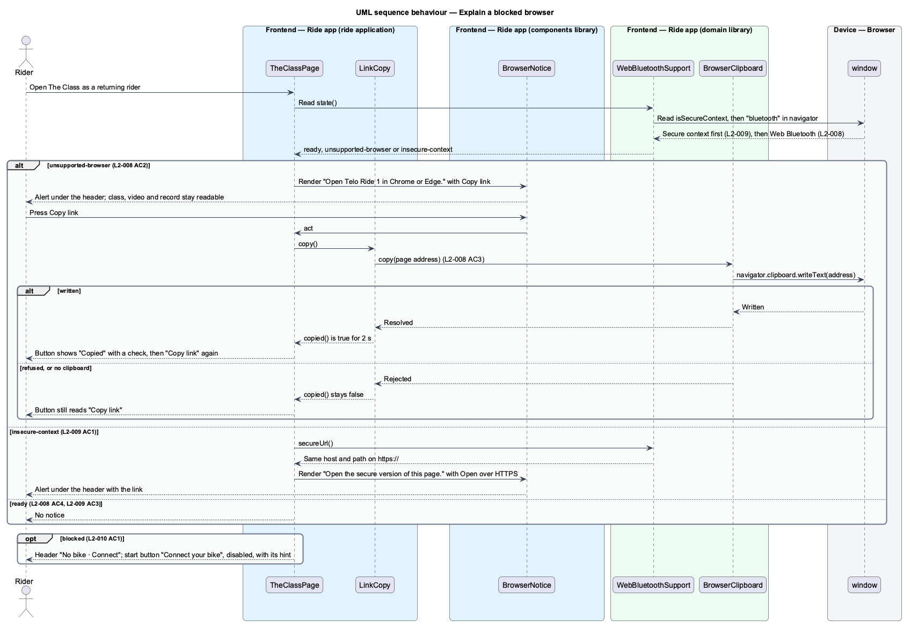
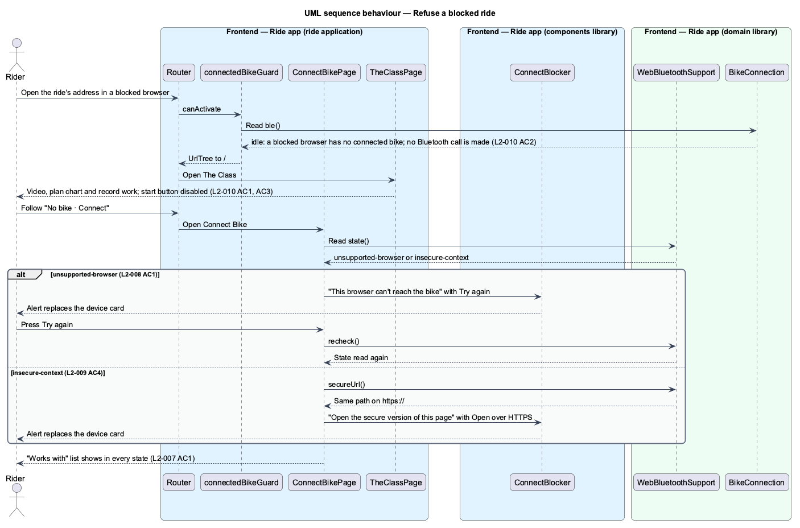

# Check bike and browser support

## Overview

Telo Ride 1 is one class on the rider's own smart bike. The Ride app reaches the bike directly from the browser through Web Bluetooth, so the browser and the page address decide whether a ride can happen at all. This feature states which bikes Telo Ride 1 works with and how well, detects a browser or a page that cannot reach a bike, says why in plain words, and keeps a ride from starting there. The class, its video and the rider's record stay readable in every case.

The following terms are used in this design:

- **Web Bluetooth**: browser API (`navigator.bluetooth`) through which a page talks to a Bluetooth LE device, present only in Chromium browsers
- **secure context**: page served over HTTPS or from `localhost`, the only kind of page on which a browser exposes Web Bluetooth
- **blocked**: state of a browser that cannot reach a bike, because it has no Web Bluetooth (`L2-008`) or the page is not a secure context (`L2-009`)
- **support state**: one of `ready`, `unsupported-browser`, `insecure-context` and `adapter-off`, read from the browser
- **full control**: support level at which the app reads the bike's telemetry and sets its resistance
- **beta**: support level of a bike that speaks the Fitness Machine Service (FTMS), on which resistance control depends on the bike granting it
- **alert**: panel with `role="alert"` that replaces the device card on Connect Bike
- **notice**: band with `role="alert"` under the header of The Class, which leaves the rest of the screen usable

Neighbouring features own the adjacent concerns. Pairing, the chooser and the Bluetooth-off alert belong to [Connect a bike](../connect-a-bike/README.md). The bike status in the header belongs to [Keep the bike connected](../keep-the-bike-connected/README.md). The simulated bike, which needs no Web Bluetooth, belongs to [Ride a simulated bike](../ride-a-simulated-bike/README.md). The Class screen and its start button belong to [Show the class](../../the-class/show-the-class/README.md), and the choice between Connect Bike and The Class at `/` (`L2-167`) to [Open the app](../../the-class/open-the-app/README.md). The Class Ride route belongs to [Ride the class](../../class-ride/ride-the-class/README.md). The static host and its response headers belong to [Host and deliver](../../platform/host-and-deliver/README.md).

## Description

The slice runs from two screens of the `ride` application through one support check in the `domain` library. No backend takes part.

**Contracts in the `api` library**

- **`BluetoothSupport`** and the token `BLUETOOTH_SUPPORT` (`api/src/bike/bluetooth-support.ts`) exist. The contract exposes `state` as a signal of `BluetoothSupportState`, `recheck()`, and `secureUrl()`, which returns the current address on `https://` with the same host, path, query and fragment. The contract is unchanged.
- **`SupportedBike`** and **`BikeSupportLevel`** (`api/src/bike/supported-bike.ts`) exist. A row carries a `label` and a `level` of `full-control` or `beta`.
- **`Clipboard`** and the token `CLIPBOARD` (`api/src/screen/clipboard.ts`) were built by slice 30.6. The contract has one method, `copy(text)`, which resolves when the text is on the clipboard and rejects where the browser has no clipboard or refuses.

**Logic in the `domain` library**

- **`WebBluetoothSupport`** (`domain/src/bluetooth/web-bluetooth-support.ts`) exists. It reads `isSecureContext` first and `'bluetooth' in navigator` second. A plain `http` page therefore reads `insecure-context` even in Chrome, and the rider is told to go secure, never to change browser (`L2-009`). It then calls `getAvailability()` and listens to `availabilitychanged`; that part serves [Connect a bike](../connect-a-bike/README.md). It removes its listener in `ngOnDestroy`.
- **`SimulatedBluetoothSupport`** exists and always reads `ready`. `provideBikeConnection()` binds it only in a development build opened with `?simulate`.
- **`SUPPORTED_BIKES`** (`domain/src/bluetooth/supported-bikes.ts`) exists. It holds the five rows in the order of `L2-007` AC1.
- **`isBlocked(state)`** (`domain/src/bluetooth/is-blocked.ts`) is a pure helper built by slice 30.6, with one unit test per support state. It returns `true` for `unsupported-browser` and `insecure-context`. `adapter-off` is not blocked: the browser can reach a bike once Bluetooth is on.
- **`BrowserClipboard`** (`domain/src/browser/browser-clipboard.ts`) was built by slice 30.6. It implements `Clipboard` through `navigator.clipboard.writeText`, and rejects in a browser with no `navigator.clipboard`.

**Presentation in the `components` library**

- **`ConnectWorks`** (`wz-connect-works`, block `connect-works`) exists. It renders the "Works with" section from its `bikes` input. Its stylesheet lays the list out in one column on a phone and two from sm (`L2-007` AC4).
- **`ConnectBlocker`** (`wz-connect-blocker`, block `connect-blocker`, `components/src/connect-blocker/`) exists, built by slice 29.2 in place of the four sections `ConnectBikePage` drew inline. It takes an `icon` (`bluetooth-off`, `browser`, `lock` or `blocked`), a `title`, a `body`, the words of its `action` ("Try again" unless given) and an optional `href`. It renders the mocks' `section` with `role="alert"` and `aria-labelledby` naming the title, and draws the action itself in `connect-blocker__retry`: a primary link when `href` is given, otherwise a raised `button` that emits `retry`. It projects nothing, so the block's stylesheet styles every element of the block. The Bluetooth-off icon is drawn in `--color-heart-fg` and the others in `--color-warn-fg`; the icon's shape and the words carry the reason. [Connect a bike](../connect-a-bike/README.md) uses it for its own alerts.
- **`BrowserNotice`** (`wz-browser-notice`, block `browser-notice`, `components/src/browser-notice/`) was built by slice 30.6 from the design system's block and the mocks `the-class/needs-chromium`, `link-copied` and `needs-https`. It takes an `icon` (`browser` or `lock`), a `title`, a `body`, the words of its `action`, an optional `href` and `done`. It renders the mocks' `div` with `role="alert"` and draws the action itself in `browser-notice__action`, as `ConnectBlocker` does and for the same reason: a primary link when `href` is given, otherwise a raised `button` that emits `act`. While `done` is true the button carries `data-copied` and draws a check in place of the copy icon. It projects nothing. The icon is hidden on a phone; the words carry the reason.

**Screens in the `ride` application**

- **`connectAlert(support, view)`** (`ride/src/app/connect/connect-alert.ts`) is a pure helper built by slice 29.2, with one unit test per row of the requirements. From the support state and the store's view it returns the alert to draw, or `null`: its `icon`, `title`, `body` and the `way` forward (`recheck`, `secure` or `pair`). What the browser cannot do comes first, a page on plain http before a browser without Web Bluetooth before Bluetooth switched off; a chooser that failed is named only in a browser that can reach the bike.
- **`ConnectBikePage`** (`ride/src/app/connect/connect-bike-page.ts`) exists. It draws `wz-connect-blocker` from `connectAlert()` in place of the device card and the pair button, and keeps the "Works with" list. "Try again" calls `support.recheck()`, and **Open over HTTPS** is a link to `support.secureUrl()`. The unsupported-browser body reads "Open Telo Ride 1 in Chrome or Edge…", as the code has read since slice 28.7. The secure-page alert of `L2-009` AC4 is drawn in the mock `connect-bike/needs-https` (open question 6, closed by slice 29.2).
- **`browserNotice(support)`** (`ride/src/app/the-class/browser-notice.ts`) is a pure helper built by slice 30.6, with one unit test per support state. It returns the notice to draw, or `null`: its `icon`, `title`, `body` and the `way` forward (`copy` or `secure`). `unsupported-browser` reads "Open Telo Ride 1 in Chrome or Edge." (open question 5, closed by slice 28.7) with `copy`; `insecure-context` reads "Open the secure version of this page." with `secure`; `ready` and `adapter-off` have no notice, because Connect Bike, where the start button leads, says when Bluetooth is off (`L2-018`).
- **`LinkCopy`** (`ride/src/app/the-class/link-copy.ts`) is a service built by slice 30.6 and provided on `TheClassPage`, with its unit tests. `copy()` writes `location.href` through `CLIPBOARD`; `copied` then reads `true` for 2 seconds, counted from the last press, as the design system's alert page specifies. A clipboard that rejects leaves `copied` false and raises nothing: the button stays "Copy link" (open question 25). Its timer is cleared when the page is destroyed.
- **`TheClassPage`** exists and is owned by [Show the class](../../the-class/show-the-class/README.md). For this feature, built by slice 30.6, it injects `BLUETOOTH_SUPPORT` and `LinkCopy` and renders `wz-browser-notice` between the header and the class from `browserNotice()`, also when the class cannot be loaded. **Copy link** calls `LinkCopy.copy()` and reads "Copied" while `copied()` is true. **Open over HTTPS** is a link to `secureUrl()`. `TheClassStore` passes `isBlocked()` to `startAction(connected, blocked)`: in a blocked browser the start button reads "Connect your bike", is a `button` with the `disabled` attribute and keeps its hint (`L2-010` AC1). A disabled button takes no Tab stop; the header's link to Connect Bike and the notice's action stay reachable (open question 25).
- **`connectedBikeGuard`** (`ride/src/app/bike/connected-bike.guard.ts`) is the `CanActivateFn` on Class Ride's route, `/ride`, built by slice 31.1 and owned by [Ride the class](../../class-ride/ride-the-class/README.md). It returns a `UrlTree` to `/` unless `BIKE_CONNECTION.ble()` is `connected`, and calls nothing, so nothing is requested from Bluetooth. A blocked browser never has a connected bike, so the ride's address opens The Class there (`L2-010` AC2). It replaced `blockedBrowserGuard`, which slice 30.6 built to read the support state alone while the ride was still at `classes/intervals-to-the-beat/ride`; that guard and its unit test went with slice 31.1, and the acceptance specs of `L2-010` AC2 stayed as they were. A new rider sent to `/` is sent on to Connect Bike, as `L2-167` AC3 says. The existing `rememberedBikeGuard` keeps its name and guards `/`; it belongs to [Open the app](../../the-class/open-the-app/README.md). `classDoneGuard` of [Show Class Done](../../class-done/show-class-done/README.md) guards `/done`.
- **`provideBikeConnection()`** (`ride/src/app/bike/provide-bike-connection.ts`) exists. It binds `BLUETOOTH_SUPPORT` on the lazy parent route in `ride.routes.ts`, so the check stays out of the initial bundle. `CLIPBOARD` is bound to `BrowserClipboard` on The Class's own route (`the-class.routes.ts`), the one screen that copies, so it goes when the rider leaves.

**Outside the app**

The redirect from `http` to `https` and the `Strict-Transport-Security` header (`L2-009` AC2) are the static host's work. Azure Static Web Apps redirects plain `http` itself, and `Strict-Transport-Security: max-age=31536000` is in the `globalHeaders` of `frontend/projects/ride/public/staticwebapp.config.json`, which the build carries (ADR 0043). `docs/deployment.md` says what a person checks on the real host; [Host and deliver](../../platform/host-and-deliver/README.md) owns the file.

The routes `/connect`, `/` and `/ride` are assumptions the mocks share (open question 7).

**Acceptance tests**

`frontend/e2e/connect-bike-alerts.spec.ts` proves the alerts on Connect Bike (`L2-008` AC1 and AC4, `L2-009` AC3 and AC4) through the page object `connect-bike.page.ts`; `frontend/e2e/browser-support.spec.ts` keeps the "Works with" list. `frontend/e2e/the-class-blocked-browser.spec.ts` proves The Class in a blocked browser (`L2-008` AC2 to AC4, `L2-009` AC1 and AC3, `L2-010`) through `the-class.page.ts`: both notices, Copy link by pointer and by keyboard with the clipboard answered by `fixtures/clipboard.ts`, a clipboard that refuses, the disabled start button, the ride's address, page not found, and the notice at 1024 × 768, 1194 × 834, 1440 × 900, 390 × 844 and 834 × 1194. `frontend/e2e/the-class-form-factors.spec.ts` proves both blocked states fit those five windows. The fake `navigator.bluetooth` of `fixtures/fake-bluetooth.ts` fails a spec on any unexpected Bluetooth call, which proves `L2-010` AC2.

## Requirements

The feature realizes the following level-2 (L2) requirements. Each refines a level-1 (L1) requirement, cited by identifier.

| L2 ID | Refines (L1) | Requirement |
|-------|--------------|-------------|
| `L2-007` | `L1-002` | Connect Bike shall show, in every state, a "Works with" section that lists in order "Echelon EX-5s", "Echelon EX-3", "Echelon EX-8s" and "Echelon Connect Sport", each "Full control", and "Other FTMS smart bikes", "Beta". For a connected Echelon bike the app shall read its telemetry and set its resistance (`L2-013`). For a connected bike that advertises FTMS (service `0x1826`) and is not an Echelon, the app shall read Indoor Bike Data and, if the bike grants control, set its resistance (`L2-014`). The list shall be two columns at sm or wider and one column on a phone. |
| `L2-008` | `L1-002` | In a browser without `navigator.bluetooth` on a secure page, Connect Bike shall replace the device card with an alert (`role="alert"`) that reads "This browser can't reach the bike" and "Open Telo Ride 1 in Chrome or Edge on a laptop or Android tablet. Safari and Firefox don't support Web Bluetooth yet.", with "Try again". In such a browser The Class shall show an alert (`role="alert"`) under the header that reads "Open Telo Ride 1 in Chrome or Edge." with "Bluetooth to the bike only works there — you can look around, but not ride." and **Copy link**, and the class, its video and the rider's record shall stay readable. **Copy link** shall copy the page address to the clipboard, and the button shall show its copied state. A supported browser on a secure page shall show no unsupported-browser message on any screen. |
| `L2-009` | `L1-002` | On a page served over plain `http` other than `localhost`, The Class shall show an alert (`role="alert"`) under the header that reads "Open the secure version of this page." with "Bluetooth is blocked on plain http, so the bike can’t connect." and **Open over HTTPS**, a link to the same path on `https://`. A production deployment shall redirect a request over `http` to `https`, and its responses shall carry `Strict-Transport-Security`. A secure context shall show no HTTPS notice on any screen. On a page served over plain `http` other than `localhost`, Connect Bike shall replace the device card with an alert (`role="alert"`) that reads "Open the secure version of this page" and "Bluetooth is blocked on plain http, so the bike can’t connect.", with **Open over HTTPS**, which goes to the same path on `https://`. |
| `L2-010` | `L1-002` | In a blocked browser, the header of The Class shall read "No bike · Connect", and the start button shall read "Connect your bike", be disabled, and be followed by "The class needs the bike to set resistance.". In a blocked browser, opening the `/ride` address shall open The Class instead, and nothing shall be requested from Bluetooth. In a blocked browser, the video, the plan chart and the record shall work normally on The Class and on the page-not-found screen. |

## Diagrams

### System context

The rider opens Telo Ride 1 in a browser. The app reaches the smart bike only from Chrome or Edge on a secure page, and the static host redirects `http` to `https`.

### Containers

The slice lives in the Ride app. Browser storage takes no part, and the app requests nothing from the bike while the browser is blocked.

### Components

`TheClassPage` and `ConnectBikePage` read `BLUETOOTH_SUPPORT`, which `provideBikeConnection()` binds to `WebBluetoothSupport`. The pages render `BrowserNotice` or `ConnectBlocker` from the support state, and `connectedBikeGuard` reads only the link's state.

### Class structure

`WebBluetoothSupport` and `SimulatedBluetoothSupport` realize `BluetoothSupport`, whose state is a `BluetoothSupportState`. `SUPPORTED_BIKES` holds five `SupportedBike` rows, `BrowserClipboard` realizes the `Clipboard` contract, and `LinkCopy` holds the copied state.

### Behaviour: explain a blocked browser

The Class reads the support state, in which the secure context is checked before Web Bluetooth. It shows the notice that fits, copies the page address on **Copy link**, and disables the start button while the browser is blocked.

### Behaviour: refuse a blocked ride

`connectedBikeGuard` sends the ride's address to The Class without calling Bluetooth. Connect Bike, reached from the header, replaces its device card with the alert for the support state and keeps the "Works with" list.

