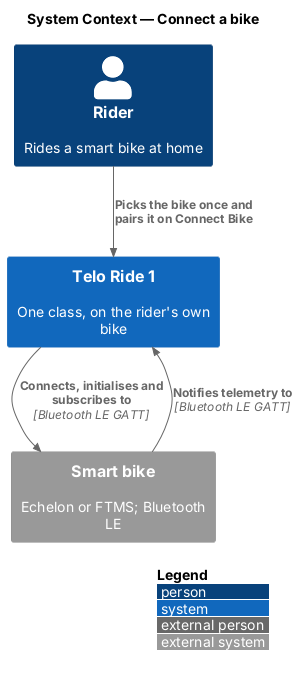
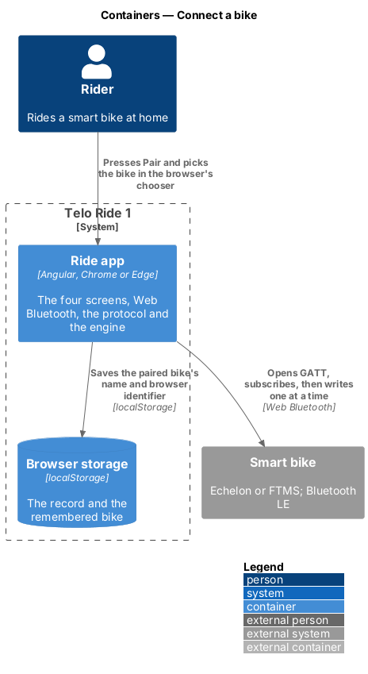
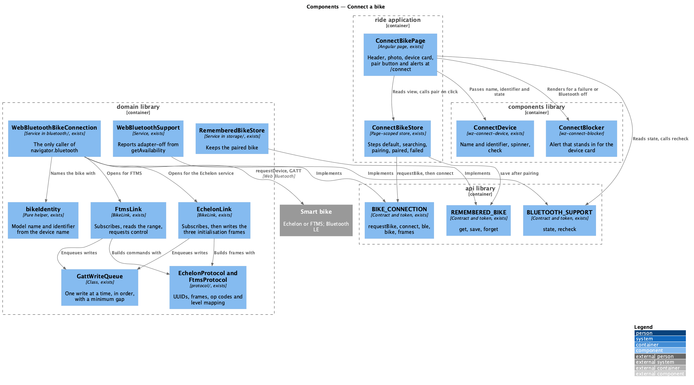
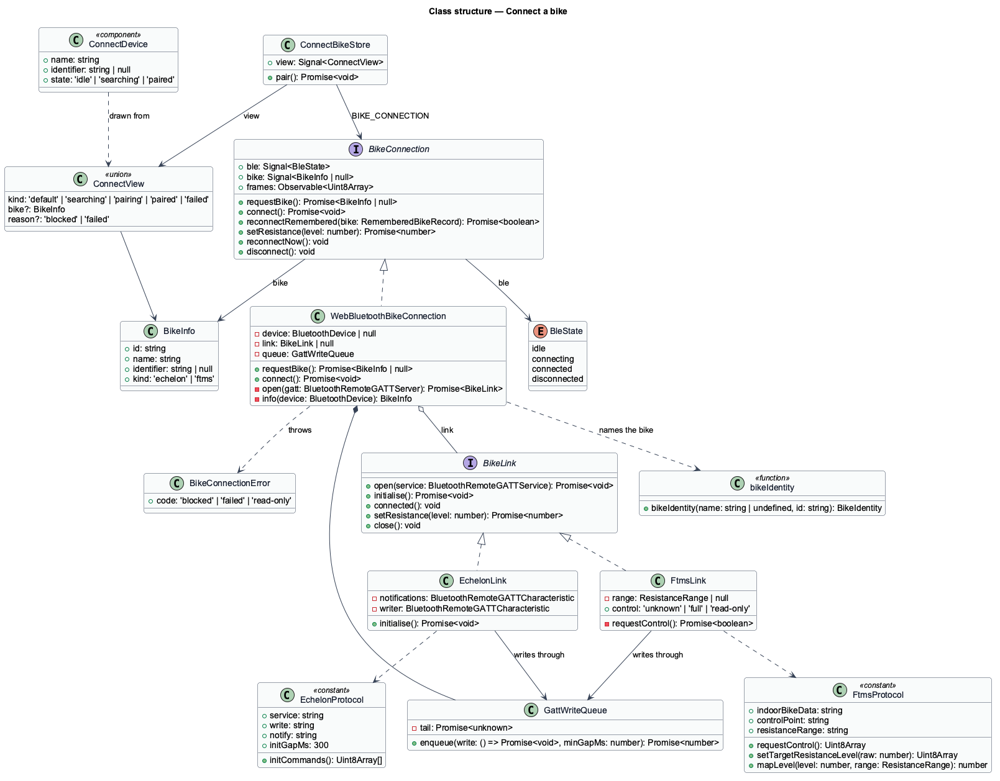
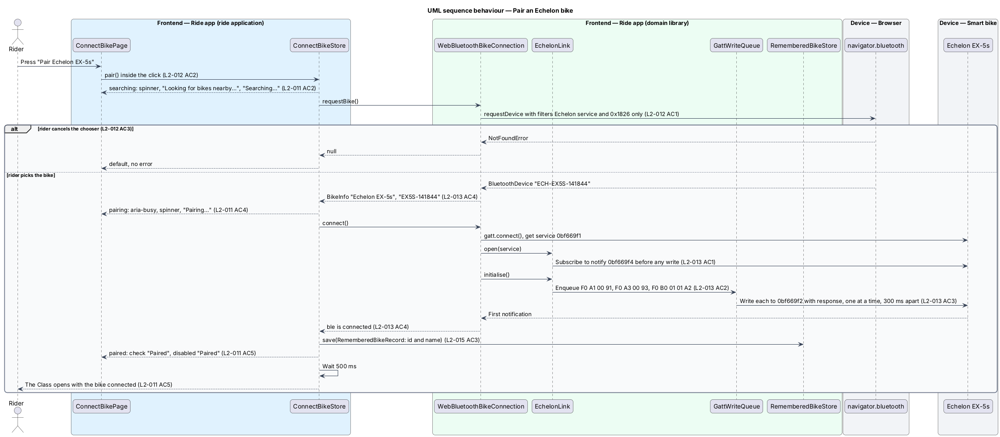
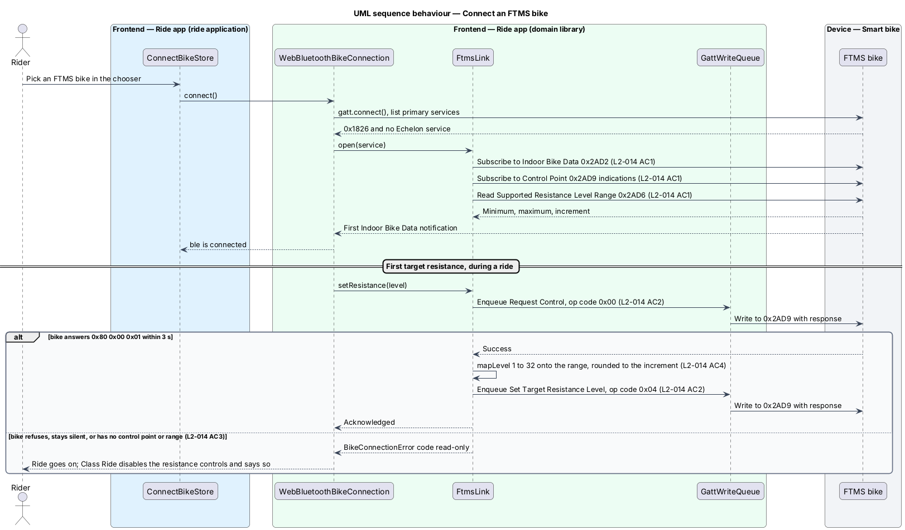
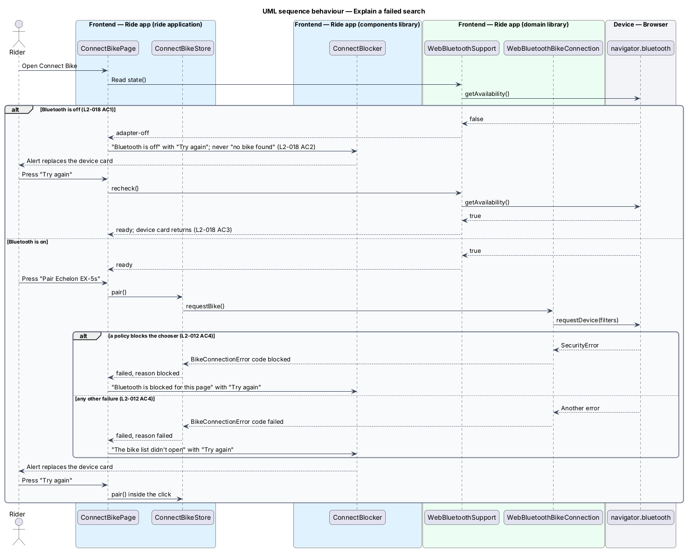

# Connect a bike

## Overview

Telo Ride 1 sets a smart bike's resistance through the class, so the bike has to be paired before anything else. Connect Bike (`/connect`) is where that happens. A new rider starts there, and any rider reaches it from the header of The Class. The rider presses one button, picks the bike in the browser's own chooser, and lands on The Class with the bike connected.

A web page cannot scan for Bluetooth devices in the background. The browser opens its chooser only inside a tap or click, and the page sees only the device the rider picks. The feature covers that choice, the connection and initialisation of an Echelon bike, the connection of an FTMS bike in beta, and the alerts shown when the chooser cannot open or Bluetooth is off.

The following terms are used in this design:

- **chooser**: browser dialog, opened by `navigator.bluetooth.requestDevice`, in which the rider picks one nearby device
- **device card**: panel on Connect Bike that shows the bike's name and identifier, a spinner while searching, and a check once paired
- **identifier**: short text under the bike's name, such as `EX5S-141844`, taken from the Echelon device name
- **GATT**: Bluetooth LE attribute protocol, in which a device offers services made of characteristics that a client reads, writes and subscribes to
- **initialisation**: three writes an Echelon bike needs before it streams telemetry
- **link**: object that speaks one bike protocol, Echelon's own or FTMS, over an open GATT service
- **write queue**: single ordered queue through which every write to the bike passes, one at a time
- **control**: permission an FTMS bike grants before it accepts a target resistance
- **`ble`**: link state of the bike, one of `idle`, `connecting`, `connected` and `disconnected`

Neighbouring features own the adjacent concerns. The "Works with" list and the alerts for a browser that cannot reach a bike belong to [Check bike and browser support](../check-bike-and-browser-support/README.md). Remembering the bike, the keepalive and recovery from a drop belong to [Keep the bike connected](../keep-the-bike-connected/README.md). Decoding what the bike sends belongs to [Read bike telemetry](../read-bike-telemetry/README.md), and the set-resistance command to [Control resistance](../control-resistance/README.md). The simulated bike belongs to [Ride a simulated bike](../ride-a-simulated-bike/README.md). The wordmark and Full screen in the header belong to [Show the wordmark](../../ui/show-the-wordmark/README.md) and [Switch theme and full screen](../../ui/switch-theme-and-full-screen/README.md). The rule that device names are text, cut to 64 characters (`L2-129`), belongs to [Treat device data as untrusted](../../security/treat-device-data-as-untrusted/README.md).

## Description

The slice runs from Connect Bike through a page-scoped store to the one service that touches `navigator.bluetooth`. Slice 29.1 built the screen as described here, and slice 29.2 its alerts.

**Contracts in the `api` library**

- **`BikeConnection`** and the token `BIKE_CONNECTION` (`api/src/bike/bike-connection.ts`) exist. This slice uses `requestBike()`, `connect()`, the signals `ble` and `bike`, and the `frames` observable. `requestBike()` resolves `null` when the rider closes the chooser.
- **`BikeInfo`** exists: the browser's `id` for the device, the `name`, the `identifier` or `null`, and the `kind` (`echelon` or `ftms`).
- **`BikeConnectionError`** (`api/src/bike/bike-connection-error.ts`) exists. A screen branches on its `code`: `blocked`, `failed` or `read-only`. The rider reads the app's own words.

**Bluetooth in the `domain` library**

- **`WebBluetoothBikeConnection`** (`domain/src/bluetooth/web-bluetooth-bike-connection.ts`) exists and is the only caller of `navigator.bluetooth` for the bike. `requestBike()` calls `requestDevice` with one filter for the Echelon service and one for `0x1826`. The code also passes `optionalServices` with Heart Rate (`0x180D`), a Telo Ride feature; Telo Ride 1 removes it, so no other service is requested (`L2-012` AC1). A `NotFoundError` resolves `null`, a `SecurityError` throws code `blocked`, and any other error throws code `failed`. `connect()` opens GATT, lists the primary services, takes the Echelon service first and FTMS otherwise, opens the link, initialises it, and resolves on the first notification. It then sets `ble` to `connected`.
- **`BikeLink`** (`bike-link.ts`) exists: `open(service)`, `initialise()`, `connected()`, `setResistance(level)` and `close()`.
- **`EchelonLink`** (`echelon-link.ts`) exists. `open()` gets the notify characteristic `0bf669f4-…`, adds its listener and starts notifications before it gets the write characteristic `0bf669f2-…`. `initialise()` writes the frames of `EchelonProtocol.initCommands()` with response, each `EchelonProtocol.initGapMs` (300 ms) after the one before.
- **`FtmsLink`** (`ftms-link.ts`) exists. `open()` subscribes to Indoor Bike Data (`0x2AD2`) and to Control Point (`0x2AD9`), and reads the Supported Resistance Level Range (`0x2AD6`). The first `setResistance()` writes Request Control and waits up to `CONTROL_TIMEOUT_MS` (3000 ms) for the response. Only Success lets Set Target Resistance Level through. A refusal, silence, or a bike with no control point or range sets `control` to `read-only`, and every target is refused with code `read-only`.
- **`GattWriteQueue`** (`gatt-write-queue.ts`) exists. One instance per connection chains every write on a single promise, so writes go one at a time in the order requested, each after an optional minimum gap.
- **`EchelonProtocol`** and **`FtmsProtocol`** (`domain/src/protocol/`) exist. They hold the UUIDs, the frame and op-code builders, and `FtmsProtocol.mapLevel()`, which maps levels 1 to 32 linearly onto the bike's range and rounds to its increment. `docs/protocol/echelon-ble-frames.md` documents the bytes.
- **`bikeIdentity(name, id)`** (`bike-identity.ts`) exists. `ECH-EX5S-141844` yields the name "Echelon EX-5s" and the identifier `EX5S-141844`. Any other device yields its device name, or its browser id when it has no name.
- **`WebBluetoothSupport`** exists and reports `adapter-off` when `getAvailability()` resolves `false` or `availabilitychanged` says so. A browser without `getAvailability()` counts as on.

**Screen in the `ride` application**

- **`ConnectBikeStore`** (`ride/src/app/connect/connect-bike-store.ts`) exists and is provided by the page, so its state goes when the rider leaves. Its `view` signal holds one `ConnectView`: `default`, `searching`, `pairing` with the bike, `paired` with the bike, or `failed` with a reason. `pair()` runs only from a click and only from `default` or `failed`. After `connect()` it saves the bike's `id` and `name` through `REMEMBERED_BIKE`, as the `RememberedBikeRecord` of [Keep the bike connected](../keep-the-bike-connected/README.md), shows `paired`, and navigates to `/` after `PAIRED_PAUSE_MS` (500 ms). The timer is cleared on destroy. The store is unchanged.
- **`ConnectBikePage`** (`connect-bike-page.ts`, selector `wz-connect-bike-page`) exists, reshaped by slice 29.1:
  - Its root is the `connect` block, a column as tall as the window that scrolls as one. The header `connect__header`, with `wz-lockup` and `wz-fullscreen-button`, sits above the `main` landmark and not inside it, and the screen has no navigation (`L2-011` AC1). The header is an element of the page's own `connect` block, as the mock draws it, and not the `ScreenHeader` of the other screens ([Show the wordmark](../../ui/show-the-wordmark/README.md)). `main` is `connect__body`, the landmark the skip link lands on.
  - It will announce the completed pairing once through the Angular CDK's `LiveAnnouncer`, as [Support screen readers and motion](../../ui/support-screen-readers-and-motion/README.md) designs it; the wording is `<TO SUPPLY>`, and slice 36.3 builds it (`L2-141`).
  - The lead reads "…Telo Ride 1 reads your power…" and the route title names Telo Ride 1.
  - The hint "Not in the list? Close the Echelon app…" (`connect__hint`) is removed; the design does not draw it.
  - The pair button is busy (`aria-busy="true"`, with the spinner) only while pairing runs. While the chooser is open it is disabled and reads "Searching…", with no `aria-busy`, as `searching.html` draws it; the card's `role="status"` carries the search.
  - The alerts are the `wz-connect-blocker` of [Check bike and browser support](../check-bike-and-browser-support/README.md), drawn from that feature's `connectAlert()` in place of the device card and the pair button (slice 29.2). With Bluetooth off (`adapter-off`) the alert is `bluetooth-off.html` and "Try again" calls `support.recheck()`; while it is still off the alert stays. For the store's `failed` view the alert is `chooser-blocked.html` when the reason is `blocked` and `chooser-failed.html` otherwise, and "Try again" calls `store.pair()` inside the click, so the chooser opens again and the card searches.
  - `connect-bike-page.scss` gives the body the height the header leaves, at most 64 rem wide (`--layout-container-narrow`) and centred both ways. At lg it is two equal columns 4 rem apart with the photo on the left; below lg the photo follows the content, square, up to 28 rem.
- **`ConnectDevice`** (`wz-connect-device`, block `connect-device`) exists in `components` and is unchanged. It takes `name`, `identifier` and `state` (`idle`, `searching`, `paired`), and draws the identifier line only when there is an identifier. It has no signal input: `requestDevice` reports no signal strength for the bike the rider picks, so none is shown (`L2-011` AC3; L2's open question 17, closed by slice 29.1).

Before the chooser returns, the page knows no device. The `default` view therefore shows the offered model, "Echelon EX-5s", with "Pair Echelon EX-5s" and no identifier, and the identifier appears from `pairing` onward. The pick starts pairing: the rider presses once. The mock's `default` state was brought in line with this in slice 29.1.

**The read-only FTMS bike**

Class Ride learns that a bike refuses control from the `read-only` code that `setResistance()` rejects with. Telemetry, the clock and the video continue, and no further resistance command is sent. A bike refuses when its control point answers Request Control with anything but Success, does not answer within `CONTROL_TIMEOUT_MS`, or is not there. Slice 31.3 built the rest: once refused, `ResistanceController` asks the connection nothing more and has it forget the kept target, so a bike that drops and reconnects is written nothing, and Class Ride shows “The class can’t set this bike’s resistance. Set it by hand.” under the bike panel as a polite status (`L2-014` AC3; mock `class-ride/by-hand`; designed in [ride the class](../../class-ride/ride-the-class/README.md)). [Control resistance](../control-resistance/README.md) owns the resistance controls.

**Acceptance tests**

`frontend/e2e/connect-bike.spec.ts` proves the screen as designed: at rest, its layout from lg and below it, searching while the chooser is open, the pick by touch and by keyboard, pairing, an FTMS bike's own name, and paired with the half second before The Class. `frontend/e2e/pair-a-bike.spec.ts` proves the chooser's request, its cancelling, and the GATT order for both protocols. `frontend/e2e/connect-bike-alerts.spec.ts` proves the alerts: Bluetooth off with "Try again" (`L2-018`), and a chooser a policy blocks or that fails for another reason, with "Try again" opening it again (`L2-012` AC4). The page object `pages/connect-bike.page.ts` and the fixtures `fixtures/fake-bluetooth.ts`, `fixtures/echelon.ts` and `fixtures/ftms.ts` serve both. The fake records every write with its characteristic, bytes and response flag, and the options of each `requestDevice` call; `holdChooser()` keeps the chooser open until `pickFromChooser()` or `closeChooser()`. The 500 ms pause is counted on Playwright's paused clock.

## Requirements

The feature realizes the following level-2 (L2) requirements. Each refines a level-1 (L1) requirement, cited by identifier.

| L2 ID | Refines (L1) | Requirement |
|-------|--------------|-------------|
| `L2-011` | `L1-003` | Connect Bike shall show the wordmark, Full screen, the bike photo, "Connect your bike" and "Pedal once to wake it up. Telo Ride 1 reads your power and sets resistance for every hill and interval.", and no navigation. While a search runs and no bike has been picked, the card shall show a spinner with "Looking for bikes nearby…" (`role="status"`) and a disabled "Searching…" button. At rest the card shall name the offered model, "Echelon EX-5s", with no identifier, and the button shall read "Pair Echelon EX-5s"; once the rider has picked a bike the card shall give its name and identifier ("EX5S-0bf669f1") as text, with no signal strength. While pairing runs, which starts with the pick, the button shall be disabled with `aria-busy="true"`, a spinner and "Pairing…". When pairing succeeds, the card shall show a check (`aria-label="Paired"`) and a disabled "Paired" button, and about half a second later The Class shall open with the bike connected. At lg or wider Connect Bike shall be two columns with the photo on the left; below lg the photo shall follow the content at up to 28 rem, square. |
| `L2-012` | `L1-003` | When the rider presses the search or pair action, the app shall call `navigator.bluetooth.requestDevice` with filters for the Echelon service (`0bf669f1-45f2-11e7-9598-0800200c9a66`) and FTMS (`0x1826`), and shall request no other service. Without a user gesture the app shall not open the chooser and shall request nothing from Bluetooth. When the rider cancels the chooser, Connect Bike shall return to its default state with no error. When a policy blocks the chooser, an alert (`role="alert"`) shall replace the device card and read "Bluetooth is blocked for this page" and "Allow Bluetooth for this site in your browser’s settings, then try again."; any other failure shall read "The bike list didn’t open" and "Something went wrong opening your browser’s list of bikes. Try again."; each alert shall offer "Try again". |
| `L2-013` | `L1-003` | For a chosen Echelon bike, the app shall open GATT, get service `0bf669f1-…`, and subscribe to the notify characteristic `0bf669f4-…` before writing anything. Initialisation shall write `F0 A1 00 91`, `F0 A3 00 93` and `F0 B0 01 01 A2`, in that order, each to `0bf669f2-…` with response and at least 300 ms after the previous one. A write shall wait while another is pending, and writes shall go one at a time in the order requested. When the first notification arrives after initialisation, the bike state shall be `connected`. The bike's name shall be the model's name when the device name is an Echelon's (`ECH-EX5S-141844` is "Echelon EX-5s", identified as `EX5S-141844`), otherwise the device name, or the device's identifier if it has none. |
| `L2-014` | `L1-003` | For a chosen FTMS bike, the app shall subscribe to Indoor Bike Data (`0x2AD2`) and to Fitness Machine Control Point (`0x2AD9`) indications, and shall read Supported Resistance Level Range (`0x2AD6`). Before setting resistance the app shall write Request Control (op code `0x00`), and shall send Set Target Resistance Level (op code `0x04`) only on a Success response (`0x80 0x00 0x01`). When the bike refuses control or has no control point, telemetry, the clock and the video shall still work during a ride, no resistance command shall be sent, the resistance controls shall be disabled, and Class Ride shall say that the rider sets the resistance by hand. The app shall map level 1 to the bike's minimum and level 32 to its maximum, with the levels between spaced linearly and rounded to the bike's increment. |
| `L2-018` | `L1-003` | When `navigator.bluetooth.getAvailability()` resolves `false`, Connect Bike shall replace the device card with an alert (`role="alert"`) that reads "Bluetooth is off" and "Turn on Bluetooth on this computer, then try again.", with "Try again". While Bluetooth is off, the alert shall not say that no bike was found. When the rider presses "Try again" and Bluetooth is now on, Connect Bike shall return to its default state. |

## Diagrams

### System context

The rider pairs a smart bike once through Telo Ride 1, which connects to it over Bluetooth LE and receives its notifications.

### Containers

The Ride app opens GATT on the bike and writes one command at a time. After pairing it saves the bike in browser storage, which [Keep the bike connected](../keep-the-bike-connected/README.md) reads on the next visit.

### Components

`ConnectBikePage` renders `ConnectBikeStore`'s view through `ConnectDevice` or `ConnectBlocker`. The store calls `BIKE_CONNECTION`, which `WebBluetoothBikeConnection` implements with an `EchelonLink` or an `FtmsLink` over one `GattWriteQueue`.

### Class structure

`WebBluetoothBikeConnection` realizes `BikeConnection`, owns the `GattWriteQueue` and holds one `BikeLink`. `EchelonLink` and `FtmsLink` realize `BikeLink` and build their bytes with `EchelonProtocol` and `FtmsProtocol`. `ConnectBikeStore` exposes a `ConnectView` that `ConnectDevice` is drawn from.

### Behaviour: pair an Echelon bike

The click opens the chooser with the two service filters. A cancelled chooser returns the screen to its default state. A picked bike is subscribed to before any write, initialised with three frames 300 ms apart, saved, and The Class opens half a second after the check appears.

### Behaviour: connect an FTMS bike

The link subscribes to Indoor Bike Data and the Control Point and reads the resistance range. The first target resistance asks for control; a Success response lets the mapped level through, and anything else leaves the bike read-only while the ride goes on.

### Behaviour: explain a failed search

With Bluetooth off, the alert says so and never that no bike was found; "Try again" reads the adapter again. With Bluetooth on, a chooser that a policy blocks and a chooser that fails for another reason each get their own alert, and "Try again" calls `pair()` inside the click.

