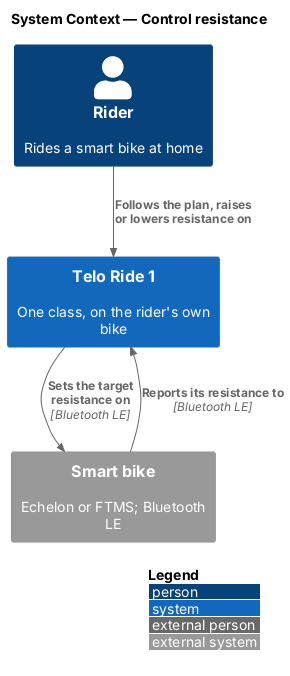
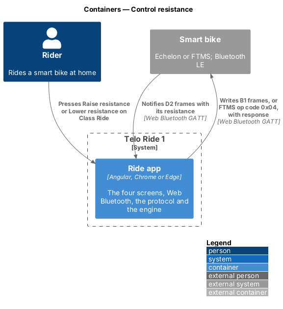
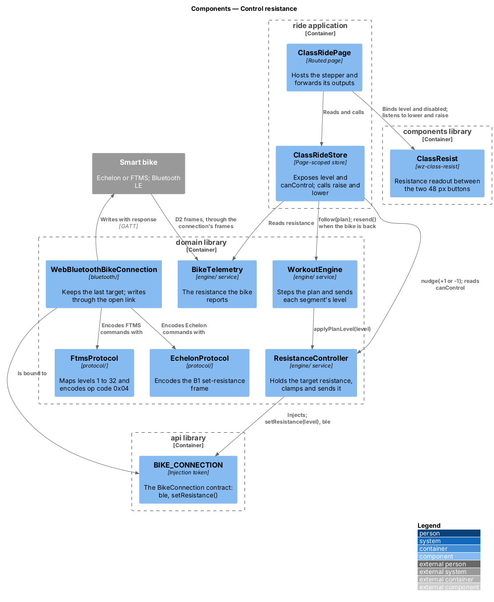
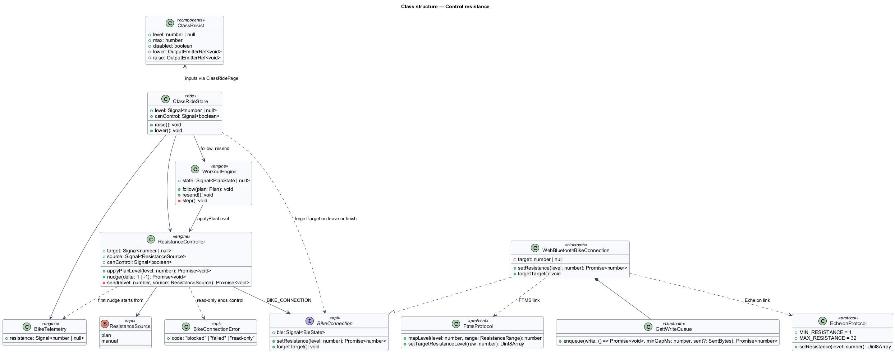
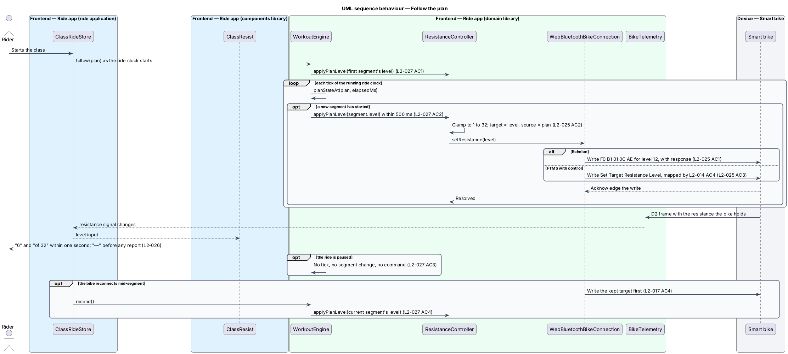
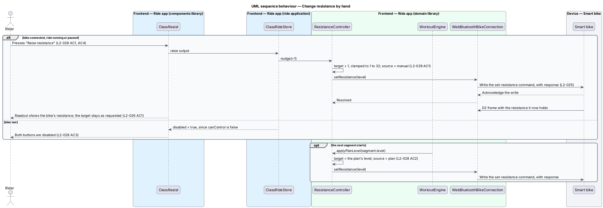

# Control resistance

## Overview

Telo Ride 1 sets the bike's resistance for every interval of its one class, so the rider just pedals. The class follows a plan of timed segments, and each segment carries the level the bike is set to. The rider may also move the resistance by one level at a time from Class Ride. This feature sends those levels to the bike and keeps the level the app asked for apart from the level the bike reports.

The two levels differ in practice: a bike may settle on another level than the one requested, and the rider may turn the bike's own knob. The readout on Class Ride always shows what the bike reports.

The following terms are used in this design:

- **resistance**: level the bike reports, from 1 to 32
- **target resistance**: level the app asks the bike for
- **plan**: timed segments the class follows
- **segment**: part of the plan with a kind (warm-up, work, recover, cool-down), a duration, a level and a cadence aim
- **segment boundary**: instant of ride time at which one segment ends and the next begins
- **source**: origin of a target resistance, `plan` when a segment starts and `manual` when the rider changes it
- **set-resistance command**: Echelon `B1` frame, or FTMS Set Target Resistance Level (op code `0x04`), that carries a target resistance
- **resistance controls**: "Lower resistance" and "Raise resistance" buttons either side of the resistance readout

Adjacent concerns belong to neighbouring features. [Connect a bike](../connect-a-bike/README.md) opens the link, requests FTMS control and defines the mapping of levels onto an FTMS bike's range (`L2-014`). [Keep the bike connected](../keep-the-bike-connected/README.md) sends the kept target again after a reconnect (`L2-017`). [Read bike telemetry](../read-bike-telemetry/README.md) decodes the resistance the bike reports. [Ride the class](../../class-ride/ride-the-class/README.md) owns the bike panel that hosts the stepper (`L2-089`). [Pause, leave or finish the class](../../class-ride/pause-leave-or-finish-the-class/README.md) and [wait for a lost bike](../../class-ride/wait-for-a-lost-bike/README.md) own the paused and lost states. [Show the class](../../the-class/show-the-class/README.md) owns the class and its plan (`L2-080`). [Keep the ride clock true](../../performance/keep-the-ride-clock-true/README.md) owns the clock and the ticks the plan steps on.

## Description

The slice lives in the Ride app: the engine and the protocol in `domain`, the contract in `api`, the stepper in `components` and its wiring in `ride`. Each building block is marked as existing in the carried-over code or as new.

- **`BikeConnection.setResistance(level)`** (exists, `api`, token `BIKE_CONNECTION`): contract operation that sends a target resistance and resolves when the bike has acknowledged the write. `WebBluetoothBikeConnection` (exists, `domain` `bluetooth/`) keeps the last level asked for in `target`, and writes through the open link's `GattWriteQueue`, so writes go one at a time. With no open link it rejects with a `BikeConnectionError` of code `failed`; the kept target is sent first after the reconnect. `forgetTarget()` (new on the contract) clears the kept level; `ClassRideStore` calls it when the rider leaves or finishes, so no resistance command follows the ride (`L2-093` AC3).
- **`GattWriteQueue`** (exists, `domain` `bluetooth/`; changed for the diagnostic recording): takes the optional `BikeLinkTap` in its constructor, and `enqueue(write, minGapMs, sent?)` takes what is written as a `SentBytes`: the characteristic `to`, the `bytes` and, for a resistance command, its `targetResistance`. With the tap bound, the queue calls `writing()` with them when the write's turn comes and calls the function it returns when the write settles, so the recording of [record diagnostics](../../security/record-diagnostics/README.md) holds each resistance command with the target resistance the app meant to request, and its outcome (`L2-178` AC5). `EchelonLink` and `FtmsLink` pass the level they were asked for. The order, the gap and the acknowledgement time of a write do not change, and with the tap `null` the queue tells no one. The recording does not use `SentCommand`.
- **`EchelonProtocol.setResistance(level)`** (exists, `domain` `protocol/`): encodes the `B1` frame with the level clamped to `MIN_RESISTANCE` 1 and `MAX_RESISTANCE` 32, and a checksum that is the sum of the preceding bytes mod 256. Level 12 is `F0 B1 01 0C AE` and level 32 is `F0 B1 01 20 C2`. The Echelon link writes it with response.
- **`FtmsProtocol.mapLevel()` and `setTargetResistanceLevel()`** (exist, `domain` `protocol/`): map a level from 1 to 32 onto the bike's supported range and encode op code `0x04`. The FTMS link sends it only after Request Control succeeded; a bike that refuses control rejects with code `read-only`. The mapping rule and the read-only bike belong to [connect a bike](../connect-a-bike/README.md) (`L2-014`).
- **`ResistanceController`** (exists, `domain` `engine/`; trimmed): service provided on `ClassRidePage` and released when the rider leaves it. It holds `target`, `source` and `canControl`. `applyPlanLevel(level)` sets the source to `plan`; `nudge(+1 | -1)` moves one level from the target, or from the reported resistance before any target, and sets the source to `manual`. Both clamp the level to 1 to 32 before sending. `canControl` is true while `ble` is `connected` and no `read-only` refusal has been received; `nudge()` sends nothing while it is false. Both come from the pure rule `resistanceControl(ble, refused)`, unit-tested one case per row, which also gives `byHand`: true once the bike has refused, connected or not (slice 31.3). After a refusal `applyPlanLevel()` still moves the target but asks the connection nothing, and the connection is told to forget the kept target, so no command follows at the next segment or after a reconnect (`L2-014` AC3). Pausing the ride does not change `canControl`. For Telo Ride 1 the controller loses `setManual()`, `last` and the `SentCommand` record with its ride time and acknowledgement time, which served the "Sent to bike" log that Telo Ride 1 leaves out.
- **`WorkoutEngine`** (exists, `domain` `engine/`; one addition): service that steps the plan on `RideTicker`'s ticks with `planStateAt()`. `follow(plan)` steps at once, so the first segment's level goes out as the clock starts. A tick that lands in a new segment calls `applyPlanLevel()` with that segment's level; ticks land on whole seconds, so the command leaves within 500 ms of the boundary. A paused clock publishes no tick, so no segment changes and no plan command is sent. The plan's level replaces a manual level because it is sent in the same way at the next boundary. A new method `resend()` sends the current segment's level again; `ClassRideStore` calls it when the bike is back.
- **Resend after a reconnect** (exists in the connection, new in the engine): `L2-017` AC4 asks for the current target resistance first after a reconnect, and `L2-027` AC4 and `L2-092` AC3 ask for the current segment's level. The two differ when the rider moved the level by hand before the bike dropped. The design satisfies each as written: the connection sends its kept target before anything else, then `WorkoutEngine.resend()` sends the segment's level, so a manual level does not survive a reconnect. The requirements do not rank the two criteria; the order of the two sends follows them as written.
- **`BikeTelemetry.resistance`** (exists, `domain` `engine/`): signal of the resistance the bike reports, `null` before any report. It never takes the target's value. It belongs to [read bike telemetry](../read-bike-telemetry/README.md).
- **`ClassRideStore`** (exists, `ride` `class-ride/`; reshaped by [ride the class](../../class-ride/ride-the-class/README.md)): exposes `level` (the reported resistance) and `canControl`, and its `raise()` and `lower()` call `nudge()`.
- **`ClassResist`** (`wz-class-resist`, exists, `components` `class-ride/`): presentation component for the block `class-resist`. It draws `class-resist__btn` "Lower resistance", the readout `class-resist__value` with `class-resist__level` and `class-resist__of` ("6" and "of 32", `aria-label="Resistance 6 of 32"`), and `class-resist__btn` "Raise resistance". It takes `level`, `max` and `disabled` as inputs and emits `lower` and `raise`. Before any report the level reads "—". The component today adds `role="status"` to the readout and labels the unreported state "Resistance unknown"; the mock carries neither, and no mock draws the readout before a report, so the accessible name of that state is `<TO SUPPLY>`.
- **`ClassRidePage`** (exists, `ride` `class-ride/`; reshaped): binds `[level]`, `[disabled]="!store.canControl()"`, `(lower)` and `(raise)`.
- **Read-only FTMS bike** (exists as `canControl`; the notice was built by slice 31.3): the controls are disabled once control is refused, and Class Ride shows the notice of the mock `class-ride/by-hand` while `byHand` is true ([ride the class](../../class-ride/ride-the-class/README.md)).
- **The plan** (exists as the `Plan` and `Segment` types in `api` `workout/plan.ts`): the frontend holds the class definition with its plan; its source is `<TO SUPPLY>` (L2.md open question 1). `SegmentKind` loses `steady`, which the Telo Ride 1 plan does not use, and `Segment.cadenceAim` becomes `number | null`, as [show the class](../../the-class/show-the-class/README.md) defines.

`ResistanceController` and `WorkoutEngine` have unit tests that advance a fake clock: the clamp, the two sources, the segment boundary, the paused ride and the resend. Playwright proves the bytes written, through the fake `navigator.bluetooth` of [test without hardware](../../platform/test-without-hardware/README.md), and the stepper states through the Class Ride page object.

## Requirements

The feature realizes the following level-2 (L2) requirements. Each L2 requirement refines a level-1 (L1) requirement, cited by identifier.

| L2 ID | Refines (L1) | Requirement |
|-------|--------------|-------------|
| `L2-025` | `L1-005` | For an Echelon and a target resistance of 12, the app shall write the bytes `F0 B1 01 0C AE` with response. For 32, it shall write `F0 B1 01 20 C2`. A target outside 1 to 32 shall be clamped to that range before it is sent. For an FTMS bike with control, a target shall go as Set Target Resistance Level, mapped by `L2-014` AC4. |
| `L2-026` | `L1-005` | When the bike reports a resistance different from the target resistance sent, the readout shall show the bike's resistance ("6" and "of 32", `aria-label="Resistance 6 of 32"`), and the target shall stay the requested level. When the bike reports a new resistance, the readout shall show the new value within one second. When no resistance has been reported, the readout shall read "—". |
| `L2-027` | `L1-005` | When a class ride's clock starts, the first segment's level shall be sent as the target resistance. When a segment starts in a running ride, its level shall be sent as the target resistance within 500 ms of the segment boundary. While a ride is paused, no segment shall change and no plan command shall be sent. When the bike reconnects mid-segment, the current segment's level shall be sent again. |
| `L2-028` | `L1-005` | In a class ride with a connected bike, pressing "Raise resistance" or "Lower resistance" shall move the target resistance by one level, clamped to 1 to 32, and send it. When the next segment starts after a change by hand, the plan's level shall apply again. While the bike is lost, both buttons shall be disabled. In a paused ride with a connected bike, the resistance controls shall stay enabled. |

## Diagrams

### System context

The rider follows the plan or changes the level by hand. Telo Ride 1 sets the target resistance on the smart bike, and the bike reports the resistance it holds.

### Containers

Commands leave the Ride app as Echelon `B1` frames or FTMS op code `0x04`, written with response. The reported resistance returns in `D2` frames. Browser storage takes no part.

### Components

`WorkoutEngine` and `ClassRideStore` both drive `ResistanceController`, which sends through the `BIKE_CONNECTION` contract. `WebBluetoothBikeConnection` encodes with `EchelonProtocol` or `FtmsProtocol`. `ClassResist` shows the resistance `BikeTelemetry` reports, never the target.

### Class structure

`ResistanceController` depends on `BikeConnection` and records a `ResistanceSource` with its target. `WorkoutEngine` calls it at each segment, and `ClassRideStore` calls it for the rider. `WebBluetoothBikeConnection` realizes the contract, keeps the last target until `forgetTarget()` and owns the `GattWriteQueue`.

### Behaviour: follow the plan

The first segment's level is sent as the clock starts, and each later segment's level within 500 ms of its boundary (`L2-027`). The level is clamped and encoded for the bike's protocol (`L2-025`), and the readout shows what the bike then reports (`L2-026`). A paused ride sends nothing. After a reconnect the connection sends its kept target first, and `resend()` then sends the current segment's level.

### Behaviour: change resistance by hand

A press moves the target one level, clamped, and sends it, whether the ride runs or is paused. With the bike lost both buttons are disabled, and the next segment's level replaces the manual one (`L2-028`).

