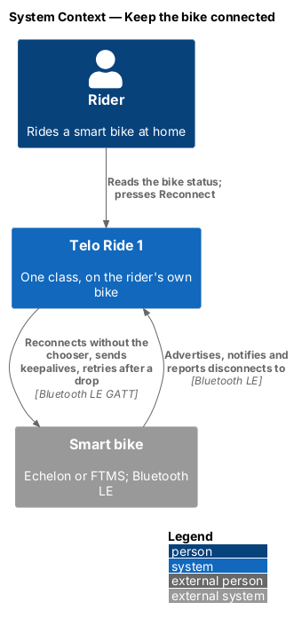
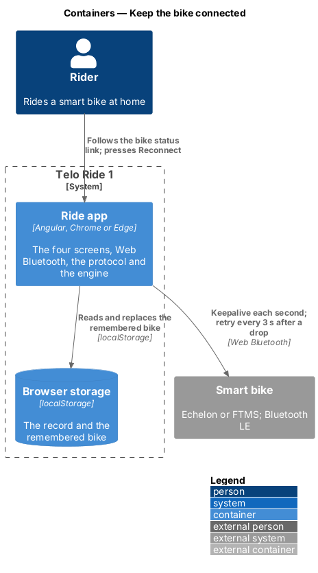
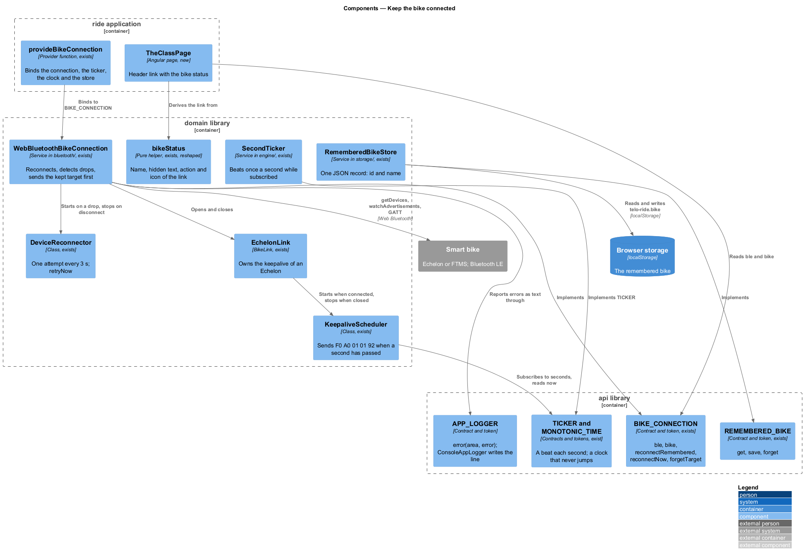
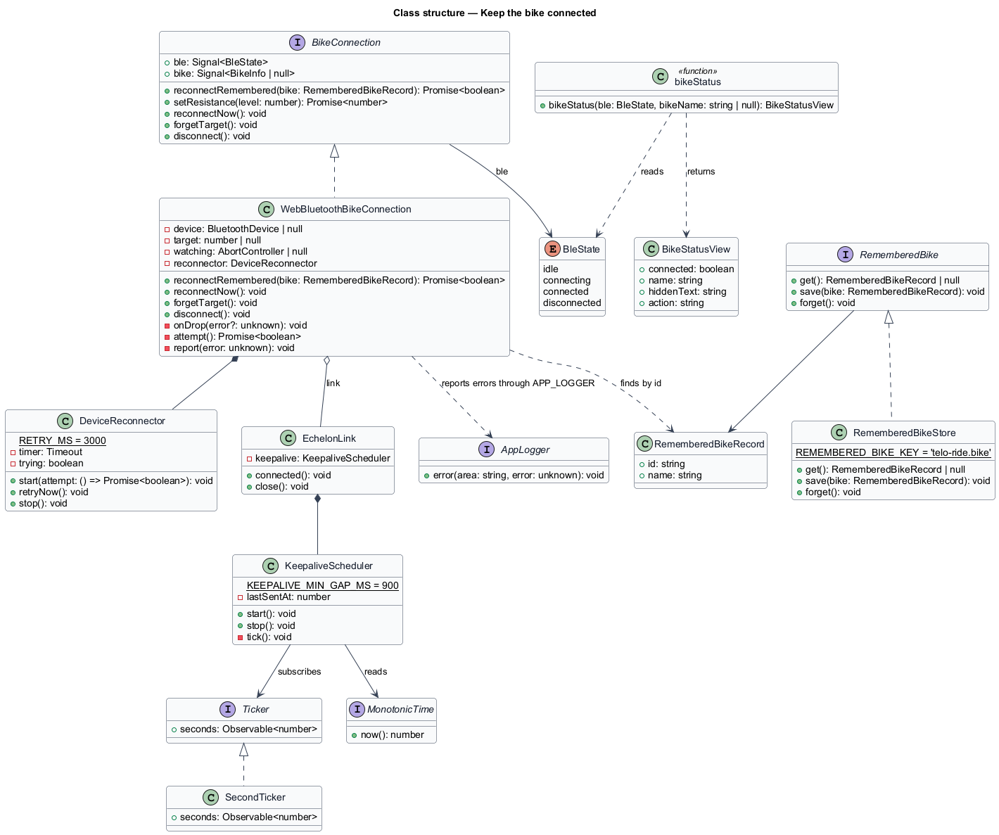
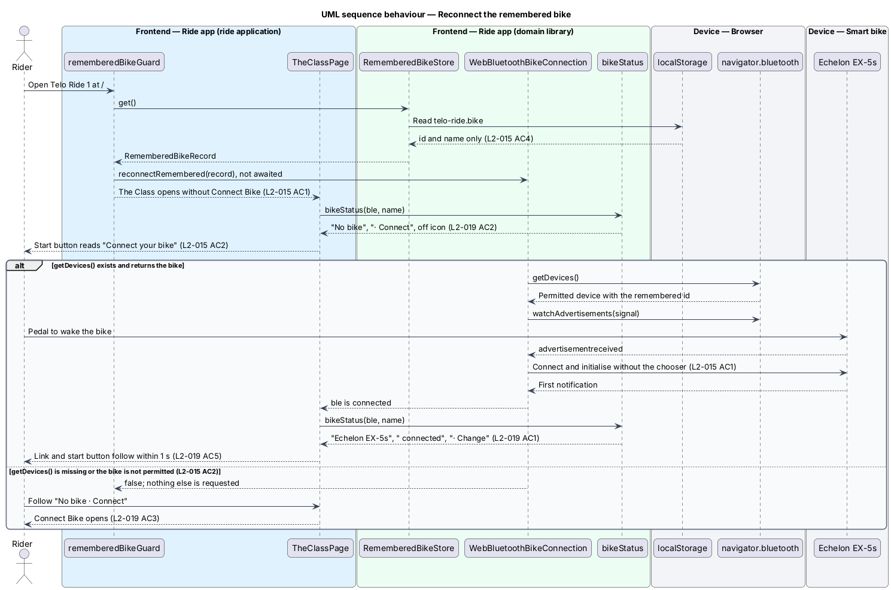
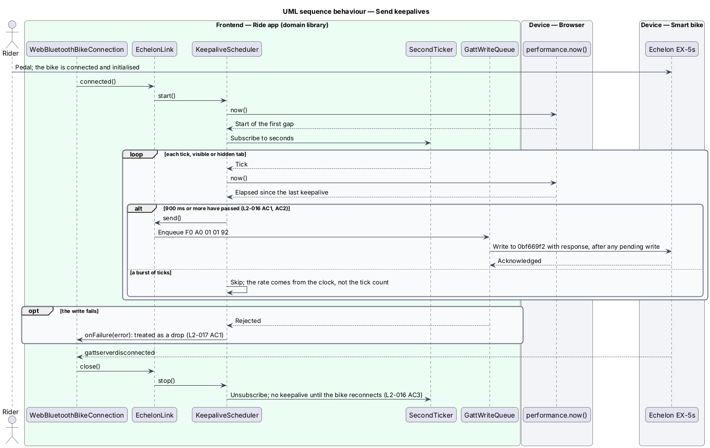
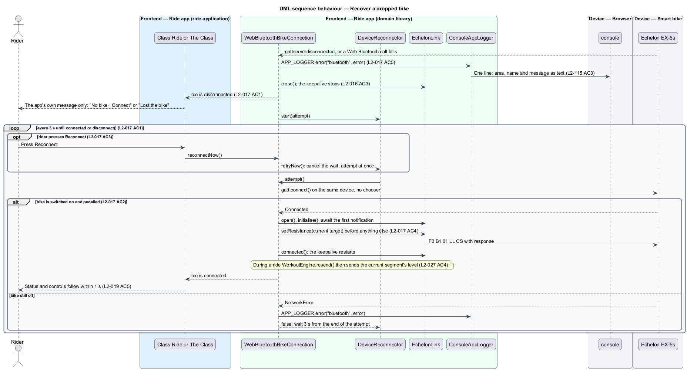

# Keep the bike connected

## Overview

A rider pairs the bike once. After that, Telo Ride 1 is expected to find the bike again on the next visit, hold the connection for a 30-minute class, and come back from a drop without a reload. This feature covers the four parts of that: the remembered bike, the keepalive an Echelon bike needs, recovery after a disconnect, and the bike status in the header of The Class.

The following terms are used in this design:

- **remembered bike**: record of the last bike paired in this browser, holding its name and the browser's identifier for it
- **permitted device**: device the rider already picked in the chooser, which the browser returns from `navigator.bluetooth.getDevices()` without asking again
- **keepalive**: frame `F0 A0 01 01 92` an Echelon bike expects about once a second, without which it closes the connection
- **drop**: loss of the connection, signalled by `gattserverdisconnected` or by a failed Web Bluetooth call
- **retry**: one attempt to reach the same device again without the chooser
- **bike status**: link in the header of The Class that names the connected bike or reads "No bike", and leads to Connect Bike
- **`ble`**: link state of the bike, one of `idle`, `connecting`, `connected` and `disconnected`

Neighbouring features own the adjacent concerns. Pairing and initialisation belong to [Connect a bike](../connect-a-bike/README.md). The choice between Connect Bike and The Class when the app opens (`L2-167`) belongs to [Open the app](../../the-class/open-the-app/README.md), and the header and start button of The Class (`L2-084`) to [Show the class](../../the-class/show-the-class/README.md). The lost-bike alert and its **Reconnect** button on Class Ride (`L2-092`) belong to [Wait for a lost bike](../../class-ride/wait-for-a-lost-bike/README.md). Sending the segment's level again after a reconnect (`L2-027` AC4) belongs to [Control resistance](../control-resistance/README.md). The monotonic clock (`L2-133`) belongs to [Keep the ride clock true](../../performance/keep-the-ride-clock-true/README.md), console logging (`L2-115`) to [Log to the console only](../../security/log-to-the-console-only/README.md), and the validation of stored data (`L2-129`) to [Treat device data as untrusted](../../security/treat-device-data-as-untrusted/README.md).

## Description

The slice is mostly `domain` code that exists. The Description names each part and states what changes for Telo Ride 1.

**The remembered bike**

- **`RememberedBike`** and the token `REMEMBERED_BIKE` (`api/src/bike/remembered-bike.ts`) have `get()`, `save(bike)` and `forget()`. Slice 30.5 narrowed the contract to **`RememberedBikeRecord`**, with two fields: `id`, the browser's identifier for the device, and `name` (`L2-015` AC4). Telo Ride's `lastSeen()` is gone; nothing read it.
- **`RememberedBikeStore`** (`domain/src/storage/remembered-bike-store.ts`) exists. It keeps one JSON record in `localStorage` under `REMEMBERED_BIKE_KEY` (`telo-ride.bike`) and reads it synchronously. A record it cannot parse, or storage the browser refuses, counts as no bike. Telo Ride also wrote `identifier`, `kind` and `seenAt`; since slice 30.5 it writes `id` and `name` only, and reads those two from a record an earlier version wrote. The protocol and the identifier are read from the device at reconnect.
- **`ConnectBikeStore.pair()`** exists and calls `save()` after each successful pairing, so a different bike replaces the remembered one (`L2-015` AC3).
- **`WebBluetoothBikeConnection.reconnectRemembered(record)`** exists. It returns `false` where `getDevices()` is missing or returns no device with the remembered `id`, and never rejects. Telo Ride made one connection attempt at once, which a bike that was switched off failed for good. Since slice 30.5 it calls `watchAdvertisements()` on the permitted device and connects on the first `advertisementreceived`, so the bike connects as soon as it advertises (`L2-015` AC1). While it waits, `ble` stays `idle`, and a second call joins the same wait. An `AbortController` ends the watch on connect, when the rider pairs another bike on Connect Bike, on `disconnect()` and on destroy; the promise then resolves `false`. A browser with `getDevices()` and no `watchAdvertisements()` still gets the one attempt at once.
- **`rememberedBikeGuard`** (`ride/src/app/bike/remembered-bike.guard.ts`) exists and keeps its name. It guards `/`, starts `reconnectRemembered()` and does not await it. [Open the app](../../the-class/open-the-app/README.md) owns it; since slice 30.5 it reads `REMEMBERED_BIKE` and `FINISHED_RIDES`.

**Keepalive**

- **`KeepaliveScheduler`** (`domain/src/bluetooth/keepalive-scheduler.ts`) exists. It subscribes to `Ticker.seconds` and, on each tick, sends a keepalive only when `KEEPALIVE_MIN_GAP_MS` (900 ms) has passed since the last one. The rate therefore comes from elapsed time: a burst of ticks sends one frame, and each late tick of a throttled hidden tab sends one. Its clock defaults to `Date.now`; Telo Ride 1 passes `MONOTONIC_TIME.now` (`L2-016` AC2).
- **`EchelonLink`** exists and owns the scheduler. `connected()` starts it once the bike is connected and initialised, and `close()` stops it. Each keepalive goes through the `GattWriteQueue` with response. **`FtmsLink`** sends no keepalive.
- **`SecondTicker`** (`domain/src/engine/second-ticker.ts`) exists and implements `TICKER` with one interval per subscription, cleared on unsubscribe.
- **`provideBikeConnection()`** (`ride/src/app/bike/provide-bike-connection.ts`) exists and binds `TICKER`, `REMEMBERED_BIKE` and `BIKE_CONNECTION` on the lazy parent route. It gains the binding of `MONOTONIC_TIME` to `performance.now()`, which only the Class Ride route binds today. The ride clock of [Keep the ride clock true](../../performance/keep-the-ride-clock-true/README.md) reads the same binding.

**Disconnect and recovery**

- **`WebBluetoothBikeConnection.onDrop()`** exists. A `gattserverdisconnected` event, a failed keepalive or a failed write while connected closes the link, sets `ble` to `disconnected` and starts the reconnector.
- **`DeviceReconnector`** (`domain/src/bluetooth/device-reconnector.ts`) exists. It runs one attempt every `RETRY_MS` (3000 ms), measured from the end of one attempt to the start of the next, until an attempt succeeds or `stop()` is called. `retryNow()` cancels the pending wait and attempts at once.
- **`attempt()`** exists. It reopens GATT on the same device without the chooser, opens and initialises the link, and waits for the first notification. It then sends the last target resistance before it sets `ble` to `connected` and restarts the keepalive (`L2-017` AC4). During a ride, `ClassRideStore` then calls `WorkoutEngine.resend()`, which sends the current segment's level (`L2-027` AC4, `L2-092` AC3), as [Control resistance](../control-resistance/README.md) describes. A manual level therefore does not survive a reconnect.
- **`forgetTarget()`** is on the contract since slice 31.2. It clears the kept target resistance, so a reconnect after a ride sends no resistance command. `ClassRideStore` calls it when the rider leaves or finishes (`L2-093` AC3), as [Pause, leave or finish the class](../../class-ride/pause-leave-or-finish-the-class/README.md) describes. `SimulatedBikeConnection` implements it as well.
- **`reconnectNow()`** exists on the contract and calls `retryNow()` while `ble` is `disconnected`. It is the **Reconnect** action.
- **`disconnect()`** exists. It stops the reconnector, closes the link and sets `ble` to `idle`. Class Ride calls it when the rider leaves a ride whose bike is lost, which ends the retries (`L2-017` AC1).
- **`describeError(error)`** (`describe-error.ts`) exists and returns `name: message`. `report()` exists and calls `AppLogger.error('bluetooth', error)` through the `APP_LOGGER` token; `ConsoleAppLogger` formats the error with `describeError` and writes one redacted line of text to the console (`L2-115` AC3). The `AppLogger` contract, the token and `ConsoleAppLogger` belong to [Log to the console only](../../security/log-to-the-console-only/README.md). The `lastError` signal on `BikeConnection` existed for Telo Ride's Diagnostics screen and is still on the contract; no screen of Telo Ride 1 shows it, so the rider sees only the app's own message (`L2-017` AC5).
- **The tap** (changed for the diagnostic recording). `WebBluetoothBikeConnection` injects the optional `BIKE_LINK_TAP`. `setBle(state)` is the one place `ble` changes, and it reports each change as the event `ble`. A drop is reported as `dropped`, and each retry as `reconnect-attempt` followed by `reconnect-ok` or `reconnect-failed`. The reconnect of a remembered bike reports `remembered-bike` when the permitted device is found, `watching-advertisements` while the app waits and `advertising` when the bike is heard. The keepalive's writes go through `GattWriteQueue.enqueue` as before and are recorded there, each with its outcome, so a keepalive that fails is in the recording before the drop it causes (`L2-178` AC5, AC6). With the tap `null` nothing changes. The tap and the recording belong to [Record diagnostics](../../security/record-diagnostics/README.md).

**Bike status**

- **`bikeStatus()`** (`domain/src/bluetooth/bike-status.ts`) and **`BikeStatusView`** (`api/src/bike/bike-status.ts`) exist and are reshaped. Today the helper takes the support state and returns labels for Telo Ride's header, Custom ride and Diagnostics. For Telo Ride 1 it is `bikeStatus(ble, bikeName)` and returns four fields:

  | `ble` | `connected` | `name` | `hiddenText` | `action` |
  |---|---|---|---|---|
  | `connected` | `true` | the bike's name | " connected" | "· Change" |
  | any other | `false` | "No bike" | "" | "· Connect" |

- **`TheClassPage`** is new and owned by [Show the class](../../the-class/show-the-class/README.md). Its header, the `ScreenHeader` of [Show the wordmark](../../ui/show-the-wordmark/README.md), holds the link, in the mock's classes: `the-class__bike` on a `routerLink` to `/connect`, `the-class__bike-icon` with the modifier `--off` and a different icon when not connected, `the-class__bike-name` with the visually hidden text, and `the-class__bike-action`. The elements belong to the `the-class` block, so they live in that page's template and stylesheet. The stylesheet hides `the-class__bike-action` visually on a phone and keeps the link at least 44 px tall (`L2-019` AC4).
- The page computes the status from the `ble` and `bike` signals of `BIKE_CONNECTION`, so the link and the start button change in the same change-detection pass as the state (`L2-019` AC5). The existing `AppHeaderBike` component (`wz-app-header-bike`) belongs to Telo Ride's app header and is not used.

A remembered bike that is not connected reads "No bike · Connect", as `L2-019` AC2 and `L2-015` AC2 require; the remembered name is not shown.

**Acceptance tests**

`frontend/e2e/remembered-bike.spec.ts`, `keep-the-bike-connected.spec.ts` and `bike-status.spec.ts` exist and are rewritten for The Class. The fake `navigator.bluetooth` offers the bike to `getDevices()`, records each keepalive write and drops the connection on demand. Its devices have `watchAdvertisements()`: a bike that is switched on advertises at once, one that is off when the spec switches it on, and the spec can take `getDevices()` away or give a second bike another identifier. `fixtures/tab.ts` hides the tab. The keepalive and the 3-second retry advance a fake clock.

## Requirements

The feature realizes the following level-2 (L2) requirements. Each refines a level-1 (L1) requirement, cited by identifier.

| L2 ID | Refines (L1) | Requirement |
|-------|--------------|-------------|
| `L2-015` | `L1-003` | When a bike was paired in this browser, Telo Ride 1 shall open on The Class without Connect Bike (`L2-167`); where `navigator.bluetooth.getDevices()` exists, the app shall reconnect to that bike without the chooser as soon as the bike advertises. When the remembered bike does not advertise, or `getDevices()` is not available, The Class shall show the bike as not connected and the start button shall read "Connect your bike" (`L2-084` AC6). When the rider pairs a different bike on Connect Bike and pairing succeeds, that bike shall replace the remembered one. The app shall store only the remembered bike's name and the browser's identifier for it, on the device. |
| `L2-016` | `L1-003` | While an Echelon bike is connected and initialised, the app shall write between 4 and 6 keepalive frames `F0 A0 01 01 92` in any 5 seconds, each with response. While the tab is hidden for 60 seconds, keepalives shall continue at about one a second, timed from the clock rather than counted ticks (`L2-133`). When the bike disconnects, keepalives shall stop until it reconnects. |
| `L2-017` | `L1-003` | When a connected bike disconnects (`gattserverdisconnected`) or any Web Bluetooth call fails, the bike state shall become `disconnected`, and the app shall retry the same bike every 3 seconds without the chooser until it connects or the rider leaves the ride. When a bike that was switched off for an hour is switched on and pedalled, the app shall reconnect within one retry without a reload. When the rider presses **Reconnect** while the bike is not connected, the app shall cancel the pending retry and start an attempt at once. When a reconnect succeeds during a ride, the app shall send the current target resistance again before anything else. The app shall write the name and message of a Web Bluetooth error to the console as text (`L2-115`), and the rider shall see only the app's own message. |
| `L2-019` | `L1-003` | With a connected bike, the header link of The Class shall read the bike's name, "connected" and "· Change" ("Echelon EX-5s connected · Change"). With no connected bike, the link shall read "No bike" and "· Connect", with a different icon from the connected one, so that colour is not the only difference. The link shall open Connect Bike. On a phone, "· Change" or "· Connect" shall be hidden from sight and still read by a screen reader, and the link shall be at least 44 px tall. When the bike connects or disconnects while The Class shows, the link and the start button (`L2-084`) shall follow within one second. |

## Diagrams

### System context

Telo Ride 1 reconnects to the rider's bike without the chooser, sends it keepalives and retries after a drop. The rider reads the bike status and may press **Reconnect**.

### Containers

The Ride app reads the remembered bike from browser storage and holds the Bluetooth connection. No other container takes part.

### Components

`WebBluetoothBikeConnection` owns a `DeviceReconnector` and, through `EchelonLink`, a `KeepaliveScheduler` that reads `TICKER` and `MONOTONIC_TIME`. `RememberedBikeStore` keeps the record, and `TheClassPage` derives its header link with `bikeStatus()`.

### Class structure

`WebBluetoothBikeConnection` composes a `DeviceReconnector` and holds an `EchelonLink`, which composes a `KeepaliveScheduler`. The scheduler depends on the `Ticker` and `MonotonicTime` contracts. `RememberedBikeStore` realizes `RememberedBike` over a `RememberedBikeRecord`, and `bikeStatus()` returns a `BikeStatusView`. The connection reports errors through the `AppLogger` contract.

### Behaviour: reconnect the remembered bike

`rememberedBikeGuard` reads the remembered bike and starts the reconnect without waiting, so The Class opens at once with "No bike · Connect". When the permitted bike advertises, the app connects without the chooser and the link changes to the bike's name. Where `getDevices()` is missing, the rider reaches Connect Bike from the link.

### Behaviour: send keepalives

Each tick reads the monotonic clock, and a keepalive is written when 900 ms or more have passed since the last one, so the rate holds in a hidden tab. A failed write counts as a drop, and a drop stops the keepalive until the bike reconnects.

### Behaviour: recover a dropped bike

A drop logs the error as text through `APP_LOGGER`, sets `ble` to `disconnected` and starts a retry every 3 seconds. **Reconnect** cancels the pending wait and attempts at once. A successful attempt sends the current target resistance before anything else, then restarts the keepalive. During a ride the engine then sends the current segment's level.

