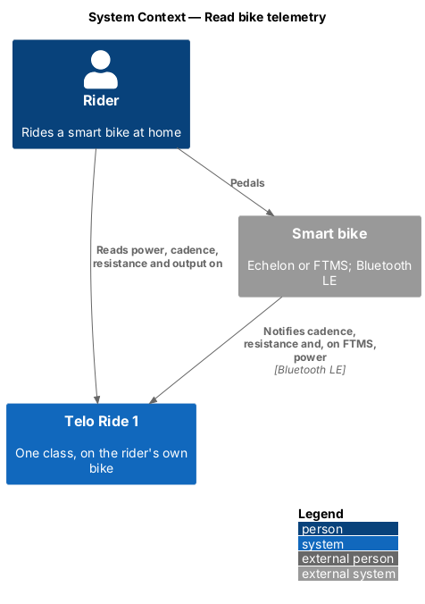
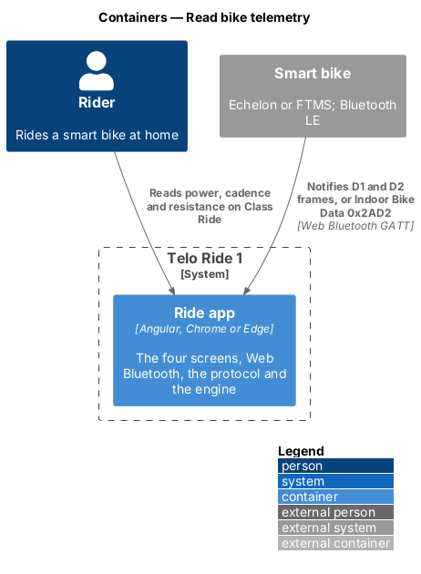
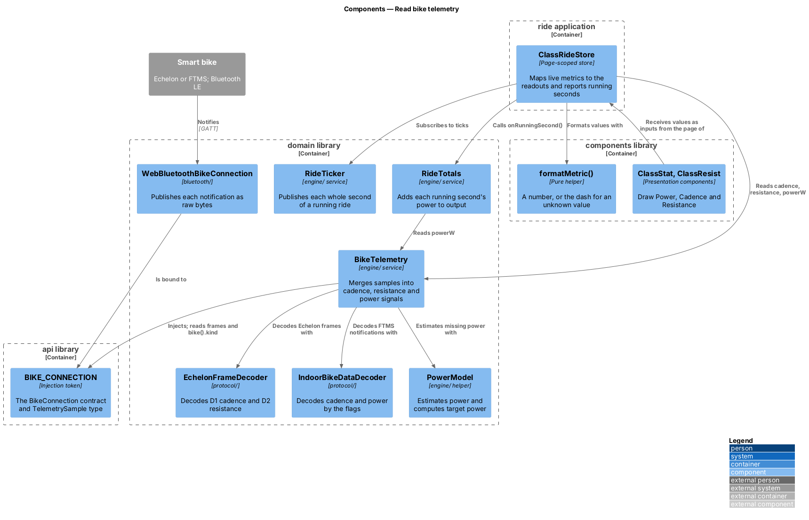
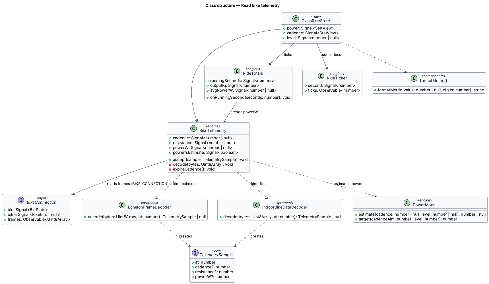
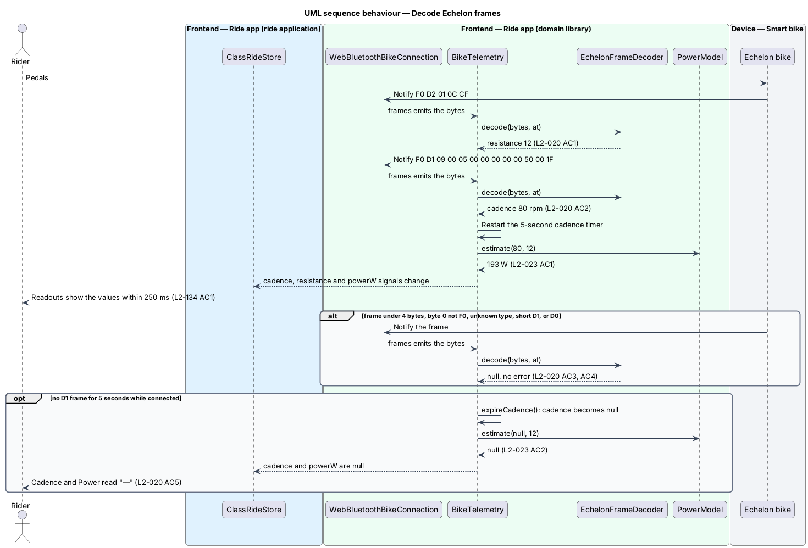
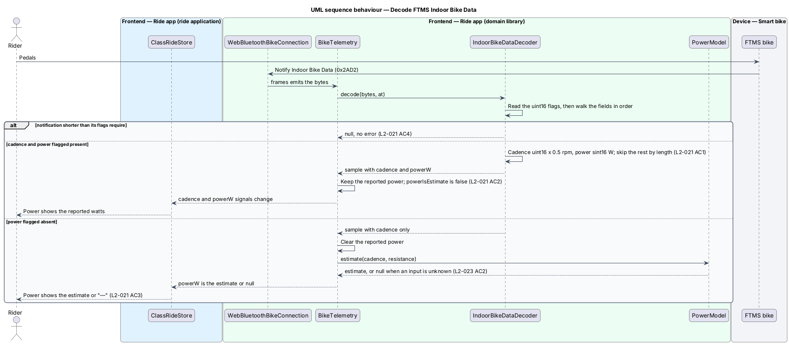
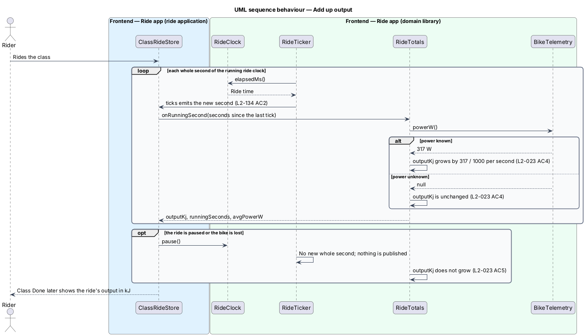

# Read bike telemetry

## Overview

Telo Ride 1 is one class ridden on the rider's own smart bike. During Class Ride the rider reads power, cadence and resistance beside the class video, and Class Done shows the ride's output. This feature turns what the bike sends over Bluetooth into those live metrics and adds up the output, second by second. It sits between the Bluetooth link and every screen that shows a number from the bike.

An Echelon bike reports cadence and resistance and no power. An FTMS bike reports whichever fields its flags declare. Where the bike reports no power, the app estimates it with one fixed formula, recorded in ADR 0003.

The following terms are used in this design:

- **telemetry**: stream of readings a bike notifies: cadence and resistance from an Echelon; cadence and power from an FTMS bike, as its flags allow
- **frame**: one Echelon message made of the marker `F0`, a type byte, a length byte, a payload and a checksum, as specified in `docs/protocol/echelon-ble-frames.md`
- **`D1` frame**: Echelon workout frame of 13 bytes, sent about once a second, whose bytes 9 and 10 hold cadence in rpm
- **`D2` frame**: Echelon resistance frame of 5 bytes, whose byte 3 holds the resistance
- **Indoor Bike Data**: FTMS characteristic `0x2AD2`, whose leading 16-bit flags field decides which fields follow
- **sample**: one decoded notification, holding its arrival time and the metrics that notification carried
- **estimate**: power computed from cadence and resistance when the bike reports none
- **target power**: power the estimate formula gives for a segment's cadence aim and level
- **running second**: second of ride time during which the ride clock runs
- **output**: work the rider did in a ride, in kJ

Adjacent concerns belong to neighbouring features. [Connect a bike](../connect-a-bike/README.md) opens the link and subscribes to notifications. [Keep the bike connected](../keep-the-bike-connected/README.md) owns the link state and recovery. [Control resistance](../control-resistance/README.md) owns the target resistance and the resistance readout's rules (`L2-026`). [Ride the class](../../class-ride/ride-the-class/README.md) draws the readouts and compares power with target power (`L2-089`). [Keep the ride clock true](../../performance/keep-the-ride-clock-true/README.md) owns the once-a-second beat and the 250 ms readout budget (`L2-133`, `L2-134`). [Show Class Done](../../class-done/show-class-done/README.md) and [keep the record](../../class-done/keep-the-record/README.md) consume the output. [Ride a simulated bike](../ride-a-simulated-bike/README.md) feeds the same decoder without hardware.

## Description

The slice lives in the Ride app's `domain` library, with the type it shares in `api` and one formatting helper in `components`. Each building block is marked as existing in the carried-over code or as new.

- **`BikeConnection.frames`** (exists, `api`, token `BIKE_CONNECTION`): stream of every notification the bike sends, as raw bytes. `WebBluetoothBikeConnection` and `SimulatedBikeConnection` both publish it. `BikeConnection.bike().kind` is `echelon` or `ftms` and selects the decoder.
- **`TelemetrySample`** (exists, `api`): arrival time `at` and the optional `cadence`, `resistance` and `powerW`. The carried-over type also holds `speedKmh` and `heartRate`; Telo Ride 1 shows neither, and the change that builds this slice drops both fields.
- **`EchelonFrameDecoder`** (exists, `domain` `protocol/`): `decode(bytes, at)` returns a `TelemetrySample` or `null`. `F0 D2 01 0C CF` gives resistance 12. `F0 D1 09 00 05 00 00 00 00 00 50 00 1F` gives cadence 80 rpm, read big-endian from bytes 9 and 10. A frame shorter than 4 bytes, a byte 0 other than `F0`, an unknown type, a `D1` shorter than 13 bytes and every `D0` frame give `null` and raise no error. The decoder does not check incoming checksums, as `docs/protocol/echelon-ble-frames.md` records. It stays as it is.
- **`IndoorBikeDataDecoder`** (exists, `domain` `protocol/`; changes): walks the Indoor Bike Data fields in specification order by a table of flag bit and size. Two things change for Telo Ride 1. First, it reads cadence (uint16 in 0.5 rpm) and power (sint16 in W) only, and skips every other field by its length; the reads of speed and heart rate in today's table become skips. Second, a notification shorter than its flags require returns `null`; today the decoder stops at the field that runs past the end and returns the fields before it.
- **`BikeTelemetry`** (exists, `domain` `engine/`; trimmed): service provided on `ClassRidePage`. It subscribes to `frames`, decodes each notification with the decoder for the bike's kind, and merges the samples into the signals `cadence`, `resistance` and `powerW`, with `powerIsEstimate`. A reported FTMS power is used as reported. A sample that carries cadence but no power clears the reported power, so `powerW` falls back to `PowerModel.estimate()`. Each sample with cadence restarts a 5-second timer (`CADENCE_TIMEOUT_MS`); when it fires, cadence and the reported power become `null`. The subscription and the timer are released when the route is left. The `speedKmh` and `heartRate` signals are removed. The decoder reads no FTMS resistance field, so an FTMS bike that reports cadence without power has no estimate and its power reads "—".
- **`telemetryDecoder(kind)`** (new, `domain` `protocol/telemetry-decoder.ts`): the one function that picks the decoder for a `BikeKind`: `IndoorBikeDataDecoder` for `ftms`, `EchelonFrameDecoder` otherwise. `BikeTelemetry` calls it in place of its own choice, and the diagnostic recording of [record diagnostics](../../security/record-diagnostics/README.md) calls it for the same bytes, so the decoder the recording names is the one the readouts use (`L2-178` AC4). With the recording on, `WebBluetoothBikeConnection.onValue` calls the optional `BIKE_LINK_TAP` before `frames` emits, so a notification is recorded before `BikeTelemetry` decodes it; a frame the decoder drops is recorded with the reason and still raises no error. With the recording off the tap is `null` and the path is unchanged.
- **`PowerModel`** (exists, `domain` `engine/`): pure helper. `estimate(cadence, level)` is max(0, round(cadence × (0.55 + level × 0.155))), or `null` when either input is `null`. `target(cadenceAim, level)` applies the same formula to a segment. `planStateAt()` (exists, `engine/plan-state.ts`) calls `target()` to give each segment its `targetPower`. The code rounds with `bankersRound()` (half to even), where `L2-023` writes `round`; the two agree on every example in the requirement and differ only at an exact half watt. The rounding rule at a half is `<TO SUPPLY>`. The target power of the warm-up and the cool-down depends on their cadence aims, which are `<TO SUPPLY>` (L2.md open question 11).
- **`RideTotals`** (exists, `domain` `engine/`; trimmed and wired): service that holds `runningSeconds`, `outputKj` and `avgPowerW` as scalars, so its size is fixed for the length of a ride. `onRunningSecond(seconds)` adds the live power ÷ 1000 to `outputKj` for each second; an unknown power adds nothing. No screen calls it today: the carried-over `ClassRideStore` feeds a `RideRecorder` built for the backend, which Telo Ride 1 removes. For Telo Ride 1, `RideTotals` is provided on `ClassRidePage` and `ClassRideStore` calls it on each of `RideTicker`'s ticks, passing the seconds since the last tick so a tick delayed by a hidden tab loses no second. It is one of the ride's three accumulators: `EffortTotals` of [show Class Done](../../class-done/show-class-done/README.md) holds the eight efforts and `OnTargetCounter` of [score on target](../../class-done/score-on-target/README.md) the on-target seconds, and each holds running totals only (`L2-138` AC2). Its `distanceKm` and `energyKcal` are removed, with `SpeedModel` and `EnergyModel`.
- **`RideTicker`** (exists, `domain` `engine/`): publishes each new whole second of the ride clock once. A paused clock yields no new second, so output does not grow while the ride is paused or waits for a lost bike. It belongs to [keep the ride clock true](../../performance/keep-the-ride-clock-true/README.md).
- **`ClassRideStore`** (exists, `ride` `class-ride/`; reshaped by [ride the class](../../class-ride/ride-the-class/README.md)): maps the signals to the readouts' view models. When the ride finishes it reads `runningSeconds` and `outputKj` into the `ClassResult`; the "Average" of Class Done is computed from those two and equals `avgPowerW`.
- **`formatMetric()`** (exists, `components` `metric/`): returns a value to a fixed number of decimals, or "—" when it is `null`. `formatDistance()` beside it is removed.
- **`ClassStat`** (`wz-class-stat`) and **`ClassResist`** (`wz-class-resist`) (exist, `components` `class-ride/`): presentation components that draw Power, Cadence and Resistance from inputs. Their layout and copy belong to [ride the class](../../class-ride/ride-the-class/README.md).

The decoders, `PowerModel`, `BikeTelemetry` and `RideTotals` each have a unit test file with one case per acceptance example; the 5-second rule advances a fake clock. The path from a notification to a readout is proved by Playwright through the fake `navigator.bluetooth` of [test without hardware](../../platform/test-without-hardware/README.md).

## Requirements

The feature realizes the following level-2 (L2) requirements. Each L2 requirement refines a level-1 (L1) requirement, cited by identifier.

| L2 ID | Refines (L1) | Requirement |
|-------|--------------|-------------|
| `L2-020` | `L1-004` | The app shall decode the notification `F0 D2 01 0C CF` as resistance 12. It shall decode `F0 D1 09 00 05 00 00 00 00 00 50 00 1F` as cadence 80 rpm. It shall ignore, without an error, a frame shorter than 4 bytes, a frame with byte 0 other than `F0`, a frame of an unknown type and a `D1` shorter than 13 bytes. It shall ignore a `D0` frame without an error. With no `D1` frame for 5 seconds while connected, cadence and power shall show "—" rather than their last values. |
| `L2-021` | `L1-004` | The app shall decode an Indoor Bike Data notification by its flags, which decide the fields present. It shall read cadence as uint16 in 0.5 rpm and power as sint16 in W, and shall skip every other field by its length. Where the bike reports power, the power shown shall be the reported value, not an estimate. A metric whose field the flags mark absent shall fall back to its estimate (`L2-023`) or "—". The app shall ignore, without an error, a notification shorter than its flags require. |
| `L2-023` | `L1-004` | For an Echelon at cadence 95 and resistance 18, estimated power shall be max(0, round(95 × (0.55 + 18 × 0.155))) = 317 W. With cadence or resistance unknown, estimated power shall be unknown and shown as "—". Target power shall use the same formula: 107 W for a segment with cadence aim 72 and level 6, and 418 W for aim 98 and level 24. Each running second shall add its power ÷ 1000 to the ride's output in kJ, and a second with unknown power shall add nothing. Output shall not grow while the ride is paused. |

## Diagrams

### System context

The rider pedals the smart bike, the bike notifies its readings to Telo Ride 1, and the rider reads the live metrics there. No other system takes part.

### Containers

Telemetry enters the Ride app over Web Bluetooth GATT as Echelon frames or FTMS Indoor Bike Data. It stays in memory for the ride; browser storage is not touched by this slice.

### Components

The connection publishes raw bytes through the `BIKE_CONNECTION` contract. `BikeTelemetry` decodes them with `EchelonFrameDecoder` or `IndoorBikeDataDecoder` and fills a missing power from `PowerModel`. `ClassRideStore` reads the signals for the readouts and calls `RideTotals` on each of `RideTicker`'s ticks.

### Class structure

Both decoders create `TelemetrySample` values that `BikeTelemetry` merges. `RideTotals` reads `BikeTelemetry.powerW`, and `ClassRideStore` depends on the telemetry, the totals and the ticker.

### Behaviour: decode Echelon frames

A `D2` frame sets resistance and a `D1` frame sets cadence, from which power is estimated. A malformed, unknown or `D0` frame decodes to `null` without an error, and 5 seconds without a `D1` frame blank cadence and power (`L2-020`, `L2-023`).

### Behaviour: decode FTMS Indoor Bike Data

The flags decide which fields the decoder reads. A reported power is shown as reported, an absent power falls back to the estimate or "—", and a notification too short for its flags is ignored (`L2-021`).

### Behaviour: add up output

Each whole second of the running ride clock adds that second's power ÷ 1000 to the output in kJ. A second with unknown power adds nothing, and a paused ride publishes no second (`L2-023`).

