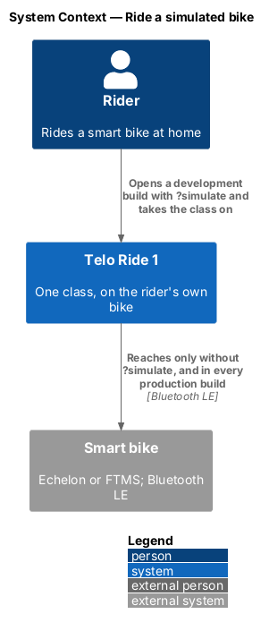
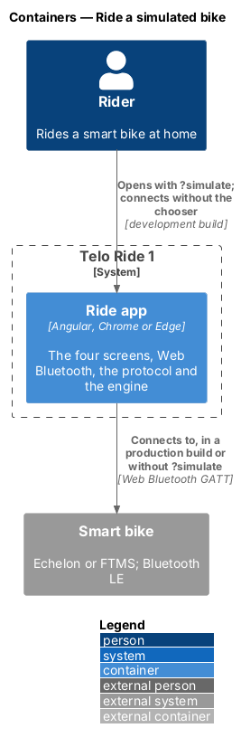
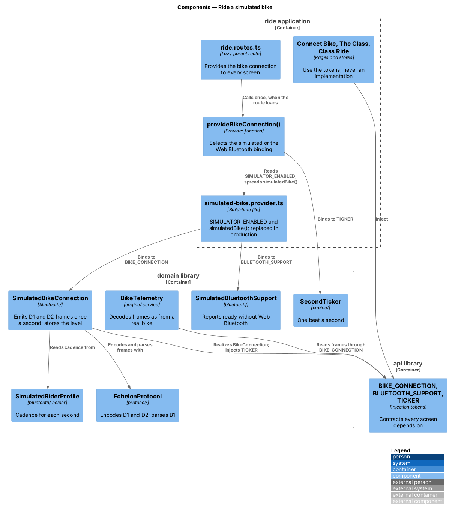
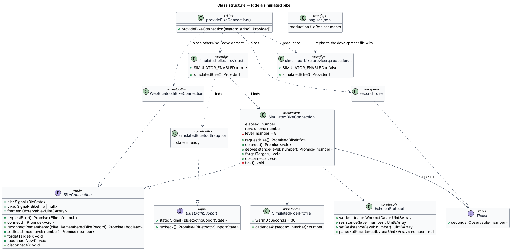
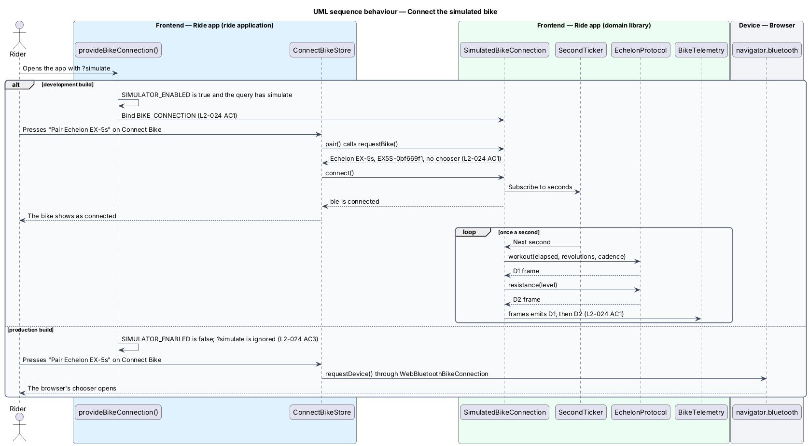
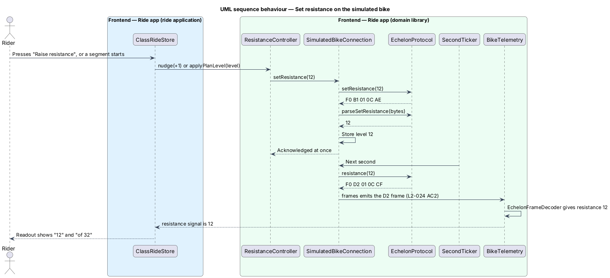

# Ride a simulated bike

## Overview

Telo Ride 1 is built and checked without a bike beside the desk. A developer, or anyone reviewing a change, opens the app in a browser and takes the class end to end: Connect Bike, The Class, Class Ride and Class Done. This feature supplies a simulated Echelon EX-5s that connects without the browser's chooser and behaves like the real bike at the frame level, so the decoder, the engine and every screen run the same code as with hardware.

The simulated bike exists only in a development build. A production build holds none of its code and ignores the request for it.

The following terms are used in this design:

- **simulated bike**: in-app stand-in for an Echelon EX-5s that emits `D1` and `D2` frames once a second and answers set-resistance commands
- **development build**: build of the Ride app made with the `development` configuration of `angular.json`, as `npm start` serves it
- **production build**: build of the Ride app made with the `production` configuration, the one deployed to riders
- **`?simulate`**: query parameter that asks a development build to bind the simulated bike in place of Web Bluetooth
- **chooser**: browser dialog in which the rider picks a Bluetooth device
- **file replacement**: `angular.json` rule that swaps one source file for another in a named build configuration

The simulated bike differs from the fake `navigator.bluetooth` that Playwright specs install. The fake sits below the Web Bluetooth link and belongs to [test without hardware](../../platform/test-without-hardware/README.md) (`L2-148`); the simulated bike replaces the link itself. Other adjacent concerns belong to neighbouring features: [connect a bike](../connect-a-bike/README.md) owns Connect Bike and the real link, [read bike telemetry](../read-bike-telemetry/README.md) decodes the frames the simulated bike emits, [control resistance](../control-resistance/README.md) sends the commands it answers, and [check bike and browser support](../check-bike-and-browser-support/README.md) owns the support check it bypasses. [Structure the frontend workspace](../../platform/structure-the-frontend-workspace/README.md) owns the build configurations.

## Description

The slice lives in the Ride app: the simulated bike in `domain`, its contracts in `api`, and the switch in `ride`. Every building block exists in the carried-over code; the changes for Telo Ride 1 are stated where there are any.

- **`simulated-bike.provider.ts`** (exists, `ride` `app/bike/`): exports `SIMULATOR_ENABLED = true` and `simulatedBike()`, which binds `BIKE_CONNECTION` to `SimulatedBikeConnection` and `BLUETOOTH_SUPPORT` to `SimulatedBluetoothSupport`.
- **`simulated-bike.provider.production.ts`** (exists, `ride` `app/bike/`): exports `SIMULATOR_ENABLED = false` and a `simulatedBike()` that returns no providers. The `production` configuration of `angular.json` replaces the development file with it through `fileReplacements`, so the production bundle imports no simulator code.
- **`provideBikeConnection(search = location.search)`** (exists, `ride` `app/bike/`): binds `TICKER` to `SecondTicker` and `REMEMBERED_BIKE` to `RememberedBikeStore`. It binds the simulated pair when `SIMULATOR_ENABLED` is true and the query has `simulate`; otherwise it binds `WebBluetoothBikeConnection` and `WebBluetoothSupport`. `ride.routes.ts` calls it in the providers of the lazy parent route that every screen sits under, so one connection serves the four screens and the bike code stays out of the initial bundle. The query is read once, when that route loads: a navigation that drops `?simulate` keeps the simulated bike, and a reload without it returns to Web Bluetooth.
- **`SimulatedBikeConnection`** (exists, `domain` `bluetooth/`): implementation of the `BikeConnection` contract that never calls `navigator.bluetooth`. `requestBike()` resolves `SIMULATED_BIKE` at once: name "Echelon EX-5s", identifier `EX5S-0bf669f1`, kind `echelon`. `connect()` subscribes to `TICKER`'s `seconds` and sets `ble` to `connected`. On each second it emits a `D1` frame (elapsed seconds, revolutions, cadence) and then a `D2` frame (current level) through `frames`. `setResistance(level)` encodes the `B1` command, parses it back and stores the level, which the next `D2` reports; the level starts at 8. `reconnectRemembered()` connects and resolves `true`. `forgetTarget()`, new on the contract, does nothing more than return: the simulated bike keeps no target to resend. `disconnect()` and destruction release the tick subscription.
- **The tap on the simulated bike** (changed for the diagnostic recording): `SimulatedBikeConnection` injects the optional `BIKE_LINK_TAP`. With it bound, `connect()` reports the events `bike`, `link simulated` and `ble connected`, and `disconnect()` reports `ble idle`. Each `D1` and `D2` frame goes through `received()`, on Echelon's notify characteristic and before `frames` emits it. Each set-resistance command goes through `writing()`, on Echelon's write characteristic and with its target resistance; the write settles at once. A development build opened with `?simulate&diagnose` therefore records the simulated bike as an Echelon is recorded (`L2-178` AC18), which `diagnostic-recording.development.spec.ts` proves. The recording belongs to [record diagnostics](../../security/record-diagnostics/README.md).
- **`SimulatedBluetoothSupport`** (exists, `domain` `bluetooth/`): implementation of the `BluetoothSupport` contract whose state is always `ready`, so the simulated bike runs in a browser without Web Bluetooth and on plain http.
- **`SimulatedRiderProfile`** (exists, `domain` `bluetooth/`): pure helper `cadenceAt(second)`. Cadence rises from 60 to 85 rpm over the first 30 seconds, then swings between 80 and 90 rpm on a 20-second period. The profile does not follow the plan's cadence aims.
- **`EchelonProtocol`** (exists, `domain` `protocol/`): besides the commands a real bike needs, `workout()` and `resistance()` encode `D1` and `D2` frames and `parseSetResistance()` reads a `B1` frame. Encoders and parser share one frame definition, so the simulated bike's frames pass through `EchelonFrameDecoder` exactly as a real bike's do.
- **`SecondTicker`** (exists, `domain` `engine/`; contract `Ticker`, token `TICKER` in `api`): beat of one a second. Unit tests bind a fake ticker and advance it by hand.
- **Playwright projects** (exist, `frontend/playwright.config.ts`): the `development` project serves a development build on the port after the production one and runs `*.development.spec.ts`, the only specs that may open `?simulate`. The `chromium` project runs every other spec against the production build. `simulated-bike.development.spec.ts` connects the simulated bike without any Bluetooth call; `simulated-bike.spec.ts` proves a production build ignores `?simulate`. Both exist and today expect Telo Ride's Home after pairing; for Telo Ride 1 they expect The Class. `ConnectBikePage.open({ simulate: true })` is the page object entry.

The simulated bike never drops: `reconnectNow()` does nothing and `ble` stays `connected`. The lost bike on Class Ride (`L2-092`), recovery (`L2-017`), Bluetooth off (`L2-018`) and the blocked browser (`L2-008`, `L2-009`) therefore cannot be reached through it today, and are proved through the fake `navigator.bluetooth`. Whether `L2-024` AC4 asks the simulated bike to reproduce those states, and by what control, is `<TO SUPPLY>`; the requirements name no such control and no mock draws one.

## Requirements

The feature realizes the following level-2 (L2) requirement. It refines a level-1 (L1) requirement, cited by identifier.

| L2 ID | Refines (L1) | Requirement |
|-------|--------------|-------------|
| `L2-024` | `L1-004` | When the rider connects in a development build opened with `?simulate`, a simulated Echelon EX-5s shall connect without the chooser and shall send `D1` and `D2` frames once a second. When a set-resistance command is written to the simulated bike, its next `D2` shall report the new level. A production build shall ignore `?simulate`. Every feature shall be able to run end to end against the simulated bike. |

## Diagrams

### System context

The rider opens a development build with `?simulate` and takes the class with no smart bike in reach. The smart bike takes part only without the parameter, and in every production build.

### Containers

The Ride app is the only container involved: the development build holds the simulated bike, and the production build reaches a bike through Web Bluetooth alone.

### Components

`ride.routes.ts` calls `provideBikeConnection()`, which reads `SIMULATOR_ENABLED` and the query and binds the tokens. The screens inject the tokens unchanged. `SimulatedBikeConnection` takes its beat from `TICKER`, its cadence from `SimulatedRiderProfile` and its frames from `EchelonProtocol`, and `BikeTelemetry` reads them as from a real bike.

### Class structure

`SimulatedBikeConnection` and `WebBluetoothBikeConnection` both realize `BikeConnection`, and `provideBikeConnection()` selects one. The two provider files share one shape, and `angular.json` replaces the development file in a production build.

### Behaviour: connect the simulated bike

In a development build with `?simulate`, the simulated bike is bound, connects without the chooser and sends `D1` and `D2` frames each second. A production build ignores the parameter and opens the browser's chooser (`L2-024`).

### Behaviour: set resistance on the simulated bike

A set-resistance command is encoded and parsed back by `EchelonProtocol`, the simulated bike stores the level, and its next `D2` frame reports it (`L2-024`).

