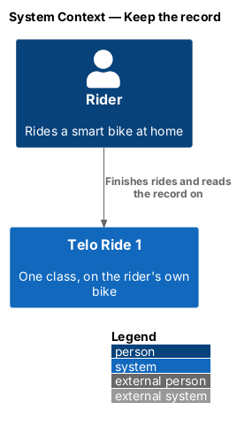
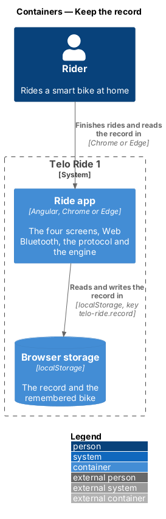
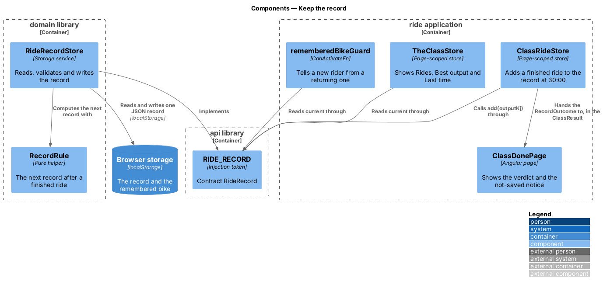
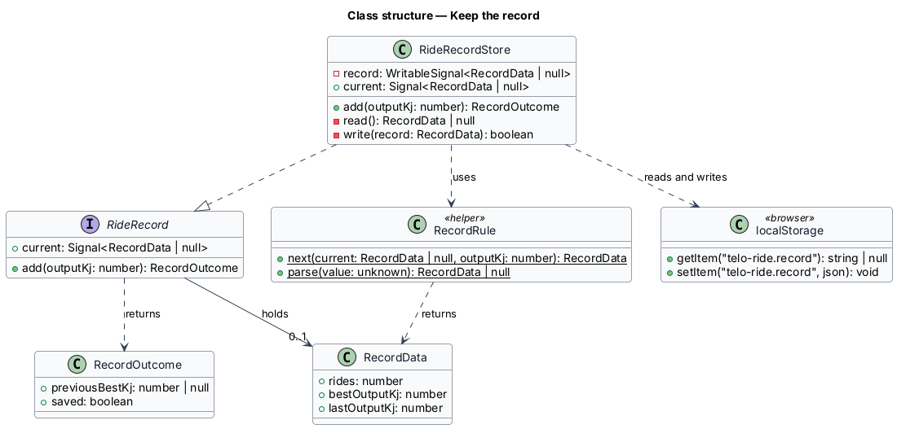
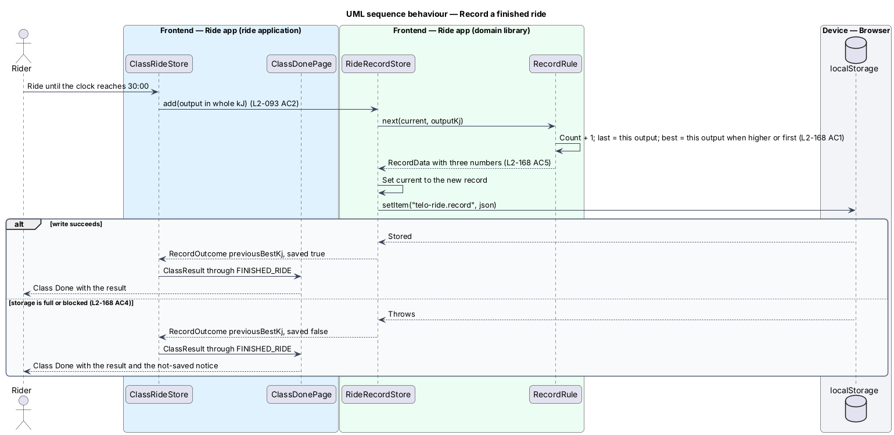
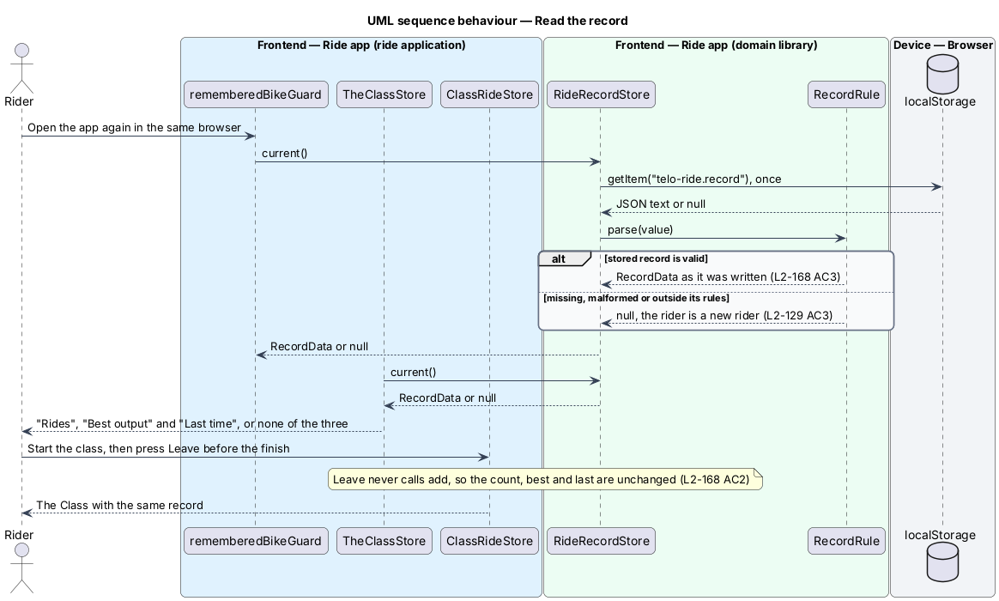

# Keep the record

## Overview

Telo Ride 1 has no accounts and no backend in its requirements. What it remembers of the rider's
rides is the record: three numbers kept in the browser's storage on the device. The record gives
the rider a number to come back and beat. The Class shows it to a returning rider, Class Done
compares a finished ride with it, and the app uses it to tell a new rider from a returning one.

This feature covers the record's rule, its storage and its failure to store.

- **ride**: one run of the class
- **finished ride**: ride whose clock reached the plan's length; a ride the rider left is not one
- **output**: work the rider did in a ride, in kJ
- **record**: rider's ride count, best output and last output, kept on the device
- **ride count**: number of finished rides
- **best output**: highest output of the finished rides, in whole kJ
- **last output**: output of the latest finished ride, in whole kJ

Neighbouring features own the adjacent concerns:

- [Pause, leave or finish the class](../../class-ride/pause-leave-or-finish-the-class/README.md)
  owns the finish that updates the record and the Leave that does not (L2-093).
- [Show Class Done](../show-class-done/README.md) owns the verdict that compares the output with
  the record's earlier best (L2-077).
- [Show the class](../../the-class/show-the-class/README.md) owns "Rides", "Best output" and "Last
  time" on The Class (L2-084 AC8).
- [Open the app](../../the-class/open-the-app/README.md) reads the record to choose the first
  screen (L2-167).
- [Treat device data as untrusted](../../security/treat-device-data-as-untrusted/README.md) owns
  the rule that a missing or malformed stored record counts as absent (L2-129 AC3).
- [Keep data on the device](../../security/keep-data-on-the-device/README.md) owns the rule that
  the record is never sent anywhere (L2-132).
- [Ride without a network](../../performance/ride-without-a-network/README.md) owns the finish
  without a network (L2-135 AC2), which this design meets by making no request.

## Description

The codebase records a finished ride with Telo Ride's backend: `ClassRideStore.finish` builds a
`SubmitRideRequest` from a `RideRecorder` and hands it to `RIDE_OUTBOX` (`SessionRideOutbox`),
which posts it through `RIDES_API`; `RIDER_PROGRESS_API` and `RiderProgressStore` read the rider's
progress back. Telo Ride 1 uses none of them. The blocks below are new, modelled on the remembered
bike's contract and store.

- **`RIDE_RECORD`** and **`RideRecord`** (`api/src/rides/ride-record.ts`, new): the contract and
  its injection token. `current` is a signal of the `RecordData`, or `null` for a rider with no
  finished ride. `add(outputKj)` counts one finished ride and returns a `RecordOutcome`.
- **`RecordData`** (same file, new): `rides`, `bestOutputKj` and `lastOutputKj`. It holds nothing
  else, so its size is fixed however many rides are finished (L2-168 AC5).
- **`RecordOutcome`** (same file, new): `previousBestKj`, the best before this ride or `null` for
  a first ride, and `saved`, `false` when the record could not be written.
- **`RecordRule`** (`domain/src/engine/record-rule.ts`, new): pure helper with unit tests.
  `next(current, outputKj)` returns the record after a finished ride: `rides` up by one,
  `lastOutputKj` this output, and `bestOutputKj` this output when it is higher than the best or
  there is no best (L2-168 AC1). `parse(value)` returns a `RecordData` only for an object whose
  `rides` is a whole number of at least 1 and whose two outputs are finite numbers of at least 0;
  anything else is `null` (L2-129 AC3).
- **`RideRecordStore`** (`domain/src/storage/ride-record-store.ts`, new, beside
  `RememberedBikeStore`): the implementation. It keeps the record as one JSON object under the
  `localStorage` key `telo-ride.record`. It reads the key once, on first use, through
  `RecordRule.parse`, and treats storage the browser refuses as no record. `add` computes the next
  record with `RecordRule.next`, sets `current`, and writes the key inside a `try`. A write that
  throws (storage full or blocked) leaves `current` at the new record for the rest of the visit,
  so The Class counts the ride (L2-079 AC2), and returns `saved: false` (L2-168 AC4). The store
  makes no network request.
- **`rideRoutes`** (`ride/src/app/ride.routes.ts`, exists, changed): binds `RIDE_RECORD` to
  `RideRecordStore` on the parent route, so the guard, The Class, Class Ride and Class Done share
  one instance. The binding sits there, not in `app.config.ts`, because the first screen brings it.
- **`ClassRideStore`** (`ride/src/app/class-ride/class-ride-store.ts`, exists, changed): the only
  caller of `add`. At the plan's end it rounds the ride's output to a whole kJ, calls
  `RIDE_RECORD.add`, and puts the `RecordOutcome` in the `ClassResult` it hands to Class Done.
  Leave never calls `add`, so a ride the rider left changes nothing (L2-168 AC2).
- **`ClassDonePage`** and **`classDoneView`** (`ride/src/app/class-done/`, new, described in
  [Show Class Done](../show-class-done/README.md)): show the result whatever `saved` is. When it
  is `false` they add a notice that the ride could not be saved on this device. The notice's copy
  and place on the screen are `<TO SUPPLY>` (mock gap: the ride that could not be saved,
  L2-168 AC4).

The record persists because `localStorage` persists: closing and reopening the app in the same
browser reads the same three numbers (L2-168 AC3), and clearing the site's data makes the rider a
new rider. Playwright gives each spec a fresh browser context, so storage
starts empty; a spec seeds a returning rider by writing the key before the app loads.

## Requirements

The feature realizes the following level-2 (L2) requirement, which refines a level-1 (L1)
requirement cited by identifier.

| L2 ID | Refines (L1) | Requirement |
|-------|--------------|-------------|
| `L2-168` | `L1-013` | When a ride finishes, the app shall raise the ride count by one, set the last output to this ride's output in whole kJ, and set the best output to this ride's output if it is higher than the best or there is no best. A ride the rider left before the finish shall leave the count, best and last unchanged. The count, best and last shall be as they were when the app is closed and opened again in the same browser. When the record cannot be written (storage is full or blocked), Class Done shall still show the result, and a notice shall say the ride could not be saved on this device. The stored record shall hold only the ride count, the best output and the last output: a fixed size, however many rides are finished. |

## Diagrams

### System context

The rider is the only actor, and Telo Ride 1 the only system: the record never leaves the device.

### Containers

The Ride app reads and writes the record in browser storage, under one `localStorage` key.

### Components

`ClassRideStore` adds a finished ride through `RIDE_RECORD`; `TheClassStore` and
`rememberedBikeGuard` read it. `RideRecordStore` implements the contract with `RecordRule` over
`localStorage`.

### Class structure

`RideRecordStore` realizes `RideRecord`, holds at most one `RecordData` and returns a
`RecordOutcome` from `add`. `localStorage` is drawn with the `<<browser>>` stereotype.

### Behaviour: record a finished ride

At 30:00 the store computes the next record, sets it and writes it. A write that fails still
returns the outcome, with `saved` false, and Class Done shows the result with the notice
(L2-168 AC4).

### Behaviour: read the record

On opening, the store reads the key once and validates it; a valid record is as it was written
(L2-168 AC3). A ride the rider leaves never reaches `add`, so the record is unchanged (AC2).

