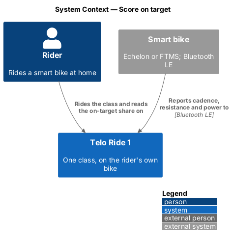
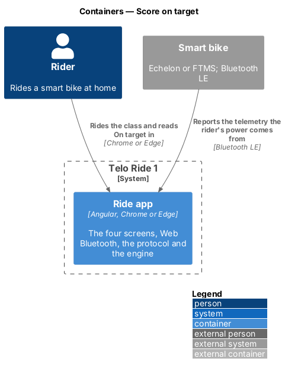
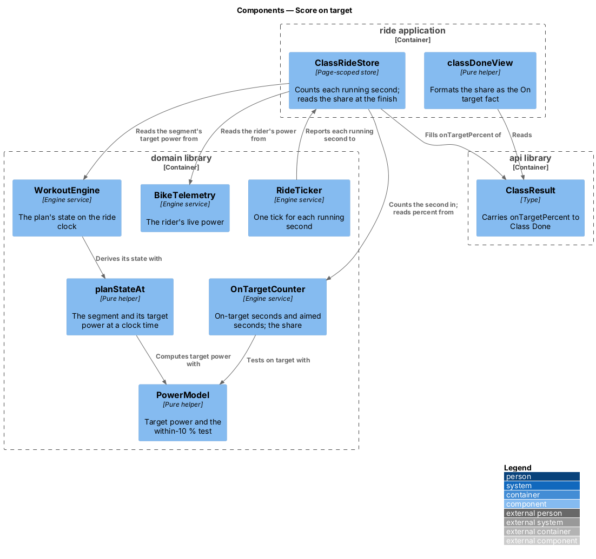
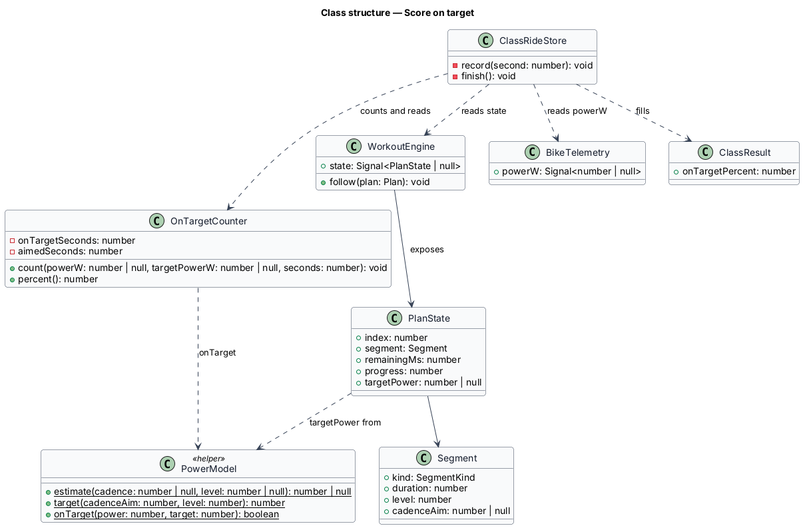
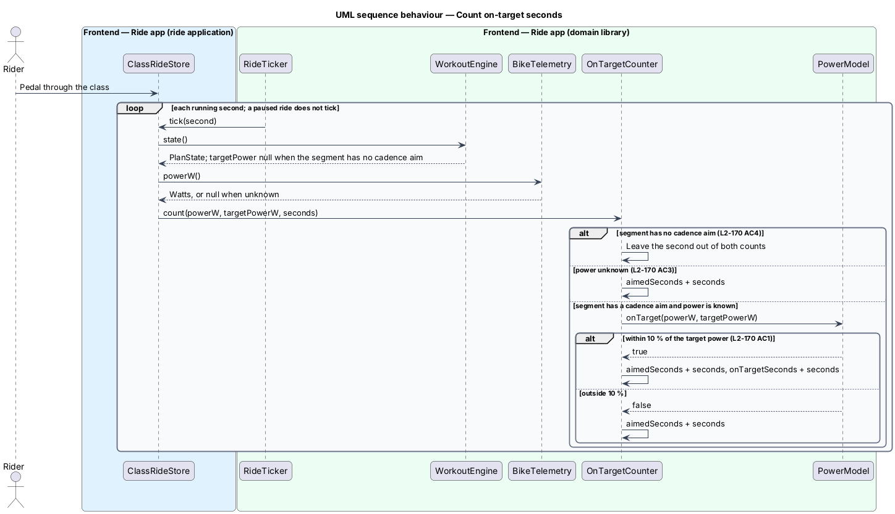
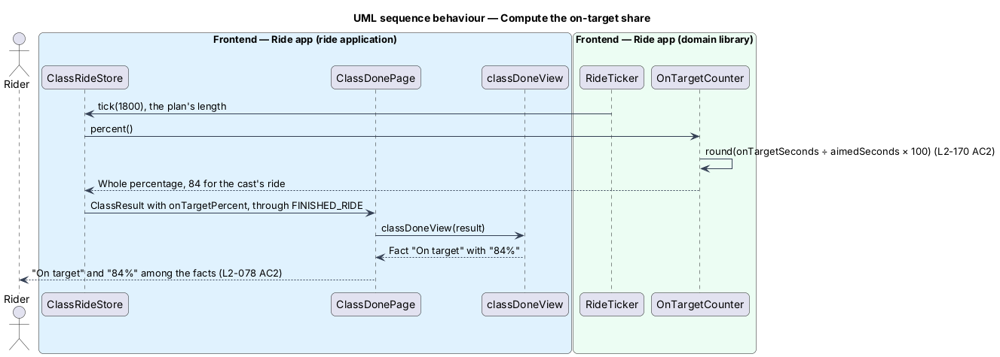

# Score on target

## Overview

During the class the plan sets the bike's resistance and gives the rider a cadence to aim for.
Together they define a target power for each segment. Class Done reports how much of the ride the
rider spent at that power, as one percentage under "On target".

This feature covers the rule that decides whether a second is on target, the two running counts
kept during the ride, and the share computed when the ride finishes. The rule is a proposal of the
requirements: the prototype shows a fixed 84 % (L2 open question 2).

- **segment**: part of the plan with a kind, a duration, a level and a cadence aim
- **cadence aim**: cadence in rpm a segment asks of the rider; a segment may have none
- **target power**: power of a segment's cadence aim at its level, by the estimate of L2-023 AC3
- **running second**: second during which the ride clock ran, a paused or waiting ride adding none
- **aimed second**: running second in a segment that has a cadence aim
- **on-target second**: aimed second in which the rider's power is within 10 % of the target power
- **on-target share**: on-target seconds as a whole percentage of the aimed seconds

Neighbouring features own the adjacent concerns:

- [Show Class Done](../show-class-done/README.md) shows the share as the "On target" fact
  (L2-078 AC2).
- [Ride the class](../../class-ride/ride-the-class/README.md) owns the live "On target" hint
  beside Power during the ride (L2-089 AC2), which uses the same 10 % test.
- [Read bike telemetry](../../bike/read-bike-telemetry/README.md) owns the rider's power and the
  target power formula (L2-023).
- [Show the class](../../the-class/show-the-class/README.md) owns the plan and its cadence aims
  (L2-080).
- [Keep the ride clock true](../../performance/keep-the-ride-clock-true/README.md) owns the
  running seconds a hidden tab catches up on (L2-133).
- [Stay smooth on long rides](../../performance/stay-smooth-on-long-rides/README.md) owns the rule
  that a ride holds only running totals (L2-138 AC2).

## Description

The codebase already counts on-target seconds, for Telo Ride's backend: `ClassRideStore.record`
tests each second with `PowerModel.onTarget` and `RideRecorder` divides the on-target seconds by
all the seconds ridden, to three decimals. Telo Ride 1 keeps the test, changes the divisor and
removes `RideRecorder`.

- **`PowerModel`** (`domain/src/engine/power-model.ts`, exists): `target(cadenceAim, level)` is
  max(0, round(cadenceAim × (0.55 + level × 0.155))) W, 107 W for an aim of 72 at level 6 and
  418 W for 98 at level 24. `onTarget(power, target)` is `true` when the power differs from the
  target by at most 10 % of the target (L2-170 AC1). It does not change.
- **`Segment`** (`api/src/workout/plan.ts`, exists, changed): `cadenceAim` becomes
  `number | null`, `null` for a segment with no cadence aim. Which segments of the class have none
  depends on the warm-up and cool-down aims, which are `<TO SUPPLY>` (L2 open question 11).
- **`PlanState`** and **`planStateAt`** (`domain/src/engine/plan-state.ts`, exist, changed):
  the plan's segment at a clock time, with its `targetPower`. `targetPower` becomes
  `number | null`, `null` when the segment has no cadence aim.
- **`WorkoutEngine`** (`domain/src/engine/workout-engine.ts`, exists): exposes the current
  `PlanState` as the signal `state`.
- **`BikeTelemetry`** (`domain/src/engine/bike-telemetry.ts`, exists): exposes the rider's power
  as the signal `powerW`, `null` when it is unknown.
- **`OnTargetCounter`** (`domain/src/engine/on-target-counter.ts`, new): engine service provided
  on `ClassRidePage`, beside `RideTotals` and `EffortTotals`, with unit tests of one case per row of the table
  below. It keeps two numbers, `onTargetSeconds` and `aimedSeconds`, so its size does not grow
  with the ride (L2-138 AC2). `count(powerW, targetPowerW, seconds)` applies:

  | Segment's target power | Rider's power | `aimedSeconds` | `onTargetSeconds` | Criterion |
  |---|---|---|---|---|
  | `null` (no cadence aim) | any | unchanged | unchanged | L2-170 AC4 |
  | a number | `null` (unknown) | + seconds | unchanged | L2-170 AC3 |
  | a number | within 10 % | + seconds | + seconds | L2-170 AC1 |
  | a number | outside 10 % | + seconds | unchanged | L2-170 AC1 |

  `percent()` returns round(`onTargetSeconds` ÷ `aimedSeconds` × 100), a whole percentage
  (L2-170 AC2). A finished ride always has aimed seconds, since the efforts and the recoveries
  have cadence aims, so the divisor is not 0 when the share is read.
- **`ClassRideStore`** (`ride/src/app/class-ride/class-ride-store.ts`, exists, changed): on each
  tick of `RideTicker` it reads `WorkoutEngine.state` and `BikeTelemetry.powerW` and calls
  `OnTargetCounter.count` with the seconds the tick covers. A paused ride and a ride waiting for a
  lost bike do not tick, so they add to neither count. At the plan's end it reads `percent()` into
  `ClassResult.onTargetPercent`.
- **`ClassResult`** (`api/src/classes/class-result.ts`, exists, reshaped): carries
  `onTargetPercent`, a whole number from 0 to 100, in the place of today's `onTargetShare` from 0
  to 1.
- **`classDoneView`** (`ride/src/app/class-done/class-done-view.ts`, new, described in
  [Show Class Done](../show-class-done/README.md)): formats the number with "%" as the value of
  the "On target" fact.

The counter and the live hint of L2-089 AC2 call the same `PowerModel.onTarget`, so a second that
reads "On target" on Class Ride is a second the share counts.

## Requirements

The feature realizes the following level-2 (L2) requirement, which refines a level-1 (L1)
requirement cited by identifier.

| L2 ID | Refines (L1) | Requirement |
|-------|--------------|-------------|
| `L2-170` | `L1-013` | A running second in a segment with a cadence aim shall be on target when the rider's power is within 10 % of the segment's target power (L2-023 AC3). The on-target share of a finished ride shall be the on-target seconds ÷ the running seconds in segments with a cadence aim, as a whole percentage rounded to nearest ("84%"). A second with unknown power shall not be on target. The seconds of a segment with no cadence aim shall be left out of both counts. |

## Diagrams

### System context

The rider rides the class on Telo Ride 1, and the smart bike reports the telemetry the rider's
power comes from. The share is computed on the device.

### Containers

The Ride app is the only container the slice touches: the two counts live in memory for the
length of one ride and are not stored.

### Components

`RideTicker` reports each running second to `ClassRideStore`, which reads the target power from
`WorkoutEngine` and the rider's power from `BikeTelemetry` and passes both to `OnTargetCounter`.
The counter tests them with `PowerModel`, and the share travels to Class Done in the
`ClassResult`.

### Class structure

`OnTargetCounter` holds two numbers and depends on `PowerModel.onTarget`. `PlanState.targetPower`
is `null` when its `Segment` has no cadence aim.

### Behaviour: count on-target seconds

For each running second the counter leaves out a segment with no cadence aim (L2-170 AC4), counts
an unknown power as aimed only (AC3), and counts a known power as on target when it is within
10 % of the target power (AC1).

### Behaviour: compute the on-target share

At the plan's end the store reads the whole percentage (L2-170 AC2) into the result, and Class
Done shows it under "On target".

