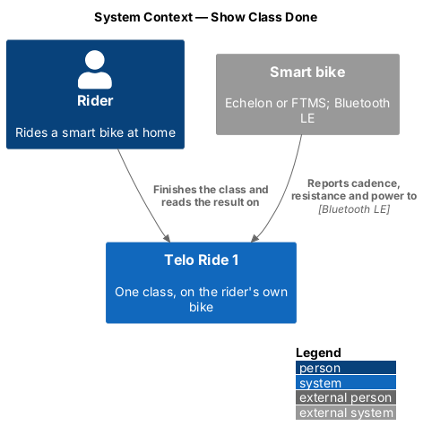
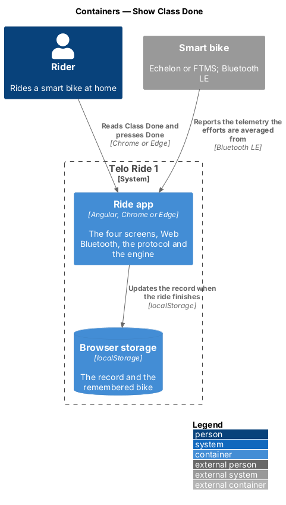
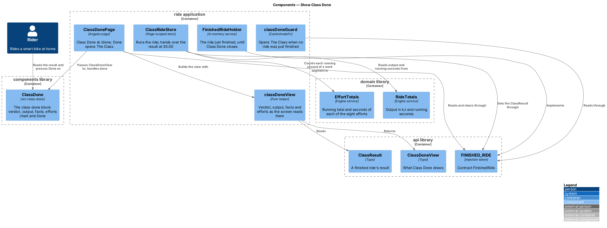
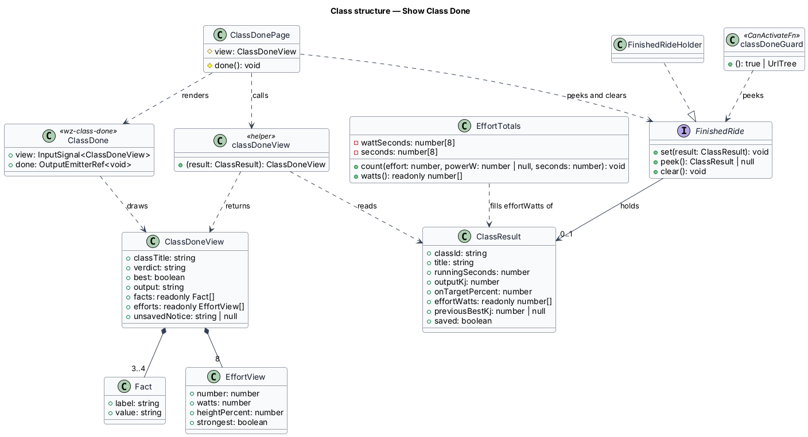
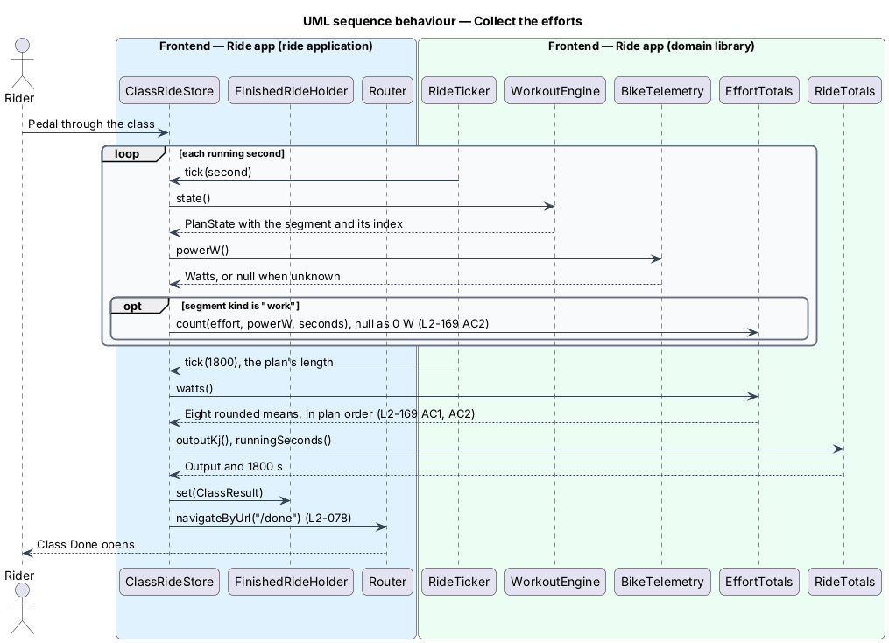
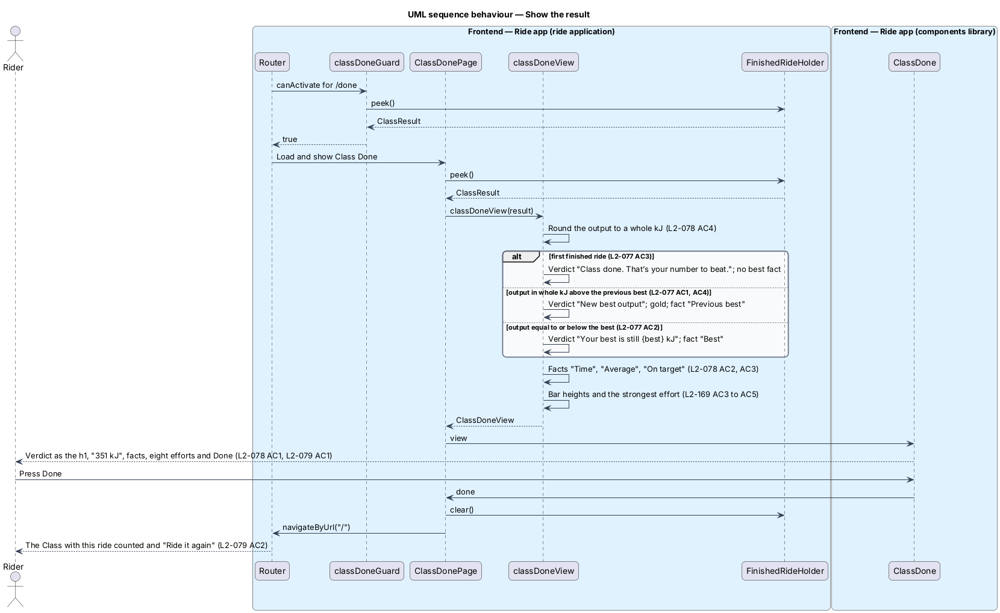
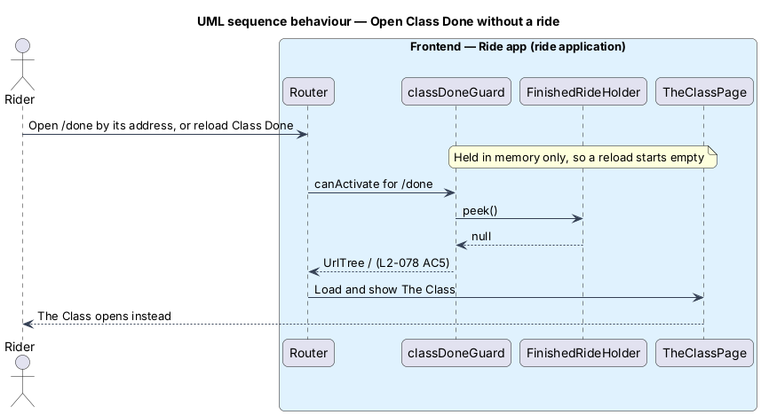

# Show Class Done

## Overview

Class Done, at `/done`, is the last of Telo Ride 1's four screens. It opens when a ride finishes,
that is when the ride clock reaches the plan's length of 30:00. It shows the ride's output in kJ,
a verdict that says whether the output is a new best, the ride's time, its average watts, the share
of the ride on target, and the eight efforts as a bar chart. **Done**, its only action, returns to
The Class, where the rider finds the number to come back and beat.

This feature covers the screen, the verdict, the facts, the efforts and the **Done** action. It
also covers the running totals of the efforts, which are gathered during the ride.

- **ride**: one run of the class; it is finished when its clock reaches the plan's length
- **output**: work the rider did in a ride, in kJ
- **record**: rider's ride count, best output and last output, kept on the device
- **verdict**: the `h1` of Class Done, which compares the output with the record's best
- **fact**: labelled figure under the output ("Time", "Average", "On target" and, where there is
  one, the best)
- **effort**: one of the plan's eight work segments
- **strongest effort**: effort with the highest average watts, the earliest where efforts tie
- **running seconds**: seconds the ride clock ran, a paused or waiting ride adding none
- **result**: figures of one finished ride that Class Ride hands to Class Done

Neighbouring features own the adjacent concerns:

- [Pause, leave or finish the class](../../class-ride/pause-leave-or-finish-the-class/README.md)
  owns the finish of the ride that opens this screen (L2-093).
- [Keep the record](../keep-the-record/README.md) owns the record the verdict compares with and its
  update (L2-168).
- [Score on target](../score-on-target/README.md) owns the on-target share behind the "On target"
  fact (L2-170).
- [Read bike telemetry](../../bike/read-bike-telemetry/README.md) owns power and the ride's output
  (L2-023).
- [Show the class](../../the-class/show-the-class/README.md) owns The Class, which **Done** opens.
- [Support screen readers and motion](../../ui/support-screen-readers-and-motion/README.md) owns
  the rise of the eight bars and its reduced-motion end state (L2-142).
- [Show the wordmark](../../ui/show-the-wordmark/README.md) and
  [Switch theme and full screen](../../ui/switch-theme-and-full-screen/README.md) own the header's
  wordmark, the gold role token and the Full screen button.
- [Stay smooth on long rides](../../performance/stay-smooth-on-long-rides/README.md) owns the rule
  that a ride holds only running totals (L2-138).

## Description

The codebase holds Telo Ride's Results at `/results` (`ResultsPage`, `resultsView`,
`resultsRoutes`, and the components `ResultsHeader`, `Standings`, `XpEarned`, `MapStars` and
`UnlockCard`). Results reads a race or class result from the navigation's history state and follows
the ride's submission to the backend through `RIDE_OUTBOX`. Class Done replaces it and uses none of
those parts; nothing leaves the device.

Slice 32.2 built the first part of it: `/done` (`ClassDonePage`, `classDoneView` in `ride/src/app/class-done/`, and
the presentation component `wz-class-done` in `components`) replaces `/results`, which is removed with
`ResultsHeader` and `resultsView`. It shows the header (lockup, "Intervals to the Beat", Full screen), the output
in whole kJ, "Time" and "Average" (round(output in kJ × 1000 ÷ running seconds)), and **Done**, a primary link to
The Class at least 44 px tall, and announces "Class done: 351 kJ in 20:00." With no result in the navigation's state
`/done` opens The Class. The verdict, "On target", the best fact and the eight efforts follow in slices 32.3 to
32.5; until then a visually hidden "Class done" heading stands in for the verdict. The mocks `class-done/default`,
`first` and `not-best` were brought in line with the one class (20:00, 293 W and 265 W).

Slice 32.3 added the verdict (`L2-077`): `ClassResult.previousBestKj` is the best before the ride, read by the ride's
finish before it adds the ride to the record and carried in the navigation's state, so a reload still compares with
the earlier best. `classDoneView` compares whole kJ: higher than the best is "New best output" (the `h1`, the output
and the verdict in gold, and the fact "Previous best"); lower or equal is "Your best is still {best} kJ" with "Best";
no best is "Class done. That’s your number to beat." with no fact. The announcement is the verdict then "351 kJ in
20:00.".

Slice 32.4 added the efforts (`L2-169`, `L2-142` AC2, AC3; the mocks `class-done/default` and `efforts-none`, now
drawn with the plan's 17 efforts, not eight). `EffortTally` (`domain/src/engine/effort-tally.ts`) holds one sum for each
work segment of the plan, to which the ride's per-second record adds the power over the seconds it covers (a hidden
tab's skipped seconds split across the segments they overlap, unknown power as 0 W); `ClassResult.efforts` carries
each effort's rounded mean watts in plan order. `classDoneView` turns them into `EffortBar`s: height as a share of the
strongest's, the earliest strongest set apart, none when all are 0 W. `wz-class-done` draws the section "Your 17
efforts, average watts" as an `ol` of bars: each bar is `calc((100% - --class-done-figure-room) * --share)` so the
strongest fills the room under its figure and the others are their watts over its, with a 4 px minimum for 0 W. The
figures are set upright (`writing-mode: vertical-rl`) so 17 fit at 320 px with none over the next. The bars rise 250 ms
each, 40 ms apart (`--duration-stagger`), and not at all with reduced motion; the app's token file gained
`--duration-stagger`, `--class-done-chart-height`, `--class-done-action-width` and `--class-done-figure-room`.

Slice 32.7 added the notice for a ride that could not be saved (`L2-168` AC4; the mock `class-done/not-saved`):
`RideRecord.add` already returned whether storage took the ride; the store puts that in `ClassResult.saved`, and
`wz-class-done` draws a polite `wz-inline-message` (`role="status"`) under the facts, "This ride could not be saved on
this device. Your result is above.", only when `saved` is false. The result itself shows as always.

Slice 32.5 added the fact "On target" (`L2-170`, `L2-078` AC2) after Time and Average and before the best fact:
`classDoneView.onTarget` is `round(ClassResult.onTargetShare × 100)` as "84%". The share itself was already counted
by `RideRecorder` (on-target seconds ÷ running seconds, power within 10 % of the segment's target, unknown power
never on target; the class has no segment without a cadence aim).

**During the ride**

- **`EffortTotals`** (`domain/src/engine/effort-totals.ts`, new): engine service provided on
  `ClassRidePage`, beside `RideTotals` and `OnTargetCounter`. It keeps two fixed arrays of eight numbers: the sum of
  the rider's power and the count of running seconds of each effort. `count(effort, powerW,
  seconds)` adds to both, an unknown power counting as 0 W. `watts()` returns the eight means,
  rounded, in plan order (L2-169 AC1, AC2). Its size does not grow with the ride (L2-138 AC2).
- **`RideTotals`** (`domain/src/engine/ride-totals.ts`, exists): `outputKj` and `runningSeconds`,
  the totals the output and the average come from. It belongs to
  [Read bike telemetry](../../bike/read-bike-telemetry/README.md), which removes its `distanceKm`
  and `energyKcal`.
- **`ClassRideStore`** (`ride/src/app/class-ride/class-ride-store.ts`, exists, changed): on each
  running second it calls `EffortTotals.count` when the current segment's kind is `work`. The
  effort number is the count of `work` segments up to the current one. Today its `finish` submits
  the ride to `RIDE_OUTBOX` and navigates to `/results` with a `ClassResult` in the navigation's
  state. For Telo Ride 1 it calls `RIDE_RECORD.add`, builds the `ClassResult`, sets it on
  `FINISHED_RIDE` and navigates to `/done`, as
  [Pause, leave or finish the class](../../class-ride/pause-leave-or-finish-the-class/README.md)
  describes. The existing `RideRecorder`, whose four-hour speed buffer served the backend, is
  removed.

**The handover**

- **`ClassResult`** (`api/src/classes/class-result.ts`, exists, reshaped): the result. Today it
  holds `classId`, `title`, `elapsedSeconds`, `outputKj` and `onTargetShare`. For Telo Ride 1 it
  holds `classId`, `title`, `runningSeconds`, `outputKj` (not rounded), `onTargetPercent`,
  `effortWatts` (eight numbers), and the `previousBestKj` and `saved` that `RIDE_RECORD.add`
  returned.
- **`FINISHED_RIDE`** and **`FinishedRide`** (`api/src/classes/finished-ride.ts`, new): the
  contract through which Class Ride hands the result over, with `set(result)`, `peek()` and
  `clear()`.
- **`FinishedRideHolder`** (`ride/src/app/class-done/finished-ride-holder.ts`, new): its
  implementation, bound on the parent route in `ride.routes.ts` so Class Ride and Class Done share
  one instance. It holds at most one `ClassResult`, in memory only. A reload therefore starts
  empty, which the navigation's history state that Results reads today does not (L2-078 AC5).
- **`classDoneGuard`** (`ride/src/app/class-done/class-done.guard.ts`, new): the `CanActivateFn`
  of `/done`. It returns the `UrlTree` for `/` when `FINISHED_RIDE.peek()` is `null` (L2-078 AC5).

**The screen**

- **`classDoneRoutes`** (`ride/src/app/class-done/class-done.routes.ts`, new): the route of
  `done`, with `classDoneGuard` and `loadComponent` of `ClassDonePage`. It needs no provider of its
  own: no catalogue, no video and no network client load with Class Done.
- **`ClassDonePage`** (`ride/src/app/class-done/class-done-page.ts`, `.html`, `.scss`, new;
  `wz-class-done-page`): the page. It reads the result once, builds the view with `classDoneView`,
  and passes it to `wz-class-done`. On `done` it clears `FINISHED_RIDE` and navigates to `/`
  (L2-079 AC2); it also clears the holder when it is destroyed, so a return to `/done` opens The
  Class.
- **`classDoneView`** (`ride/src/app/class-done/class-done-view.ts`, new, in the place of
  `results-view.ts`): pure helper with unit tests, one case per row of the tables below. It rounds
  the output to a whole kJ (L2-078 AC4) and compares that whole number with `previousBestKj`:

  | Case | Verdict (`h1`) | Output in gold | Best fact |
  |---|---|---|---|
  | `previousBestKj` is `null` | "Class done. That’s your number to beat." | no | none |
  | output above `previousBestKj` | "New best output" | yes | "Previous best", the earlier best |
  | output equal to or below `previousBestKj` | "Your best is still {best} kJ" | no | "Best", the best |

  The facts are, in order:

  | Label | Value |
  |---|---|
  | "Time" | `runningSeconds` as a clock, "30:00" for a finished class |
  | "Average" | round(`outputKj` × 1000 ÷ `runningSeconds`) with " W" (L2-078 AC3) |
  | "On target" | `onTargetPercent` with "%" |
  | the best fact | the earlier or current best with " kJ", where the table above gives one |

  The average uses the output before it is rounded to a whole kJ. For each effort the helper gives
  its number, its watts, the bar height as the watts' share of the strongest effort's, and whether
  it is the strongest. The strongest is the earliest effort with the highest watts and is full
  height (L2-169 AC3, AC4). When every effort is 0 W no effort is the strongest and each bar takes
  its minimum height, whose value is `<TO SUPPLY>` (mock gap: Class Done when every effort is
  0 W, L2-169 AC5). When `saved` is `false` the view carries the not-saved notice of
  [Keep the record](../keep-the-record/README.md) (L2-168 AC4).
- **`ClassDoneView`** (`api/src/results/class-done-view.ts`, new): the view type the page and the
  presentation component share.
- **`ClassDone`** (`components/src/class-done/class-done.ts`, `.html`, `.scss`, new;
  `wz-class-done`): the presentation component of the design-system block `class-done`, with the
  mock's BEM classes. It takes `view`, emits `done` and has the slot `[slot=end]` for the Full
  screen button. It draws:
  - the header, a `ScreenHeader` (`wz-screen-header`, new, owned by
    [Show the wordmark](../../ui/show-the-wordmark/README.md)), with the class title in
    `class-done__class` in its default slot and the `[slot=end]` content passed on to it;
  - the verdict as the `h1` (`class-done__verdict`, with `class-done__verdict--best` for a new
    best) and the output in `class-done__number` with "kJ" in `class-done__unit`
    (`class-done__output--best` sets the gold);
  - the facts as a `dl` (`class-done__facts`);
  - the section headed "Your eight efforts, average watts" with an `ol` of eight
    `class-done__effort` items, each the watts above a `class-done__bar`. The strongest takes
    `class-done__effort--peak` and reads "Effort {n}: {watts} W, your strongest" through visually
    hidden text; the others read "Effort {n}: {watts} W". The words, not the colour, carry the
    state (L2-077 AC4, L2-169 AC4);
  - **Done** (`class-done__done`), a primary `wz-button` of size `xl` and the only action
    (L2-079 AC1).

  The mock sets each bar's `--value` and `--index` in a `style` attribute. The component binds the
  two custom properties with `[style.--value]` and `[style.--index]`, since templates hold no
  inline `style`.
- **`Button`** and **`FullscreenToggle`** (`components/src/`, exist; `[wz-button]`,
  `wz-fullscreen-toggle`): the button and the Full screen control the screen reuses. The
  wordmark comes with `ScreenHeader`, which renders `wz-lockup`.

From lg the block lays the score and the efforts out to fit one screen; below lg it is one column
that scrolls (L2-078 AC6). The Playwright page object `class-done.page.ts` (`frontend/e2e/pages/`,
new, replacing `results.page.ts`) owns the selectors.

The mock's `default` state shows "30:12" for "Time". A ride finishes when its clock reaches 30:00,
so the design follows L2-078 AC2 and shows "30:00"; whether the fact stays on the screen is open
(L2 open question 3).

## Requirements

The feature realizes the following level-2 (L2) requirements. Each L2 requirement refines a
level-1 (L1) requirement, cited by identifier.

| L2 ID | Refines (L1) | Requirement |
|-------|--------------|-------------|
| `L2-077` | `L1-013` | When a finished ride's output, in whole kJ, is higher than the record's best, the `h1` of Class Done shall read "New best output", the output shall be in gold, and a fact shall read "Previous best" with the earlier best ("342 kJ"). When the output is equal to or lower than the best, the `h1` shall read "Your best is still {best} kJ" ("Your best is still 342 kJ"), the output shall not be gold, and a fact shall read "Best" with the best. For the rider's first finished ride the `h1` shall read "Class done. That’s your number to beat.", the output shall not be gold, and there shall be no best fact. The words "New best output" shall carry a new best, never the gold alone. |
| `L2-078` | `L1-013` | Class Done shall be at `/done` and shall open when a ride finishes. Its header shall show the wordmark, "30 Minute HIIT Cardio" and Full screen, and the screen shall show the verdict (L2-077), the output as a whole number with "kJ" ("351 kJ"), the facts, the eight efforts (L2-169) and **Done**. The facts shall read "Time" with the ride's running time ("30:00" for a finished class), "Average" with the average watts ("194 W") and "On target" with the on-target share ("84%", L2-170), then the best fact of L2-077 where there is one. The average watts shall be round(output in kJ × 1000 ÷ running seconds). The output shown shall be the ride's output (L2-023 AC4) rounded to a whole kJ. When `/done` is opened with no ride just finished, a reload included, The Class shall open instead. At lg or wider the score and the efforts shall fit on one screen; below lg Class Done shall be one column that scrolls. |
| `L2-079` | `L1-013` | **Done** shall be the only action of Class Done, a primary button at least 44 px tall. When the rider presses **Done**, The Class shall open, show the record with this ride counted (L2-168), and its start button shall read "Ride it again". |
| `L2-169` | `L1-013` | Class Done shall list the eight efforts in plan order in a section headed "Your eight efforts, average watts", each as a bar with its watts above it. An effort's watts shall be the mean of the rider's power over the running seconds of that work segment, rounded; seconds with unknown power shall count as 0 W. Each bar's height shall be its watts as a share of the strongest effort's, and the strongest shall be full height. The strongest effort shall be set apart in colour and shall read "Effort {n}: {watts} W, your strongest" to a screen reader; the others shall read "Effort {n}: {watts} W". Where efforts tie, the earliest shall be the strongest. When every effort is 0 W, all eight bars shall be at their minimum height and none shall be marked the strongest. |

## Diagrams

### System context

The rider finishes the class on Telo Ride 1 and reads the result there. The smart bike supplies
the telemetry the figures are computed from; no other system takes part.

### Containers

The Ride app computes the result on the device from the bike's telemetry. It touches browser
storage only to update the record when the ride finishes.

### Components

`ClassRideStore` feeds `EffortTotals` during the ride and sets the `ClassResult` on
`FINISHED_RIDE` at the finish. `classDoneGuard` and `ClassDonePage` read it there, `classDoneView`
turns it into a `ClassDoneView`, and `ClassDone` draws it.

### Class structure

`ClassResult` is the handover type that `FinishedRide` holds. `classDoneView` maps it to a
`ClassDoneView` of three or four `Fact` values and eight `EffortView` values.

### Behaviour: collect the efforts

On each running second of a work segment the store adds the rider's power to that effort's total,
an unknown power as 0 W (L2-169 AC2). At 30:00 it reads the eight means, builds the result and
opens Class Done.

### Behaviour: show the result

The guard lets the navigation through because a ride was just finished. The view helper picks one
of the three verdicts (L2-077), builds the facts and the efforts, and **Done** clears the result
and opens The Class (L2-079 AC2).

### Behaviour: open Class Done without a ride

The result lives in memory only. Opening `/done` by its address, or reloading it, finds none, and
the guard opens The Class instead (L2-078 AC5).

