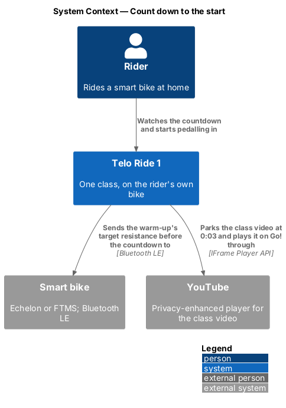
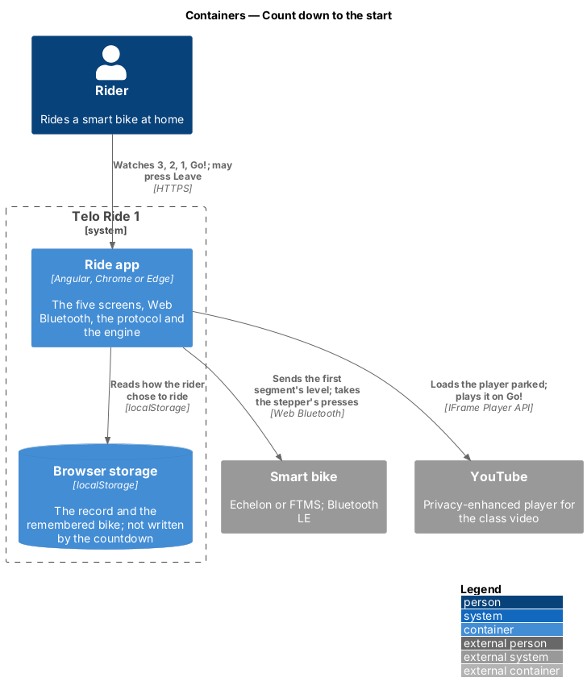
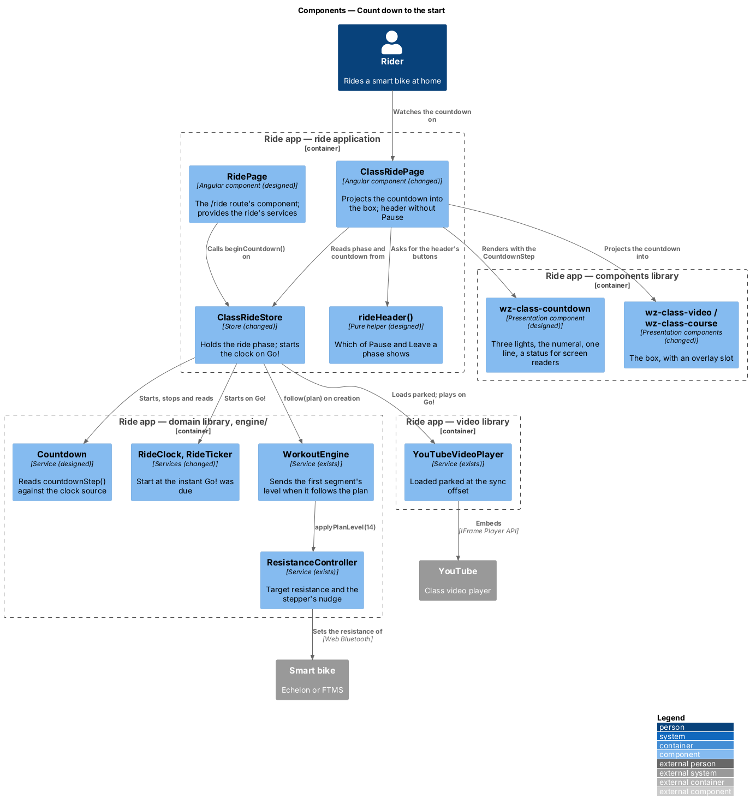
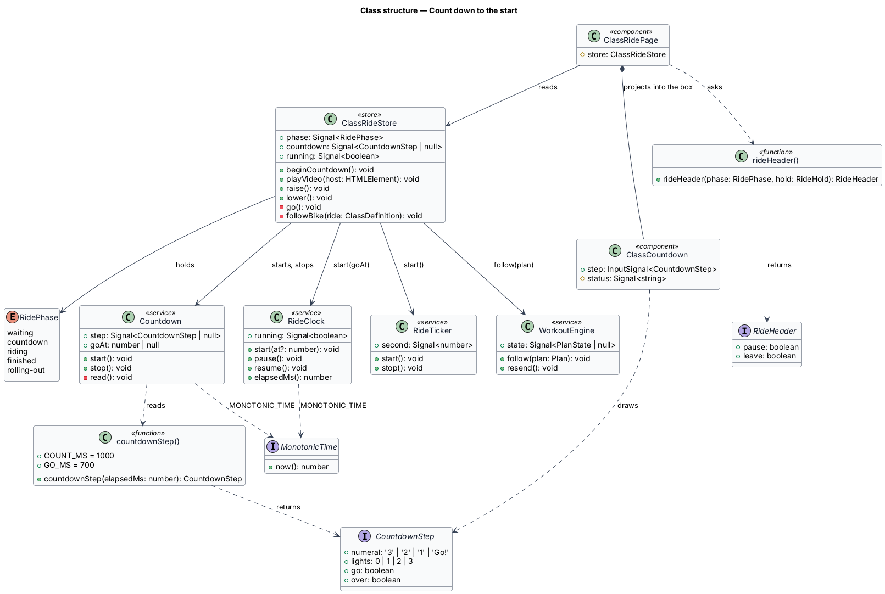
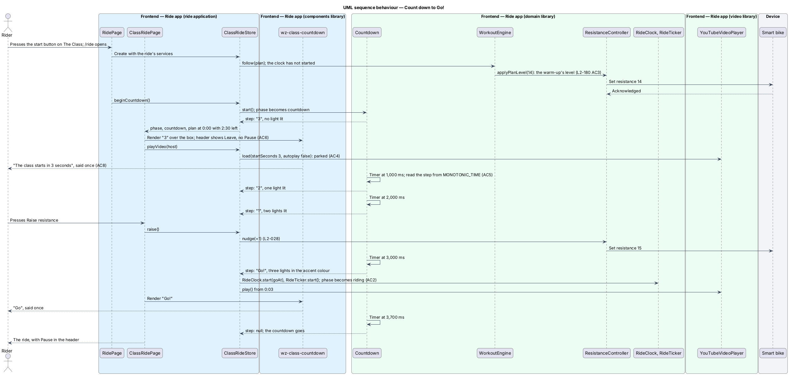
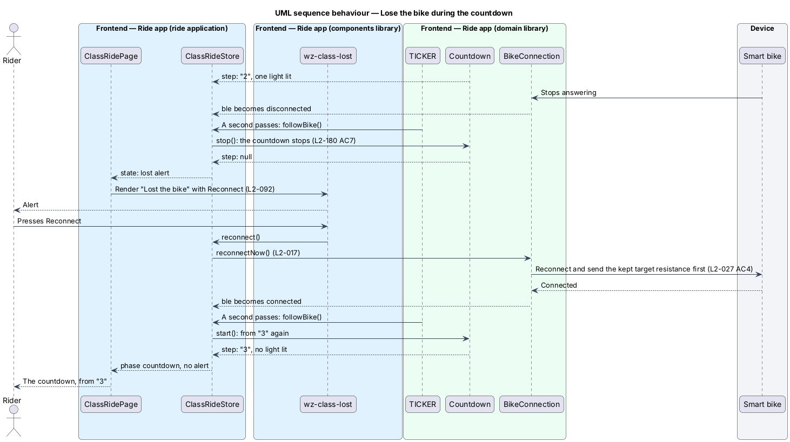

# Count down to the start

## Overview

Telo Ride 1 has one class, Intervals to the Beat, and five screens. Class Ride is the screen the
rider is on while pedalling. A ride is shaped like a race for one (ADR 0049): it does not start
the moment the screen opens. Class Ride opens on a countdown of "3", "2", "1" and "Go!", in Ibiza
and with the class video alike, and the ride clock starts at 0:00 as "Go!" shows.

The countdown gives the rider three seconds to get their feet turning with the bike already set:
the first segment's target resistance is sent before the countdown shows, and the stepper works
while it runs. It lies inside the video's or the course's box, so the bike panel under it keeps
its place. Nothing of it is built: journey 39 plans it, and slice 39.1 builds it first, because
it moves the start of the clock that every later slice counts from.

Local terms:

- **countdown**: three seconds before the ride clock starts, plus the 0.7 seconds "Go!" shows
- **light**: one of the three discs above the numeral; one more is lit as each second passes
- **numeral**: the text "3", "2", "1" or "Go!" the countdown shows
- **ride phase**: stage a ride is in: `waiting`, `countdown`, `riding`, `finished` or `rolling-out`
- **clock source**: monotonic time the ride clock reads (`MONOTONIC_TIME`, `performance.now()`)
- **parked video**: class video loaded at the sync offset (0:03) and not playing
- **box**: the video's box on the stage, which the course takes in a ride in Ibiza

Neighbouring features own the adjacent concerns:

- The screen, its header, the bike panel and the video kept on the clock (`L2-087` to `L2-089`)
  belong to [ride the class](../ride-the-class/README.md). This design changes when its clock
  starts.
- Ibiza Flyover, which sets the rider on the grid before the countdown in Ibiza (`L2-179`), and
  `RidePage`, which shows it and then Class Ride, belong to
  [fly over the course](../../ibiza-flyover/fly-over-the-course/README.md).
- The course in the box and its loading line (`L2-174`, `L2-175`) belong to
  [ride in Ibiza](../ride-in-ibiza/README.md) and [load the course](../load-the-course/README.md);
  the music that starts on "Go!" (`L2-176`) belongs to [play the music](../play-the-music/README.md).
- The lost-bike alert (`L2-092`) belongs to [wait for a lost bike](../wait-for-a-lost-bike/README.md);
  Leave (`L2-093` AC1) to [pause, leave or finish the class](../pause-leave-or-finish-the-class/README.md).
- The finish banner and the roll-out, the other end of the ride's shape (`L2-181`, `L2-182`),
  belong to [show the finish banner](../show-the-finish-banner/README.md) and
  [ease off and roll on](../ease-off-and-roll-on/README.md).
- Sending a segment's level and the stepper (`L2-027`, `L2-028`) belong to
  [control resistance](../../bike/control-resistance/README.md); the clock in a hidden tab
  (`L2-133`) to [keep the ride clock true](../../performance/keep-the-ride-clock-true/README.md).

## Description

The slice lives in the Ride app: the ride's phase and the page in the `ride` application, the
countdown's rule in `domain`'s `engine/`, and its picture in `components`. The mocks are
`docs/mocks/pages/class-ride/countdown.html` ("3" over the video's box), `countdown-ibiza.html`
("1" over the course's box) and `go-ibiza.html` ("Go!"). Each part below is marked as existing
or as designed; none of the designed parts is built.

### What changes in the ride as built

`ClassRideStore` (exists, `ride/src/app/class-ride/class-ride-store.ts`) starts the ride in its
constructor today: `RideClock.start()`, `RideTicker.start()` and `WorkoutEngine.follow(plan)`
run at once, as ADR 0047 decided. ADR 0049 replaces that. The store is created when `/ride`
opens and holds a ride phase; the clock and the ticker start on "Go!".

- **`RidePhase`** (designed, `ride/src/app/class-ride/ride-phase.ts`). The union `'waiting' |
  'countdown' | 'riding' | 'finished' | 'rolling-out'`. `waiting` is the phase while Ibiza
  Flyover shows; a ride with the class video, and a ride in Ibiza with no flyover, never has it.
- **`ClassRideStore.phase`** (designed). A read-only signal of the `RidePhase`. `running`
  becomes true only in `riding` with no hold, so the course's rider waits on the grid and the
  video stays parked until then.
- **On creation** (changed). The store calls `WorkoutEngine.follow(plan)` and nothing else of
  the start. `RideClock` has not started, so `planStateAt(plan, 0)` gives the warm-up with 2:30
  left, and `WorkoutEngine.step()` sends the warm-up's level through
  `ResistanceController.applyPlanLevel(14)` (`L2-180` AC3, `L2-175` AC1). The header's clock
  reads "0:00 / 20:00" from `RideTicker.second`, which is 0, and the segment card reads
  "Warm-up" and "2:30" from `ClassRideStore.plan` (AC1). The screen wake lock is held from here.
- **`ClassRideStore.beginCountdown()`** (designed). Called by `RidePage` when Class Ride takes
  the screen. It sets the phase to `countdown` and calls `Countdown.start()`.
- **`ClassRideStore.go()`** (designed, private). Runs when the countdown reaches "Go!". It sets
  the phase to `riding`, calls `RideClock.start(at)` with the instant "Go!" was due,
  `RideTicker.start()` and `RIDE_ACTIVITY.begin()`, creates the `RideRecorder` and the
  `EffortTally`, and plays the parked video. The music's effect sees `running` turn true and
  plays the track (`L2-176` AC1).
- **`RideClock.start(at?: number)`** (changed, `domain/src/engine/ride-clock.ts`). An optional
  start instant on the clock source. `go()` passes the countdown's start plus 3,000 ms, so a
  timer that fires late in a throttled tab does not move the ride's 0:00 (AC5).

### The countdown's rule

- **`countdownStep(elapsedMs)`** (designed, `domain/src/engine/countdown.ts`, with a unit test
  per boundary). A pure function from the milliseconds since the countdown started to a
  `CountdownStep`: the numeral, the count of lights lit, whether it is "Go!" and whether the
  countdown is over. It reads "3" with no light lit from 0 ms, "2" with one from 1,000 ms, "1"
  with two from 2,000 ms, "Go!" with all three from 3,000 ms, and is over at 3,700 ms (AC2).
  `COUNT_MS` (1,000), `GO_MS` (700) and the three counts are its named constants. The timings
  are the prototype's and have not been tried on a bike (open question 42).
- **`Countdown`** (designed, same file). An injectable provided by `RidePage` with the ride's
  other services. `start()` records `MONOTONIC_TIME.now()` and publishes `step`, a signal of the
  `CountdownStep` or `null`. It wakes by `setTimeout` at each boundary and reads the step from
  the elapsed time on the clock source, never from a count of timers or frames, and it reads
  again when a hidden tab shows (`visibilitychange`), as `RideTicker` does (AC5, `L2-133`).
  `stop()` clears the timer and sets `step` to `null`; `start()` after `stop()` begins again
  from "3". `goAt` gives the instant "Go!" was due. Destroying its owner releases the timer and
  the listener.
- **A countdown that ends unseen.** In a tab hidden for the whole countdown the step read on
  return is already over. The store still calls `go()` once, with `goAt`, so the ride clock
  shows the time that passed since "Go!" was due.

### The page

- **`wz-class-countdown`** (designed, `components/src/class-ride/class-countdown.ts`, `.html`,
  `.scss`; block `class-countdown` as in the design system). A presentation component with one
  input, the `CountdownStep`. It draws the three lights (`class-countdown__light`, with
  `--on` for a lit one), the numeral (`class-countdown__num`) and the line "The plan sets your
  resistance. Just pedal." (`class-countdown__line`). On "Go!" the block takes
  `class-countdown--go`, which turns all three lights and the numeral to the accent colour. The
  lights and the numeral are `aria-hidden`. A visually hidden `role="status"` paragraph reads
  "The class starts in 3 seconds" for the three numerals and "Go" for "Go!", so a screen reader
  hears each once and never the numerals (AC8). The numeral and "Go!" carry the meaning as text;
  the lights repeat it (AC10). Each numeral is a fresh node, so its entry animation
  (`ride-countdown-step`) runs for each; under `prefers-reduced-motion: reduce` the stylesheet
  swaps it for a fade with no growth or slide (AC9). The block takes no pointer events, so the
  Music button under it stays in reach.
- **`ClassRidePage`** (changed, `class-ride-page.html`). While `store.countdown()` is not `null`
  the template projects `wz-class-countdown` into the box: `wz-class-video` and
  `wz-class-course` each gain an `overlay` slot, declared once, that lies over the picture and
  under the Music button. The finish banner and the roll-out use the same slot.
- **The header.** `rideHeader(phase, hold)` (designed, pure, in `ride-hold.ts` with a unit test
  per phase) says which of Pause and Leave the header shows. In `countdown` it shows Leave and
  Full screen and no **Pause** (AC6). Leave is the existing `routerLink="/"`; leaving destroys
  `RidePage` and its services with no ride started and the record untouched (`L2-093` AC1).
- **Power, Cadence and the stepper.** `powerStat` gains the phase: it returns no hint and no
  tone outside `riding`, so no line stands under Power during the countdown (AC3). Power and
  Cadence read the bike's telemetry as they do in the ride ("0 W", "0 rpm"), Cadence keeps its
  hint "Aim 80", and `wz-class-resist` reads `BikeTelemetry.resistance` ("14 of 32") with
  `raise()` and `lower()` working through `ResistanceController.nudge`.
- **The class video.** `ClassRideStore.playVideo(host)` loads the player with
  `startSeconds` at the sync offset and `autoplay: false` while the phase is `countdown`, which
  parks it at 0:03; `go()` calls `player.play()` (AC4). A player that arrives after "Go!" loads
  at the offset plus the clock's elapsed seconds and plays, as it does today.
- **The course.** In Ibiza `CourseScene` is drawn with `running` false, so the rider waits on
  the grid; it rolls when `running` turns true on "Go!". While `store.courseDrawn()` is false,
  `wz-class-course` shows its still and "Loading Ibiza Sunset Strip" under the countdown (AC4;
  the course's `loading` line is drawn under the overlay slot).

### The bike lost during the countdown

`ClassRideStore.followBike()` (exists) watches `ble` once a second on `TICKER`. In `countdown`
it calls `Countdown.stop()` when the bike is lost and shows `wz-class-lost`, and calls
`Countdown.start()` when the bike is back, so the countdown starts again from "3" (AC7). The
connection kept the target resistance and sends it first after the reconnect (`L2-027` AC4), so
the bike is set before "Go!". The mock is `docs/mocks/pages/class-ride/countdown-disconnected.html`:
the countdown is not drawn, the clock reads 0:00, the header has neither **Pause** nor **Resume**,
the stepper is off, and the alert's body line during a countdown is "The class has not started.
Pedal to wake the bike, then reconnect." (`lostBikeMessage` gains the phase; the wording is a
proposal).

## Requirements

| L2 ID | Refines (L1) | Requirement |
|-------|--------------|-------------|
| `L2-180` | `L1-015` | Class Ride shall open on a countdown that lies over the video's or the course's box: three lights, the numeral, and "The plan sets your resistance. Just pedal.", with the clock reading "0:00 / 20:00" and held and the segment card reading "Warm-up" and "2:30". The numeral shall read "3", "2" and "1" for one second each, a light lit as each second passes, and then "Go!" with all three lights in the accent colour for 0.7 seconds. The ride clock shall start at 0:00 as "Go!" shows. During the countdown the first segment's target resistance shall have been sent, the stepper shall show the bike's resistance and work, Power and Cadence shall show what the bike reports, and no line shall stand under Power. With the class video the video shall be parked at the sync offset (0:03) and play from it on "Go!"; in Ibiza the rider shall wait on the grid and roll on "Go!", and a course still loading shall read "Loading Ibiza Sunset Strip" under the countdown. The countdown shall be counted by the ride's clock source, not by frames. The header shall show no **Pause**; Leave and Full screen shall work, and Leave shall open The Class with no ride started. A bike lost during the countdown shall stop it and show the lost-bike alert, and the countdown shall start again from "3" when the bike is back. A screen reader shall hear "The class starts in 3 seconds" once and "Go" once, and the lights shall be hidden from it. With reduced motion the numeral shall change without growing or sliding. No light or numeral shall carry its meaning by colour alone. |

## Diagrams

The context diagram shows what the countdown touches outside the app: the rider, the bike that
is set before it runs, and YouTube, whose player is parked until "Go!".

The container diagram shows that the countdown runs wholly in the Ride app in the browser. It
writes nothing to storage: a ride that is left during the countdown was never started.

The component diagram shows the parts of the slice. `RidePage` provides the ride's services;
`ClassRideStore` holds the phase and reads `Countdown`; `ClassRidePage` projects
`wz-class-countdown` into the box.

The class diagram shows the phase, the pure rule `countdownStep`, the `Countdown` service that
reads it against the clock source, and the store's two new actions.

The first sequence follows a ride with the class video from the start button to "Go!": the
level is sent first, the video is parked, the numerals follow the clock source, and the ride
clock starts at the instant "Go!" was due.

The second sequence shows the bike lost at "2": the countdown stops, the alert shows, and the
countdown starts again from "3" when the bike is back.

