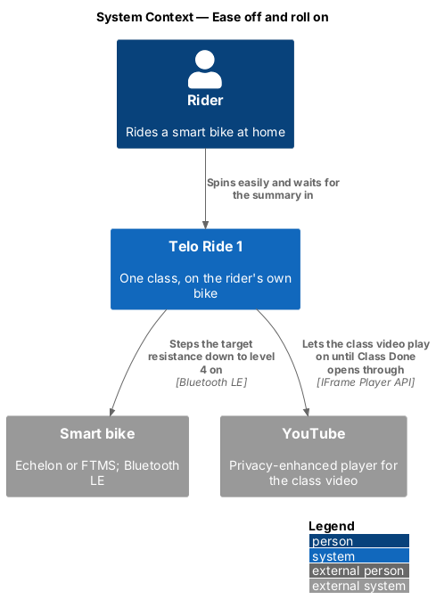
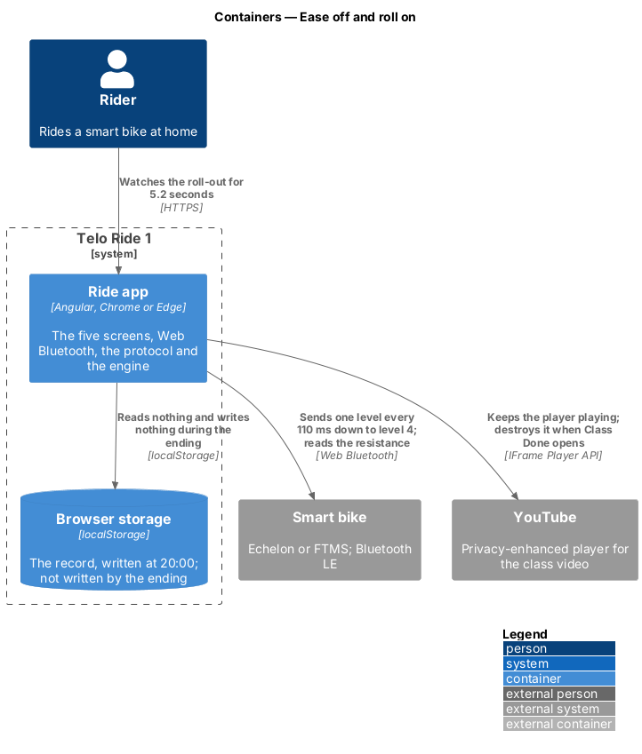
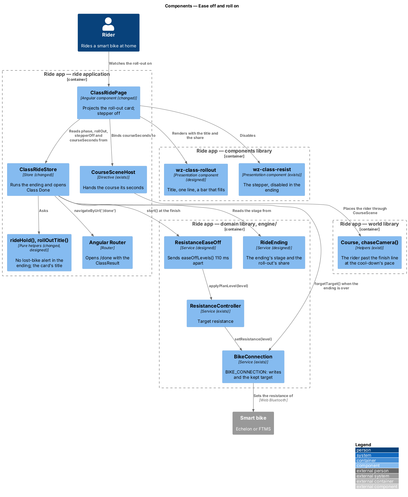
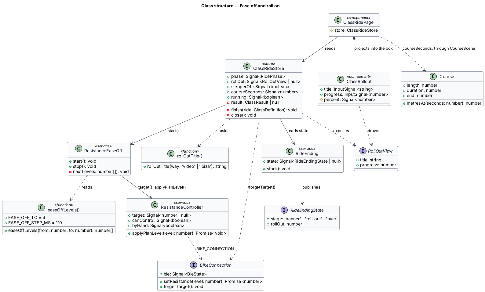
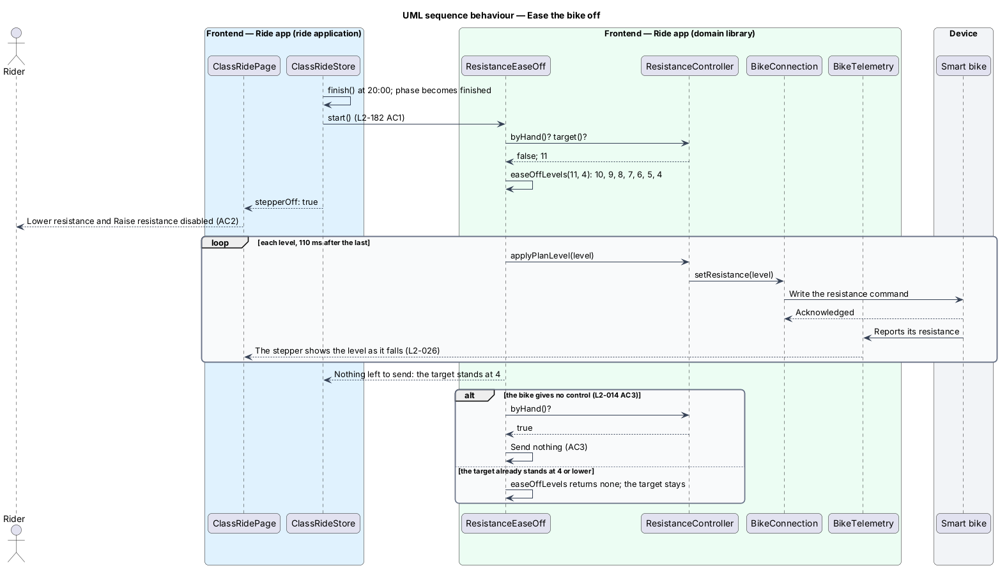
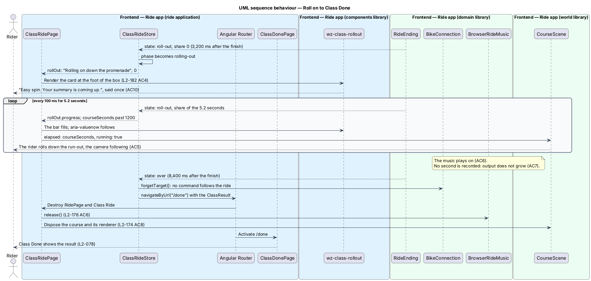
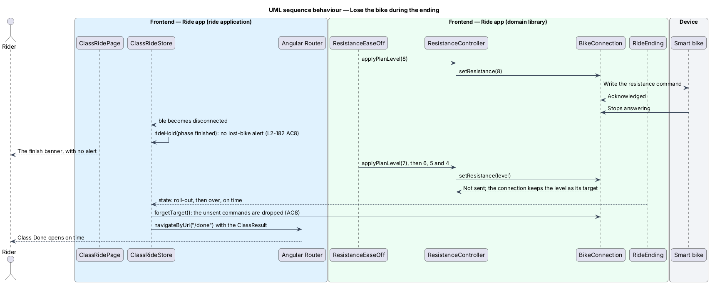

# Ease off and roll on

## Overview

Telo Ride 1 has one class, Intervals to the Beat, and five screens. A ride is finished when its
clock reaches 20:00, and a finish banner shows for 3.2 seconds. A ride shaped like a race for
one (ADR 0049) does not then drop the rider onto a result with the bike still set for the
cool-down. The bike eases off: the target resistance steps down one level at a time to level 4.
After the banner comes the roll-out, 5.2 seconds in which the video or the course carries on
under a card that says the summary is coming. Then Class Done opens on its own.

The roll-out asks nothing of the rider and counts nothing: the ride ended at 20:00, and what the
rider pedals after it adds no output. Nothing of it is built: slices 39.3 and 39.4 of journey 39
build it, after the countdown and the finish banner.

Local terms:

- **easing off**: target resistance stepping down one level every 110 ms to level 4
- **roll-out**: the 5.2 seconds between the finish banner and Class Done
- **ending**: the 8.4 seconds after the finish: 3.2 of finish banner, then 5.2 of roll-out
- **roll-out card**: card at the foot of the box with a title, one line and a bar that fills
- **run-out**: the 200 m of straight road past the course's finish line
- **ride phase**: stage a ride is in: `waiting`, `countdown`, `riding`, `finished` or `rolling-out`
- **box**: the video's box on the stage, which the course takes in a ride in Ibiza

Neighbouring features own the adjacent concerns:

- The finish at 20:00, the record written before the banner, the banner itself and the timing
  service `RideEnding` (`L2-181`) belong to
  [show the finish banner](../show-the-finish-banner/README.md).
- What is released when Class Ride closes (`L2-093` AC3) belongs to
  [pause, leave or finish the class](../pause-leave-or-finish-the-class/README.md).
- Sending a target resistance, the stepper and the bike that gives no control (`L2-025` to
  `L2-028`, `L2-014` AC3) belong to [control resistance](../../bike/control-resistance/README.md)
  and [connect a bike](../../bike/connect-a-bike/README.md).
- The course's run-out and the chase camera (`L2-174` AC7, AC10) belong to
  [ride in Ibiza](../ride-in-ibiza/README.md); the music that plays on (`L2-176`) to
  [play the music](../play-the-music/README.md).
- Class Done (`L2-078`) belongs to [show Class Done](../../class-done/show-class-done/README.md).
- The clock in a hidden tab (`L2-133`) belongs to
  [keep the ride clock true](../../performance/keep-the-ride-clock-true/README.md).

## Description

The slice lives in the Ride app: the ending's orchestration in the `ride` application, the
easing-off rule in `domain`'s `engine/`, the card in `components`, and the rider's place past
the finish line in `world`. The mocks are `docs/mocks/pages/class-ride/rolling-on.html` (with
the class video) and `rolling-on-ibiza.html`; `finish.html` and `finish-ibiza.html` show the
stepper off while the banner is up. Each part below is marked as existing or as designed; none
of the designed parts is built.

### Easing off

- **`easeOffLevels(from, to)`** (designed, `domain/src/engine/ease-off.ts`, with unit tests). A
  pure function that returns the levels to send, one below the other: from 11 to 4 it returns
  10, 9, 8, 7, 6, 5 and 4; from 4 or lower it returns none (`L2-182` AC1). `EASE_OFF_TO` (4)
  and `EASE_OFF_STEP_MS` (110) are its named constants. Both are the prototype's values and
  have not been tried on a bike; whether a bike's motor follows seven commands in under a
  second is open (open question 42).
- **`ResistanceEaseOff`** (designed, same file). An injectable provided by `RidePage` with the
  ride's other services. `start()` reads `ResistanceController.target()`, takes the levels from
  `easeOffLevels` and sends them one at a time through `ResistanceController.applyPlanLevel`,
  each 110 ms after the last by `setTimeout`. It sends nothing when
  `ResistanceController.byHand()` is true: a bike that gives no control gets no command, and the
  roll-out is otherwise the same (AC3). Destroying its owner clears the pending timer.
- **Where it starts.** `ClassRideStore.finish()` calls `ResistanceEaseOff.start()` as it sets
  the phase to `finished`, so the levels fall while the finish banner shows (AC1).
  `wz-class-resist` goes on reading `BikeTelemetry.resistance`, the level the bike reports, so
  the stepper shows the resistance as it falls (`L2-026`).
- **An FTMS bike.** `applyPlanLevel` sends through `BIKE_CONNECTION.setResistance`, which maps
  a level of 1 to 32 onto an FTMS bike's own range (`L2-014` AC4). Level 4 needs no rule of its
  own.
- **The stepper.** `ClassRideStore.stepperOff` (designed) is true when the bike cannot be
  controlled or the phase is `finished` or `rolling-out`. `ClassRidePage` binds it to
  `wz-class-resist`'s `disabled`, so **Lower resistance** and **Raise resistance** are disabled
  until Class Done opens (AC2).
- **A bike set by hand.** The mocks are `class-ride/finish-by-hand` and `rolling-on-by-hand`: the
  banner and the card as on any bike, the stepper reading "—" with both buttons disabled, and the
  by-hand notice still under the bike panel until Class Done opens.

### The roll-out

- **`RideEnding`** (designed in [show the finish banner](../show-the-finish-banner/README.md),
  `domain/src/engine/ride-ending.ts`). Its `state` gives the stage and `rollOut`, the share of
  the 5.2 seconds that has passed. During the roll-out it wakes every 100 ms to publish the
  share, 52 times in all, and at 8,400 ms the stage is `over`.
- **`wz-class-rollout`** (designed, `components/src/class-ride/class-rollout.ts`, `.html`,
  `.scss`; block `class-rollout` as in the design system). A presentation component with two
  inputs, `title` and `progress` (0 to 1). It draws the title (`class-rollout__title`), the
  line "Easy spin. Your summary is coming up." (`class-rollout__body`, `role="status"`, so a
  screen reader hears it once, AC10) and the bar (`class-rollout__bar`, `role="progressbar"`,
  `aria-label="Class Done opens in a moment"`, `aria-valuemin="0"`, `aria-valuemax="100"`,
  `aria-valuenow` in whole percent) whose fill takes its width from the `--value` custom
  property (AC4). The card slides up as it enters (`class-rollout-in`); under
  `prefers-reduced-motion: reduce` it appears with no animation, and the bar still fills,
  because it shows time passing (AC11).
- **`rollOutTitle(way)`** (designed, pure, `ride/src/app/class-ride/ride-hold.ts`, beside
  `lostBikeMessage`). It returns "Rolling on down the promenade" in Ibiza and "Rolling on" with
  the class video (AC4).
- **`ClassRidePage`** (changed, `class-ride-page.html`). While the phase is `rolling-out` the
  template projects `wz-class-rollout` into the `overlay` slot of `wz-class-video` or
  `wz-class-course`, the slot the countdown and the finish banner use. The header shows Full
  screen only, as it does under the banner (`L2-181` AC5); there is no button that opens Class
  Done sooner (open question 46).

### Class Done opens on its own

- **`ClassRideStore.close()`** (designed, private). An effect calls it when the ending's stage
  becomes `over`. It calls `BIKE_CONNECTION.forgetTarget()`, `RIDE_ACTIVITY.end()` and
  `router.navigateByUrl('/done', { state: { classResult } })` with the result `finish()` kept.
  The navigation destroys `RidePage`, whose `DestroyRef` callbacks destroy the player, release
  the music and the wake lock, and dispose the course (AC6, `L2-088` AC6, `L2-176` AC6,
  `L2-174` AC8). These are the steps `finish()` ran at 20:00 as built.
- **The video and the music play on.** `finish()` no longer pauses the player or releases the
  music, and the music's effect counts the ending as running, so both carry on until `close()`
  (AC6).
- **Output does not grow.** `RideTicker` stopped at 20:00, so `RideRecorder.record` and
  `EffortTally.add` are not called again, and the `ClassResult` was built before the banner
  showed (AC7, `L2-023` AC4).
- **A hidden tab.** `RideEnding` reads its state from `MONOTONIC_TIME`, by timer and again on
  `visibilitychange`. A tab hidden through the ending reaches `over` on the browser's throttled
  timer or, at the latest, when it shows, and Class Done is open then (AC9, `L2-133`).
- **A lost bike.** `rideHold` gains the phase and returns no lost-bike alert in `finished` and
  `rolling-out`, and `followBike()` returns at once in those phases, so nothing holds the
  ending and Class Done opens on time (AC8). A level `ResistanceController` could not send is
  kept by the connection as the target for a reconnect; `close()` forgets it, so no command
  follows the ride (`L2-093` AC3).

### Rolling on past the finish line

- **`ClassRideStore.courseSeconds`** (designed). The seconds that place the rider on the
  course: `elapsed` while the ride runs, and in `finished` and `rolling-out` the class length
  plus the whole seconds of the ending. `ClassRidePage` binds it to `CourseSceneHost`'s
  `elapsed`, and binds `running` to true through the ending.
- **`Course.metresAt(seconds)`** (exists, `world/src/course.ts`). Past the plan's length it
  already carries the rider on at the last stage's pace, the cool-down's, clamped to the last
  metre of road. `SceneDriver` (exists) advances the frame's time between whole seconds, so the
  rider rolls smoothly. At that pace the 8.4 seconds are under 60 m of the 200 m run-out, so
  the clamp is never reached (AC5).
- **The camera.** `chaseCamera(metres, finish)` (exists, `world/src/chase-camera.ts`) depends on
  the metres ridden alone. It stays close on the finish line and eases out over the 70 m after
  it, as on the road (`L2-174` AC10). The roll-out needs no camera of its own.

## Requirements

| L2 ID | Refines (L1) | Requirement |
|-------|--------------|-------------|
| `L2-182` | `L1-015` | When the ride is finished and the finish banner shows, the target resistance shall step down one level at a time, 110 ms apart, from the level it stands at to level 4, and shall stay where it is if it is already at 4 or lower. The stepper shall show the resistance the bike reports as it falls, and **Lower resistance** and **Raise resistance** shall be disabled until Class Done opens. For a bike that gives no control of its resistance, no command shall be sent and the roll-out shall be otherwise the same. When the finish banner has gone, a card at the foot of the video's or the course's box shall read "Rolling on down the promenade" in Ibiza or "Rolling on" with the class video, then "Easy spin. Your summary is coming up." and a bar that fills over the 5.2 seconds (`role="progressbar"`, "Class Done opens in a moment"); when it is full, Class Done shall open. In Ibiza the rider shall roll on past the finish line down the run-out at the cool-down's pace, the camera following as it does on the road, and shall never reach the end of the road. With the class video the video shall play on, and in Ibiza the music shall play on; both shall stop when Class Done opens. Output shall not grow during the roll-out. Where the bike is lost during the finish banner or the roll-out, no alert shall show, Class Done shall open on time, and the commands that could not be sent shall be dropped. Where the tab is hidden during the finish banner or the roll-out, Class Done shall be open when the tab shows again. A screen reader shall hear "Easy spin. Your summary is coming up." once. With reduced motion the card shall appear without sliding, and the bar shall still fill. |

## Diagrams

The context diagram shows what the ending touches outside the app: the rider who watches, the
bike that is eased off, and YouTube, whose player plays on until Class Done opens.

The container diagram shows that the ending writes nothing: the record was written at 20:00,
before the banner. The app's own origin still serves the music and the course it already holds.

The component diagram shows the parts of the slice. `ClassRideStore` starts
`ResistanceEaseOff`, reads `RideEnding`, feeds the course its seconds and opens Class Done;
`ClassRidePage` projects `wz-class-rollout` into the box.

The class diagram shows the pure rule `easeOffLevels`, the service that sends its levels, the
store's new members and the card.

The first sequence follows the bike easing off from level 11 to level 4 while the finish banner
shows, seven commands 110 ms apart.

The second sequence follows the roll-out in Ibiza: the card and its bar, the rider rolling down
the run-out, and Class Done opening when the bar is full.

The third sequence shows the bike lost while it eases off: no alert shows, the unsent commands
are dropped, and Class Done opens on time.

