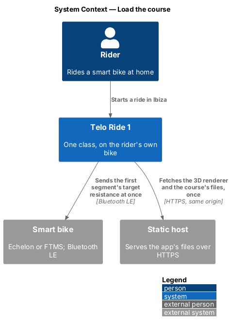
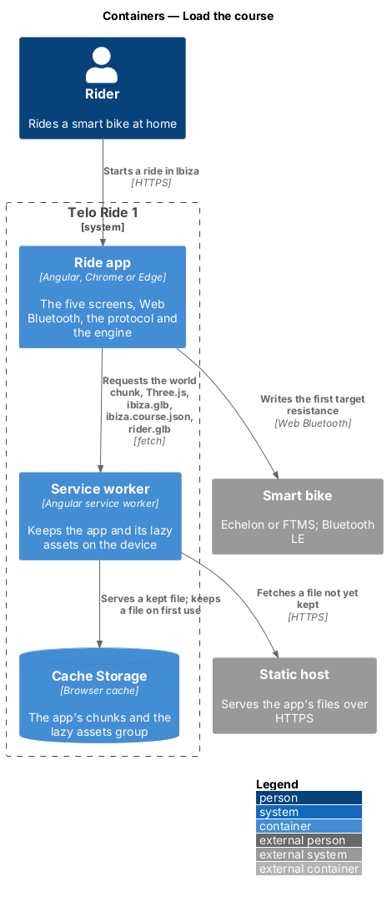
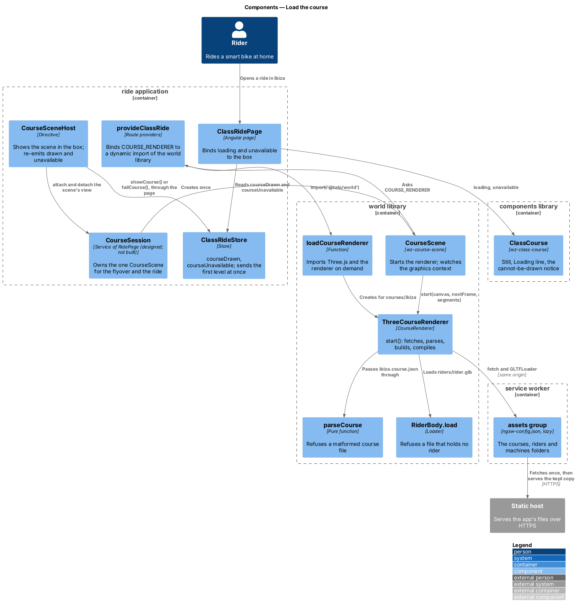
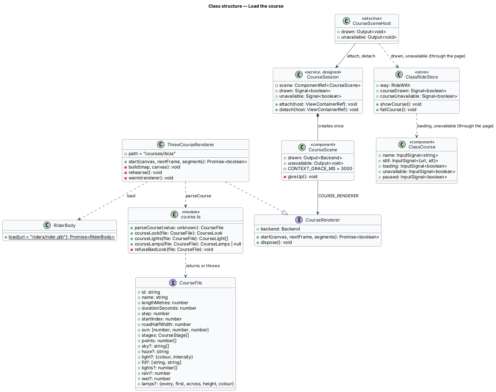
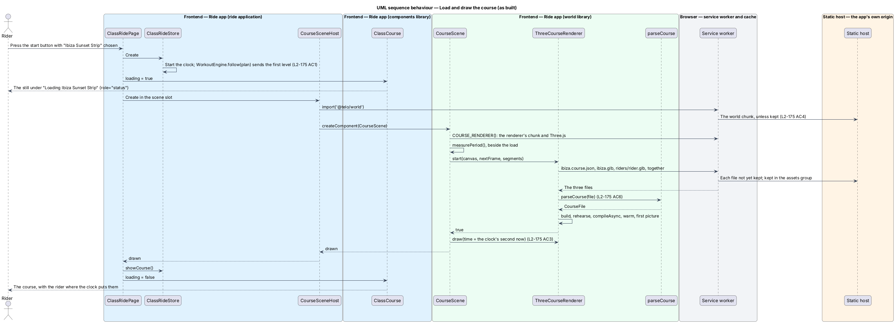
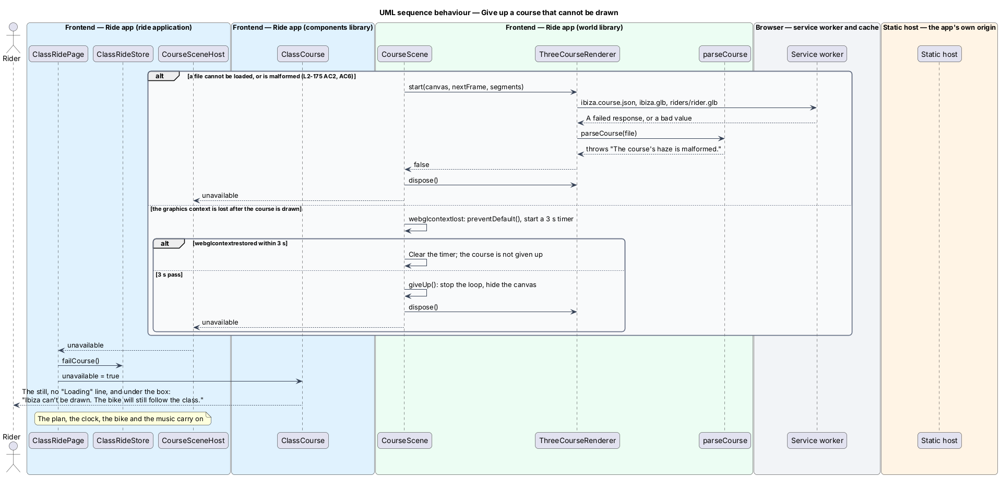
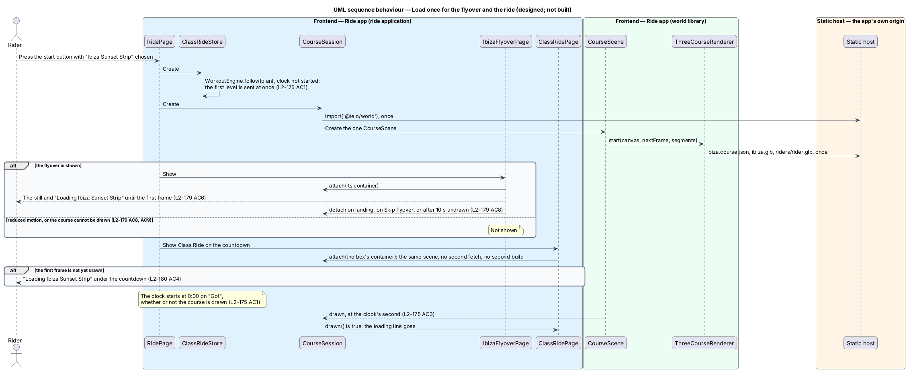

# Load the course

## Overview

A ride in Ibiza draws Ibiza Sunset Strip, the only course, in the box of Class Ride. The course is
not part of the app's first download: the 3D renderer, the map, the road's centre line and the
rider's figure are fetched from the app's own origin when a ride in Ibiza starts, and never before.
A rider who rides with the class video never fetches them.

This feature covers that load and what the rider sees of it: what is fetched and when, the line
"Loading Ibiza Sunset Strip" over the course's still, a course that arrives after the ride has
started, a course that cannot be drawn, a graphics context that is lost, files that are malformed,
and the copy kept on the device so that a second ride downloads nothing and a ride with no network
still has its course. The ride never waits for the course: the bike is sent its first target
resistance at once and the clock starts on time.

Slices 37.1, 37.3 and 37.4 built the feature for a ride that starts the moment Class Ride opens
(ADR 0047). ADR 0049 then amended `L2-175` AC1: the course loads while the rider watches Ibiza
Flyover and the countdown, it is fetched once for the flyover and the ride together, and the clock
starts on "Go!". That amendment is designed and not built (journey 39). The Description states what
exists first and then what the amendment changes.

Local terms:

- **course's files**: `courses/ibiza.glb` (the map), `courses/ibiza.course.json` (the centre line
  and the plan's stages) and `riders/rider.glb` (the rider's figure)
- **still**: `courses/ibiza-sunset-strip.jpg`, picture of the course that stands in the box until
  the course is drawn
- **first frame**: first frame of the ride that the renderer draws, which shows the canvas
- **malformed**: of a course file, holding a length, a count or a colour that is missing or out of range
- **graphics context**: the canvas's WebGL 2 context, which the browser can take away and give back
- **grace**: 3 seconds a lost graphics context has to come back before the course is given up
- **kept copy**: the course's files in the service worker's cache after their first download
- **box**: the video's box on the stage of Class Ride, which the course takes in a ride in Ibiza

Neighbouring features own the adjacent concerns:

- The picture once it is drawn, the rider's place and disposal belong to
  [ride in Ibiza](../ride-in-ibiza/README.md) (`L2-174`).
- `CourseSession`, the one scene lent to the flyover and to the ride, and the flyover's own loading
  line and 10-second limit belong to
  [fly over the course](../../ibiza-flyover/fly-over-the-course/README.md) (`L2-179`).
- The countdown, under which a course still loading reads "Loading Ibiza Sunset Strip", belongs to
  [count down to the start](../count-down-to-the-start/README.md) (`L2-180`).
- Sending a segment's level belongs to [control resistance](../../bike/control-resistance/README.md)
  (`L2-027`); the start of a ride to [ride the class](../ride-the-class/README.md).
- The music, which carries on when the course cannot be drawn, belongs to
  [play the music](../play-the-music/README.md) (`L2-176`).
- The service worker, the app's cache and a ride that loses its network belong to
  [ride without a network](../../performance/ride-without-a-network/README.md) (`L2-135`); the
  initial bundle's size to
  [meet performance budgets](../../performance/meet-performance-budgets/README.md) (`L2-136`).
- A browser that cannot draw the course at all rides with the class video; that test belongs to
  [show the class](../../the-class/show-the-class/README.md) (`L2-173` AC6).

## Description

The slice lives in the Ride app. The providers, the store and the host directive are in the `ride`
application, the box in `components`, the loader, the renderer and the file's gate in `world`, and
the kept copy in the service worker's configuration.

### What is fetched, and when (as built)

- **`provideClassRide()`** (exists, `ride/src/app/class-ride/provide-class-ride.ts`). It binds
  `COURSE_RENDERER` to `() => import('@telo/world').then((world) => world.loadCourseRenderer())`.
  The token is in `api`; nothing in the initial bundle or in Class Ride's own chunk names Three.js.
- **`CourseSceneHost`** (built by slice 37.1, `ride/src/app/class-ride/course-scene-host.ts`). When
  it is created, which is when Class Ride opens in Ibiza, it imports `@telo/world` and creates
  `CourseScene` with `ViewContainerRef.createComponent`. A dynamic import with `setInput` is used
  rather than `@defer`, whose runtime would enter the initial bundle. A rider who leaves before the
  library has come gets no scene.
- **`loadCourseRenderer()`** (exists, `world/src/course-renderer-loader.ts`). A second dynamic
  import, of `course-renderer.ts`, which brings Three.js in a chunk of its own, and a
  `ThreeCourseRenderer` for the path `courses/ibiza`.
- **`ThreeCourseRenderer.start(canvas, nextFrame, segments)`** (exists,
  `world/src/course-renderer.ts`). It starts a `WebGPURenderer` on the canvas, which draws with
  WebGL 2 where no WebGPU adapter is granted, and then fetches the three files together:
  `courses/ibiza.course.json` with `fetch`, `courses/ibiza.glb` with `GLTFLoader` and the meshopt
  decoder, and `riders/rider.glb` through `RiderBody.load()`. Each path is relative, so each
  request goes to the app's own origin. It then passes the course file through `parseCourse`,
  builds the scene, compiles its programs, sends each chunk of the map to the GPU once (`warm`),
  draws a first picture and resolves `true`. Any failure on the way is caught and resolves `false`.
- **`CourseScene`** (exists, `world/src/course-scene.ts`). In `ngAfterViewInit` it asks
  `COURSE_RENDERER` for the renderer and, beside it, measures the display's frame period before
  the scene's own work can slow it. It then calls `start`.
- **The Class fetches none of it.** The Class shows the still only. The spec `class-ride-ibiza`
  asserts that The Class requests none of the course's files and no 3D code with "Ibiza Sunset
  Strip" chosen (`L2-136` AC1).

### The loading line and the first frame (as built)

- **`ClassRideStore`** (exists). `courseDrawn` is false until `showCourse()`; `courseUnavailable`
  is false until `failCourse()`. The store starts the clock, the ticker and
  `WorkoutEngine.follow(plan)` when it is created, so the first segment's target resistance is
  sent while the course loads (`L2-175` AC1 as first written).
- **`ClassCourse`** (exists, `components/src/class-ride/class-course.ts`, `wz-class-course`).
  Inputs `name`, `still`, `loading` and `unavailable`. While `loading` or `unavailable` it draws
  `` over the scene's slot. While `loading` and not `unavailable`
  it draws `
Loading Ibiza Sunset Strip
` centred
  on a scrim (mock `class-ride/ibiza-loading`). Both leave the DOM once the course is drawn.
- **The first frame** (`L2-175` AC3). `CourseScene` keeps its canvas transparent and `aria-hidden`
  until the first frame of the ride is drawn. `SceneDriver` takes the ride's whole second as it
  stands at that frame, so a course that is ready after the ride has started shows the rider up
  the road and never on the grid. The scene then emits `drawn` once; the host re-emits it and the
  page answers with `ClassRideStore.showCourse()`. The test-only report `firstMetres` records where
  that frame put the rider.

### A course that cannot be drawn

- **A file that cannot be loaded** (built by slice 37.4; `L2-175` AC2). A response that is not OK,
  a network error, or a rider's file without a clip, a `body` or a `body-coarse` makes `start`
  resolve `false`. `CourseScene` disposes the renderer and emits `unavailable` once. A rejected
  import of the library or of the renderer does the same.
- **A lost graphics context** (built by slice 37.4). `CourseScene` listens on the canvas for
  `webglcontextlost` and `webglcontextrestored`. A loss is cancelled with `preventDefault()`, so
  the browser may restore the context, and starts a timer of `CONTEXT_GRACE_MS` = 3,000 ms. A
  restore clears the timer and the course is not given up. When the timer fires, `giveUp` stops
  the frame loop, disconnects the `ResizeObserver`, hides the canvas, disposes the renderer and
  emits `unavailable`.
- **A lost WebGPU device** is not watched. Whether it shall give the same notice, and after what
  grace, is `<TO SUPPLY>` (open question 31).
- **The notice.** `CourseSceneHost` re-emits `unavailable`, the page calls
  `ClassRideStore.failCourse()` and `wz-class-course` takes `unavailable`: the still stays or
  returns, the loading line goes, and `wz-inline-message` (`class-course__notice`, tone `warn`,
  `role="status"`) reads "Ibiza can’t be drawn. The bike will still follow the class." under the box
  (mock `class-ride/ibiza-unavailable`). The plan, the clock, the bike and the music do not depend
  on the scene and carry on. The course is given up for the rest of that ride; the next ride tries
  again.

### Malformed files

- **`parseCourse(value)`** (built by slice 37.3, `world/src/course.ts`, with unit tests). The gate
  the course file passes before anything is drawn from it (`L2-175` AC6). It throws when the value
  is not an object or names no course; when `lengthMetres`, `durationSeconds`, `step`,
  `startIndex` or `roadHalfWidth` is not a number at or above zero, or the step or the length is
  zero; when the centre line is not a list of numbers in threes or ends before the finish; when
  the sun has no direction; and when a stage is malformed. The stages shall lie end to end: each
  starts where the one before ends, within 0.5 s and 0.5 m, the first at the grid and the last at
  the course's length, adding up to its seconds, each with a level from 1 to 32, a duration and a
  cadence aim above zero and a kind the plan knows.
- **`refuseBadLook(file)`** (same file). What a file names of how the course looks shall be what
  it says: a sky of at least 2 `#rrggbb` colours, a haze that is a colour, a fill of exactly 2
  colours, a light with a colour and an intensity at or above zero, a rain and a wet from 0 to 1,
  lamps with positive spacing and height and a colour, and lights in fives with a whole colour and
  positive reach and strength. What a file leaves out is Ibiza's sunset (`courseLook`), as the
  shipped file's lamps, rain and wet are. A value named wrongly is never drawn.
- **The map and the rider.** `GLTFLoader` rejects a `.glb` it cannot read, and `RiderBody.load`
  refuses a file that is not the rider's. A mesh of the map whose group has no material is not
  drawn.

### The kept copy

- **`ngsw-config.json`** (exists, `frontend/projects/ride/ngsw-config.json`). The lazy asset group
  `assets` lists `/courses/**`, `/riders/**` and `/machines/**` with `installMode: lazy` and
  `updateMode: prefetch`. The service worker keeps each file the first time the page asks for it
  and serves the kept copy after, so a second ride in Ibiza downloads none of the three files
  (`L2-175` AC4) and rides with no network (`L2-175` AC5, `L2-135` AC1). A new version of the app
  brings a changed file with it. The spec `class-ride-ibiza-kept` rides once, goes offline and
  asserts that all three files of the second ride come from the service worker.
- **The code.** The `world` chunks are `/*.js` files of the `app` group, which the service worker
  prefetches when it installs. The page itself requests them only when a ride in Ibiza starts.
- **After the load.** A course already drawn holds everything it needs in memory and on the GPU,
  so a network lost during the ride changes nothing of it.

### What ADR 0049 changes (designed; not built)

- **When the fetch happens.** `RidePage` (`wz-ride-page`, the component of the `/ride` route)
  provides `CourseSession` (`ride/src/app/class-ride/course-session.ts`). When a ride in Ibiza
  starts, `CourseSession` is created, imports `@telo/world` once and creates the one `CourseScene`,
  whose renderer fetches the course's files once. That moment is when Ibiza Flyover opens, or when
  Class Ride opens if the flyover is not shown (`L2-179` AC8, AC9). `CourseSceneHost` no longer
  imports the library or creates the scene: it calls `CourseSession.attach` with its own
  `ViewContainerRef` when it is created and `detach` when it is destroyed. The flyover and the
  ride therefore share one renderer, one canvas and one download (`L2-175` AC1). With the class
  video `CourseSession` does nothing, so nothing of the course is fetched.
- **The first target resistance.** `ClassRideStore`, now provided by `RidePage`, calls
  `WorkoutEngine.follow(plan)` when it is created, with the clock not started. The first segment's
  level is sent at that moment, during the flyover.
- **The clock.** The ride clock starts at 0:00 on "Go!", whether or not the course is drawn by
  then. Neither the flyover nor the countdown waits for the course beyond the flyover's own
  10-second limit (`L2-179` AC8).
- **The loading line on Class Ride.** `ClassCourse` is unchanged. `CourseSession` exposes `drawn`
  and `unavailable` as signals, and the box's `loading` and `unavailable` shall follow them. A
  course still loading when Class Ride opens reads "Loading Ibiza Sunset Strip" under the countdown
  (`L2-180` AC4). A course drawn during the flyover is already drawn when Class Ride opens, so
  `loading` is false from the first render and no loading line flashes.
- **The first frame.** During the countdown the clock stands at 0, so a course drawn then shows
  the rider on the grid. A course drawn after "Go!" shows the rider where the clock puts them, by
  the same rule of `SceneDriver` (`L2-175` AC3).
- **Failure.** `CourseSession.unavailable` turns true whichever view holds the scene. A course
  given up during the flyover opens Class Ride on the countdown with the still and the notice.

## Requirements

The feature realizes the following level-2 (L2) requirement. It refines the level-1 (L1)
requirement cited beside it.

| L2 ID | Refines (L1) | Requirement |
|-------|--------------|-------------|
| `L2-175` | `L1-028` | When the rider starts a ride in Ibiza and Ibiza Flyover opens (or Class Ride, when the flyover is not shown, `L2-179` AC8 and AC9), the first segment's target resistance shall be sent at once, and the 3D renderer and the course's files (`courses/ibiza.glb`, its centre line, and its rider, `riders/rider.glb`) shall be fetched from the app's own origin at that moment and shall be fetched once for the flyover and the ride together. On Class Ride the box shall read "Loading Ibiza Sunset Strip" (`role="status"`) over the course's still until the first frame is drawn. The clock shall start at 0:00 on "Go!" (`L2-180`), whether or not the course is drawn by then. When the course's files (its rider's among them) cannot be loaded, are malformed, or the graphics context is lost and does not come back, the plan, the clock, the bike and the music shall carry on, the still shall stay in the box, and a notice under it shall say "Ibiza can’t be drawn. The bike will still follow the class."; a context that comes back within 3 seconds shall not be given up. When the course is ready after the ride has started, its first frame shall show the rider where the clock puts them, not at the start line. When the course has been loaded once on the device, its files shall not be downloaded again. When the network is lost after the course has loaded, the course shall still be drawn (`L2-135` AC1). A length, a count or a colour in the course's files that is missing or out of range shall make the course malformed; the course shall not be drawn from a bad value. |

## Diagrams

### System context

Telo Ride 1 fetches the renderer and the course's files from its own static host when a ride in
Ibiza starts, and sends the bike its first target resistance without waiting for them.

### Containers

The Ride app asks for the files through the service worker, which fetches each from the static
host once and serves the kept copy from Cache Storage after.

### Components

`CourseScene` asks `COURSE_RENDERER` for the renderer and starts it; `ThreeCourseRenderer` fetches
the three files and passes the course file through `parseCourse`. The outcome reaches
`ClassRideStore` through `CourseSceneHost` and shows in `ClassCourse`. `CourseSession` is designed
and not built; today `CourseSceneHost` creates the scene itself. The static host stands behind the
service worker's lazy asset group.

### Class structure

`ClassRideStore` holds the two facts the box shows, `courseDrawn` and `courseUnavailable`.
`CourseScene` owns the grace for a lost context. `parseCourse` returns a `CourseFile` or throws.

### Behaviour: load and draw the course (as built)

The ride starts and the first level is sent before anything of the course is requested. The scene
loads the renderer, the renderer fetches and checks the files, and the first frame is drawn at the
clock's second.

### Behaviour: give up a course that cannot be drawn

A file that fails or is malformed, or a graphics context that stays lost for 3 seconds, ends in one
`unavailable`. The still stays under the notice and the ride carries on.

### Behaviour: load once for the flyover and the ride (designed; not built)

`CourseSession` starts the one load when the ride's route opens. Ibiza Flyover attaches the scene
first when it is shown, and Class Ride attaches the same scene after, so nothing is fetched or
built twice.

