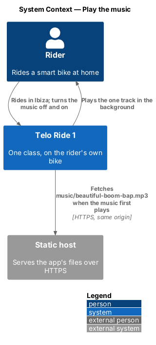
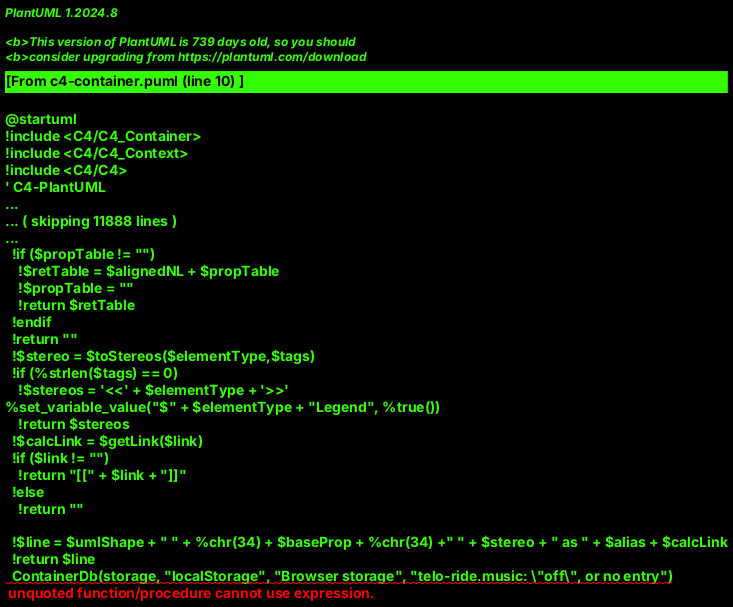
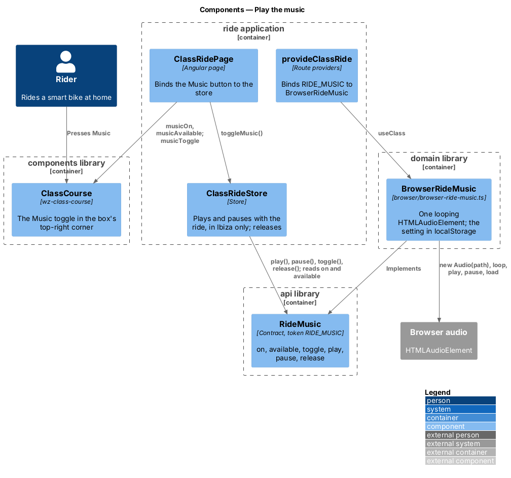
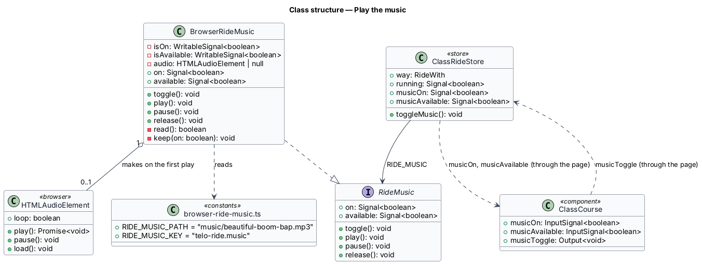
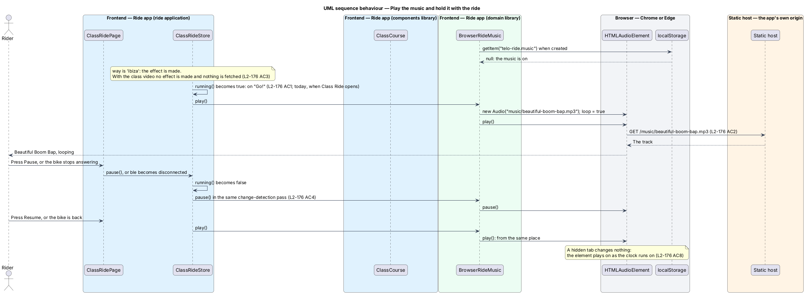
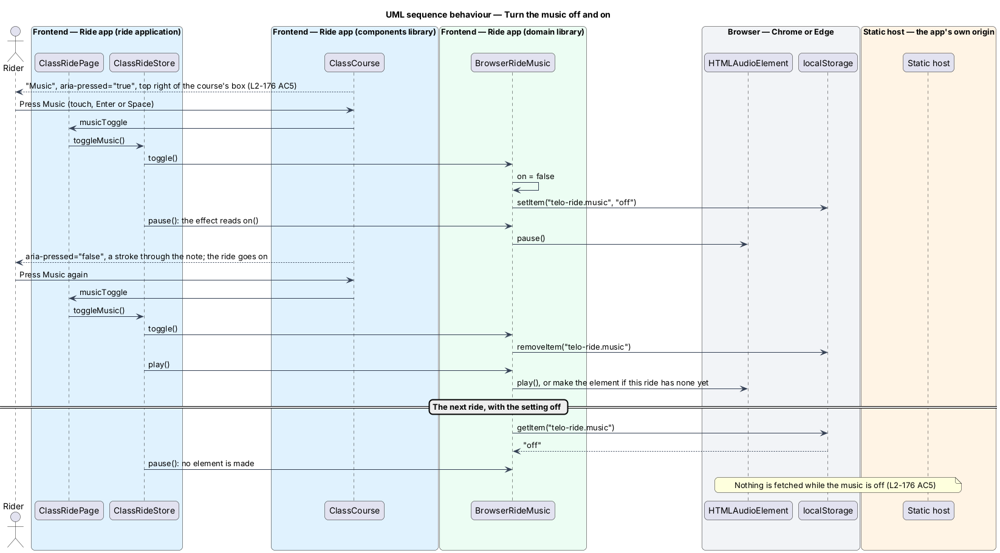
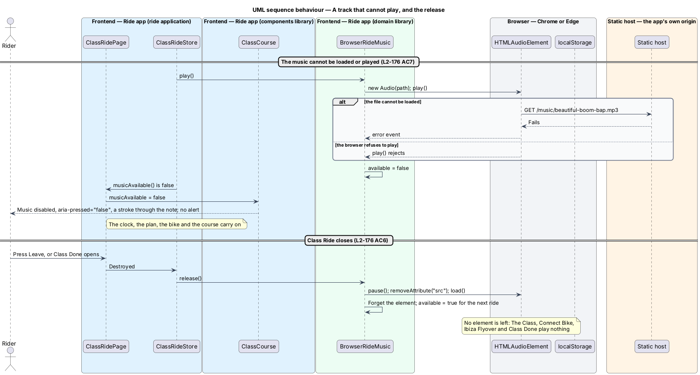

# Play the music

## Overview

A ride with the class video has the video's own sound. A ride in Ibiza has no video, so Telo Ride 1
plays one track in the background of it: *Beautiful Boom Bap* by Music_Unlimited, from Pixabay under
the Pixabay Content License, the music of the marketing film "Meet Telo Ride". It is the only music
the app has. There is no other track, no way to choose one and no synthesised ride sound.

This feature covers that track on Class Ride in Ibiza: when it starts, how it loops, how it holds
with the ride, the "Music" button that turns it off and on and keeps the choice on the device, what
happens when the track cannot be loaded or played, and its release when Class Ride closes. The
track is served by the app's own origin and is fetched only when it first plays.

Slices 37.5 and 37.6 built the feature for a ride that starts the moment Class Ride opens. ADR 0049
then amended `L2-176` AC1 and AC6: the music starts on "Go!", stays silent through the flyover and
the countdown, and plays on through the finish banner and the roll-out until Class Done opens. That
amendment is designed and not built (journey 39). The Description states what exists first and then
what the amendment changes.

Local terms:

- **track**: the one file `music/beautiful-boom-bap.mp3`, 2:04 long at 93 BPM, shipped unchanged
- **setting**: whether the rider wants the music, kept on the device; on until the rider turns it off
- **Music button**: toggle in the top-right corner of the course's box that turns the music off and on
- **unavailable**: of the music, unable to play in this ride because the track did not load or the
  browser refused to play it
- **release**: stopping the track and letting go of its audio element and its buffers
- **held**: of a ride, paused by the rider or waiting for a lost bike

Neighbouring features own the adjacent concerns:

- The course in the box belongs to [ride in Ibiza](../ride-in-ibiza/README.md) (`L2-174`); its load,
  which the music does not wait for, to [load the course](../load-the-course/README.md) (`L2-175`).
- The size of the track's file belongs to
  [draw the course on a low-power tablet](../../performance/draw-the-course-on-a-low-power-tablet/README.md)
  (`L2-177` AC2).
- "Go!", on which the music starts, belongs to
  [count down to the start](../count-down-to-the-start/README.md) (`L2-180`); the silent flyover to
  [fly over the course](../../ibiza-flyover/fly-over-the-course/README.md) (`L2-179`).
- The finish banner and the roll-out, through which the music plays on, belong to
  [show the finish banner](../show-the-finish-banner/README.md) (`L2-181`) and
  [ease off and roll on](../ease-off-and-roll-on/README.md) (`L2-182`).
- Pause and Leave belong to
  [pause, leave or finish the class](../pause-leave-or-finish-the-class/README.md) (`L2-091`,
  `L2-093`); the lost bike to [wait for a lost bike](../wait-for-a-lost-bike/README.md) (`L2-092`).
- What the device keeps and sends nowhere belongs to
  [keep data on the device](../../security/keep-data-on-the-device/README.md).
- The ride clock in a hidden tab belongs to
  [keep the ride clock true](../../performance/keep-the-ride-clock-true/README.md) (`L2-133`).

ADR 0050 later replaced the "Music" button with the Sound button and its panel, and made the
music one of four sounds: it plays only while the sound is Music. That is designed in
[choose the sound](../choose-the-sound/README.md); what follows describes the button as slice 37.6
built it.

## Description

The slice lives in the Ride app. The contract and its token are in `api`, the implementation in
`domain`'s `browser/`, the button in `components`, and the rule that ties the music to the ride in
the `ride` application's store. No library is imported for it: the browser's own
`HTMLAudioElement` plays the track.

### The track and its file

- **`music/beautiful-boom-bap.mp3`** (exists, `frontend/projects/ride/public/music/`). The file of
  `docs/videos/assets/music/beautiful-boom-bap.mp3`, byte for byte: 3,964,760 bytes. Its source and
  licence are recorded in `docs/videos/assets/music/CREDITS.md`. The path is relative, so the
  request goes to the app's own origin, and the Content Security Policy's `media-src 'self'`
  refuses any other. Nothing is fetched from Pixabay (`L2-176` AC2).
- **The static host** (`frontend/projects/ride/public/staticwebapp.config.json`). `/music/*` is
  excluded from the navigation fallback, so a missing track answers as a missing file and not as
  the app's page.
- **The service worker** keeps no copy: `ngsw-config.json` lists `/courses/**`, `/riders/**` and
  `/machines/**` in its lazy group and not `/music/**`. A ride in Ibiza started with no network
  therefore has its course and no music, and the Music button is disabled as for any track that
  cannot be loaded (`L2-176` AC7). No requirement asks for the track with no network.

### The contract and its implementation

- **`RideMusic`** and **`RIDE_MUSIC`** (built by slice 37.5, `api/src/screen/ride-music.ts`). The
  contract: the signals `on` and `available`, and `toggle()`, `play()`, `pause()` and `release()`.
- **`BrowserRideMusic`** (built by slices 37.5 and 37.6,
  `domain/src/browser/browser-ride-music.ts`). `provideClassRide()` binds it to `RIDE_MUSIC` on the
  class ride route, so its code loads with Class Ride and not with the initial bundle.
  - `on` starts from `localStorage`: the key `telo-ride.music` (`RIDE_MUSIC_KEY`) holding `"off"`
    means off, and anything else, or a storage that cannot be read, means on.
  - `play()` returns at once while the music is off or unavailable. Otherwise the first call makes
    one `Audio` element for `RIDE_MUSIC_PATH` with `loop = true`, which is when the browser
    fetches the track, and each call calls the element's `play()`, which carries on from where the
    element stands.
  - `pause()` pauses the element, if there is one.
  - `toggle()` flips `on` and keeps it: `"off"` is written, and the entry is removed for on. A
    storage that refuses the write is ignored, and the setting then lasts for the visit.
  - `available` goes false when the element raises `error` or its `play()` rejects.
  - `release()` pauses the element, removes its `src`, calls `load()` so the browser drops the
    buffered track, and forgets the element. It sets `available` true again, so the next ride tries
    the track afresh.
- **The loop** (`L2-176` AC1). The element's own `loop` restarts the unchanged file. Chromium plays
  an MP3 that carries its encoder delay without a gap. Whether a gap or a click is heard on the
  reference tablet is `<TO SUPPLY>` (open question 32); the stated answer, if one is heard, is a
  second element started a little before the first ends, not a decoded buffer.

### The music and the ride (as built)

- **`ClassRideStore`** (exists, `ride/src/app/class-ride/class-ride-store.ts`). When `way` is
  `'ibiza'` its constructor makes one `effect`:
  `running() && music.on() ? music.play() : music.pause()`. With the class video no effect is made,
  so no element is made and nothing is fetched (`L2-176` AC3; open question 12 asks whether that
  shall change).
- **Held with the ride** (`L2-176` AC4). `running` is false while the rider has paused or
  `BIKE_CONNECTION.ble()` is `disconnected`. The effect runs in the change-detection pass that
  follows the press or the drop, so the element pauses well inside 100 ms; the spec
  `class-ride-ibiza-music` measures the time from the click to the element's `pause()`. Resume, or
  the bike's return, calls `play()` and the track carries on from the same place.
- **A hidden tab** (`L2-176` AC8). Nothing listens for visibility. The element plays on as the ride
  clock runs on.
- **Release** (`L2-176` AC6). The store calls `music.release()` in `finish()`, at 20:00, and in its
  destroy callback, when the rider leaves. `BrowserRideMusic` is bound on the route, whose injector
  outlives the page, so the release is explicit. The Class, Connect Bike and Class Done never call
  `play()`.
- **No synthesised sound** (`L2-176` AC9). The app creates no `AudioContext`; the spec
  `no-ride-sound` asserts it.

### The Music button

- **`ClassCourse`** (exists, `components/src/class-ride/class-course.ts`, `wz-class-course`).
  Inputs `musicOn` and `musicAvailable`, output `musicToggle`. The button (`class-course__music`, a
  raised `wz-button`) sits `space-3` from the top and the right of the box, above the scene and
  below the "Paused" overlay, and is never under 44 px tall. It reads "Music" beside a note icon.
  `aria-pressed` is true while the music is on and available. A stroke crosses the note while it
  is off or unavailable, so colour is not the only carrier. The button is `disabled` when the
  music is unavailable, and no alert or notice is raised (`L2-176` AC5, AC7; mocks
  `class-ride/ibiza`, `ibiza-music-off` and `ibiza-music-unavailable`).
- **`ClassRidePage`** (exists). It binds `store.musicOn()`, `store.musicAvailable()` and
  `(musicToggle)="store.toggleMusic()"`.
- **Turning it off and on.** `toggleMusic()` calls `RideMusic.toggle()`. The store's effect reads
  `on`, so the track pauses or plays without touching the clock, the plan or the bike. A ride that
  starts with the music off makes no element and fetches nothing until the rider turns it on.

### What ADR 0049 changes (designed; not built)

- **The music starts on "Go!"** (`L2-176` AC1). `ClassRideStore` is provided by `RidePage` and
  holds `phase: 'waiting' | 'countdown' | 'riding' | 'finished' | 'rolling-out'`. The music's
  condition is false in `waiting` and `countdown`, so the flyover and the countdown are silent and
  the track is not fetched before "Go!". Whether the track shall start with the flyover instead is
  `<TO SUPPLY>` (open question 41).
- **The music plays on after 20:00** (`L2-176` AC1, `L2-182` AC6). The music's condition stays
  true through `finished` and `rolling-out`. `finish()` no longer calls `music.release()`.
- **The music stops when Class Done opens** (`L2-176` AC6). The release moves to the moment Class
  Ride closes: when the roll-out ends and Class Done opens, and when the rider leaves. Because the
  store then outlives `ClassRidePage`, the release shall be tied to the end of the ride's route
  and not to the page alone.
- **Held before the finish only.** A pause or a lost bike holds the music in `riding`. After the
  finish there is no Pause, and a lost bike raises no alert (`L2-182` AC8); the music plays on.
- **The Music button** is unchanged. During the countdown it shows the setting and may be toggled;
  nothing plays or is fetched until "Go!".

## Requirements

The feature realizes the following level-2 (L2) requirement. It refines the level-1 (L1)
requirement cited beside it.

| L2 ID | Refines (L1) | Requirement |
|-------|--------------|-------------|
| `L2-176` | `L1-028` | In a ride in Ibiza, when the ride clock starts on "Go!" (`L2-180` AC2), the music shall play in the background and loop without a gap or a click until Class Ride closes, the roll-out included (`L2-182` AC6); no music shall play during the flyover or the countdown. The music shall be served by the app's own origin, nothing shall be fetched from Pixabay, and it shall be fetched only when a ride in Ibiza starts: never by the initial bundle, The Class or a ride with the class video. In a ride with the class video no music shall play. While the ride is paused or the bike is lost the music shall pause within 100 ms, and it shall carry on from the same place when the ride does. On Class Ride in Ibiza a "Music" toggle button (`aria-pressed`, at least 44 px) in the top-right corner of the course's box shall be on, shall turn the music off and on without stopping the ride, and shall keep its setting on the device for the next ride; while the music is off, nothing shall be fetched. When Class Ride closes, the music shall stop and its audio element and buffers shall be released; no music shall play on The Class, Connect Bike, Ibiza Flyover or Class Done. When the music cannot be loaded or the browser refuses to play it, the ride and the course shall carry on without it, the "Music" button shall be disabled, and no alert shall interrupt the rider. While the tab is hidden and the ride clock runs on (`L2-133`), the music shall play on with it. This shall be the only music the app has: no other track, no way to choose one, and no synthesised ride sound. |

## Diagrams

### System context

The rider hears one track while riding in Ibiza. Telo Ride 1 fetches it from its own static host
the first time it plays.

### Containers

The Ride app drives one browser audio element, which streams the shipped file, and keeps the
setting in `localStorage`.

### Components

`ClassRideStore` plays and pauses through the `RideMusic` contract, which `BrowserRideMusic`
implements on an `HTMLAudioElement`. `ClassCourse` draws the Music button; the page passes its
press to the store.

### Class structure

`BrowserRideMusic` realizes `RideMusic` and holds at most one audio element. `ClassRideStore`
reads `on` and `available` and passes them to `ClassCourse` through the page.

### Behaviour: play the music and hold it with the ride

The first `play()` makes the element and fetches the track. A pause or a lost bike pauses the
element in the same pass; the ride's return plays it from the same place.

### Behaviour: turn the music off and on

A press flips the setting, keeps it in `localStorage` and pauses or plays the track; the ride goes
on. A later ride with the setting off makes no element and fetches nothing.

### Behaviour: a track that cannot play, and the release

A track that fails to load, or a refused `play()`, disables the Music button with no alert and
leaves the ride running. Closing Class Ride pauses the element, drops its source and forgets it.

