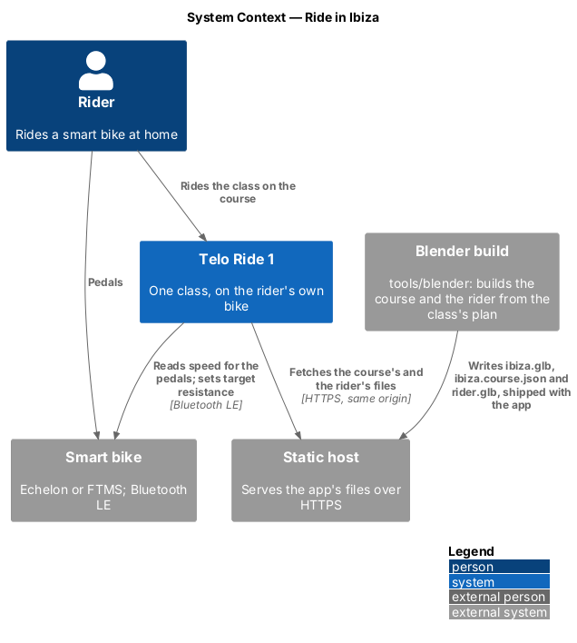
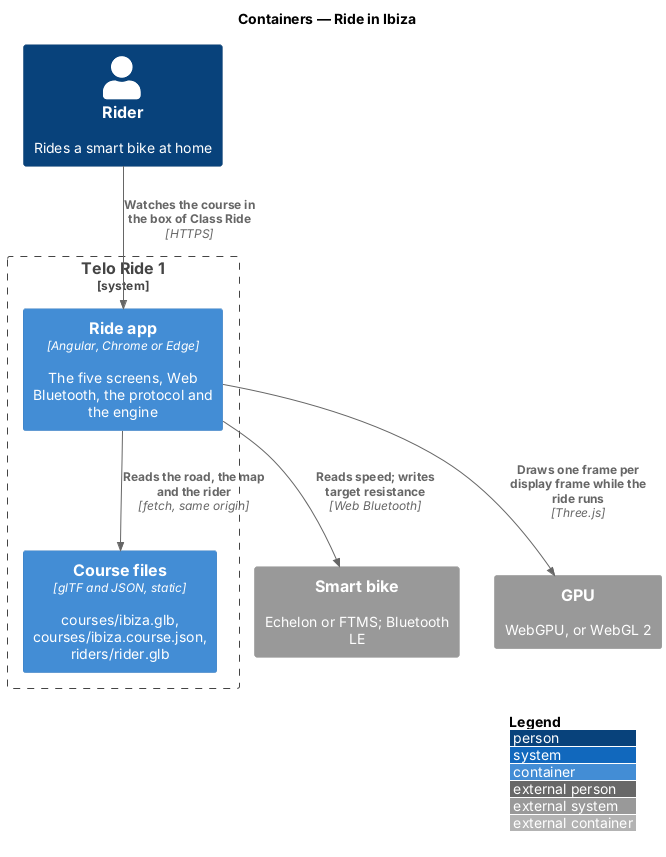
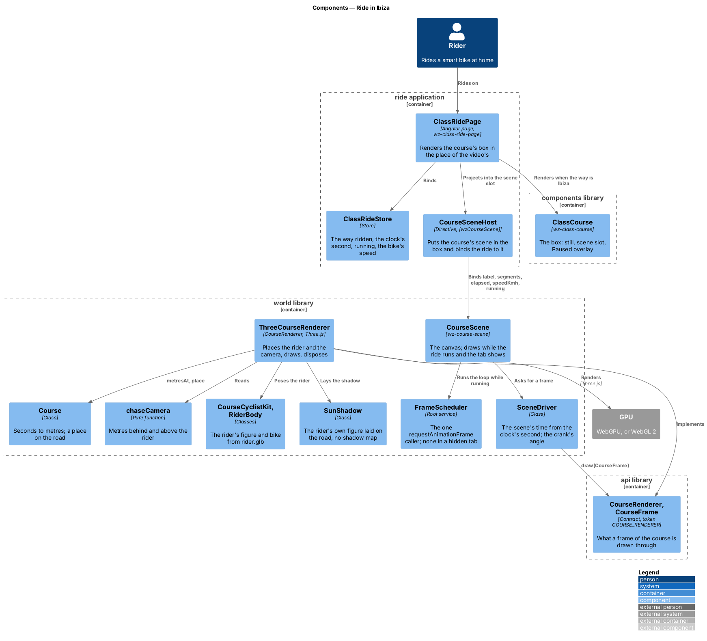
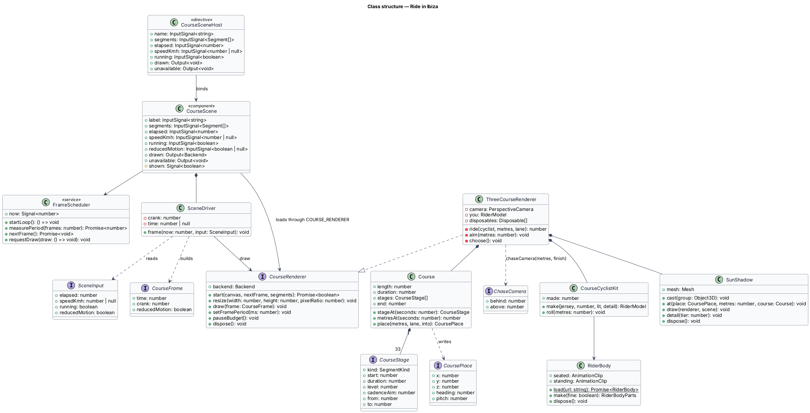
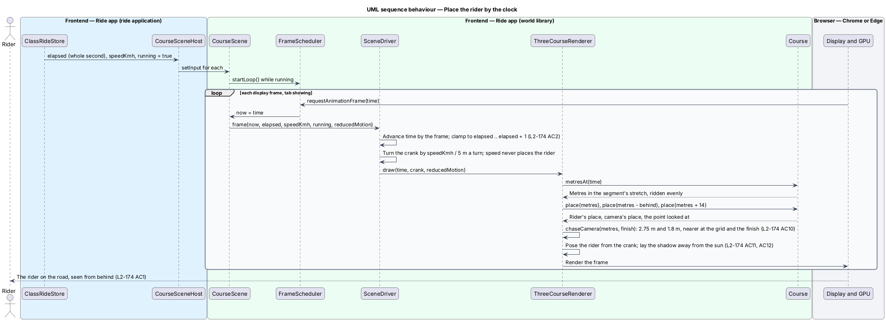
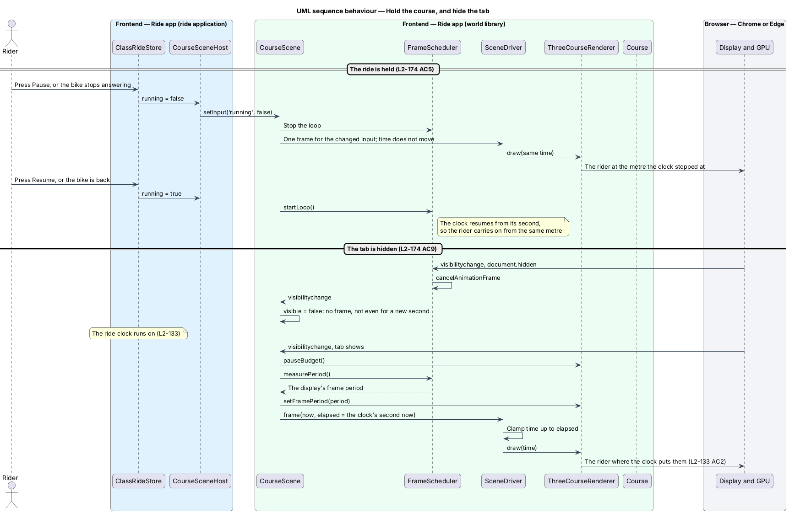
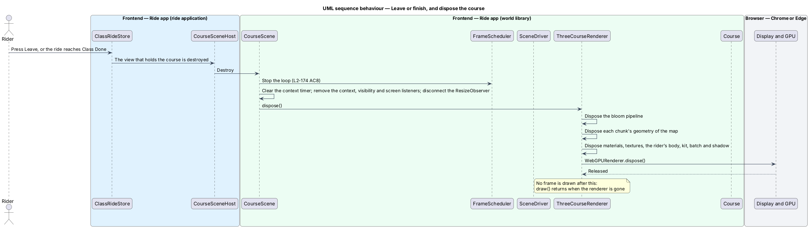

# Ride in Ibiza

## Overview

Telo Ride 1 has one class, Intervals to the Beat, and two ways to ride it: with the class video, or
in Ibiza. A ride in Ibiza draws Ibiza Sunset Strip, the only course, in the box of Class Ride where
the class video would play. The course is a road built in Blender from the class's own plan: 8.4 km
and 159 m of climbing over the class's 20:00. The plan still sets the bike's target resistance; the
course shows the rider where they are in the plan, so each hill arrives as the resistance changes
for it.

This feature covers the picture itself: the course in the box, the rider placed on the road by the
ride clock, the course as it is built, the camera, the rider's figure and shadow, the course held
while the ride is held, a hidden tab that draws nothing, and the release of everything when Class
Ride closes. Everything else on Class Ride is as it is with the class video (`L2-174` AC4).

Slices 37.1, 37.2, 37.3 and 37.8 built the feature as this document describes it. ADR 0049 then gave
the ride its shape: Ibiza Flyover before it, a countdown, a finish banner and a roll-out. Those are
designed and not built (journey 39); what they change here is marked "(designed; not built)".

Local terms:

- **course**: Ibiza Sunset Strip, the road and the map around it, built in Blender from the plan
- **map**: the course's model, `courses/ibiza.glb`: land, sea, buildings and what stands by the road
- **centre line**: the road's middle as points 4 m apart, in `courses/ibiza.course.json`
- **stage**: one segment of the plan as the course file holds it, with the stretch of road it rides
- **stretch**: metres of road from a stage's `from` to its `to`
- **grid**: painted start of the road, metre 0
- **finish line**: chequered line under an arch at the plan's last metre, 8,434.2 m from the grid
- **run-out**: road past the finish line, where the rider rolls on during the roll-out
- **scene's time**: seconds the rider is placed by in one frame, which follows the ride clock's whole second
- **chase camera**: camera behind and above the rider, looking up the road
- **figure**: the rider's body and bike drawn once more, as the sun sees them, to make their shadow
- **box**: the video's box on the stage of Class Ride, which the course takes in a ride in Ibiza

Neighbouring features own the adjacent concerns:

- The screen around the box, the header, the bike panel and the start of a ride belong to
  [ride the class](../ride-the-class/README.md) (`L2-087`, `L2-089`).
- Fetching the course, "Loading Ibiza Sunset Strip", a course that cannot be drawn, malformed files
  and the kept copy belong to [load the course](../load-the-course/README.md) (`L2-175`).
- The music belongs to [play the music](../play-the-music/README.md) (`L2-176`).
- The triangle and draw-call budgets, the five steps of quality and the rider's finenesses belong to
  [draw the course on a low-power tablet](../../performance/draw-the-course-on-a-low-power-tablet/README.md)
  (`L2-177`).
- The course seen from above, and the one scene lent to the flyover and to the ride, belong to
  [fly over the course](../../ibiza-flyover/fly-over-the-course/README.md) (`L2-179`).
- The rider waiting on the grid belongs to [count down to the start](../count-down-to-the-start/README.md)
  (`L2-180`); the banner at 20:00 to [show the finish banner](../show-the-finish-banner/README.md)
  (`L2-181`); rolling on down the run-out to [ease off and roll on](../ease-off-and-roll-on/README.md)
  (`L2-182`).
- Pause, Leave and the finish belong to
  [pause, leave or finish the class](../pause-leave-or-finish-the-class/README.md); the lost bike to
  [wait for a lost bike](../wait-for-a-lost-bike/README.md).
- The choice between the class video and Ibiza belongs to
  [show the class](../../the-class/show-the-class/README.md) (`L2-173`).
- The ride clock in a hidden tab belongs to
  [keep the ride clock true](../../performance/keep-the-ride-clock-true/README.md) (`L2-133`).

## Description

The slice lives in the Ride app. The page, its store and the directive that hosts the scene are in
the `ride` application, the box in `components`, the contract in `api`, and the scene, the renderer
and every rule of the picture in `world`. The `world` library and Three.js are imported dynamically,
so no chunk of a ride with the class video holds them (ADR 0047). The course and the rider are built
by `tools/blender/` and shipped with the app as static files.

### The course in the box

- **`ClassRidePage`** (exists, `ride/src/app/class-ride/class-ride-page.ts`). When
  `ClassRideStore.way` is `'ibiza'` the template renders `wz-class-course` and never
  `wz-class-video`, so no video player is created and nothing is asked of YouTube (`L2-174` AC1).
  The header, the clock, the bike panel, Pause, Leave, the lost-bike alert and the finish are the
  same template and the same store either way, and the output, the efforts and the on-target share
  come from the same `RideRecorder` and `EffortTally` (`L2-174` AC4).
- **`ClassRideStore.way`** (exists). `rideWith(HOW_TO_RIDE.kept(), COURSE_GRAPHICS.available())`: the
  way the rider chose on The Class, or the class video in a browser that cannot draw the course.
- **`ClassCourse`** (exists, `components/src/class-ride/class-course.ts`, `wz-class-course`, block
  `class-course`). The box. Its slot `[slot=scene]` takes the course's canvas; `paused` draws
  "Paused" over the whole box (mock `class-ride/paused-ibiza`). The lost-bike alert of
  `class-ride/disconnected-ibiza` is the page's `wz-class-lost`, whose body reads "The ride is
  paused. Pedal to wake the bike, then reconnect." in Ibiza (`lostBikeMessage`).
- **`CourseSceneHost`** (built by slice 37.1, `ride/src/app/class-ride/course-scene-host.ts`,
  `[wzCourseScene]`). The directive on the node projected into the slot. It hands the scene the
  course's name, the plan's segments, `ClassRideStore.elapsed` (the ride clock's whole second),
  `speedKmh`, `running` and the device's reduced-motion preference, and re-emits `drawn` and
  `unavailable`. Today it imports `@telo/world` and creates the scene itself; with `CourseSession`
  (designed; not built, owned by fly over the course) it attaches the one scene to its own
  container instead and neither creates nor destroys it.
- **`CourseScene`** (built by slice 37.1, `world/src/course-scene.ts`, `wz-course-scene`). One
  `canvas` with `role="img"` and `aria-label` "Ibiza Sunset Strip" (`L2-174` AC1). The canvas is
  transparent and `aria-hidden` until the ride's first frame is drawn. Two effects drive it. The
  first runs the frame loop only while a renderer has started and `running` is true. The second
  draws one frame for each tick of the loop and for each change of an input, unless the tab is
  hidden or the display's frame period is being measured.
- **`CourseRenderer`** and **`CourseFrame`** (exist, `api/src/course/course-renderer.ts`, token
  `COURSE_RENDERER`). The contract a frame is drawn through. A `CourseFrame` carries `time`,
  `crank` and `reducedMotion` and nothing else; a unit test reaches a fake through the same
  contract. `CourseFrame.flyover` (designed; not built) is the flyover's.

### The rider placed by the clock

- **`SceneDriver`** (exists, `world/src/scene-driver.ts`, with unit tests). It keeps the scene's
  time. The first frame takes the ride's whole second as it then stands. While the ride runs the
  time advances by each frame's own duration, 0.25 s at most, and is then held between the clock's
  second and one second past it. The rider therefore moves on between two seconds at the segment's
  pace, is never behind the clock's second and never more than one second ahead of it (`L2-174`
  AC2; open question 30, closed). The bike's speed turns the crank, 5 m of road to a turn, and
  never places the rider.
- **`Course`** (exists, `world/src/course.ts`, with unit tests). `metresAt(seconds)` finds the
  stage the second falls in and rides its stretch evenly over its seconds. `place(metres, lane,
  into)` answers the position, heading and pitch of a place on the centre line, eased between
  points and written into an object the caller keeps, so a frame allocates nothing. Past the last
  stage `metresAt` rolls on at the last stage's pace, up to `end`, the last metre of road.
- **`ThreeCourseRenderer.draw(frame)`** (exists, `world/src/course-renderer.ts`). Each frame it
  asks `Course.metresAt(frame.time × clockScale)`, stands the rider there, turns the wheels by the
  metres covered, poses the rider from the crank's angle, aims the camera and renders. `clockScale`
  is the course's seconds over the plan's seconds: 1 for the class the course was built from.
- **Held with the ride** (`L2-174` AC5). `ClassRideStore.running` is false while the rider has
  paused or the bike is lost. The loop stops, and `SceneDriver` does not advance its time while
  `running` is false. The ride clock holds its second, so Resume, or the bike's return, carries on
  from the same metre.
- **A hidden tab** (`L2-174` AC9). `FrameScheduler` (exists, `world/src/frame-scheduler.ts`), the
  app's one `requestAnimationFrame` caller, cancels its request when the document is hidden.
  `CourseScene` also keeps a `visible` signal and draws nothing for a change of input while the
  tab is hidden. When the tab shows again the scene measures the display's frame period once more
  and draws the next frame at the clock's second, where `SceneDriver` clamps its time up to it.
- **The rider on the grid, and past the finish line** (designed; not built). During the countdown
  the ride clock stands at 0 and `running` is false, so the scene draws the rider on the grid; the
  renderer already shows the start lights red while `frame.time` is 0 and green after. After 20:00
  `ClassRideStore.courseSeconds` keeps counting, so `metresAt` carries the rider down the run-out.
  Both belong to the neighbouring designs.

### The camera

- **`chaseCamera(metres, finish, into)`** (built by slice 37.2, `world/src/chase-camera.ts`, with
  unit tests). A pure function of the metres ridden: 2.75 m behind the rider and 1.8 m above the
  road; 2.4 m and 1.65 m on the grid and on the finish line; eased with no step over the 45 m
  either side of the grid and the 70 m either side of the finish line (`L2-174` AC10).
- **`ThreeCourseRenderer.aim(metres)`** (exists). It puts a 58° `PerspectiveCamera` at the place
  `behind` metres back along the road and looks at the point 14 m up the road and 1.35 m above it.
  The lens is shifted so the picture sits 0.19 of its height higher in the frame, which keeps the
  rider's wheels clear of the foot of the box without leaning the camera. The sky and the sun's
  light move with the camera.

### The course as built

- **`tools/blender/build_course.py`** and **`tools/blender/themes.py`** (exist). The build reads
  `tools/blender/courses/ibiza.json`, which holds the class's plan. Each segment's stretch is its
  seconds × its cadence aim in turns a second × 5 m. The road climbs 0.855 % for each level a
  segment's target resistance stands above the plan's mean level, and descends for each level
  below, the gradient eased along the road and gathered into a ramp over the first half of each
  effort and the first quarter of each recovery (`L2-174` AC3; open question 18, closed). The build
  lays `LEAD_IN` = 80 m of road before the grid and `RUN_OUT` = 200 m after the finish line; the
  last 300 m and the run-out are one straight (`L2-174` AC7).
- **`courses/ibiza.course.json`** (exists, shipped). 33 stages over 1,200 s and 8,434.2 m, a centre
  line of 2,180 points 4 m apart, `startIndex` 20 and the sun's direction. Its last point lies
  201.8 m past the finish line. The file records `gradePerLevel` 0.855 and `meanLevel` 15.84; the
  app reads neither. The plan's mean level weighted by seconds is 15.9, as `L2-174` AC3 states.
- **`courses/ibiza.glb`** (exists, shipped). The map: groups of meshes coloured by vertex and cut
  into chunks along the road, among them the painted grid and the finish arch at the course's last
  metre. `ThreeCourseRenderer.build` gives each group one material and keeps in the scene only the
  chunks near the camera (`choose`).
- **Alone on the road** (`L2-174` AC6). `ThreeCourseRenderer` makes one rider, `you`, at lane 0.
  No other rider, ghost or bot is made, and no component of Class Ride draws a position, a gap or
  a leaderboard. The test-only report `riders` is 1.

### The rider's figure

- **`tools/blender/rider.py`** and **`riders/rider.glb`** (exist; ADR 0045). The rider's body is one
  connected, watertight mesh at two finenesses (`body`, 5,684 triangles, and `body-coarse`, 1,530),
  skinned to an armature of 19 bones. One baked clip holds a turn of the cranks seated and then a
  turn out of the saddle, 30 frames each, worked out in Blender by inverse kinematics.
- **`RiderBody`** (exists, `world/src/rider-body.ts`). It loads the file, refuses one with no clip,
  no `body` or no `body-coarse`, cuts the clip into `seated` and `standing`, and makes a body with
  its own skeleton and its own copy of the geometry.
- **`CourseCyclistKit`** (exists, `world/src/course-cyclist.ts`). It builds the helmet, the shoes
  and the bike apart from the body, paints the kit in the design system's `--jersey-you`, and
  answers a rider whose `pose(crank, standing)` plays the baked turn from the crank's angle, so
  each foot stays on its pedal and each hand on its hood (`L2-174` AC11). `roll(metres)` turns the
  wheels as the bike covers the road. `bendLean` leans the rider into a bend read 6 m up the road;
  `outOfTheSaddle` stands them on a steep gradient. With reduced motion the crank stands at 0 and
  nothing on the map moves but the rider along the road.

### The rider's shadow

- **`shadowSun`**, **`shadowReach`**, **`shadowShade`** (exist, `world/src/sun-shadow-frame.ts`, with
  unit tests). Pure rules: the sun's bearing is the course file's, and a sun lower than
  `LOWEST_SUN` is counted as standing at `LOWEST_SUN`. Ibiza's sun stands 6° up in its file.
  `LOWEST_SUN` is 25.9°, the height of the light the renderer shades the rider with, so the shadow
  of the rider's head (1.65 m up) lies 3.4 m from their wheels. `L2-174` AC12 states 20° and at
  most 4.6 m: the built reach is inside the limit, and the built angle is not the stated one. Which
  of the two stands is `<TO SUPPLY>`; no open question records it.
- **`SunShadow`** (exists, `world/src/sun-shadow.ts`). Each frame, or every second or third frame
  on the lower steps, it draws the rider's figure and bike once more, white on black, into a small
  render target, from an orthographic camera that looks along the sun's rays. A strip of 8 rows
  laid on the road, 36 mm above it, reads that picture along the rays and multiplies the road
  darker where the figure is. The blur is 2 cm at the wheels and grows 8.5 cm for each metre from
  them; the shade is darkest under each tyre. The shadow therefore turns with the road, pedals and
  leans as the rider does, and is never a picture drawn beforehand. Nothing is compared in depth:
  `renderer.shadowMap.enabled` stays false (`L2-177` AC1).
- **`RiderShadows`** (exists, `world/src/rider-shadows.ts`). The lamps' shadow, used only where a
  course file names street lamps. Ibiza's names none, so it is never made for this course.

### Disposal

- **`CourseScene`'s destroy callback** (exists; proved by slice 37.8). It stops the frame loop,
  clears the context timer, removes the `webglcontextlost`, `webglcontextrestored`,
  `visibilitychange` and screen-change listeners, disconnects the `ResizeObserver` and calls
  `CourseRenderer.dispose()` (`L2-174` AC8).
- **`ThreeCourseRenderer.dispose()`** (exists). It disposes the bloom pipeline, each geometry of
  the map and of its chunks, and each entry of `disposables`: materials, textures, the rider's
  body, kit, batch and shadow, and the lights. It then calls `WebGPURenderer.dispose()`. A renderer
  disposed while its files are still loading resolves `start` false and is disposed by the scene.
- **Who destroys the scene.** Today `ClassRidePage` owns the host, so leaving or finishing destroys
  the scene. With `CourseSession` (designed; not built) the scene outlives one view and is
  destroyed when `RidePage` is, whichever view the rider leaves from (`L2-179` AC5).
- **The renderer's test-only report** (`world/src/course-probe.ts`, `e2e/fixtures/course-probe.ts`).
  When a spec sets the hook before the app boots, the renderer writes what it drew: `riders`,
  `firstMetres`, `metres`, `frames`, `camera`, `shadow`, `released`, `heldBefore` and `held`. The
  specs `class-ride-ibiza`, `-clock`, `-holds`, `-shadow` and `-leave` read it and never a pixel.
  Nothing in the app sets the hook.

## Requirements

The feature realizes the following level-2 (L2) requirement. It refines the level-1 (L1)
requirement cited beside it.

| L2 ID | Refines (L1) | Requirement |
|-------|--------------|-------------|
| `L2-174` | `L1-028` | In a class ride started with "Ibiza Sunset Strip" chosen, the course shall be drawn in the video's box with the rider on its road seen from behind, the canvas shall be named "Ibiza Sunset Strip" (`role="img"`), and no video player shall be loaded. In each frame of a running ride the rider shall be on the stretch of the plan's segment at that second of the ride clock, each stretch ridden evenly over its segment; the clock shall place the rider, never their power or cadence. Each stretch shall be as long as its seconds × its cadence aim (in turns a second) × 5 m, and shall climb 0.855 % for each level its target resistance stands above the plan's mean level (15.9) and descend 0.855 % for each level below, eased along the road and gathered into a ramp at the start of each effort (half of its stretch) and of each recovery (a quarter), as `tools/blender/themes.py` builds Ibiza's. The header, the clock, the bike panel, Pause, Leave, the lost bike and the finish shall behave as with the class video (`L2-087`, `L2-089`, `L2-091` to `L2-093`), and the output, the efforts and the on-target share shall be computed the same. While the ride is paused or the bike is lost the rider shall hold their place on the road, and Resume shall carry on from it. The rider shall be alone on the road: no other rider, ghost, bot, position, gap or leaderboard. The rider shall start on a painted grid, and a chequered finish line under an arch shall stand at the plan's last metre; the road shall run on 200 m past the finish line, straight, for the roll-out (`L2-182` AC5), and 80 m before the grid. When Class Ride closes, the frame loop shall stop and the map's geometry and materials, the rider and the renderer shall be disposed (`L2-093` AC3). While the tab is hidden no frame shall be drawn; when it shows again the rider shall be where the clock puts them (`L2-133` AC2). The camera shall sit 2.75 m behind and 1.8 m above the rider, closing in to 2.4 m and 1.65 m on the grid and on the finish line, eased over the 45 m either side of the grid and the 70 m either side of the finish line. The rider shall have the shape of a cyclist on a road bike: a body that is one connected, watertight surface built in Blender (ADR 0045), bending at each joint with no seam, gap or overlap, kit that stands 2 to 4 mm proud, a road helmet, bib shorts, socks, road shoes and a jersey, on a bike whose wheels turn as it covers the road; each foot shall stay on its pedal and each hand on its hood, the turn of the cranks baked into `riders/rider.glb` and played from the crank's angle. In the sun the rider's shadow shall lie on the road from under their wheels straight away from the sun; it shall be their own figure and bike as the sun sees them in that frame, as long as the sun's height makes it with a sun lower than 20° counted as 20°, so that the shadow of the head lies no more than 4.6 m from the wheels; it shall be soft at its edge, softer and fainter further from the wheels and darkest where the tyres meet the road, and shall be made with no shadow map (`L2-177` AC1) within the course's budgets at every step. |

## Diagrams

### System context

The rider takes the class on the course. Telo Ride 1 reads the course's and the rider's files from
its own origin, where the Blender build put them, and drives the smart bike over Bluetooth.

### Containers

The Ride app is the only running container. It reads three static files and draws through the
device's GPU; the bike supplies the speed that turns the pedals.

### Components

`ClassRidePage` projects `CourseSceneHost` into `ClassCourse`. The host binds the ride to
`CourseScene`, which asks `SceneDriver` for each frame; the driver draws through the
`CourseRenderer` contract, which `ThreeCourseRenderer` implements with `Course`, `chaseCamera`, the
rider's kit and `SunShadow`.

### Class structure

`CourseScene` owns a `SceneDriver` and reaches the renderer only through `CourseRenderer`.
`ThreeCourseRenderer` owns the `Course`, whose 33 stages turn seconds into metres, and the rider's
kit and shadow.

### Behaviour: place the rider by the clock

On each display frame the driver advances the scene's time and clamps it to the ride clock's
second. The renderer turns that time into metres, places the rider and the chase camera, poses the
rider and lays their shadow.

### Behaviour: hold the course, and hide the tab

A held ride stops the loop, and the rider stays at the metre the clock stopped at. A hidden tab
requests no frame; when it shows again the frame period is measured once more and the next frame
puts the rider at the clock's second.

### Behaviour: leave or finish, and dispose the course

Destroying the scene stops the loop, removes its listeners and disposes the renderer, which
releases the map, the rider and the GPU renderer in that order.

