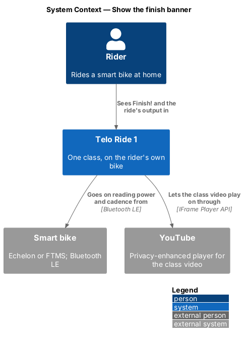
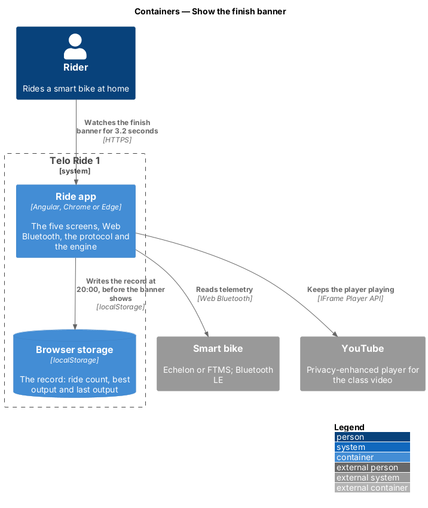
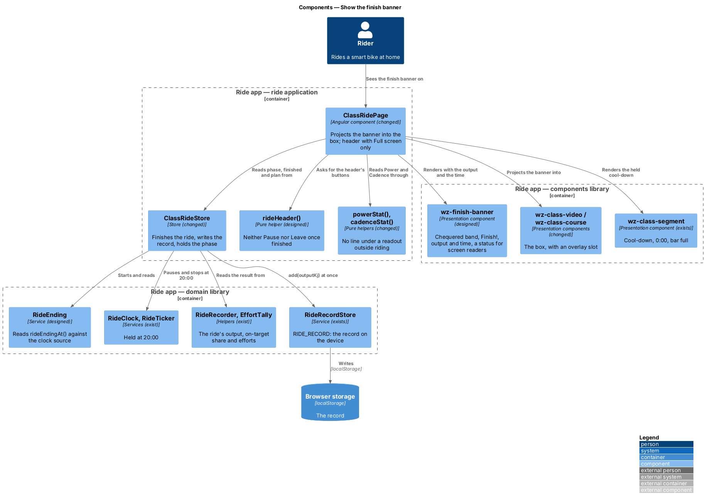
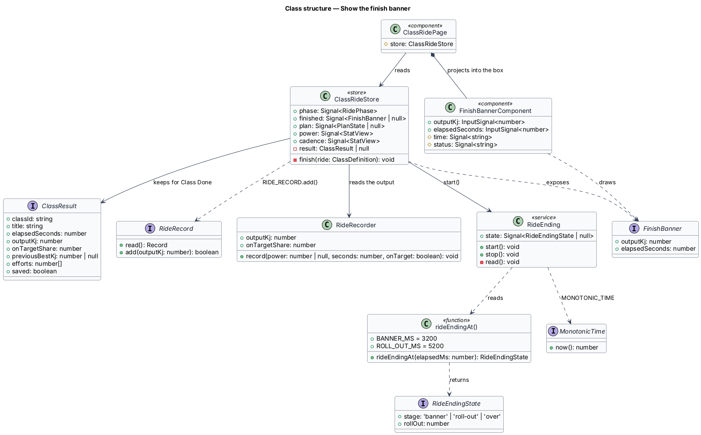
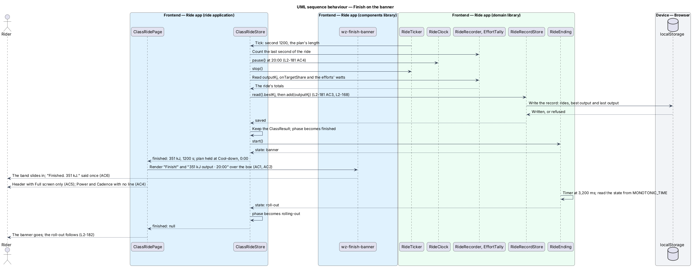
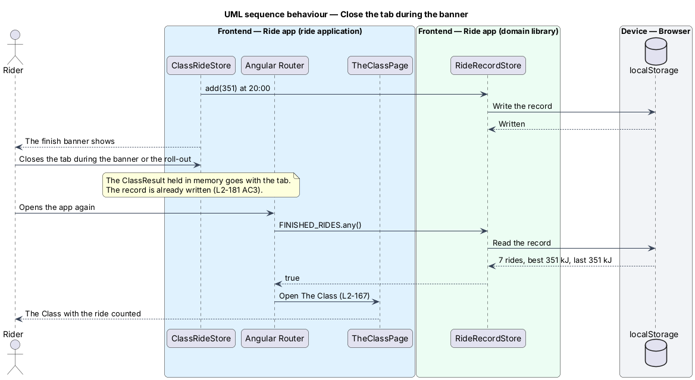

# Show the finish banner

## Overview

Telo Ride 1 has one class, Intervals to the Beat, and five screens. Class Ride is the screen the
rider is on while pedalling. A ride is finished when its clock reaches the plan's length, 20:00.
As built, Class Done opens that same second. A ride shaped like a race for one (ADR 0049) ends
on a finish banner instead: a band across the video's or the course's box that reads "Finish!"
and the ride's output and time, for 3.2 seconds. The roll-out follows it, and then Class Done
opens on its own.

The banner is a moment, not a result. The record is written before it shows, so a tab closed
while it shows loses nothing. It says nothing of a best, a place or another rider: the result
and the new best belong to Class Done. Nothing of it is built: slice 39.2 of journey 39 builds
it, after the countdown (slice 39.1).

Local terms:

- **finish banner**: band across the box that shows "Finish!" with the ride's output and time
- **chequered edge**: row of ink squares above and below the band's words
- **finished ride**: ride whose clock has reached the plan's length
- **ride phase**: stage a ride is in: `waiting`, `countdown`, `riding`, `finished` or `rolling-out`
- **ending**: the 8.4 seconds after the finish: 3.2 of finish banner, then 5.2 of roll-out
- **output**: work the rider did in the ride, in kJ
- **box**: the video's box on the stage, which the course takes in a ride in Ibiza

Neighbouring features own the adjacent concerns:

- What follows the banner (the target resistance easing off, the roll-out card, and Class Done
  opening on its own, `L2-182`) belongs to [ease off and roll on](../ease-off-and-roll-on/README.md).
- The finish of the plan and what is released when Class Ride closes (`L2-093` AC2, AC3) belong
  to [pause, leave or finish the class](../pause-leave-or-finish-the-class/README.md). This
  design changes what the finish does next.
- The record (`L2-168`) belongs to [keep the record](../../class-done/keep-the-record/README.md);
  the output, the result and the new best in gold (`L2-077`, `L2-078`) to
  [show Class Done](../../class-done/show-class-done/README.md).
- The countdown, the other end of the ride's shape (`L2-180`), belongs to
  [count down to the start](../count-down-to-the-start/README.md), which introduces the ride phase.
- The rider crossing the finish line under the arch at 20:00 (`L2-174` AC7) belongs to
  [ride in Ibiza](../ride-in-ibiza/README.md).
- The screen, its header and the bike panel belong to [ride the class](../ride-the-class/README.md).

## Description

The slice lives in the Ride app: the finish and the page in the `ride` application, the ending's
timing in `domain`'s `engine/`, and the banner's picture in `components`. The mocks are
`docs/mocks/pages/class-ride/finish.html` (over the video's box) and `finish-ibiza.html` (over
the course's box). Each part below is marked as existing or as designed; none of the designed
parts is built.

### The finish

`ClassRideStore.finish()` (exists, `ride/src/app/class-ride/class-ride-store.ts`) runs on the
tick whose second reaches the class length. Today it pauses the clock, stops the ticker, pauses
the player, releases the wake lock and the music, forgets the target, writes the record and
navigates to `/done` with the `ClassResult` in the navigation's state. The design keeps the
first half and moves the second half to the end of the roll-out.

- **At 20:00** (changed). `finish()` calls `RideClock.pause()` and `RideTicker.stop()`, so the
  header's clock reads "20:00 / 20:00" and holds (`L2-181` AC4). It builds the `ClassResult`
  from the `RideRecorder` and the `EffortTally`, reads the best before this ride, and calls
  `RIDE_RECORD.add(outputKj)` at once (AC3, `L2-168`). It keeps the result in a private field,
  sets the phase to `finished` and calls `RideEnding.start()`.
- **What it no longer does at 20:00.** It does not pause the player, release the music or the
  wake lock, forget the target or navigate: the video and the music play on through the ending,
  the screen stays awake, and the commands that ease the bike off are still to send. Those four
  move to the end of the roll-out, designed in
  [ease off and roll on](../ease-off-and-roll-on/README.md).
- **A tab closed during the ending.** The record is already in `localStorage`, so the ride is
  counted and the app opens next on The Class through `FINISHED_RIDES.any()` (AC3, `L2-167`).
  The `ClassResult` itself is held in memory only; Class Done for that ride is not shown again.
- **`ClassRideStore.finished`** (designed). A read-only signal of the `FinishBanner` view
  (`outputKj` as a whole number and `elapsedSeconds`) while the phase is `finished`, and `null`
  otherwise. `RideRecorder.outputKj` is kept to the joule; the banner shows `Math.round` of
  it, the rounding `class-done-view.ts` applies to `ClassResult.outputKj`, so the two agree (AC2).

### The ending's timing

- **`rideEndingAt(elapsedMs)`** (designed, `domain/src/engine/ride-ending.ts`, with a unit test
  per boundary). A pure function from the milliseconds since the finish to a `RideEndingState`:
  the stage (`'banner'`, `'roll-out'` or `'over'`) and the share of the roll-out that has
  passed. The stage is `banner` from 0 ms, `roll-out` from 3,200 ms and `over` from 8,400 ms.
  `BANNER_MS` (3,200) and `ROLL_OUT_MS` (5,200) are its named constants. Both are the
  prototype's timings (open question 42).
- **`RideEnding`** (designed, same file). An injectable provided by `RidePage` with the ride's
  other services. `start()` records `MONOTONIC_TIME.now()` and publishes `state`, a signal of
  the `RideEndingState` or `null`. It wakes by `setTimeout` at each boundary, reads the state
  from the elapsed time on the clock source, and reads again when a hidden tab shows, so the
  ending is not stretched by a throttled tab (`L2-133`). Destroying its owner releases the timer
  and the listener.
- **From banner to roll-out.** An effect of the store sets the phase to `rolling-out` when the
  stage becomes `roll-out`, which removes the banner from the template.

### The page

- **`wz-finish-banner`** (designed, `components/src/class-ride/finish-banner.ts`, `.html`,
  `.scss`; block `finish-banner` as in the design system). A presentation component with two
  inputs, `outputKj` and `elapsedSeconds`. It draws the band (`finish-banner__band`) with a
  chequered edge (`finish-banner__chequer`) above and below, "Finish!" (`finish-banner__title`)
  and the result line (`finish-banner__result`): the output's numerals
  (`finish-banner__output`), "kJ output", and the time through `formatClock`
  (`finish-banner__time`, "· 20:00"), as in "351 kJ output · 20:00" (AC1). The band is
  `aria-hidden`; a visually hidden `role="status"` paragraph reads "Finished. 351 kJ." once
  (AC6). The component has no input for a best, a place or another rider (AC8, open question 43).
- **Motion.** The band slides in across the box (`finish-banner-in`); under
  `prefers-reduced-motion: reduce` the stylesheet swaps the slide for a fade (AC7). The design
  system's stylesheet draws no exit: the banner's node is removed when the roll-out starts, so
  nothing slides as it goes.
- **Colour.** The band is the inverse surface in both themes (`--color-bg-inverse`) with ink
  words. The output's numerals take `--finish-banner-accent`: the deep signal on the light band
  of the dark theme, the signal on the dark band of the light theme. The design system's
  `contrast-pairs.json` holds the pairs, checked at 4.5:1 for the words and 3:1 for the
  numerals in both themes (AC9).
- **`ClassRidePage`** (changed, `class-ride-page.html`). While `store.finished()` is not `null`
  the template projects `wz-finish-banner` into the `overlay` slot of `wz-class-video` or
  `wz-class-course`, the slot the countdown uses. The Music button stays above it in Ibiza.
- **The header.** `rideHeader(phase, hold)` (designed in
  [count down to the start](../count-down-to-the-start/README.md)) returns neither Pause nor
  Leave in `finished` and `rolling-out`; `wz-fullscreen-button` stays (AC5). The rider has no
  way out of the ending but to wait (open question 46).
- **The segment card.** `planStateAt` returns `null` at the plan's length, so
  `WorkoutEngine.state` is `null` once the clock holds at 20:00. `ClassRideStore.plan` therefore
  holds the last state it read and, in `finished` and `rolling-out`, gives the cool-down with
  0 ms left and progress 1, so `wz-class-segment` reads "Cool-down" and "0:00" with its bar full
  (AC4).
- **Power and Cadence.** `powerStat` and `cadenceStat` return no hint and no tone outside
  `riding`, so the two readouts go on showing what the bike reports ("187 W", "83 rpm") with no
  line under either (AC4).

## Requirements

| L2 ID | Refines (L1) | Requirement |
|-------|--------------|-------------|
| `L2-181` | `L1-015` | When the clock reaches 20:00 and the ride is finished, a banner shall lie across the video's or the course's box: a chequered edge above and below, "Finish!", and the ride's output and time ("351 kJ output · 20:00"). It shall show for 3.2 seconds, and then the roll-out shall follow. The banner's output shall be the output Class Done will show, in whole kJ, and the time shall be the ride's time. The record shall already be updated when the banner shows, so that a tab closed during the banner or the roll-out loses nothing and the app opens next on The Class with the ride counted. While the banner shows, the clock shall read "20:00 / 20:00" and hold, the segment card shall read "Cool-down" and "0:00", and Power and Cadence shall go on showing what the bike reports with no line under either. The header shall show neither **Pause** nor Leave; Full screen shall work. A screen reader shall hear "Finished. 351 kJ." once (`role="status"`). With reduced motion the banner shall fade and shall not slide. The banner shall say nothing of a place, a position or another rider, and a new best shall be told on Class Done, not on the banner. The contrast of the banner's words on its band shall be at least 4.5:1, and 3:1 for the output's numerals, in both themes. |

## Diagrams

The context diagram shows what the finish touches outside the app: the rider who sees the
banner, the bike that is still connected, and YouTube, whose player plays on.

The container diagram shows the one write of the slice: the record goes to the browser's
storage at 20:00, before the banner shows.

The component diagram shows the parts of the slice. `ClassRideStore` writes the record, sets
the phase and starts `RideEnding`; `ClassRidePage` projects `wz-finish-banner` into the box.

The class diagram shows the pure rule `rideEndingAt`, the `RideEnding` service that reads it
against the clock source, the `FinishBanner` view the store exposes, and the presentation
component that draws it.

The first sequence follows the tick at 20:00: the clock holds, the record is written, the
banner shows for 3.2 seconds and the phase moves on to the roll-out.

The second sequence shows a tab closed while the banner shows: nothing is lost, and the app
opens next on The Class with the ride counted.

