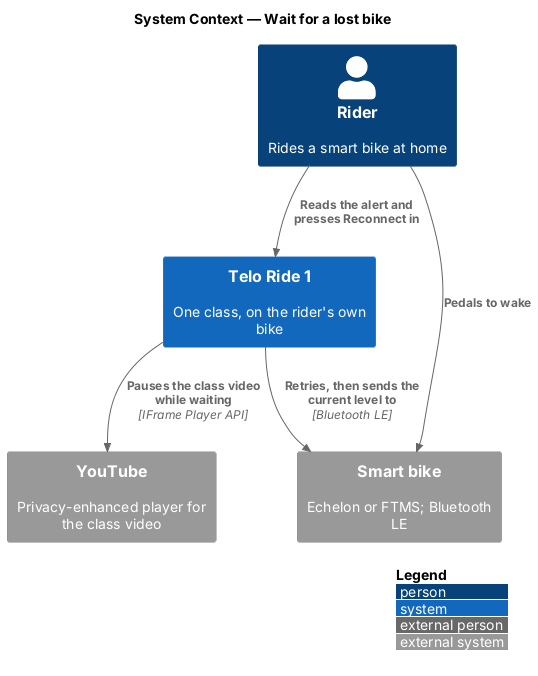
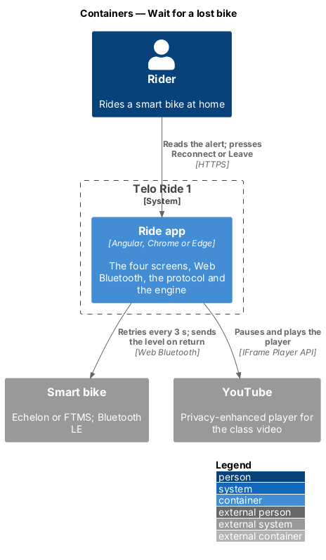
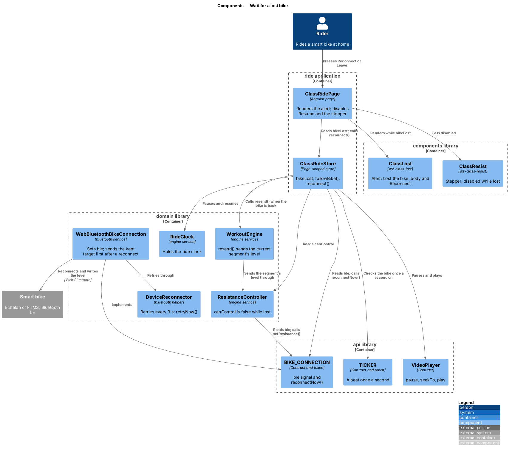
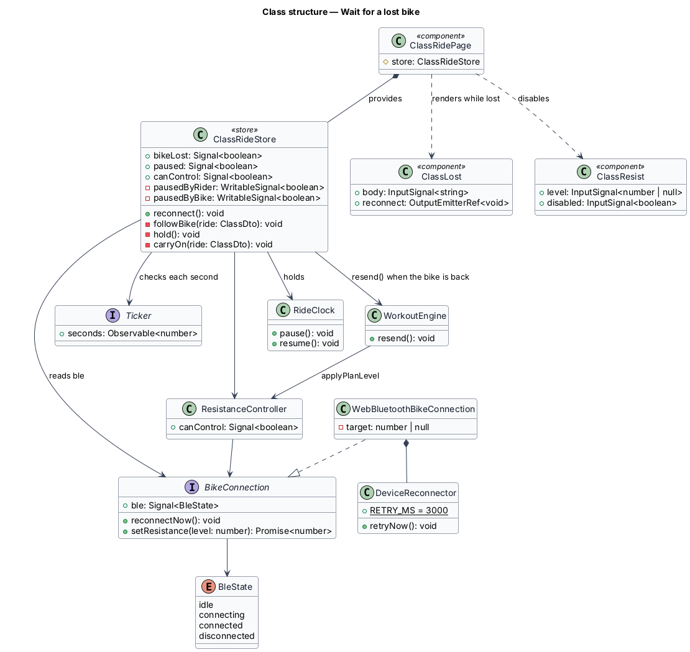
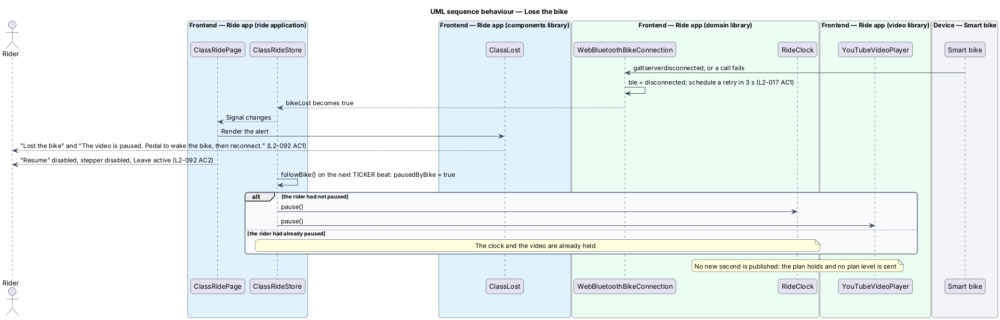
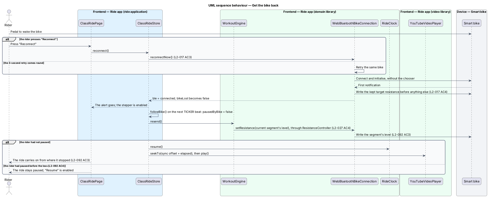

# Wait for a lost bike

## Overview

Telo Ride 1 sets the resistance of the rider's smart bike over Bluetooth while the rider takes
the one class on the Class Ride screen. A Bluetooth link to a bike at home drops now and then:
the bike goes to sleep, the rider stops pedalling for too long, or the radio loses it. A class
that kept running without the bike would count time the rider did not ride and would change
intervals with nothing to set.

The ride is solo, so it can wait. When the bike stops answering, the ride holds: the clock, the
plan and the video stand still, and an alert tells the rider what happened and offers
**Reconnect**. When the bike is back, by the app's own retry or by **Reconnect**, the current
segment's level is sent again and the ride carries on from where it stopped. A ride the rider
had already paused stays paused.

Local terms:

- **lost bike**: bike whose Bluetooth link state (`ble`) is `disconnected` during a ride
- **hold**: state in which the ride clock, the plan and the video stand still
- **lost-bike alert**: `role="alert"` card over Class Ride that reads "Lost the bike" and carries **Reconnect**
- **retry**: attempt the connection makes every 3 seconds to reach the same bike without the browser's chooser

Neighbouring features own the adjacent concerns:

- Detecting the drop, the 3-second retry and **Reconnect**'s immediate attempt (`L2-017`) belong
  to [keep the bike connected](../../bike/keep-the-bike-connected/README.md).
- Sending the level again after a reconnect (`L2-027` AC4) and the disabled resistance controls
  (`L2-028` AC3) belong to [control resistance](../../bike/control-resistance/README.md).
- The rider's own pause and the Leave link belong to
  [pause, leave or finish the class](../pause-leave-or-finish-the-class/README.md).
- The screen the alert sits over belongs to [ride the class](../ride-the-class/README.md).

## Description

The slice lives in the Ride app: `ClassRideStore` and `ClassRidePage` in the `ride`
application, the alert in `components`, and the link in `domain`'s `bluetooth/`. Slice 31.2
built it on the carried-over ride: the alert's copy, the header's button and the header above
the alert as the mock `docs/mocks/pages/class-ride/disconnected.html` draws them, the copy in
Ibiza (`disconnected-ibiza.html`), `rideHold()` and `WorkoutEngine.resend()`.

- **`rideHold()`** (`ride/src/app/class-ride/ride-hold.ts`, with its unit tests). A pure helper
  that gives the ride's state from the two reasons it can be held:

  | Paused by the rider | Bike lost | Runs | Header button | "Paused" overlay | Alert |
  |---|---|---|---|---|---|
  | no | no | yes | Pause | no | no |
  | yes | no | no | Resume | yes | no |
  | no | yes | no | Resume, disabled | no | yes |
  | yes | yes | no | Resume, disabled | yes, under the alert | yes |

  `ClassRideStore.state` is that value as a signal; the template reads the button's word,
  `disabled`, the overlay and the alert from it. `pause()` and `resume()` do nothing while the
  bike is lost.

- **`BIKE_CONNECTION`** (exists in `api`). `ble` is a signal of `BleState`: `idle`,
  `connecting`, `connected` or `disconnected`. `reconnectNow()` cancels the wait for the next
  retry and tries at once.
- **`WebBluetoothBikeConnection`** and **`DeviceReconnector`** (exist in `domain/bluetooth`). On
  `gattserverdisconnected` or a failed call the connection sets `ble` to `disconnected` and the
  reconnector retries every `RETRY_MS` (3000). On success the connection sends the last target
  resistance before anything else (`L2-017` AC4).
- **`ClassRideStore.bikeLost`** (exists). A computed signal, true while `ble()` is
  `disconnected`. The alert follows it at once.
- **`ClassRideStore.followBike()`** (exists). The store subscribes to the `TICKER` beat, which
  runs apart from the ride clock because the ride clock's ticks stop while the ride is held.
  Once a second it compares `bikeLost` with the private signal `pausedByBike`. On a change it
  sets `pausedByBike` and, unless `pausedByRider` is set, calls `hold()` for a loss or
  `carryOn()` for a return. The ride therefore holds within a second of the drop and carries on
  within a second of the return. On a return it first calls `WorkoutEngine.resend()`, whether
  or not the rider had paused.
- **`WorkoutEngine.resend()`** (built by slice 31.2, designed in
  [control resistance](../../bike/control-resistance/README.md)). It sends the current
  segment's level again through `ResistanceController.applyPlanLevel` (`L2-027` AC4,
  `L2-092` AC3).
- **`hold()` and `carryOn()`** (exist). The same steps the rider's pause uses: `RideClock.pause()`
  and `VideoPlayer.pause()`; then `RideClock.resume()`, `seekTo(sync offset + elapsed)` and
  `play()`.
- **Two reasons for one hold** (exist). `pausedByRider` and `pausedByBike` are separate signals.
  The ride runs only when both are false. A bike that returns while `pausedByRider` is set
  clears `pausedByBike` and nothing else, so the ride stays paused until **Resume**
  (`L2-092` AC4).
- **`ClassLost`** (exists, `wz-class-lost`; its copy changes). A presentation component with
  the input `body` and the output `reconnect`. It renders `class-lost` with `role="alert"`,
  labelled by its `h2` "Lost the bike", the body, and a primary **Reconnect** button. The page
  renders it while `bikeLost()` is true and passes `lostBikeMessage()`: "The video is paused.
  Pedal to wake the bike, then reconnect." with the class video and "The ride is paused. Pedal
  to wake the bike, then reconnect." in Ibiza, where no video is paused (`L2-092` AC1). The
  alert covers the ride under the header: `class-ride__header` is drawn above it, so Leave and
  Full screen take a press while the bike is away (`L2-092` AC2).
- **`ClassRideStore.reconnect()`** (exists). It calls `BIKE_CONNECTION.reconnectNow()`.
- **Pause button while lost** (`class-ride-session.html`). The mock draws the header button as
  a disabled "Resume" while the bike is lost. The button reads "Resume" when `paused()` or
  `bikeLost()` is true and is `disabled` while `bikeLost()` is true.
- **Resistance stepper while lost** (exists). `ClassResist.disabled` follows
  `ResistanceController.canControl`, which is false unless `ble()` is `connected`.
- **Leave link** (exists). It does not depend on the link state and stays active. Leaving
  while the bike is lost forgets the kept target and leaves the retries running on The Class, as
  [pause, leave or finish the class](../pause-leave-or-finish-the-class/README.md) describes.
- **Paused overlay**. The mock draws no "Paused" overlay under the alert, so `ClassVideo.paused`
  (and `ClassCourse.paused` in Ibiza) follows the rider's own pause alone.

The level after a reconnect reaches the bike in two steps. The connection sends its kept target
resistance first (`L2-017` AC4); that target is the current segment's level or the rider's last
nudge within it. `ClassRideStore` then calls `WorkoutEngine.resend()`, which sends the current
segment's level (`L2-027` AC4, `L2-092` AC3). A manual nudge therefore does not survive a
reconnect. No segment changed while the ride was held, because the held clock published no
tick.

## Requirements

The feature realizes the following level-2 (L2) requirement, which refines the level-1 (L1)
requirement cited beside it.

| L2 ID | Refines (L1) | Requirement |
|-------|--------------|-------------|
| `L2-092` | `L1-015` | When the bike stops answering during a class ride, the ride shall pause, and an alert (`role="alert"`) shall read "Lost the bike" and "The video is paused. Pedal to wake the bike, then reconnect.", with **Reconnect**. While the bike is lost, the clock, the plan and the video shall hold, **Resume** and the resistance controls shall be disabled, and Leave shall stay active. When the bike reconnects, by a retry or by **Reconnect** (`L2-017`), the alert shall go, the current segment's level shall be sent, and the ride shall carry on from where it stopped. When the rider had paused the ride before the bike was lost, the ride shall stay paused after the bike is back until the rider presses **Resume**. |

## Diagrams

### System context

The rider's smart bike stops answering Telo Ride 1 during the class. The app waits, and the
rider wakes the bike by pedalling.

### Containers

The Ride app notices the dropped Bluetooth link, holds the ride and the YouTube video, and
retries the bike. Browser storage plays no part.

### Components

`ClassRideStore` reads the link state from `BIKE_CONNECTION`, holds the clock and the player,
and calls `WorkoutEngine.resend()` when the bike is back. `ClassRidePage` renders `ClassLost`
and disables the Resume button and the stepper.

### Class structure

`ClassRideStore` derives `bikeLost` from `BikeConnection.ble` and keeps `pausedByBike` apart from
`pausedByRider`. `ClassLost` only draws the alert and emits `reconnect`.

### Behaviour: lose the bike

The link drops, the alert shows at once, and within a second the store holds the clock and the
video. Resume and the stepper are disabled; Leave stays active.

### Behaviour: get the bike back

A retry or **Reconnect** restores the link and the connection sends the kept target resistance
first. The store then has the engine send the current segment's level. The ride carries on
unless the rider had paused it, in which case it waits for **Resume**.

