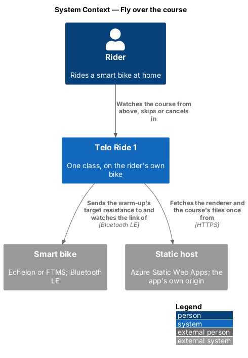
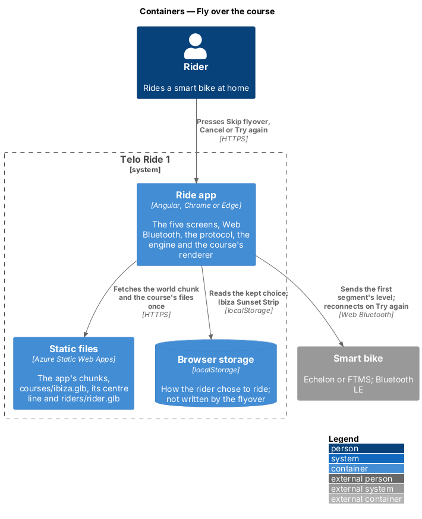
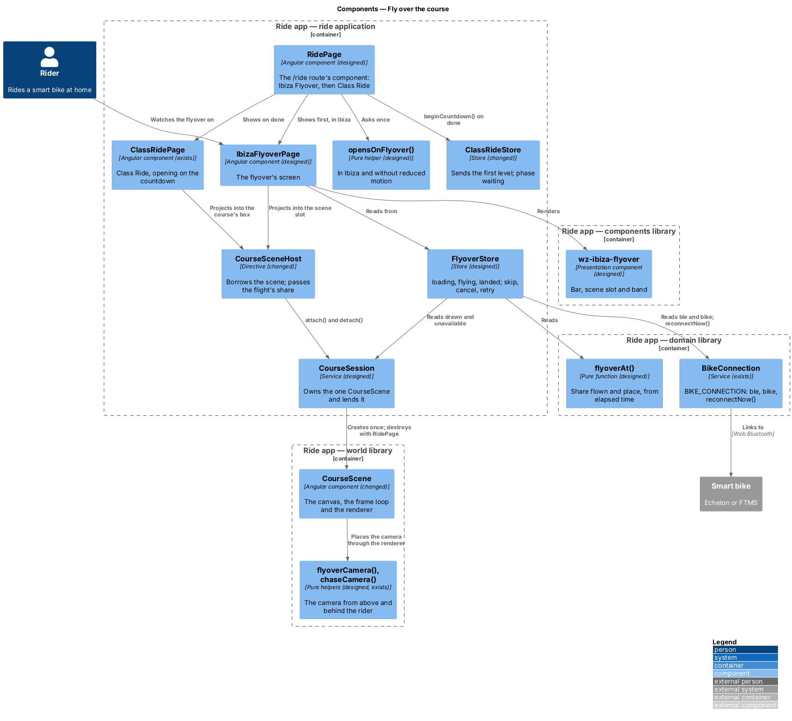
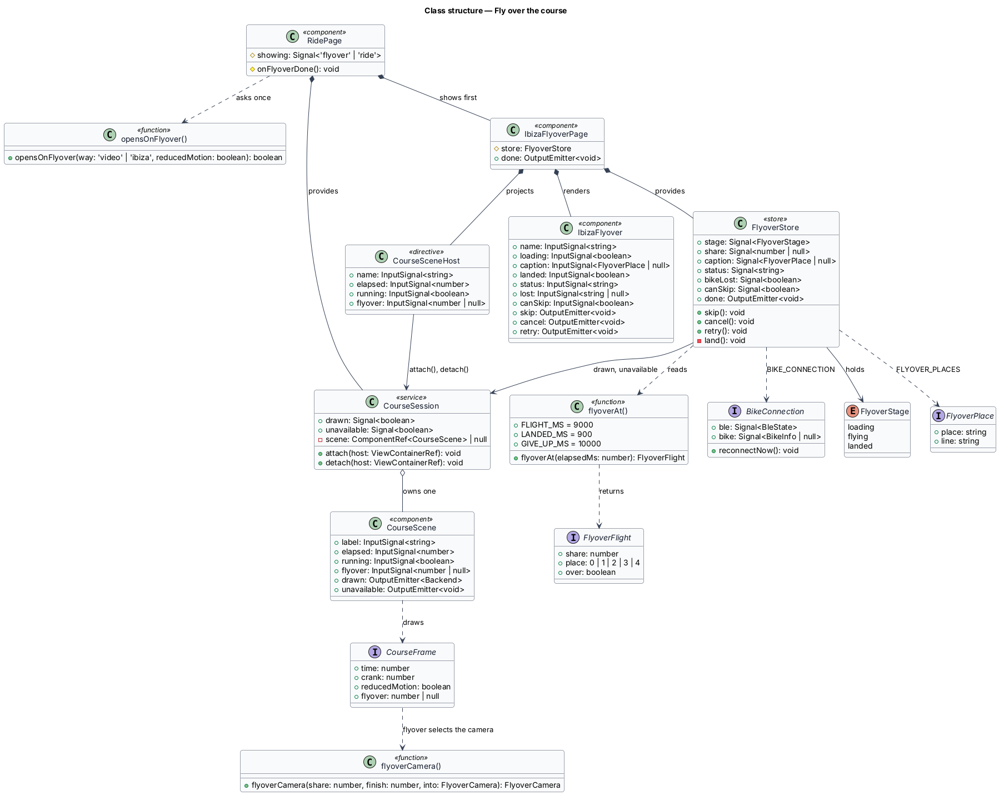
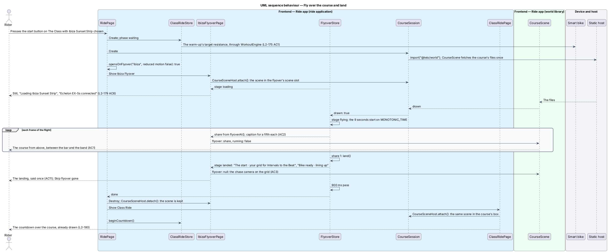
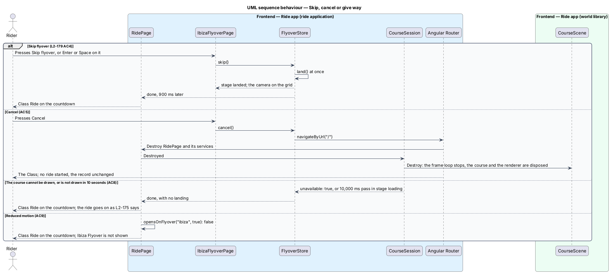
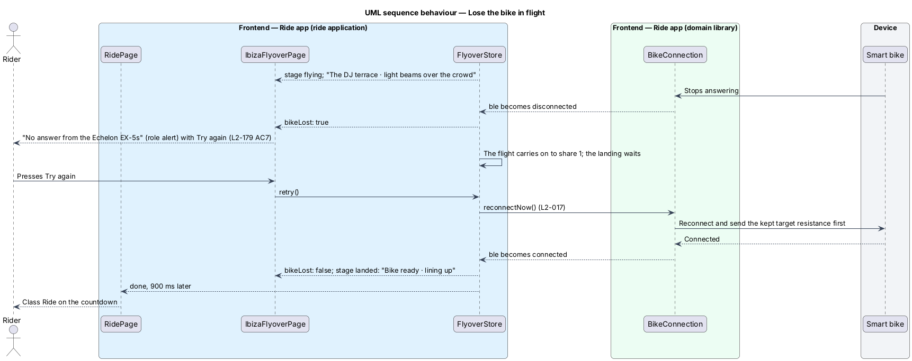

# Fly over the course

## Overview

Telo Ride 1 has one class, Intervals to the Beat, and five screens. The rider takes the class
with its video or in Ibiza, on the one course, Ibiza Sunset Strip. Ibiza Flyover is the screen
between The Class and Class Ride when the rider rides in Ibiza. It shows the course from above,
from the grid to the finish line, while the course loads, and then sets the rider down on the
grid, where Class Ride opens on its countdown. A ride with the class video has no flyover.

The flyover is the course itself, not a loading screen (ADR 0049). It draws the same course the
ride draws, from the same files, fetched once for both. It never holds the ride: the rider can
skip it or cancel it, it gives way to Class Ride when the course cannot be drawn or is not
drawn within 10 seconds, and it is not shown to a rider who asks for reduced motion. It has no
address of its own: it is what `/ride` shows before a ride in Ibiza starts. Nothing of it is
built: slices 39.5 and 39.6 of journey 39 build it, after the countdown.

Local terms:

- **flyover**: the course seen from above before a ride in Ibiza
- **flight**: the 9 seconds in which the camera follows the road from the grid to the finish line
- **landing**: the camera set down behind the rider on the grid, held for 0.9 seconds
- **grid**: painted start of the course, where the rider waits for the countdown
- **bar**: strip across the top of the screen holding the wordmark, **Skip flyover** and Cancel
- **band**: strip across the bottom holding the course's name, the caption and the bike's status
- **caption**: line under the course's name that names the place the camera is over
- **course session**: owner of the one course scene the flyover and the ride both draw on

Neighbouring features own the adjacent concerns:

- What is fetched for the course, the loading line on Class Ride, a course that cannot be
  drawn, a lost graphics context and cached files (`L2-175`) belong to
  [load the course](../../class-ride/load-the-course/README.md).
- The course in Class Ride's box, the rider, the chase camera and disposal (`L2-174`) belong to
  [ride in Ibiza](../../class-ride/ride-in-ibiza/README.md); the frame budgets and the quality
  steps (`L2-177`) to
  [draw the course on a low-power tablet](../../performance/draw-the-course-on-a-low-power-tablet/README.md).
- The countdown Class Ride opens on (`L2-180`) and the ride phase belong to
  [count down to the start](../../class-ride/count-down-to-the-start/README.md).
- The choice of how to ride and the start button (`L2-173`, `L2-084`) belong to
  [show the class](../../the-class/show-the-class/README.md).
- Detecting a lost bike and reconnecting (`L2-017`) belong to
  [keep the bike connected](../../bike/keep-the-bike-connected/README.md).
- The `/ride` route and its guard (`L2-087` AC4, ADR 0046) belong to
  [ride the class](../../class-ride/ride-the-class/README.md).
- Reduced motion and what a screen reader hears (`L2-141`, `L2-142`) belong to
  [support screen readers and motion](../../ui/support-screen-readers-and-motion/README.md).

## Description

The slice lives in the Ride app: the screen and its store in the `ride` application, the
flight's timing in `domain`'s `engine/`, the bar and the band in `components`, and the camera
in `world`. The mocks are `docs/mocks/pages/ibiza-flyover/default.html` (in flight),
`loading.html`, `landed.html` and `bike-lost.html`. Each part below is marked as existing or as
designed; none of the designed parts is built.

### The `/ride` route shows two screens

- **`RidePage`** (designed, `wz-ride-page`, `ride/src/app/class-ride/ride-page.ts`, `.html`,
  `.scss`). The component the `/ride` route loads in place of `ClassRidePage`. It provides the
  ride's services on itself, so they live as long as `/ride` is open and go when the rider
  leaves: `ClassRideStore`, `RideClock`, `RideTicker`, `WorkoutEngine`, `ResistanceController`,
  `BikeTelemetry`, `VideoClockSync`, `Countdown`, `RideEnding`, `ResistanceEaseOff` and
  `CourseSession`. `ClassRidePage` provides them today; they move up so that the store exists
  while the flyover shows. The template renders `wz-ibiza-flyover-page` or
  `wz-class-ride-page`, one at a time.
- **`opensOnFlyover(way, reducedMotion)`** (designed, pure,
  `ride/src/app/ibiza-flyover/opens-on-flyover.ts`, with a unit test per row). It returns true
  for a ride in Ibiza on a device that does not ask for reduced motion (`L2-179` AC9), and
  false for a ride with the class video. `RidePage` reads `ClassRideStore.way` and
  `DISPLAY_PREFERENCES.reducedMotion()` once, when it is created.
- **The first target resistance.** `ClassRideStore` calls `WorkoutEngine.follow(plan)` when it
  is created, which sends the warm-up's level at once, flyover or not (`L2-175` AC1; designed
  in [count down to the start](../../class-ride/count-down-to-the-start/README.md)). The
  store's phase is `waiting` while the flyover shows.
- **From the flyover to the ride.** `IbizaFlyoverPage` emits `done`. `RidePage` then renders
  `ClassRidePage` and calls `ClassRideStore.beginCountdown()`. Without a flyover it does both
  when it is created.
- **The route.** `class-ride.routes.ts` loads `RidePage`. `connectedBikeGuard` and
  `theClassGuard` stay as they are, so a reload or a typed `/ride` opens The Class and the
  flyover cannot be opened without a connected bike (ADR 0049). The route's title stays "Class
  ride · Telo Ride 1"; a title for the flyover is `<TO SUPPLY>`.

### One course for the flyover and the ride

- **`CourseSession`** (designed, `ride/src/app/class-ride/course-session.ts`). An injectable
  provided by `RidePage`. For a ride in Ibiza it imports `@telo/world` when it is created and
  creates the library's `CourseScene` once, which loads the renderer through `COURSE_RENDERER`
  and fetches the course's files. It keeps the `ComponentRef` and exposes `drawn` and
  `unavailable` as signals. `attach(host: ViewContainerRef)` inserts the scene's host view into
  the given container and `detach(host)` takes it out without destroying it, so the canvas, its
  graphics context and the renderer pass from the flyover's scene to Class Ride's box with no
  second download and no second build (AC3). `RidePage`'s destruction destroys the scene, which
  stops its frame loop and disposes the renderer, whichever screen the rider leaves from (AC5,
  `L2-174` AC8).
- **`CourseSceneHost`** (changed, `ride/src/app/class-ride/course-scene-host.ts`,
  `[wzCourseScene]`). Today it imports the library and creates and destroys the scene itself.
  It becomes a borrower: it calls `CourseSession.attach` with its own `ViewContainerRef` when it
  is created and `detach` when it is destroyed, and goes on handing the scene its inputs. It
  gains one input, `flyover`, the share of the flight flown or `null`.
- **A ride with the class video** never creates a `CourseScene`: `CourseSession` does nothing
  when `ClassRideStore.way` is `'video'`, so neither the `world` library nor the course's files
  are fetched (`L2-136` AC1).

### The camera from above

- **`CourseFrame.flyover`** (designed, `api/src/course/course-renderer.ts`). A new member of
  the frame the renderer draws: `null` draws the chase camera of the ride; a number from 0 to 1
  draws the flyover's camera at that share of the flight. `CourseScene` gains the matching
  `flyover` input and `SceneDriver` passes it through.
- **`flyoverCamera(share, finish, into)`** (designed, `world/src/flyover-camera.ts`, pure, no
  Three.js, with unit tests). It gives the camera's place above the road `share × finish`
  metres from the grid, written into `into` so a frame allocates nothing, as `chaseCamera`
  does. The renderer takes the point on the road from `Course.place`. The camera's height
  above the road and its pitch are `<TO SUPPLY>`: the course was built to be seen from behind
  the rider, and what holds within the budgets from above is not known until it is drawn (open
  question 45). The cheap form, if a high camera does not hold, is a camera low over the road.
- **The landing.** With `flyover` back to `null` and the ride's seconds at 0, the renderer
  draws the chase camera at the grid: 2.4 m behind the rider and 1.65 m above the road
  (`L2-174` AC10), the place Class Ride's camera starts from (AC3). The requirement gives the
  landing no descent of its own: **Skip flyover** puts the camera on the grid at once (AC4),
  and the end of the flight does the same.
- **The rider alone.** The renderer draws the one rider on the grid and nothing else that
  moves: no other rider, position, lap or lap count exists in the `world` library (AC12,
  `L2-174` AC6).
- **Budgets.** The flyover is drawn by the same renderer under the same `frame-budget.ts`
  steps, so a frame from above is counted against 120,000 triangles, 140 draw calls and the
  quality steps like any other, and `CourseScene` draws no frame while the tab is hidden (AC10,
  `L2-177` AC1 and AC3, `L2-174` AC9). Whether the course from above stays within them is to
  be measured by slice 39.6.

### The flight's timing

- **`flyoverAt(elapsedMs)`** (designed, `domain/src/engine/flyover.ts`, with a unit test per
  boundary). A pure function from the milliseconds since the flight started to the share flown
  (0 to 1) and the place's index (0 to 4, a fifth of the flight each; AC2). `FLIGHT_MS`
  (9,000), `LANDED_MS` (900) and `GIVE_UP_MS` (10,000) are its named constants. All three are
  the prototype's timings (open question 42).
- **`FLYOVER_PLACES`** (designed, `ride/src/app/ibiza-flyover/flyover-places.ts`). The five
  captions in order, each a place and a line: "The waterfront" · "the warm-up rolls out along
  the sea", "The Strip" · "every effort climbs past the clubs", "The DJ terrace" · "light beams
  over the crowd", "The finale" · "five short, steep sprints" and "The finish" · "the cool-down
  runs back down to the sea"; and the landing's, "The start" · "your grid for Intervals to the
  Beat", whose class title comes from `THE_CLASS`. The captions were written from the course as
  built and are a proposal (open question 40).

### The screen

- **`FlyoverStore`** (designed, `ride/src/app/ibiza-flyover/flyover-store.ts`, provided by
  `IbizaFlyoverPage`). It holds `stage`, one of `'loading'`, `'flying'` and `'landed'`, and
  exposes `share`, `caption`, `status`, `bikeLost` and `canSkip` as signals, and `skip()`,
  `cancel()` and `retry()` as actions. It reads time from `MONOTONIC_TIME` and wakes by
  `requestAnimationFrame` while the tab shows, so the camera's share follows the display; a
  hidden tab draws nothing and the flight is read from the clock source when the tab shows
  again. Its `DestroyRef` callback cancels the frame request and its timers.
  - `loading` (mock `loading`): the course's still stands in the scene with "Loading Ibiza
    Sunset Strip" (`role="status"`), and there is no caption. When `CourseSession.drawn()`
    turns true the stage becomes `flying` and the 9 seconds start (AC6).
  - `flying` (mock `default`): `share` runs from 0 to 1 and the caption is the place of
    `flyoverAt`. The status reads the bike's name with "connected", from
    `BIKE_CONNECTION.bike().name` ("Echelon EX-5s connected", AC1).
  - `landed` (mock `landed`): the caption is the landing's, the status reads "Bike ready ·
    lining up", `canSkip` is false, and 900 ms later the store emits `done` (AC3).
  - `skip()` moves to `landed` at once from `loading` or `flying` (AC4).
  - `cancel()` navigates to `/`. The navigation destroys `RidePage`: the course and its
    renderer are released, no ride was started, and the record is untouched (AC5).
  - **Giving way.** When `CourseSession.unavailable()` turns true, or 10,000 ms after the
    screen opened with the course still not drawn, the store emits `done` without a landing.
    Class Ride opens on the countdown and the ride goes on as `L2-175` says (AC8).
  - **The bike lost.** `bikeLost` is `BIKE_CONNECTION.ble() === 'disconnected'`. The flight
    carries on, but the store does not emit `done` while it is true. The band shows "No answer
    from the Echelon EX-5s" (`role="alert"`) with **Try again**, and `retry()` calls
    `BIKE_CONNECTION.reconnectNow()` (AC7, mock `bike-lost`). When the bike is back, the
    landing follows.
- **`IbizaFlyoverPage`** (designed, `wz-ibiza-flyover-page`,
  `ride/src/app/ibiza-flyover/ibiza-flyover-page.ts`, `.html`, `.scss`). It renders
  `wz-ibiza-flyover` with the store's signals and projects a `[wzCourseScene]` node into its
  `scene` slot with `flyover` bound to `store.share()`, `running` false and the ride's seconds
  at 0. It is part of the chunk `/ride` loads; The Class loads none of it.
- **`wz-ibiza-flyover`** (designed, `components/src/ibiza-flyover/ibiza-flyover.ts`, `.html`,
  `.scss`; block `ibiza-flyover` as in the design system). A presentation component that injects
  nothing. The bar (`ibiza-flyover__bar`) holds `wz-lockup`, **Skip flyover**
  (`ibiza-flyover__skip`, a `wz-button`, at least 44 px tall, pressed by Enter or Space as any
  button is; AC4) and Cancel (`ibiza-flyover__cancel`, `aria-label="Cancel"`). The scene
  (`ibiza-flyover__scene`, the page's `main`) holds the `scene` slot, the still while loading,
  and the loading line. The band (`ibiza-flyover__band`) holds the `h1` "Ibiza Sunset Strip"
  (`ibiza-flyover__title`), the caption (`ibiza-flyover__caption` with `ibiza-flyover__place`)
  and the status (`ibiza-flyover__status`, with `--ready` on the grid) or the lost-bike line
  and **Try again** (`ibiza-flyover__lost`). The scene lies between the bar and the band, so no
  word lies on the course (AC1). Its outputs are `skip`, `cancel` and `retry`.
- **The canvas's name.** `CourseSceneHost` passes "Ibiza Sunset Strip from above" as the
  scene's label during the flyover, so the canvas is `role="img"` with that name (AC1).
- **What a screen reader hears.** The store announces "Ibiza Sunset Strip" through `ANNOUNCER`
  when the screen opens and the landing's caption when the camera lands, each once, and the
  five captions of the flight are not announced (AC11). The mock marks the caption
  `aria-live="polite"`; the component sets that attribute only on the landing's caption, so the
  five flight captions are not read out as they change.
- **The recording mark.** While a diagnostic recording is on (`L2-178` AC2) the mark stands above
  the band on the bottom-left corner of the course, with the modifier
  `diagnostic-mark--on-ibiza-flyover` (mock `recording`); `wz-diagnostic-mark`'s `screen` input
  gains `"ibiza-flyover"` when this screen is built.
- **Open questions that touch the screen.** Whether the flyover plays before every ride in
  Ibiza or only the first (open question 44) and whether music plays under it (open question
  41) are undecided; the design plays it every time, in silence, as `L2-179` and `L2-176` AC1
  stand.

## Requirements

| L2 ID | Refines (L1) | Requirement |
|-------|--------------|-------------|
| `L2-179` | `L1-028` | When the rider starts a ride in Ibiza, Ibiza Flyover shall open at `/ride` and show the course edge to edge, seen from above (`role="img"`, "Ibiza Sunset Strip from above"), the wordmark, **Skip flyover**, Cancel (`aria-label="Cancel"`), "Ibiza Sunset Strip" as the `h1`, and the bike's name with "connected". A bar across the top and a band across the bottom shall hold the words, so that no word lies on the course. The camera shall follow the road from above from the grid to the finish line in 9 seconds, and a caption under the `h1` shall name where it is in five steps, each for a fifth of the flight. When the flight ends the camera shall land behind the rider on the grid, the caption shall read "The start · your grid for Intervals to the Beat", the status shall read "Bike ready · lining up", **Skip flyover** shall go, and after 0.9 seconds Class Ride shall open on the countdown with the course already drawn. **Skip flyover** shall put the camera on the grid at once; it shall be at least 44 px tall and pressed by Enter or Space. Cancel shall open The Class with no ride started, the record unchanged, and the course and its renderer released. Until the course is drawn, its still shall stand in its place with "Loading Ibiza Sunset Strip" (`role="status"`), and the 9 seconds shall start when the first frame is drawn. Where the bike is lost during the flyover, the flight shall carry on but Class Ride shall not open: the status shall read "No answer from the Echelon EX-5s" (`role="alert"`) with **Try again**, which reconnects. Where the course cannot be drawn, or has not been drawn 10 seconds after Ibiza Flyover opened, Class Ride shall open on the countdown instead. Where the rider asks for reduced motion, Ibiza Flyover shall not be shown. A frame of the flyover shall be within the course's budgets, and a hidden tab shall draw none. A screen reader shall hear the course's name and the landing once, not all five captions. The flyover shall draw no other rider, position, lap or lap count. |

## Diagrams

The context diagram shows what the flyover touches outside the app: the rider, the bike whose
link it watches, and the app's own origin, which serves the course's files.

The container diagram shows that the flyover runs in the Ride app and reads the course's files
from the static host once, for the flyover and the ride together.

The component diagram shows the parts of the slice. `RidePage` chooses the screen and provides
`CourseSession`; `IbizaFlyoverPage` and `ClassRidePage` each borrow the one `CourseScene`
through `CourseSceneHost`.

The class diagram shows `FlyoverStore` with its three stages, the pure rules it reads, the
course session that lends the scene, and the frame's new `flyover` member.

The first sequence follows the flyover from the start button to the countdown: the level is
sent, the course loads once, the camera flies for 9 seconds, lands, and hands the scene to
Class Ride.

The second sequence shows the three ways the rider or the course cuts the flyover short: Skip
flyover, Cancel, and a course that is not drawn in time.

The third sequence shows the bike lost in flight: the flight carries on, the landing waits, and
**Try again** reconnects.

