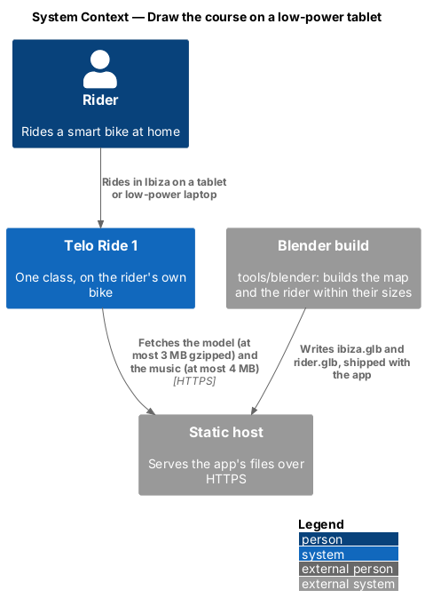
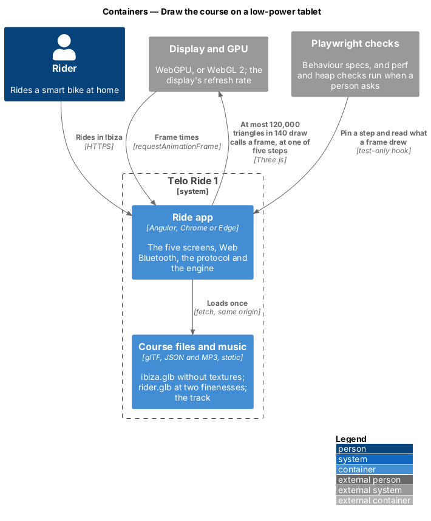
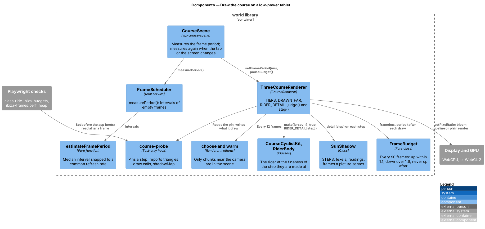
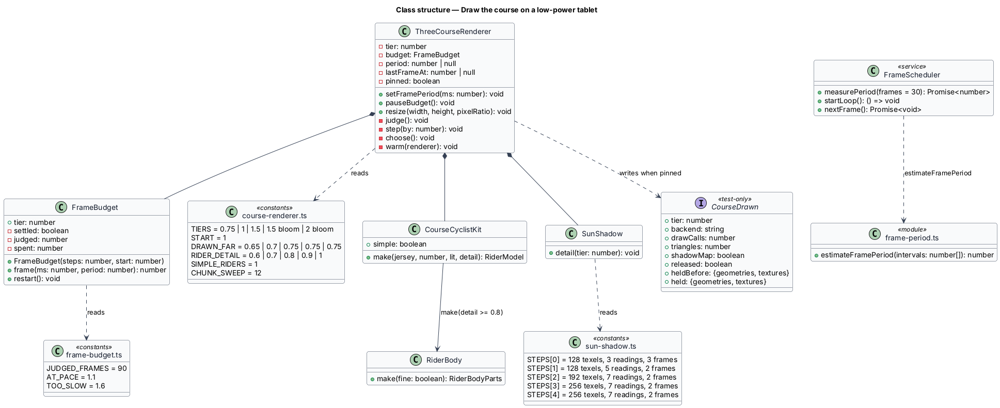
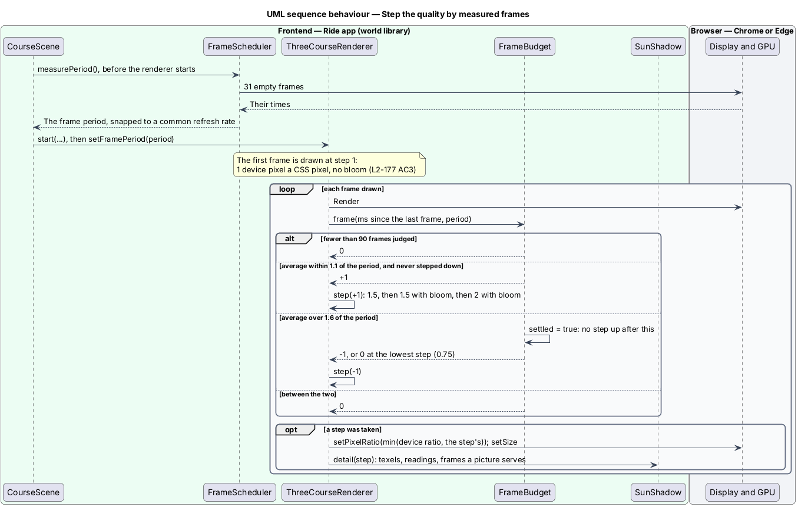
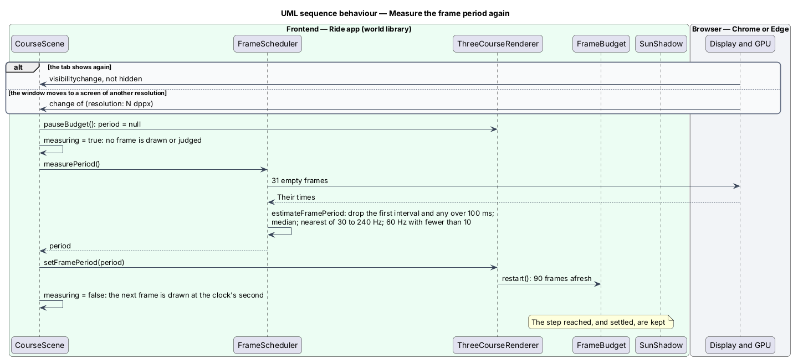
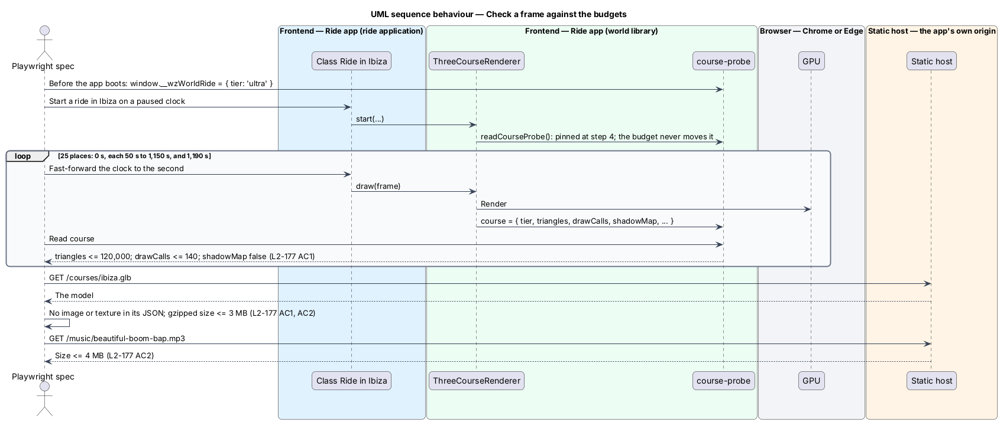

# Draw the course on a low-power tablet

## Overview

The rider runs Telo Ride 1 on a tablet or a low-power laptop beside the bike. A ride in Ibiza draws
a 3D course for 20 minutes on that device, beside readouts that update once a second and a bike
that is sent a new target resistance at each segment. A course drawn too richly makes the whole
screen stutter; one that keeps memory makes the tab slow by the end of the ride.

This feature keeps the course inside what such a device can draw. It sets fixed budgets for what
one frame sends to the GPU and for the size of the files, opens every ride at a cheap step of
quality and raises or lowers the step from the frame times the device really achieves, makes the
rider's figure more coarsely on the lower steps, and bounds the time of an interface frame and the
growth of memory over a full ride.

Slice 37.7 built the budgets and the steps, and slice 37.8 the release of the course; the code
predates both as Telo Ride's course renderer. Each part below is marked with what exists and with
how it is checked. Two of the six criteria are measured only on the reference tablet, by checks
that run when a person asks.

Local terms:

- **budget**: fixed upper limit a frame or a file stays within
- **triangle** and **draw call**: what one frame sends to the GPU, as the renderer counts them
- **shadow map**: depth picture a renderer makes to cast shadows; the course makes none
- **step**: one of the five levels of quality the course is drawn at, from 0, the cheapest, to 4
- **device pixels a CSS pixel**: the canvas's resolution against its size on the page
- **bloom**: soft glow drawn over the neon, the bulbs and the sun in a second pass
- **frame period**: time between two frames of the display, 16.7 ms at 60 Hz
- **judged frames**: the 90 frames whose average time decides a step
- **fineness**: how many triangles the rider's body is made of; its file holds two
- **chunk**: one piece of the map along the road, drawn only while it is near the camera
- **reference tablet**: the 11-inch tablet in landscape (1194 × 834) the budgets are set for
- **pin**: of a test, to fix the step through the test-only hook so the budget does not move it

Neighbouring features own the adjacent concerns:

- What the course shows, the rider's shape and the rider's shadow belong to
  [ride in Ibiza](../../class-ride/ride-in-ibiza/README.md) (`L2-174`); its files and their load to
  [load the course](../../class-ride/load-the-course/README.md) (`L2-175`); the track to
  [play the music](../../class-ride/play-the-music/README.md) (`L2-176`).
- The flyover's frames, which shall stay within the same budgets seen from above (`L2-179` AC10),
  belong to [fly over the course](../../ibiza-flyover/fly-over-the-course/README.md).
- The initial bundle, lazy loading and the interface's frames with the class video (`L2-136`)
  belong to [meet performance budgets](../meet-performance-budgets/README.md).
- The app's memory over a long session and across visits (`L2-138`) belongs to
  [stay smooth on long rides](../stay-smooth-on-long-rides/README.md).
- The readouts' once-a-second update (`L2-134`) belongs to
  [keep the ride clock true](../keep-the-ride-clock-true/README.md).

## Description

The slice lives in the `world` library, which is imported only when a ride in Ibiza starts, and in
the Blender build that makes the files. The rules that decide a step are pure and unit-tested; the
renderer applies them.

### The frame's budgets (`L2-177` AC1)

- **One cheap material a group** (exists, `ThreeCourseRenderer.build`,
  `world/src/course-renderer.ts`). The map arrives as groups of meshes coloured by vertex. The
  land, the solids, the leaves and the far island are `MeshLambertMaterial`, flat shaded; the glow,
  the sky and the beams are `MeshBasicMaterial`. The ground, the walls, the windows, the fences and
  the sea are node materials that work their surface out a pixel at a time from the mesh's UV.
- **No texture in the model.** `courses/ibiza.glb` holds no image and no texture. The app makes
  one 256 × 256 detail texture on the device (`surfaceTexture`, `world/src/ground-material.ts`),
  which the ground, the walls, the windows, the sea and the sky read, and one light map of the
  course's coloured lights. The spec reads AC1's "no texture on the map" as the model carrying
  none.
- **No shadow map.** `WebGPURenderer.shadowMap` is never enabled. The rider's shadow is their own
  figure drawn into a small render target and laid on the road (`SunShadow`, owned by ride in
  Ibiza).
- **Only what is near.** `build` takes the map's chunks out of the map; `choose()` keeps in the
  scene only those within their group's draw distance of the camera (`DRAW_DISTANCE`, from 120 m
  for fences to 950 m for the land) and runs every 12 frames, or at once when the camera has
  jumped more than 60 m. The haze from 200 m to 1,500 m hides the rest. `DRAWN_FAR` scales each
  distance by the step: 0.65, 0.7, 0.75, 0.75 and 0.75. Slice 37.7 set the top three to 0.75 after
  the finish measured 130,130 triangles at the heaviest step; the most of 25 places along the
  course is now 111,570 triangles in 85 draw calls or fewer.
- **One batch for the rider.** `RiderBatch` (`world/src/rider-batch.ts`) draws the rider's moving
  parts of a plain colour in one draw call.
- **No stutter from uploads.** `warm()` sends each chunk's geometry to the GPU once while the
  course loads, and `compileAsync` compiles the programs before the first frame. A chunk first
  drawn mid-ride would otherwise cost a frame of 40 to 80 ms.
- **The check** (`e2e/class-ride-ibiza-budgets.spec.ts`). The spec pins the highest step and reads
  the renderer's test-only report at 25 seconds of the ride from 0 to 1,190: at most 120,000
  triangles, at most 140 draw calls and `shadowMap` false at each. The spec
  `class-ride-ibiza-shadow` asserts `shadowMap` false with the shadow drawn.

### The files' budgets (`L2-177` AC2)

- **`tools/blender/pack_glb.py`** and **`tools/blender/meshopt_glb.mjs`** (exist). The first
  rewrites the exported vertex colours as bytes and each mesh's positions as 16-bit steps of its
  own box; the second writes the buffers with the meshopt codec. The renderer decodes them with
  `MeshoptDecoder`.
- **The shipped sizes.** `courses/ibiza.glb` is 2,052,060 bytes and 853,550 bytes gzipped, against
  3 MB. `music/beautiful-boom-bap.mp3` is 3,964,760 bytes, against 4 MB. The same spec fetches
  both and asserts the limits.

### The five steps (`L2-177` AC3)

- **`TIERS`** (exists, `course-renderer.ts`). Five steps, cheapest first: 0.75 device pixels a CSS
  pixel; 1; 1.5; 1.5 with bloom; 2 with bloom. `START` is 1, so every ride opens at 1 device pixel
  a CSS pixel with no bloom and never starts high and drops in front of the rider. `resize` sets
  the pixel ratio to the lesser of the device's own and the step's.
- **`FrameScheduler.measurePeriod(frames = 30)`** (exists, `world/src/frame-scheduler.ts`). It
  collects the times of back-to-back frames that draw nothing of their own and answers
  `estimateFramePeriod` of their intervals. `CourseScene` asks for it beside the renderer's load,
  before the scene's own work can slow the display.
- **`estimateFramePeriod(intervals)`** (exists, `world/src/frame-period.ts`, with unit tests). The
  median interval, leaving out the first and any over 100 ms, snapped to the nearest of 30, 48,
  50, 60, 75, 90, 120, 144, 165 and 240 Hz; 60 Hz with fewer than 10 usable intervals.
- **`FrameBudget`** (built by slice 37.7, `world/src/frame-budget.ts`, with unit tests). A pure
  class the renderer asks once a frame with the time since the last frame. Every 90 frames it
  compares their average with the frame period. An average within 1.1 of the period steps up. An
  average over 1.6 of it steps down, to step 0 at the least, and sets `settled`, after which the
  budget steps up no more.
- **`ThreeCourseRenderer.judge()` and `step(by)`** (exist). `judge` runs after each `draw`; it
  judges nothing while a step is pinned, while no period is set, or on the first frame after a
  pause. `step` changes the step, resizes to the new pixel ratio and calls `SunShadow.detail`. The
  bloom pipeline is built once and used only at the steps that have it.
- **Measuring again** (exists, `CourseScene`). When the tab shows again, or the window's
  `resolution` media query changes, the scene calls `pauseBudget()`, draws no frame while it
  measures the period once more, and then calls `setFramePeriod`, which restarts the 90 frames.
  A display of another refresh rate is therefore judged against its own period.
- **The shadow by step** (exists, `STEPS` in `world/src/sun-shadow.ts`). The figure's picture is
  128, 128, 192, 256 and 256 texels across, read 3, 5, 7, 7 and 7 times for each point of the
  road, and one picture serves 3, 2, 2, 2 and 2 frames.
- **The checks.** The unit tests of `FrameBudget` and `estimateFramePeriod` cover the rule.
  `e2e/perf/ibiza-frames.perf.ts`, run when a person asks (`npm run perf -- ibiza-frames`), rides
  ten seconds at each step a spec can pin, at 1194 × 834 with the CPU slowed 4 times, and reports
  the frames a second with and without the shadow. The hook's four names pin steps 0, 1, 3 and 4;
  step 2 cannot be pinned.

### The interface's frames and the heap (`L2-177` AC4, AC5)

- **One loop, held with the ride.** `FrameScheduler` is the app's only `requestAnimationFrame`
  caller. `CourseScene` runs its loop only while the ride runs and the tab shows, so a paused ride
  and a hidden tab cost no frame. The readouts are signals read by `OnPush` components and do not
  wait on the scene.
- **Nothing allocated a frame.** `Course.place` and `chaseCamera` write into objects the renderer
  keeps, and `choose()` walks an array made once. A frame adds nothing that grows with the ride's
  length.
- **Everything released.** `ThreeCourseRenderer.dispose()` releases the map's geometry, the
  materials, the textures, the rider and the GPU renderer (`L2-174` AC8, owned by ride in Ibiza).
  The spec `class-ride-ibiza-leave` asserts the drop in what the renderer holds.
- **How AC4 is measured.** `e2e/perf/ride-frames.perf.ts` asserts no interface frame over 100 ms
  for a ride with the class video (`L2-136` AC3). `ibiza-frames.perf.ts` reports the course's
  frame times and fails where the shadow costs more than 1.5 ms a frame. A check that asserts the
  100 ms limit for a ride in Ibiza is `<TO SUPPLY>`.
- **How AC5 is measured.** `e2e/heap/enter-and-leave.heap.ts` enters and leaves a ride in Ibiza ten
  times and allows 5 MB of growth (`L2-138` AC3). `e2e/heap/long-ride.heap.ts` holds a ride with
  the class video open for 3 hours (`L2-138` AC1). A heap check of a full 20:00 ride in Ibiza,
  from its first minute to its last, is `<TO SUPPLY>`.
- **The reference tablet's frame rate** has not been timed on a real tablet: the 4 times CPU
  slowdown stands in for it and is not calibrated. The result on the device is `<TO SUPPLY>` (open
  question 15).

### The rider's finenesses (`L2-177` AC6)

- **`riders/rider.glb`** (exists; ADR 0045). The body at two finenesses on one armature: `body`,
  5,684 triangles, and `body-coarse`, 1,530.
- **`RIDER_DETAIL`** (exists, `course-renderer.ts`). 0.6, 0.7, 0.8, 0.9 and 1 for steps 0 to 4.
  `build` passes the step's value to `CourseCyclistKit.make(jersey, 4, true, detail)`.
- **`FINE_BODY`** (exists, `world/src/course-cyclist.ts`). 0.8: `RiderBody.make(detail >= 0.8)`
  gives the finer body at steps 2, 3 and 4 and the coarser at steps 0 and 1. A rider made finely
  keeps the coarse body too, unseen, to throw their shadow.
- **`fineness`** (same file). The detail scales the number of sides of every shape the helmet, the
  shoes and the bike are built from, so each is the same shape, kit and colours in fewer triangles
  at each step below the highest.
- **`SIMPLE_RIDERS`** (exists). At steps 0 and 1 the kit is the simple build, which draws the
  rider in fewer draw calls.
- **When the rider is made.** The rider is made once, in `build`, at the step the renderer stands
  at then. A ride opens at step 1 (AC3), and `step()` does not make the rider again. In a rider's
  ride the body is therefore the coarser one for the whole ride, whatever step the frames later
  earn; the finer body is drawn only when a test pins step 3 or 4. AC6 states the fineness for the
  step "when they are made", which this satisfies. Whether the rider shall be made again when the
  step rises to 2 or above is `<TO SUPPLY>`; no open question records it.

## Requirements

The feature realizes the following level-2 (L2) requirement. It refines the level-1 (L1)
requirement cited beside it.

| L2 ID | Refines (L1) | Requirement |
|-------|--------------|-------------|
| `L2-177` | `L1-022` | At any place on the course, a frame shall send the GPU no more than 120,000 triangles in no more than 140 draw calls, with no shadow map and no texture on the map. The course's model shall be no more than 3 MB gzipped as served, and the music no more than 4 MB. When a ride in Ibiza opens, the course shall first be drawn at 1 device pixel a CSS pixel with no bloom; given 90 frames that average within 1.1 of the display's frame period, it shall step up through 1.5, 1.5 with bloom and 2 with bloom; given 90 frames that average over 1.6 of it, it shall step down (to 0.75 at the least) and shall step up no more. In a ride in Ibiza on the reference tablet, the readouts shall stay within `L2-134` and no frame of the interface shall take longer than 100 ms (`L2-136` AC3). Over a full 20:00 ride in Ibiza, the page's memory shall grow by at most 50 MB from the first minute to the last (`L2-138` AC1). When the rider is made, their body shall have the finer of its file's two finenesses (5,684 triangles) on the three highest of the five steps and the coarser (1,530) on the two lowest, and their helmet, shoes and bike shall be made more coarsely at each step below the highest: the same shape, kit and colours in fewer triangles. |

## Diagrams

### System context

The rider rides in Ibiza on a low-power device. Telo Ride 1 draws the course from files the Blender
build keeps within their sizes.

### Containers

The Ride app draws through the device's GPU within the frame's budgets and reads frame times back
from the display. Playwright checks pin a step and read what a frame drew through a test-only hook.

### Components

Every part is in the `world` library. `CourseScene` measures the display's frame period;
`ThreeCourseRenderer` asks `FrameBudget` after each frame and applies a step to the pixel ratio,
the bloom and the shadow. The rider's kit takes its fineness from the step the rider is made at.

### Class structure

`ThreeCourseRenderer` owns one `FrameBudget` and reads the per-step tables `TIERS`, `DRAWN_FAR` and
`RIDER_DETAIL`. `SunShadow` reads its own table of steps. `CourseDrawn` is what the renderer writes
to the test-only hook.

### Behaviour: step the quality by measured frames

The ride opens at step 1. After each 90 frames the budget compares their average with the display's
frame period: at pace, one step up; too slow, one step down and no step up after.

### Behaviour: measure the frame period again

When the tab shows again or the window moves to another screen, the scene stops judging, measures
the display's frame period once more and restarts the 90 frames. The step reached is kept.

### Behaviour: check a frame against the budgets

The budgets spec pins the highest step before the app boots, rides to 25 places on a paused clock
and reads the triangles, the draw calls and the shadow map of each frame; it then fetches the model
and the music and checks their sizes.

