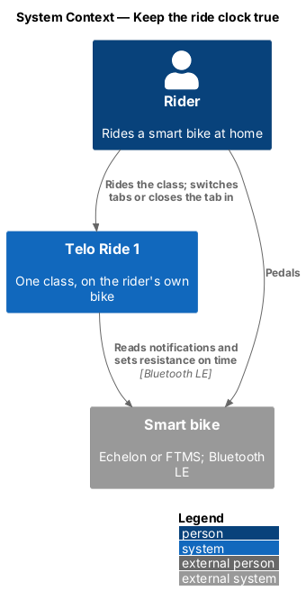
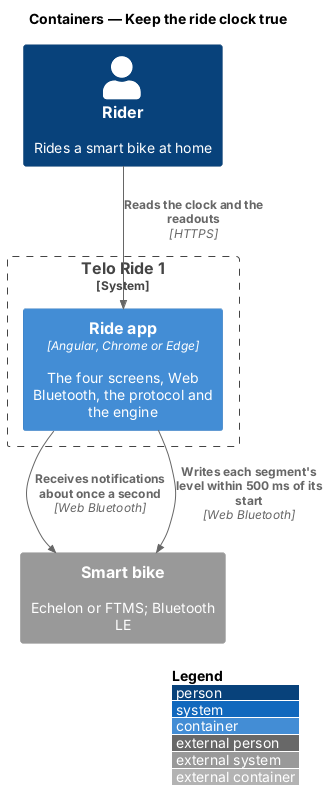
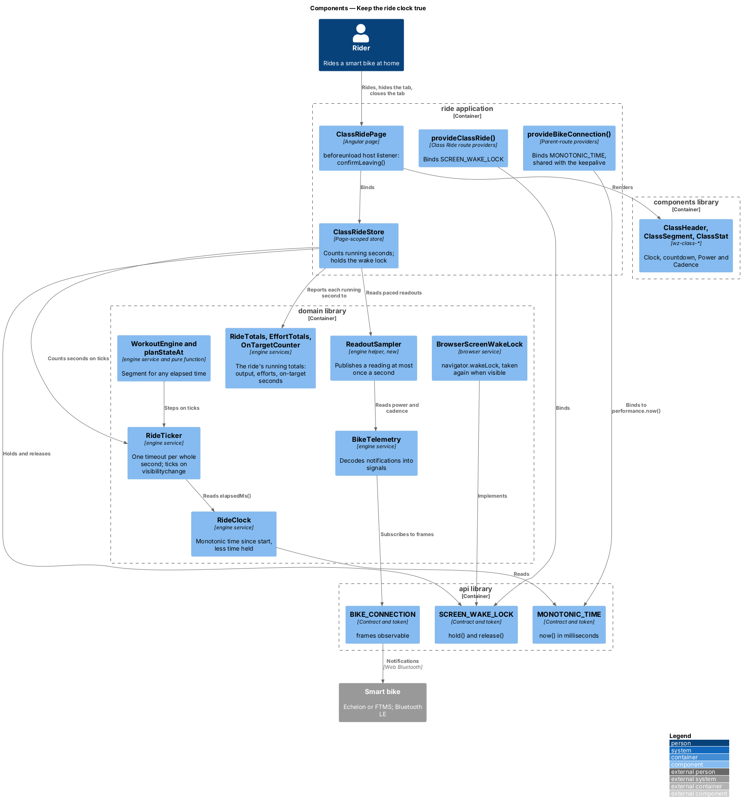
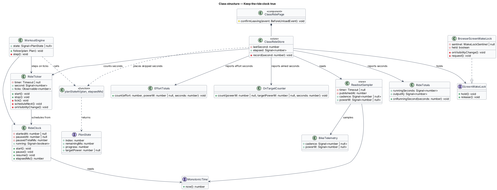
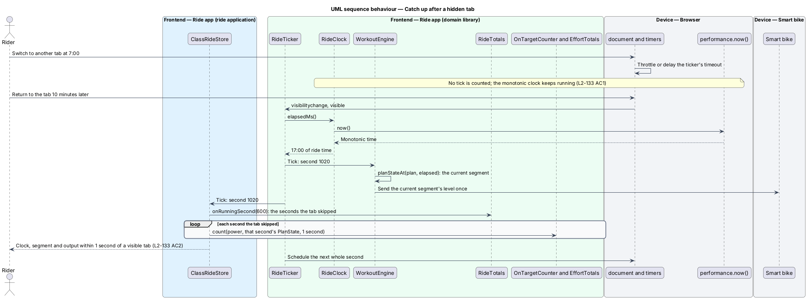
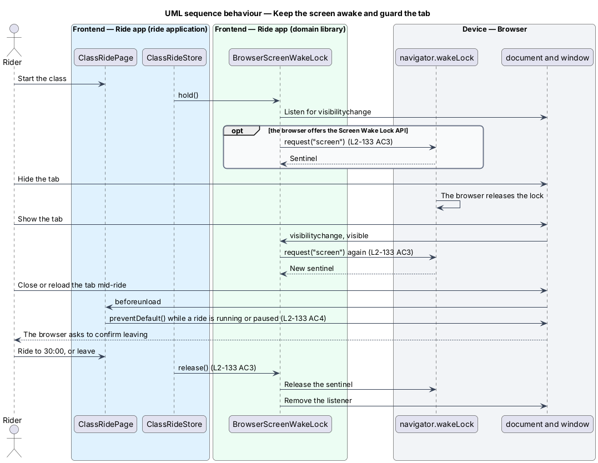
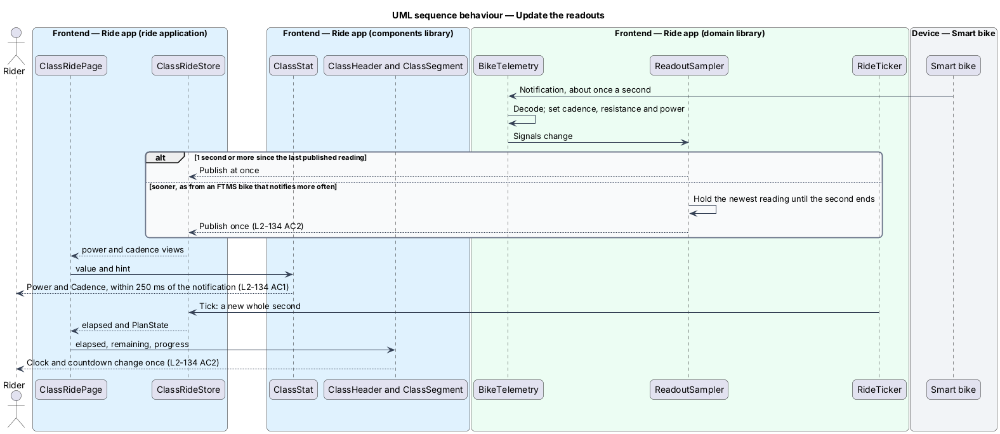

# Keep the ride clock true

## Overview

Telo Ride 1 runs one 30-minute class on a tablet or low-power laptop beside the rider's smart
bike. Everything in the ride hangs on one clock: which segment of the class is current, when the
bike's resistance changes, where the video is, and how much output the rider has built up. The
rider also switches tabs, lets the screen dim, or closes the lid for a moment. Browsers slow or
stop a hidden tab's timers, so a clock that counted timer ticks would fall behind the rider.

This feature keeps that clock, and the readouts driven by it, correct for the whole ride:

- The ride clock is read from a monotonic clock and never counts ticks.
- After a hidden tab, the clock, the plan's segment and the output catch up to within 1 second.
- The screen is kept awake while a ride runs.
- Closing or reloading the tab mid-ride asks the rider to confirm.
- Readouts follow the bike within 250 ms and change once a second.

Local terms:

- **monotonic clock**: time source that never jumps backwards and ignores wall-clock changes, `performance.now()` in the browser
- **ride clock**: monotonic time since the ride started, less the time the ride was held
- **tick**: publication of one new whole second of the ride clock
- **running second**: whole second of the ride clock, counted once towards the ride's totals
- **catch-up**: single step in which the seconds a throttled tab skipped are counted from the clock
- **wake lock**: browser's promise, through the Screen Wake Lock API, not to dim or lock the screen

Neighbouring features own the adjacent concerns:

- The screen that shows the clock and the readouts belongs to
  [ride the class](../../class-ride/ride-the-class/README.md); holding the clock on a pause or a
  lost bike belongs to
  [pause, leave or finish the class](../../class-ride/pause-leave-or-finish-the-class/README.md)
  and [wait for a lost bike](../../class-ride/wait-for-a-lost-bike/README.md).
- Decoding notifications and the output rule (`L2-020`, `L2-021`, `L2-023`) belong to
  [read bike telemetry](../../bike/read-bike-telemetry/README.md).
- The keepalive timed from the clock in a hidden tab (`L2-016` AC2) belongs to
  [keep the bike connected](../../bike/keep-the-bike-connected/README.md).
- The totals the running seconds feed, and their fixed size (`L2-138`), belong to
  [stay smooth on long rides](../stay-smooth-on-long-rides/README.md).
- Fake clocks in tests (`L2-148` AC2) belong to
  [test without hardware](../../platform/test-without-hardware/README.md).

## Description

The timing rules are in `domain`'s `engine/` folder, the browser integrations in `domain`'s
`browser/` folder, their contracts in `api`, and the wiring in the `ride` application on the
Class Ride route. Every part but `ReadoutSampler` exists.

### The clock

- **`MonotonicTime`** and **`MONOTONIC_TIME`** (exist in `api/time`). A contract with one
  method, `now(): number`, in milliseconds. `provideBikeConnection()` binds it to
  `performance.now()` on the parent route, so the ride clock and the keepalive of
  [keep the bike connected](../../bike/keep-the-bike-connected/README.md) read one clock.
  Today only `provideClassRide()` binds it, on the Class Ride route. Unit tests bind a fake
  that moves by hand.
- **`RideClock`** (exists in `domain/engine`). It records `now()` at `start()`, records it again
  at `pause()`, and adds the paused interval to `pausedTotalMs` at `resume()`. `elapsedMs()` is
  `now() - startedAt - pausedTotalMs`. It holds no timer and counts nothing (`L2-133` AC1).
- **`RideTicker`** (exists in `domain/engine`). It schedules one `setTimeout` for the next whole
  second of `RideClock.elapsedMs()`, or a second later while the clock is held. On waking it
  publishes `Math.floor(elapsedMs / 1000)` as the signal `second` and on the observable `ticks`,
  once, and only when it differs from the last published value. It listens for
  `visibilitychange` and ticks at once when the tab becomes visible. `stop()` and its
  `DestroyRef` clear the timeout and remove the listener.
- **`planStateAt(plan, elapsedMs)`** (exists in `domain/engine`). A pure function from the plan
  and an elapsed time to the `PlanState`. A late tick lands on the correct segment because the
  state is computed from the clock, not stepped.
- **`WorkoutEngine`** (exists). It calls `planStateAt` on each tick and sends a level only when
  the segment index changed. After a hidden tab it sends the current segment's level once, not
  one command per segment missed.

### Catching up the totals

- **`ClassRideStore.record(second)`** (exists; changes). On each tick the store counts
  `second - lastSecond` running seconds, so a tick that arrives late counts every second the
  throttled tab skipped. Today it passes that count to `RideRecorder` at the power of the
  moment. In Telo Ride 1 it reports the seconds to the ride's three accumulators. It calls
  `RideTotals.onRunningSecond(seconds)` once with the count, because output does not depend on
  the segment. It then walks the skipped seconds in order and, with the `PlanState` that
  `planStateAt` gives for each, calls `OnTargetCounter.count` and, in a work segment,
  `EffortTotals.count`, each for 1 second, so a second lands in the segment it belongs to.
  Power for a skipped second is the power at the moment of the catch-up; no earlier reading is
  kept (`L2-138` AC2). The seconds counted then equal the clock, so the output is within one
  second's worth of a visible tab's (`L2-133` AC2).
- **`RideTotals`** (exists in `domain/engine`; owned by
  [read bike telemetry](../../bike/read-bike-telemetry/README.md)). It adds each second's
  power ÷ 1000 to the output in kJ.
- **`EffortTotals`** and **`OnTargetCounter`** (new in `domain/engine`; owned by
  [show Class Done](../../class-done/show-class-done/README.md) and
  [score on target](../../class-done/score-on-target/README.md)). They take the same running
  seconds for the eight efforts and for the on-target share.

### The screen and the tab

- **`ScreenWakeLock`** and **`SCREEN_WAKE_LOCK`** (exist in `api/screen`). `hold()` and
  `release()`.
- **`BrowserScreenWakeLock`** (exists in `domain/browser`). `hold()` requests a `screen` lock
  from `navigator.wakeLock` and adds a `visibilitychange` listener that requests it again each
  time the tab becomes visible, because the browser lets the lock go when the tab is hidden.
  `release()` removes the listener and releases the sentinel. Without the API, or when the
  browser refuses, it does nothing. `provideClassRide()` binds it on the Class Ride route.
- **`ClassRideStore`** (exists). It calls `ScreenWakeLock.hold()` when the ride starts and
  `release()` at the finish and in its teardown.
- **`ClassRidePage.confirmLeaving(event)`** (exists). A host listener on `window:beforeunload`.
  While the store holds a ride, running or paused, it calls `event.preventDefault()`, and the
  browser asks the rider to confirm (`L2-133` AC4). The listener goes with the page.

### Readouts

- **`BikeTelemetry`** (exists in `domain/engine`). It subscribes to `BIKE_CONNECTION.frames`,
  decodes each notification in the same task and sets the signals `cadence`, `resistance` and
  `powerW`. The app is zoneless, so a signal write schedules one render on the next frame.
- **`ReadoutSampler`** (new, `domain/engine/readout-sampler.ts`, page-scoped). It stands between
  `BikeTelemetry` and the Power and Cadence stats. A reading that arrives 1 second or more
  after the last published one publishes at once. A reading that arrives sooner replaces the
  held value, which publishes when that second ends. An Echelon notifies once a second, so each
  reading passes straight through, within one frame of its notification (`L2-134` AC1). An FTMS
  bike that notifies more often still changes the readouts once a second (`L2-134` AC2). It
  reads `MONOTONIC_TIME`, keeps one timeout and clears it through `DestroyRef`.
- **`ClassHeader`** and **`ClassSegment`** (exist in `components`). They take the ticker's whole
  second and the engine's `PlanState`, so the clock and the segment countdown change once per
  tick. Both are `role="timer"` with no live region.

### Proof

- Unit specs beside each type (`ride-clock.spec.ts`, `ride-ticker.spec.ts`,
  `plan-state.spec.ts`, `browser-screen-wake-lock.spec.ts`) advance a fake clock.
- The Playwright fixtures `e2e/fixtures/tab.ts` (`hideTab`, `showTab`) and
  `e2e/fixtures/wake-lock.ts` (`WakeLockFixture`) exist. A spec hides the tab, runs
  `page.clock` forward 10 minutes, shows the tab and reads the clock, the segment and the
  writes to the fake bike.

## Requirements

The feature realizes the following level-2 (L2) requirements. Each refines the level-1 (L1)
requirement cited beside it.

| L2 ID | Refines (L1) | Requirement |
|-------|--------------|-------------|
| `L2-133` | `L1-022` | The clock of a running ride shall be computed from a monotonic clock (`performance.now()`) and shall never be computed by counting timer ticks. When the tab is hidden for 10 minutes during a ride and shown again, the clock, the plan's segment and the output shall be within 1 second of what they would have been in a visible tab. Where the browser offers the Screen Wake Lock API, the screen shall be kept awake during a running ride, the lock shall be taken again when the tab becomes visible, and the lock shall be released when the ride ends. When the rider closes or reloads the tab during a running or paused ride, the browser shall ask the rider to confirm leaving. |
| `L2-134` | `L1-022` | When a notification arrives from the bike, the readouts shall show it within 250 ms. In a running ride, the clock, the segment countdown, power and cadence shall each update once when a second passes. |

## Diagrams

### System context

The rider rides through Telo Ride 1, which reads the smart bike once a second and keeps time for
the ride on the rider's device.

### Containers

The Ride app is the only container involved. It reads the bike over Web Bluetooth; the clock, the
wake lock and the leave confirmation all come from the browser the app runs in.

### Components

`RideClock` reads `MONOTONIC_TIME`, `RideTicker` turns it into whole seconds, and
`WorkoutEngine` and `ClassRideStore` act on each tick. `BrowserScreenWakeLock` and the page's
`beforeunload` listener guard the screen and the tab; `ReadoutSampler` paces the readouts.

### Class structure

`RideClock` depends only on `MonotonicTime`. `RideTicker` and `WorkoutEngine` depend on the
clock, `BrowserScreenWakeLock` realizes `ScreenWakeLock`, and `ReadoutSampler` reads
`BikeTelemetry`.

### Behaviour: catch up after a hidden tab

While the tab is hidden the browser delays the ticker's timeout, but the clock keeps time. When
the tab is shown the ticker ticks at once, the engine lands on the current segment and the store
counts the skipped seconds into the three accumulators.

### Behaviour: keep the screen awake and guard the tab

The store holds the wake lock from the start of the ride, the lock is requested again each time
the tab becomes visible, and it is released at the end. A close or reload mid-ride is answered
with `preventDefault()`.

### Behaviour: update the readouts

A notification reaches the Power and Cadence stats within one frame; the clock and the countdown
change on the tick. Each changes once a second.

