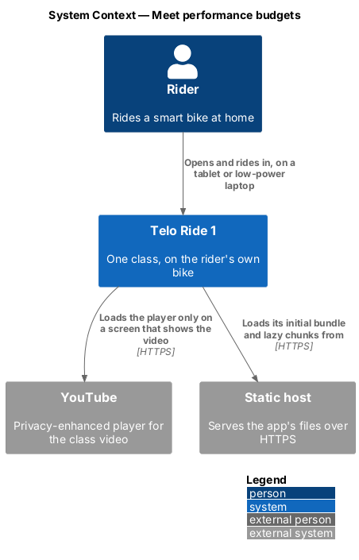
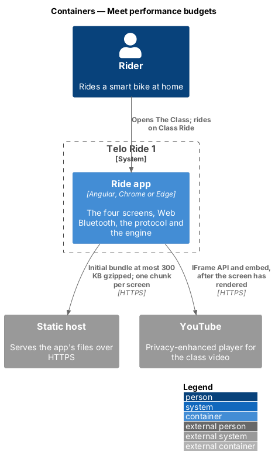
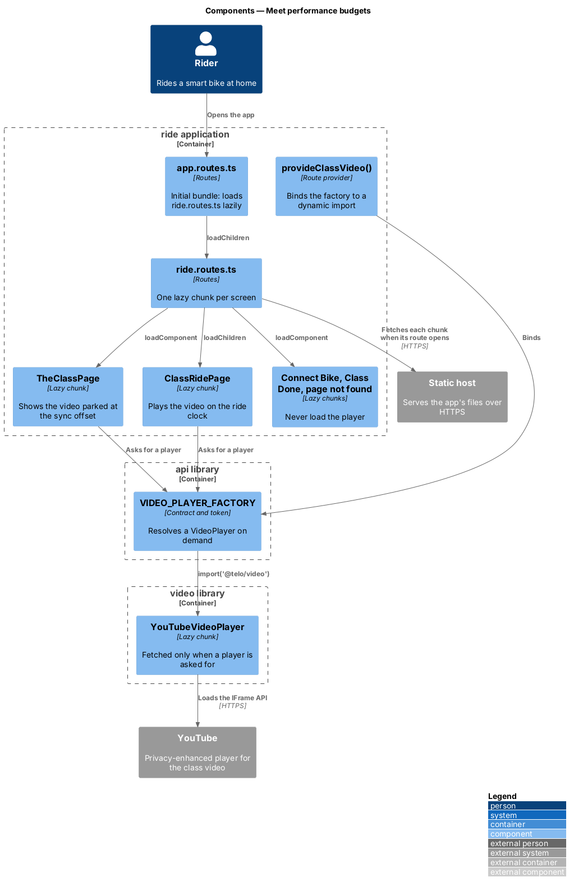
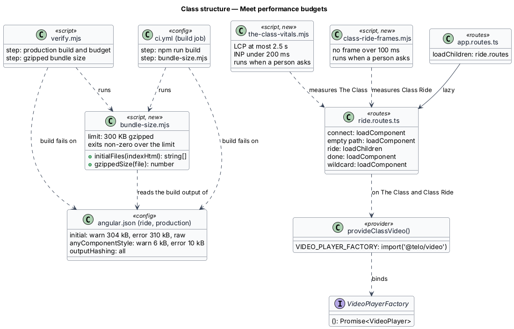
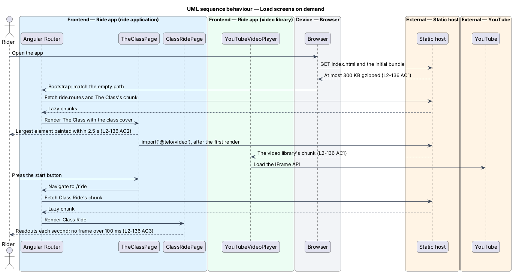
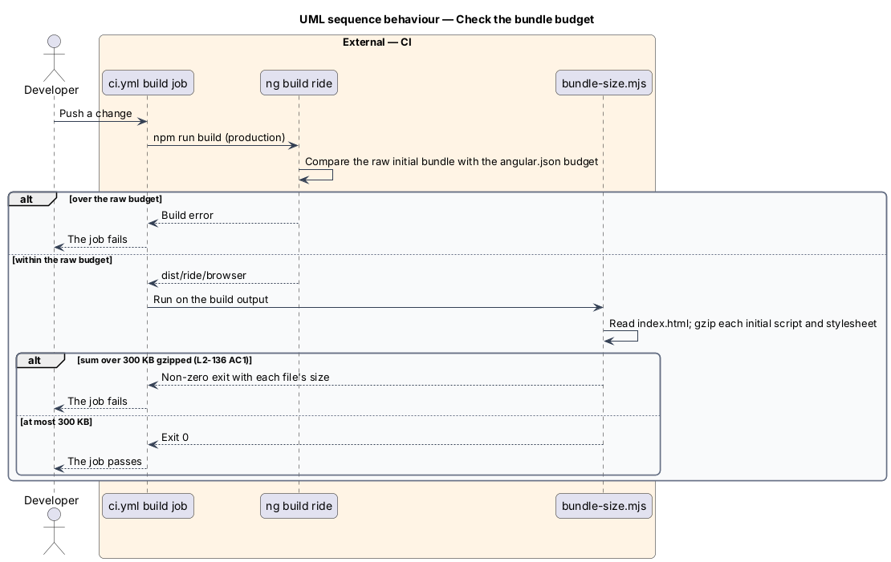

# Meet performance budgets

## Overview

Telo Ride 1 runs in Chrome or Edge on a tablet or low-power laptop beside the rider's bike. The
rider opens it to take one 30-minute class. On such a device, each kilobyte of script delays the
first screen, and each long task during the ride delays a readout the rider is pedalling
against. The product therefore sets budgets that can be measured, and a change that breaks one
is not done.

This feature covers three budgets and the mechanisms that hold them:

- a size budget for the code the browser loads first, with every screen and the video player
  loaded only when used;
- a loading budget for The Class, the screen a returning rider lands on;
- a responsiveness budget for Class Ride while a ride runs.

Local terms:

- **initial bundle**: scripts and styles the browser loads before the first route renders
- **lazy chunk**: script file the browser fetches when a route or a dynamic import first asks for it
- **budget**: limit a build or a measurement fails when exceeded
- **Largest Contentful Paint (LCP)**: time from navigation to the render of the largest element in the viewport
- **Interaction to Next Paint (INP)**: time from a tap, click or key press to the next frame the browser paints
- **long frame**: frame of the interface that takes longer than 100 ms to produce

Neighbouring features own the adjacent concerns:

- The once-a-second readouts and their 250 ms limit (`L2-134`) belong to
  [keep the ride clock true](../keep-the-ride-clock-true/README.md).
- Memory over a long ride and across repeated visits (`L2-138`) belongs to
  [stay smooth on long rides](../stay-smooth-on-long-rides/README.md).
- The workspace's projects and their dependency rules (`L2-146`) belong to
  [structure the frontend workspace](../../platform/structure-the-frontend-workspace/README.md).
- The CI pipeline and its 5-minute limit (`L2-149`) belong to
  [host and deliver](../../platform/host-and-deliver/README.md).
- The screens measured belong to [show the class](../../the-class/show-the-class/README.md) and
  [ride the class](../../class-ride/ride-the-class/README.md).

## Description

The budgets are held by configuration and scripts, not by a runtime component. Each mechanism
below is an artefact in the repository.

### Size and lazy loading (`L2-136` AC1)

- **`app.routes.ts`** (exists). One route that loads `ride.routes.ts` with `loadChildren`, so
  the initial bundle holds Angular, the router and the shell only.
- **`ride.routes.ts`** (exists; changes). A parent route provides the bike connection, and each
  screen under it loads with `loadComponent` or `loadChildren`. Telo Ride 1 keeps five routes:
  `connect`, the empty path (The Class), `ride`, `done` and `**` (page not found). The routes of
  the features Telo Ride 1 leaves out are removed in changes of their own. The route paths are
  assumptions the mocks share (open question 7).
- **`provideBikeConnection()`** (exists). Bound on the lazy parent route, so the Bluetooth code
  loads with the first screen, not with the initial bundle.
- **`provideClassVideo()`** (exists). It binds `VIDEO_PLAYER_FACTORY` to
  `() => import('@telo/video')`. Only the routes of The Class and Class Ride provide it, and the
  `video` library's chunk is fetched only when one of them asks for a player. Connect Bike,
  Class Done and page not found never fetch it.
- **The diagnostic recording** (ADR 0048). None of its code is in the initial bundle or in a
  chunk a rider loads (`L2-178` AC1). Four mechanisms hold that:
  - `ride.routes.ts`, itself a lazy chunk, exports `rideRoutes` as a `Promise<Routes>`. It reads
    the switch once and awaits `import('./diagnostics/provide-diagnostics')` only when the app is
    opened with `?diagnose`. `app.routes.ts`, `AppShell` and `app.config.ts` are not changed.
  - The recording's code is exported only from the entry points `@telo/domain/diagnostics` and
    `@telo/components/diagnostics`. Exported from the libraries' main entry points, it was
    bundled into a chunk every rider loads; the acceptance test for "off" caught it.
  - `noDiagnostics` in `frontend/eslint.config.js` keeps each library from importing those two
    entry points.
  - The production build sets `namedChunks`, and `projects/ride/ngsw-config.json` leaves
    `/provide-diagnostics-*.js` out of the prefetched `app` group and lists it in a lazy
    `diagnostics` group, so the service worker downloads the chunk to no rider's device.
    `e2e/diagnostic-recording-app-cache.spec.ts` proves it.

  Measured: `main` is 243.06 kB raw, from 243.05 kB, and the recording's chunk is 21.68 kB raw,
  6.81 kB transferred; no budget changed. The dialog is the platform's `<dialog>` element and
  not the CDK Dialog for a measured reason: with `@angular/cdk/dialog` imported from one lazy
  chunk, `main` would have been 250.95 kB raw, because the parts of `@angular/core` the CDK needs
  are bundled into the initial chunk. The recording belongs to
  [record diagnostics](../../security/record-diagnostics/README.md).
- **`angular.json` budgets** (exist; change). The `ride` project's production configuration
  sets an `initial` budget that warns at 304 kB and fails at 310 kB, and an
  `anyComponentStyle` budget that warns at 6 kB and fails at 10 kB. The Angular CLI measures
  raw bytes, while `L2-136` AC1 states 300 KB gzipped, so the raw budget is a guard against
  growth and not the requirement itself. Its value for Telo Ride 1 is `<TO SUPPLY>`: it is set
  from the first production build after the carried-over features are removed, and tightened
  to that size. Raising it needs a reason in the change.
- **`tools/verify/bundle-size.mjs`** (new). A Node script. It builds nothing; it reads the
  production build's output in `frontend/dist/ride/browser`, takes the scripts and stylesheets
  that `index.html` references (the initial bundle), gzips each with `node:zlib`, and exits
  non-zero when the sum exceeds 300 KB. It prints each file's raw and gzipped size.
- **`tools/verify/verify.mjs`** (exists; changes). Its step "production build and budget" runs
  `npm run build`; the new script runs after it.
- **`.github/workflows/ci.yml`** (exists; changes). The `build` job's step "The ride app, within
  its budgets" runs `npm run build`, which fails on the `angular.json` budget. A step after it
  runs `bundle-size.mjs`. The job's other step (the API) is carried over and is removed by the
  change that removes the backend's projects (28.8).

### Loading The Class (`L2-136` AC2)

- **`tools/perf/the-class-vitals.mjs`** (new). A Node script that serves the production build
  with `frontend/scripts/serve-dist.mjs` (exists), opens `/` cold in Chromium with a remembered
  bike in `localStorage`, and reads LCP and INP. It fails when LCP exceeds 2.5 s or any
  measured interaction reaches 200 ms. The device profile ("a mid-range tablet": CPU slowdown
  and viewport) and the 4G profile (latency and throughput) are `<TO SUPPLY>`: the specs name
  them and give no values. The measuring library is `<TO SUPPLY>` for the same reason.
- **What keeps LCP low** (exists in part). The class cover is the largest element of The Class
  until the player paints. The YouTube player's script is not in the initial bundle and loads
  after the screen has rendered. Fonts are bundled and self-hosted.
- The measurement runs only when a person asks. It is not a CI step.

### Responsiveness of Class Ride (`L2-136` AC3)

- **`tools/perf/class-ride-frames.mjs`** (new). A Node script that opens the development build
  with `?simulate`, starts the class on the simulated bike, and observes
  `long-animation-frame` entries with a `PerformanceObserver` for a set length of ride. It fails
  on any frame longer than 100 ms. The "reference tablet" profile and the length of ride
  measured are `<TO SUPPLY>`: the specs name the device and give no values.
- **What keeps frames short** (exists). Every component is `OnPush` and the app is zoneless, so
  a tick renders only the components whose signals changed. A tick does a fixed amount of work:
  one `planStateAt` call, one addition to each running total, one drift check.
- The measurement runs only when a person asks.

## Requirements

The feature realizes the following level-2 (L2) requirement, which refines the level-1 (L1)
requirement cited beside it.

| L2 ID | Refines (L1) | Requirement |
|-------|--------------|-------------|
| `L2-136` | `L1-022` | The initial bundle of the production build shall be at most 300 KB gzipped, every screen shall be loaded when its route opens, and the video player's code shall be loaded only by a screen that shows the video. When The Class loads cold on a mid-range tablet over a 4G profile, Largest Contentful Paint shall be at most 2.5 s, and Interaction to Next Paint shall stay under 200 ms. When a ride runs on Class Ride on the reference tablet, the readouts shall stay within `L2-134` and no frame of the interface shall take longer than 100 ms. |

## Diagrams

### System context

The rider's browser loads Telo Ride 1 from the static host and the class video from YouTube.
Both loads count against the budgets; the bike does not.

### Containers

The Ride app is served as static files. The browser fetches the initial bundle first and each
lazy chunk when its route opens; the YouTube player loads only on a screen that shows the video.

### Components

The route files split the app into lazy chunks and `provideClassVideo()` keeps the `video`
library out of every chunk until a player is asked for.

### Class structure

The budgets live in configuration and scripts. `angular.json` holds the raw budget, the new
`bundle-size.mjs` holds the gzipped one, and `verify.mjs` and `ci.yml` run both.

### Behaviour: load screens on demand

A returning rider's first visit fetches the initial bundle and The Class's chunk. The `video`
library and Class Ride's chunk are fetched only when The Class asks for a player and when the
rider starts the class.

### Behaviour: check the bundle budget

A push starts CI. The production build fails on the raw budget, and the size script fails when
the gzipped initial bundle exceeds 300 KB.

