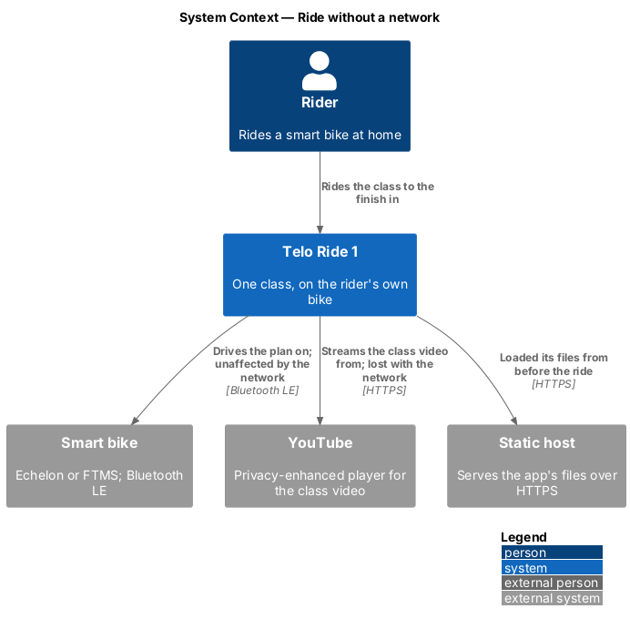
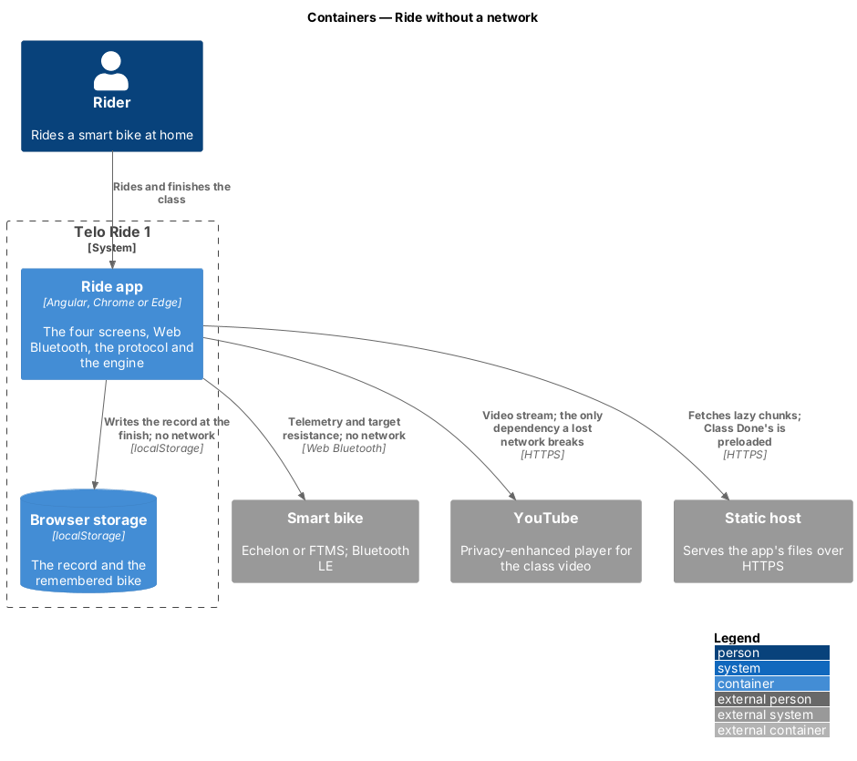
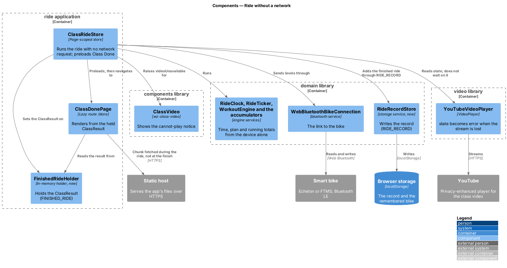
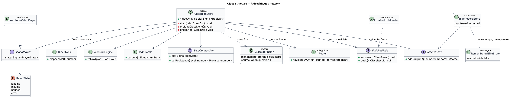
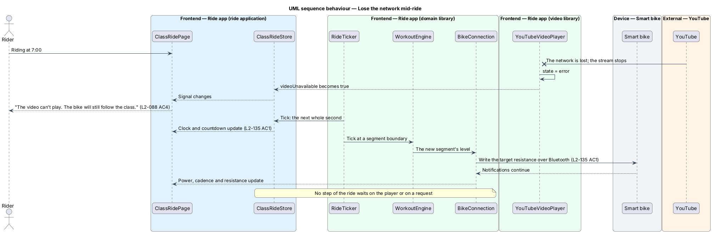
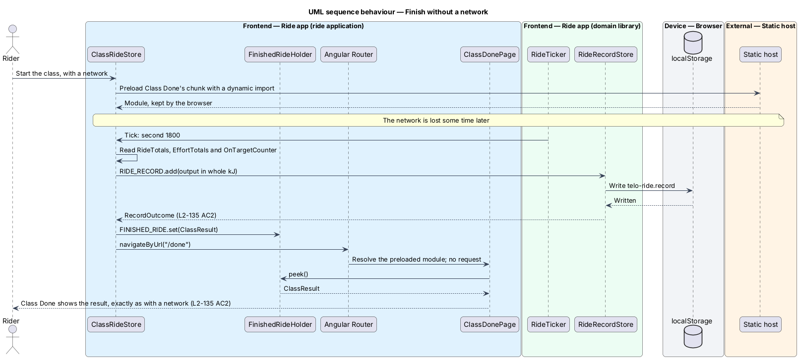

# Ride without a network

## Overview

Telo Ride 1 is used at home, beside a bike, often on Wi-Fi that reaches the room poorly. A ride
lasts 30 minutes and the network may drop in the middle of it. The rider's effort is not to be
lost to that.

Telo Ride 1 has no accounts and, in its requirements, no backend. The whole ride runs on the
device: the app talks to the bike over Bluetooth, keeps time from the device's clock, and keeps
the rider's record in the browser's storage. The one thing a ride takes from the network while
it runs is the class video, which streams from YouTube. This feature states that property and
names what keeps it true: when the network is lost, only the video is affected, and a ride that
finishes with no network is recorded and shown exactly as one that finishes with it.

Local terms:

- **network**: device's connection to the internet; the Bluetooth link to the bike is not part of it
- **running ride**: ride whose page, class and plan are already loaded and whose clock has started
- **record**: rider's ride count, best output and last output, kept on the device
- **ride result**: output, running time, on-target share and eight effort averages of one finished ride, carried as a `ClassResult`

Neighbouring features own the adjacent concerns:

- The notice shown when the video cannot play (`L2-088` AC4) belongs to
  [ride the class](../../class-ride/ride-the-class/README.md).
- Writing the record (`L2-168`) belongs to
  [keep the record](../../class-done/keep-the-record/README.md); the Class Done screen belongs
  to [show Class Done](../../class-done/show-class-done/README.md).
- The class showing without a network after a first visit (`L2-080` AC5) belongs to
  [show the class](../../the-class/show-the-class/README.md).
- The rule that nothing about a ride leaves the device (`L2-132`) belongs to
  [keep data on the device](../../security/keep-data-on-the-device/README.md); the policy that
  allows connections only to the app's own origin (`L2-131`) belongs to
  [restrict third parties](../../security/restrict-third-parties/README.md).
- The clock that keeps time without any server belongs to
  [keep the ride clock true](../keep-the-ride-clock-true/README.md).

## Description

The feature is a property of the ride's building blocks, not a component of its own. Each block
below is on the path of a running ride; the description says what it takes from the network.

### What a running ride depends on

- **`ClassRideStore`** (exists in the `ride` application; changes). Today it reads the class
  from `CLASSES_API` over HTTP when the page opens, joins a hub session for a group ride, and at
  the finish submits the ride to `RIDE_OUTBOX` for the backend. All three leave. In Telo Ride 1
  the store makes no network request: it starts the ride from a class definition already in
  hand, and at the finish it calls `RIDE_RECORD.add`, sets the `ClassResult` on `FINISHED_RIDE`
  and navigates.
- **Class definition** (source `<TO SUPPLY>`, open question 1). The design treats the class as
  a definition the frontend holds. Whatever the source, the store has the whole plan before the
  clock starts, so no part of the plan is fetched during the ride.
- **`RideClock`, `RideTicker`, `WorkoutEngine`, `RideTotals`** (exist in `domain/engine`), with
  the new `EffortTotals` and `OnTargetCounter`. They read `performance.now()`, the plan and the
  bike's telemetry in memory. None takes a network dependency.
- **`BIKE_CONNECTION`** (exists; `WebBluetoothBikeConnection` in `domain/bluetooth`). Bluetooth
  LE between the device and the bike. It does not use the network.
- **`YouTubeVideoPlayer`** (exists in `video`). The one network dependency of a running ride.
  When the stream stops, the player's `state` becomes `error`, or the player stalls: it reports
  `buffering` and no error, and `VideoStallWatch` counts 10 s of the ride without playing (slice
  31.3). Either way the store's `videoUnavailable` signal raises the notice. The store does not read the player to advance
  the clock or the plan, so they carry on (`L2-135` AC1).
- **`RIDE_RECORD`** and **`RideRecordStore`** (new; defined in
  [keep the record](../../class-done/keep-the-record/README.md)). The store writes the record
  to `localStorage` under `telo-ride.record`, in the way `RememberedBikeStore` (exists in
  `domain/storage`) writes the remembered bike under `telo-ride.bike`. A write to
  `localStorage` does not use the network.
- **`FINISHED_RIDE`** and **`FinishedRideHolder`** (new; defined in
  [show Class Done](../../class-done/show-class-done/README.md)). The store sets the
  `ClassResult` on the holder, in memory, before it navigates.
- **Class Done route** (new). `classDoneGuard` and `ClassDonePage` read the result from
  `FINISHED_RIDE`. The result carries the earlier best, so Class Done renders with no request
  and no further read of storage.

### Loading Class Done with no network

Every route is lazy (`loadComponent`, `loadChildren`), so Class Done's chunk is fetched from the
static host when the route first opens. With no network that fetch fails unless the chunk is
already on the device. `L2-135` AC2 requires Class Done to show the result exactly as with a
network, so the chunk shall be on the device before the ride ends. The design preloads it:

- **Class Done preload** (new, in `ClassRideStore`). After the ride starts, the store calls the
  same dynamic `import()` the `/done` route uses and discards the result. The browser then holds
  the module, and the navigation at the finish resolves it from memory. A failed preload is
  logged to the console and retried at the next segment change.

No service worker exists in the workspace (`angular.json` has no `serviceWorker` entry and no
`ngsw-config.json`). Whether the app shall also open and start a ride with no network at all, as
an installed and cached app, is `<TO SUPPLY>` (open question 8). The preload covers a ride that
started with a network; it does not cover a cold start without one.

### Proof

- **`e2e/ride-without-a-network.spec.ts`** (new). It starts a ride with the fake bike, sets the
  browser context offline, runs `page.clock` forward to 30:00, and expects the clock, the
  segment changes and the writes to the bike to carry on, the video notice to show, the record
  in `localStorage` to be updated and Class Done to show the result. The shared fixture
  `e2e/fixtures/test.ts` already fails a spec on any request off localhost.

## Requirements

The feature realizes the following level-2 (L2) requirement, which refines the level-1 (L1)
requirement cited beside it.

| L2 ID | Refines (L1) | Requirement |
|-------|--------------|-------------|
| `L2-135` | `L1-022` | When the network is lost during a running ride, the clock, the plan and the bike shall carry on, and only the video shall be affected (`L2-088` AC4). When a ride finishes with no network, the record shall be updated and Class Done shall show the result, exactly as with a network. |

## Diagrams

### System context

Telo Ride 1 reaches three things outside itself: the bike over Bluetooth, YouTube for the video,
and the static host for its own files. A lost network cuts off the last two and leaves the bike.

### Containers

The Ride app and the browser's storage are both on the device. The ride's path runs between
them and the bike; YouTube and the static host are off that path once the ride has started.

### Components

`ClassRideStore` drives the ride from `domain` services that read only the device. The video
player is the single component with a network dependency, and the store treats its failure as a
notice.

### Class structure

The store depends on the clock, the engine, the accumulators, the connection, `RideRecord` and
`FinishedRide`, none of which holds a network client. `VideoPlayer.state` is the only signal the network can
change.

### Behaviour: lose the network mid-ride

The video stops and the notice shows. Ticks, segment changes and resistance commands continue,
because none of them waits on the player.

### Behaviour: finish without a network

At 30:00 the store writes the record to `localStorage`, sets the result on `FINISHED_RIDE` and
opens Class Done from the module it preloaded. No request leaves the device.

