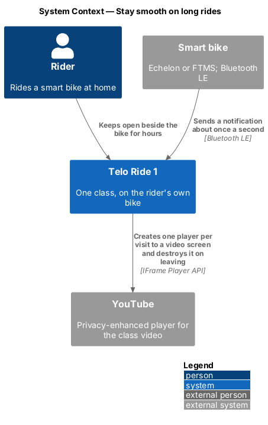
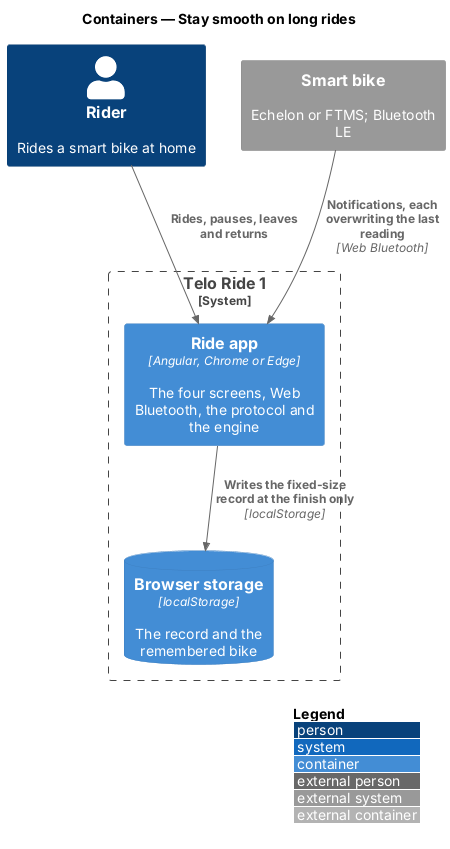
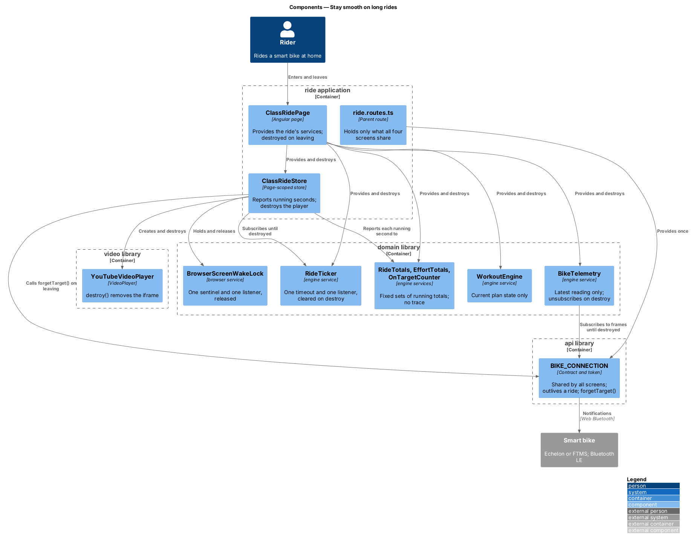
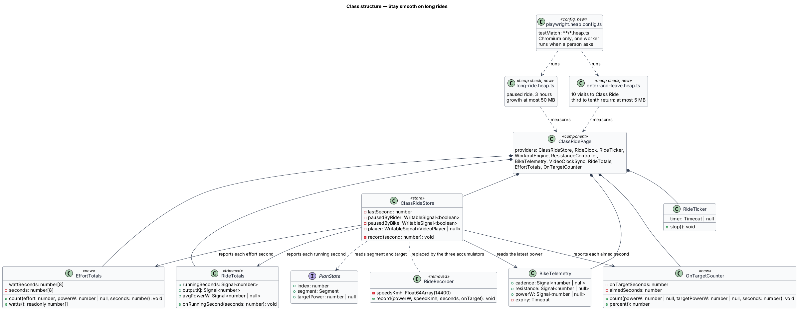
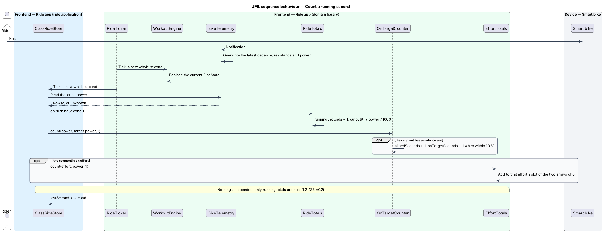
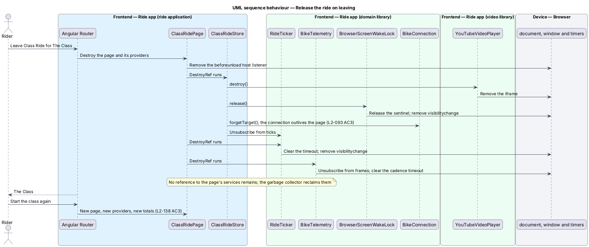
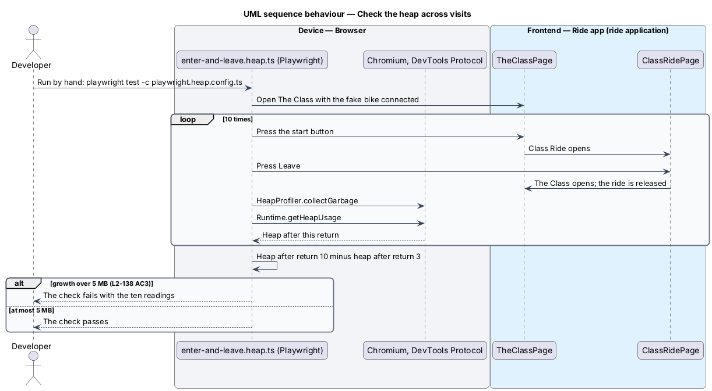

# Stay smooth on long rides

## Overview

Telo Ride 1 stays open on a tablet or low-power laptop beside the bike for the length of a ride
and often well beyond it: a rider pauses to answer the door, or leaves the tab open between
rides for days. Such a device has little memory to spare. An app that keeps a little more with
every second of a ride, or with every visit to a screen, slows down and is finally reloaded by
the browser, in the middle of a ride at worst.

This feature keeps the app's memory flat over time. A ride holds a fixed number of running
totals and no history. Everything a screen acquires is released when the rider leaves it. Two
heap checks measure the result: one over a 3-hour session and one across ten visits to Class
Ride.

Local terms:

- **running total**: single number updated in place each running second, such as the output in kJ
- **trace**: list of readings kept one per second, which grows with the ride's length
- **running second**: whole second of the ride clock, counted once towards the totals
- **effort**: one of the plan's eight work segments
- **heap**: memory the page's JavaScript holds, as the browser reports it after a garbage collection
- **heap check**: scripted measurement of the heap, run only when a person asks

Neighbouring features own the adjacent concerns:

- The rules the totals follow belong to others: output to
  [read bike telemetry](../../bike/read-bike-telemetry/README.md) (`L2-023`), the on-target
  share to [score on target](../../class-done/score-on-target/README.md) (`L2-170`), and the
  effort averages to [show Class Done](../../class-done/show-class-done/README.md) (`L2-169`).
- The record's fixed size (`L2-168` AC5) belongs to
  [keep the record](../../class-done/keep-the-record/README.md).
- Releasing the ride when the rider leaves or finishes (`L2-093` AC3) belongs to
  [pause, leave or finish the class](../../class-ride/pause-leave-or-finish-the-class/README.md).
- Counting every running second after a hidden tab belongs to
  [keep the ride clock true](../keep-the-ride-clock-true/README.md).
- The size and frame budgets (`L2-136`) belong to
  [meet performance budgets](../meet-performance-budgets/README.md).

## Description

The slice is the ride's three accumulators in `domain`'s `engine/`, the provider scopes and
teardown in the `ride` application, and two heap checks under `frontend/e2e/`.

### Running totals, no trace (`L2-138` AC2)

- **Three accumulators** hold the ride's live data. Each is a small engine service provided on
  `ClassRidePage`, each holds running totals only, and each has the same size at 0:01 and at
  30:00:
  - **`RideTotals`** (exists in `domain/engine/ride-totals.ts`; trimmed): `runningSeconds`,
    `outputKj` and the `avgPowerW` derived from them. `onRunningSecond(seconds)` adds to them.
    Its distance and energy leave with `SpeedModel` and `EnergyModel`. It belongs to
    [read bike telemetry](../../bike/read-bike-telemetry/README.md) (`L2-023` AC4 and AC5).
  - **`EffortTotals`** (new, `domain/engine/effort-totals.ts`): two arrays of length 8, the
    power sum and the running seconds of each effort. It belongs to
    [show Class Done](../../class-done/show-class-done/README.md) (`L2-169`).
  - **`OnTargetCounter`** (new, `domain/engine/on-target-counter.ts`): `onTargetSeconds` and
    `aimedSeconds`. It belongs to
    [score on target](../../class-done/score-on-target/README.md) (`L2-170`).
- **`RideRecorder`** (exists in `domain/engine/ride-recorder.ts`; removed). It allocates a
  `Float64Array` of 14,400 speeds, one per second, to send to the backend. That is a trace.
  Telo Ride 1 sends nothing, so `ClassRideStore` stops creating it and calls the three
  accumulators instead, and the file is removed.
- **`BikeTelemetry`** (exists). It keeps the latest cadence, resistance and power as signals
  and overwrites them on each notification. It keeps no earlier reading.
- **`ClassRideStore`** (exists; changes). It keeps `lastSecond`, two booleans for the hold and
  one reference each to the class and the player. The `ClassResult` it builds at the finish is
  a fixed-size value: its figures and eight effort averages. `FINISHED_RIDE` holds at most one.
- **`ClassSegment`** (exists in `components`). The resistance profile is computed from the
  plan's 17 segments, not from readings, so it does not grow.
- **`VideoClockSync`**, **`WorkoutEngine`** (exist). Each keeps the current state only.
- **The diagnostic recording** (only when the app is opened with `?diagnose`). It is the one
  list of readings the page holds, and it is bounded: `RecordingBuffer` is a ring of at most
  20,000 entries and 3,000,000 bytes of text, line breaks counted, that drops its oldest lines
  first, and at most 8 screen captures are kept beside it (`L2-178` AC9). Its size therefore
  stops growing with the ride's length. A rider's app holds none of it. The ring belongs to
  [record diagnostics](../../security/record-diagnostics/README.md).

### Release on leaving (`L2-138` AC3)

- **Page-scoped providers** (exist). `ClassRidePage` provides `ClassRideStore`, `RideClock`,
  `RideTicker`, `WorkoutEngine`, `ResistanceController`, `BikeTelemetry` and `VideoClockSync`;
  `RideTotals`, `EffortTotals` and `OnTargetCounter` join them. None is provided in `root`. Angular destroys them with the page, so
  a new visit starts from new instances and the old ones become unreachable.
- **Teardown through `DestroyRef`** (exists). `RideTicker` clears its timeout and removes its
  `visibilitychange` listener. `BikeTelemetry` unsubscribes from `frames` and clears its
  cadence timeout. `WorkoutEngine` and `ClassRideStore` unsubscribe through
  `takeUntilDestroyed`. The store destroys the video player, which removes its iframe, and
  releases the wake lock. `BrowserScreenWakeLock` removes its `visibilitychange` listener. The
  page's `beforeunload` listener is a host binding and goes with the page.
- **Route-scoped providers** (exist). `provideClassRide()` binds on the Class Ride route, whose
  injector outlives the page. It binds one `BrowserScreenWakeLock` and stateless values, so
  nothing accumulates there; the store releases the lock explicitly for this reason.
- **Parent-route providers** (exist; three join). `BIKE_CONNECTION`, `TICKER` and
  `REMEMBERED_BIKE` are shared by all four screens and live as long as the app, as do the new
  bindings of `MONOTONIC_TIME`, `RIDE_RECORD` and `FINISHED_RIDE`. `SecondTicker` gives each
  subscriber its own interval and clears it on unsubscribe, so it holds nothing between rides.
  The record is three numbers and `FinishedRideHolder` holds at most one `ClassResult`, which
  Class Done clears. The connection outlives the ride with one kept target resistance; the
  store calls `BikeConnection.forgetTarget()` when the rider leaves or finishes
  ([pause, leave or finish the class](../../class-ride/pause-leave-or-finish-the-class/README.md)).
- **YouTube IFrame API script** (exists in `video`). `loadApi` adds the script element once per
  page and reuses it. Ten visits create ten players and destroy ten; the script is one.

### Heap checks (`L2-138` AC1 and AC3)

Both are new. They sit apart from the behaviour specs, because `playwright.config.ts` matches
`**/*.spec.ts` and the checks shall not run by default.

- **`e2e/heap/long-ride.heap.ts`** (new). It opens the development build with `?simulate`,
  starts the class on the simulated bike with `page.clock` installed, pauses the ride, and
  advances the clock 3 hours. Through a Chrome DevTools Protocol session it calls
  `HeapProfiler.collectGarbage` and reads `Runtime.getHeapUsage` at the end of the first minute
  and of the last. It fails when the growth exceeds 50 MB.
- **`e2e/heap/enter-and-leave.heap.ts`** (new). It goes from The Class to Class Ride and back
  ten times. After each return it collects garbage and reads the heap. It fails when the heap
  after the tenth return exceeds the heap after the third by more than 5 MB. The first two
  returns are left out because lazy chunks and the YouTube script load once and stay.
- **`e2e/long-ride-recording.spec.ts`**. A behaviour spec: the class is ridden to its end with
  the recording on. A readout still follows a notification within 250 ms, Class Done opens with
  20:00 and its output, and the saved recording is within its limits (`L2-178` AC9, AC19).
- **`e2e/heap/recording.heap.ts`**. The 3-hour check of `long-ride.heap.ts` with `?diagnose`.
  The ride is paused after a minute and the clock runs 3 hours in ten-minute steps, while the
  fake bike sends five notifications a second through `FakeBluetooth.notifyTimes`, so the
  recording passes 20,000 entries and drops its oldest. The heap is held to the same 50 MB
  (`L2-178` AC19). Like the other heap checks, it runs only when a person asks.
- **`playwright.heap.config.ts`** (new). A second Playwright configuration with
  `testMatch: '**/*.heap.ts'`, Chromium only, one worker. A person runs it with
  `npx playwright test -c playwright.heap.config.ts`. No agent and no CI job runs it.

Whether the long-ride check advances a fake clock, as designed here, or runs for 3 real hours on
a device is `<TO SUPPLY>`: `L2-138` AC1 states the duration and no device or method. A fake
clock exercises every per-second code path 10,800 times and does not exercise the real YouTube
player, which the fixture `e2e/fixtures/youtube.ts` replaces.

## Requirements

The feature realizes the following level-2 (L2) requirement, which refines the level-1 (L1)
requirement cited beside it.

| L2 ID | Refines (L1) | Requirement |
|-------|--------------|-------------|
| `L2-138` | `L1-022` | When a ride is left paused so that the screen stays open for 3 hours, the page's memory shall grow by at most 50 MB from the first minute to the last. A ride shall hold only running totals as live data (output, on-target seconds, each effort's total) and shall hold no trace that grows with the ride's length. When the rider goes from The Class to Class Ride and back ten times and the heap is measured after each return, the heap shall not grow from the third return to the tenth by more than 5 MB. |

## Diagrams

### System context

The rider keeps Telo Ride 1 open beside the bike for hours. The bike sends a notification every
second for as long as it is connected, and the app keeps none of them.

### Containers

The Ride app holds the ride's live data in memory as fixed-size totals. Browser storage receives
the fixed-size record only at the finish; nothing is written per second.

### Components

`ClassRidePage` provides the ride's services, so they are destroyed with it. `RideTotals`,
`EffortTotals` and `OnTargetCounter` are the only places ride data accumulates, and each
accumulates into a fixed set of numbers.

### Class structure

`RideTotals` holds three numbers, `OnTargetCounter` two counters and `EffortTotals` two arrays
of length 8. The heap checks are scripts with their own Playwright configuration;
`RideRecorder`, with its per-second buffer, is removed.

### Behaviour: count a running second

Each tick adds to the three accumulators in place and overwrites the latest reading. Nothing is appended, so
the ride's memory is the same at the first second and the last.

### Behaviour: release the ride on leaving

Leaving destroys the page's providers. Each clears its own timer, listener or subscription, the
player is destroyed, the connection forgets the kept target, and the next visit starts from new
instances.

### Behaviour: check the heap across visits

A person runs the heap check. It visits Class Ride ten times and compares the heap after the
third and tenth returns.

