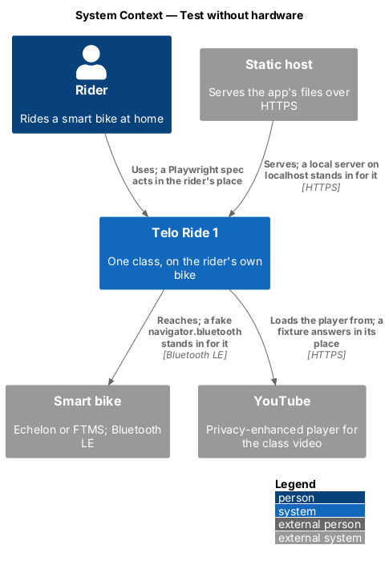
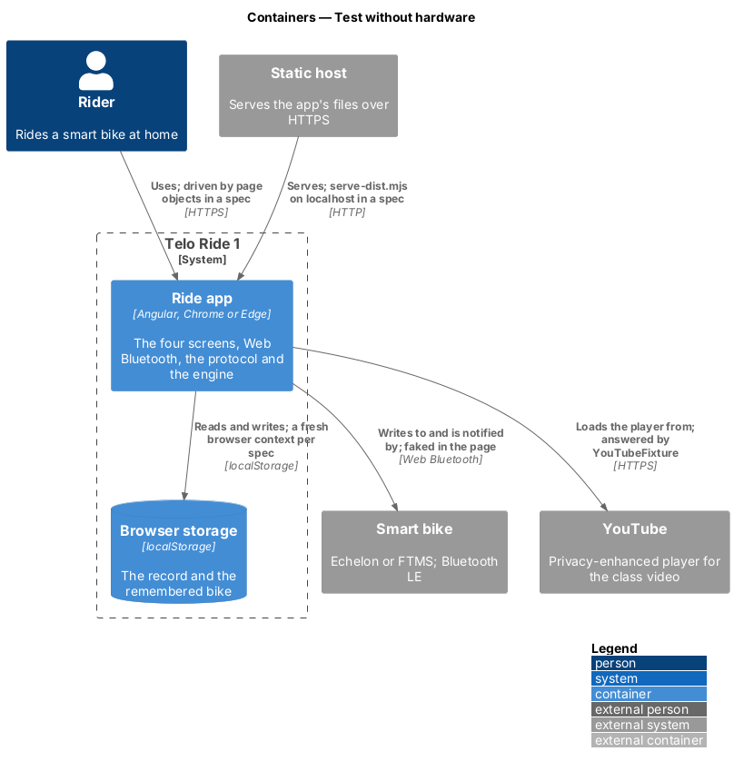
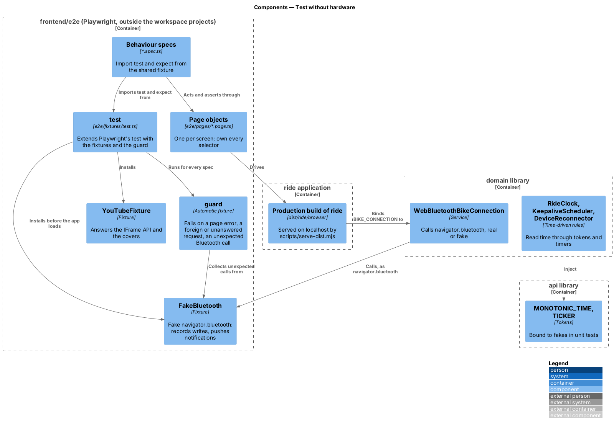
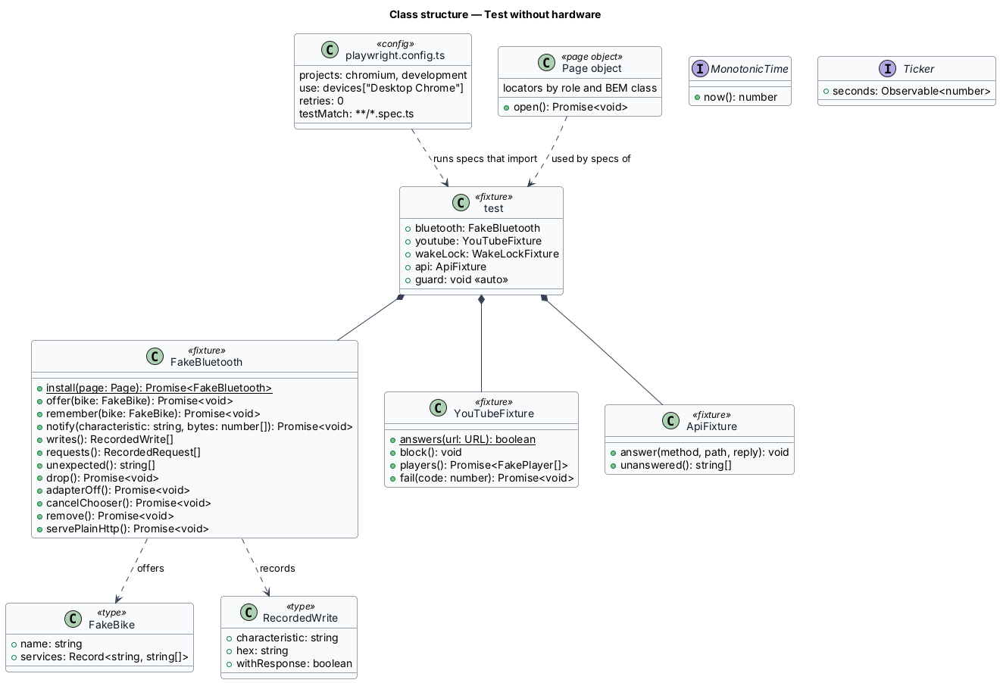
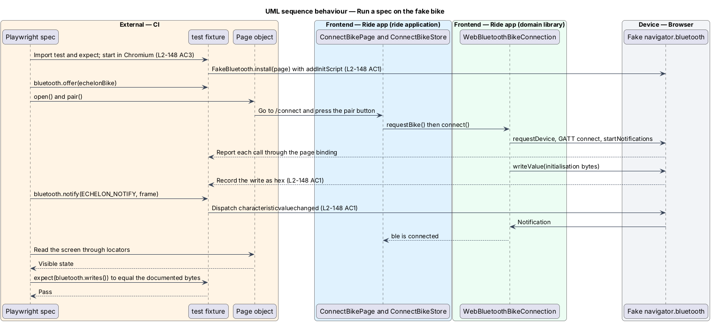
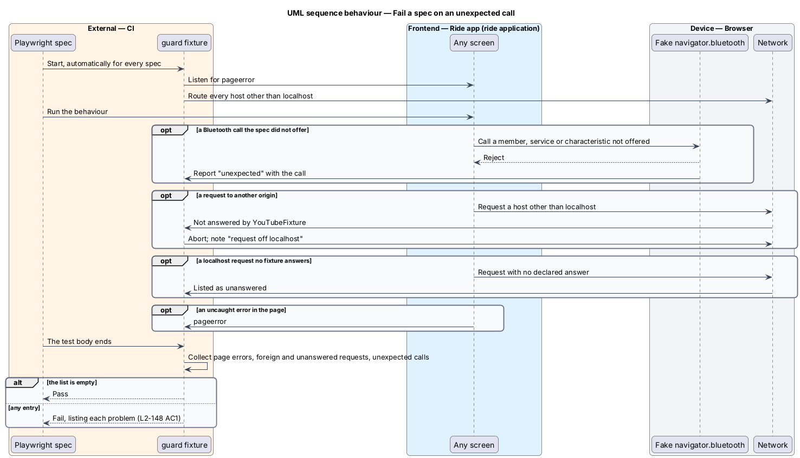
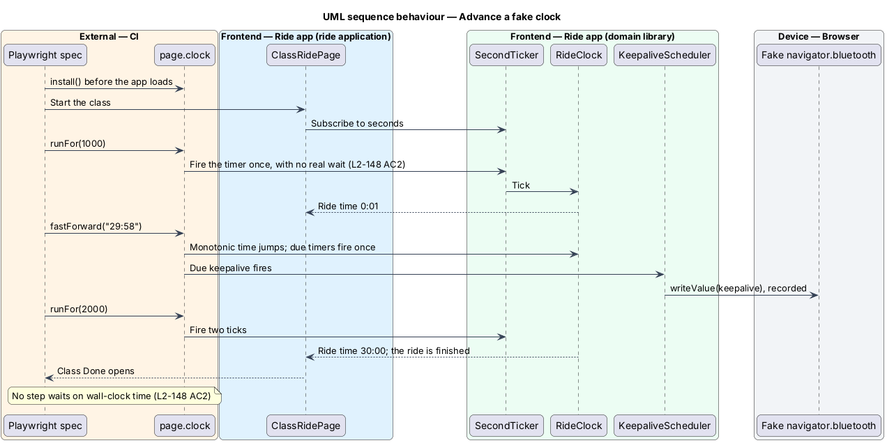

# Test without hardware

## Overview

Telo Ride 1 drives a physical bike over Bluetooth, plays a video from YouTube and runs rules that
unfold over a 30-minute ride. None of those can be present when a test runs: not in CI, and not
when an agent runs the suite. This feature describes the test doubles and guards that let every
behaviour run end to end without a bike, without a network beyond localhost, and without waiting
on real time. It refines `L1-024`.

Local terms:

- **behaviour spec**: Playwright test that drives the built app through a screen and asserts what the rider sees and what the bike is sent
- **fixture**: object the shared `test` hands to a spec, set up before the spec body and checked after it
- **fake `navigator.bluetooth`**: in-page replacement for the Web Bluetooth API that records every write and delivers notifications on demand
- **guard**: automatic fixture that fails a spec on an event the spec did not declare
- **page object**: class that owns the selectors of one screen and exposes its actions and locators
- **fake clock**: time source a test advances by hand in place of waiting

Neighbouring features own the adjacent concerns:

- [Ride a simulated bike](../../bike/ride-a-simulated-bike/README.md) owns the simulated bike
  behind `?simulate`, which serves a person at a desk; the fake `navigator.bluetooth` here serves
  specs (`L2-024`).
- [Structure the frontend workspace](../structure-the-frontend-workspace/README.md) owns the rule
  that only `domain`'s `bluetooth/` folder reaches `navigator.bluetooth`, which gives the fake one
  seam to replace (`L2-146` AC3).
- [Host and deliver](../host-and-deliver/README.md) owns which specs CI runs and the 5-minute limit
  (`L2-149` AC2).
- [Restrict third parties](../../security/restrict-third-parties/README.md) owns the rule that
  YouTube is the only foreign origin, which the guard mirrors (`L2-131` AC3).
- [Keep the ride clock true](../../performance/keep-the-ride-clock-true/README.md) owns the ride
  clock's own rules (`L2-133`).

## Description

### The shared fixture (`L2-148` AC1)

- **`test`** and **`expect`** (`frontend/e2e/fixtures/test.ts`): exist. `test` extends Playwright's
  `test`; every spec imports both from this file. For Telo Ride 1 it keeps the fixtures
  `bluetooth`, `youtube`, `wakeLock`, `api` and `guard`.
- **`FakeBluetooth`** (`e2e/fixtures/fake-bluetooth.ts`): exists. `install(page)` adds an init
  script that defines `navigator.bluetooth` before the app loads, and exposes a page binding
  through which the page reports each call, so the record survives navigation.
  - `offer(bike)` makes a `FakeBike` (name, services and characteristic UUIDs) available to
    `requestDevice` and `getDevices`; `remember(bike)` makes it a previously permitted device.
  - `writes()` returns every `writeValue` as a `RecordedWrite`: the characteristic, the bytes as
    upper-case hex (`F0 A1 00 91`) and whether a response was requested. A write resolves in the
    page only once the spec side has recorded it.
  - `notify(characteristic, bytes)` dispatches `characteristicvaluechanged` on demand.
  - `drop()`, `adapterOff()`, `adapterOn()`, `cancelChooser()`, `blockChooser()`, `remove()` and
    `servePlainHttp()` reproduce a lost bike, Bluetooth switched off, the chooser outcomes, a
    browser with no Web Bluetooth and an insecure page.
  - Until a bike is offered, every call is unexpected. So is a call to a member, service or
    characteristic the offered bike lacks. An unexpected call rejects in the page and is listed by
    `unexpected()`.
- **`echelonBike`** and **`ftmsBike`** (`e2e/fixtures/echelon.ts`, `e2e/fixtures/ftms.ts`): exist.
  The two `FakeBike` definitions, with frame builders such as `workoutFrame(cadence)` and
  `resistanceFrame(level)` and the expected write `targetResistanceWrite(level)`.
- **`YouTubeFixture`** (`e2e/fixtures/youtube.ts`): exists. It answers
  `https://www.youtube.com/iframe_api` with a fake player script and each `i.ytimg.com` cover with
  a local picture. `block()` and `fail(code)` reproduce a barred script and a video that cannot
  play; `players()`, `time()`, `seeks()` and `jump(seconds)` let a spec read and move the fake
  player.
- **`WakeLockFixture`** (`e2e/fixtures/wake-lock.ts`), **`hideTab`** and **`showTab`**
  (`e2e/fixtures/tab.ts`) and **`withoutFullscreen`** (`e2e/fixtures/fullscreen.ts`): exist. They
  fake the Screen Wake Lock API, the hidden tab and a browser without full screen.
- **`ScreenCaptureFixture`** (`e2e/fixtures/screen-capture.ts`): exists, for the diagnostic
  recording of [Record diagnostics](../../security/record-diagnostics/README.md) (`L2-178`).
  Headless Chromium cannot show the browser's own sharing prompt, so `install(page)` answers
  `navigator.mediaDevices.getDisplayMedia` before the app loads. Granted, it resolves a real
  `MediaStream` of a drawn canvas of 640 × 360 px, so the app's capture code runs on real video
  frames. `refuse()` makes it reject with `NotAllowedError`, and `remove()` takes the API away
  from the next page load, as on Chrome for Android. `asked()` returns what the page asked for
  and `tracks()` the state of each track handed out, so a spec proves the sharing ended.
- **`FakeBluetooth` for the recording**: `failWrites()` and `allowWrites()` make every write
  fail with `NetworkError` and succeed again; `notifyTimes()` pushes the same bytes a set number
  of times at once; each fake service answers `getCharacteristics()`, and a `FakeBike` may state
  each characteristic's `properties`.
- **`ApiFixture`** (`e2e/fixtures/api.ts`): exists. It routes every localhost request under `/api/`
  and lists a request with no declared answer in `unanswered()`. Telo Ride 1 has no backend
  (ADR 0037, ADR 0043) and the class ships with the app (ADR 0042), so no spec declares an answer
  and any such request fails the spec.
- **`guard`**: exists, as an automatic fixture in `test.ts`. It listens for `pageerror`, routes
  every request whose host is not `localhost` or `127.0.0.1`, lets through only what
  `YouTubeFixture.answers(url)` accepts, and aborts the rest. After the spec body it gathers page
  errors, requests off localhost, unanswered requests and unexpected Bluetooth calls, and expects
  the list to be empty.
- **What changes**: `HubFixture`, `MapTilesFixture`, `FakeWebGl` and `WorldRideProbe`, with the
  data fixtures `course.ts`, `maps.ts`, `race.ts`, `progress.ts`, `results.ts`, `library.ts` and
  `classes.ts`, serve Telo Ride's backend, hub, maps and World rendering. They leave `test.ts` and
  the guard as those features are removed, each in a change of its own.

### Page objects

- **`ConnectBikePage`**, **`ClassRidePage`** and **`NotFoundPage`** (`e2e/pages/`): exist and are
  reshaped to the Telo Ride 1 mocks. `NotFoundPage` today looks for "Back to Home"; `L2-145`
  names the link "Back to the class".
- **The Class** and **Class Done** page objects: new, as `e2e/pages/the-class.page.ts`
  (`TheClassPage`) and `e2e/pages/class-done.page.ts` (`ClassDonePage`).
- **`DiagnosticsPage`** (`e2e/pages/diagnostics.page.ts`): exists. The page object of the
  recording mark and the "Diagnostic recording" dialog, which are no screen of their own.
  `open(path)` opens an address with `?diagnose`, and `addNoteOf(text)` adds a note.
  `saveFiles(files)` presses **Save files** and reads each saved file, its name and its bytes,
  from Playwright's `download` events; `savedRecording()` and `entries()` return the saved text
  and its entry lines. A spec therefore asserts the saved recording's lines without a real
  downloads folder and without a request. The specs that use it are listed in
  [Record diagnostics](../../security/record-diagnostics/README.md).
- **Storage**: Playwright gives each spec a fresh browser context, so `localStorage` starts empty.
  A spec seeds a returning rider by writing `telo-ride.bike` and `telo-ride.record` before the app
  loads.
- **Rule**: a spec holds no selector. A page object locates by role and by the mocks' BEM classes.
  Page objects for Telo Ride's other screens (`home.page.ts`, `race.page.ts`, `profile.page.ts`
  and the rest) are carried over and leave with their screens.

### Fake clocks (`L2-148` AC2)

- **Behaviour specs**: Playwright's `page.clock` exists in use, for example
  `page.clock.runFor(1000)` and `page.clock.fastForward('29:58')` in the carried-over
  `record-a-ride.spec.ts`. A spec that depends on the ride clock, a segment change, the keepalive
  or a retry installs the clock before the app loads and advances it. No spec calls
  `page.waitForTimeout`.
- **Unit tests**: exist. `npm test` runs `ng test ride` with the `@angular/build:unit-test` builder
  on Vitest over jsdom, across every `*.spec.ts` under `projects/*/src/`. Time-driven rules use
  Vitest's fake timers (`vi.useFakeTimers`, `advanceTimersByTime`), as in
  `device-reconnector.spec.ts`, `gatt-write-queue.spec.ts` and `workout-engine.spec.ts`.
- **`MONOTONIC_TIME`** and **`TICKER`** (`api`, `time/`): exist. `MonotonicTime.now()` is
  `performance.now()` in the browser and `Ticker.seconds` emits once a second (`SecondTicker` in
  `domain`). A unit test binds each to a fake it moves by hand.
- **Constants under test**: `KEEPALIVE_MIN_GAP_MS` (900) and `RETRY_MS` (3000) in `domain`'s
  `bluetooth/` are reached by advancing the clock past them.

### Chromium only (`L2-148` AC3)

- **`frontend/playwright.config.ts`**: exists. Two projects, both on `devices['Desktop Chrome']`:
  `chromium` runs every spec against the production build, and `development` runs
  `*.development.spec.ts` against the development build on the next port, the only build that
  honours `?simulate` (`L2-024`). No Firefox or WebKit project is configured. `retries` is 0 and
  `forbidOnly` is set in CI.
- **`frontend/scripts/serve-dist.mjs`**: exists. It serves each build on `127.0.0.1` as the
  `staticwebapp.config.json` in that build says: its headers, and `index.html` for an address that
  matches no file and is not a missing asset (ADR 0043), so no spec needs a real host.
- **Sweeps**: visual, responsive, accessibility and heap sweeps are kept current and run only when
  a person asks. Hardware smoke tests are run by a person.

## Requirements

The feature realizes the following level-2 (L2) requirement, which refines the level-1 (L1)
requirement cited beside it.

| L2 ID | Refines (L1) | Requirement |
|-------|--------------|-------------|
| `L2-148` | `L1-024` | For each Playwright spec, a fixture shall install a fake `navigator.bluetooth` that records every write and pushes notifications on demand. Network requests shall be answered by fixtures, and an unexpected Bluetooth call, an unanswered request, a request off localhost or a page error shall fail the spec. A test of a time-driven rule (keepalive, retries, the ride clock, segment changes) shall advance a fake clock and shall never sleep. Each spec shall run in Chromium only. |

## Diagrams

### System context

In a spec, each party around Telo Ride 1 has a stand-in: the spec for the rider, a fake
`navigator.bluetooth` for the bike, a fixture for YouTube and a local server for the static host.

### Containers

The Ride app under test is the production build, unchanged. The doubles sit at its edges, and each
spec starts with a fresh browser context and therefore empty storage.

### Components

Specs reach the app through page objects and the shared `test`. The fixtures live in
`frontend/e2e/`, which is outside the workspace projects and is drawn as its own boundary.
`WebBluetoothBikeConnection` calls the fake exactly as it calls the browser's API.

### Class structure

`test` composes `FakeBluetooth`, `YouTubeFixture`, `ApiFixture` and the automatic `guard`.
`playwright.config.ts` is modelled with the `config` stereotype, and `MonotonicTime` and `Ticker`
are the two time contracts a unit test fakes.

### Behaviour: run a spec on the fake bike

The fixture installs the fake before the app loads and the spec offers a bike. The app pairs and
writes as it would to a real bike; the spec pushes a notification and asserts the recorded bytes.

### Behaviour: fail a spec on an unexpected call

The guard runs for every spec. A Bluetooth call that was not offered, a request off localhost, an
unanswered request or a page error is collected, and any entry fails the spec when its body ends.

### Behaviour: advance a fake clock

A spec installs `page.clock`, then moves the ride from 0:00 to 30:00 with `runFor` and
`fastForward`. Ticks, the ride clock and the keepalive all fire from the fake clock, with no real
wait.

