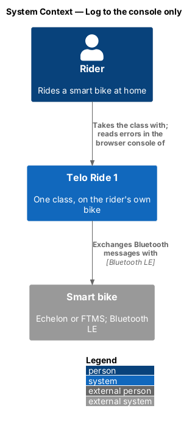
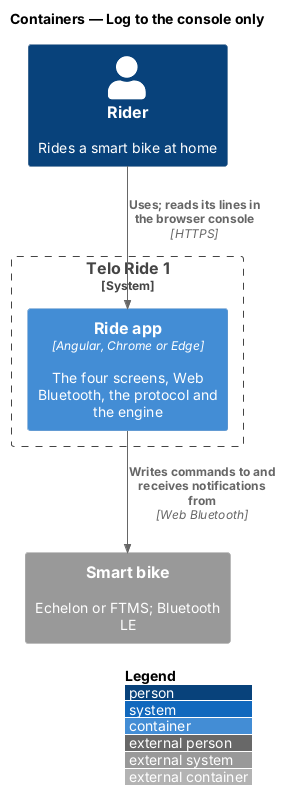
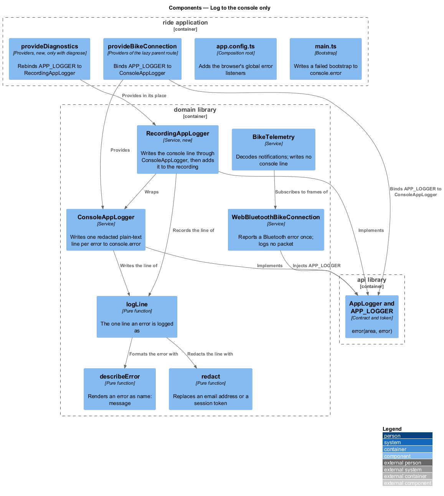
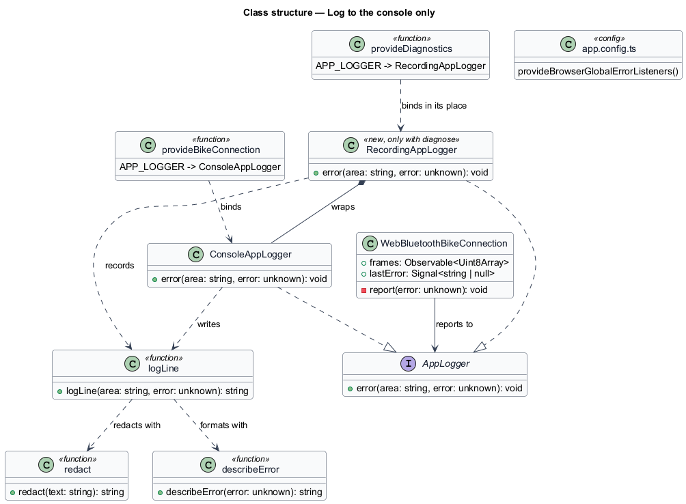
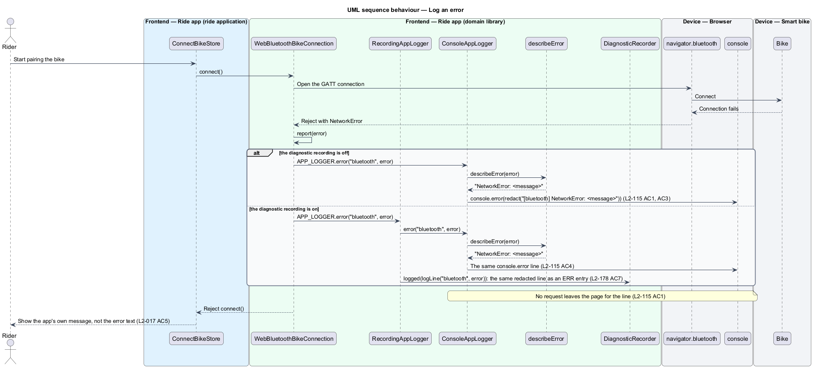
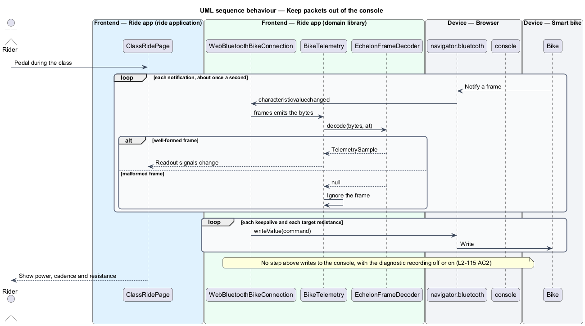

# Log to the console only

## Overview

Telo Ride 1 is one class on the rider's own bike, run in Chrome or Edge with no account and no
backend in its requirements. This feature fixes where the app's diagnostic output goes: the
browser console of the device the rider rides on, and nowhere else. It refines `L1-021`, which
asks that Telo Ride 1 collect nothing about the rider.

The feature has four parts. Each Bluetooth error the app handles is written once, as one
plain-text line that names the area it came from and the error. No line is written for the
Bluetooth messages that flow about once a second for the length of the class. No logging service,
crash reporter or analytics client is part of the app. The diagnostic recording of
[Record diagnostics](../record-diagnostics/README.md) is not a log: it writes nothing to the
console, and it copies each logged error's line into its own store.

Local terms:

- **console line**: single plain-text entry the app writes to the browser console
- **area**: part of the app an error came from, written in square brackets at the head of the line; `bluetooth` is the one area in use
- **packet**: one Bluetooth message, either a notification from the bike or a command written to it
- **remote logging service**: third-party or first-party endpoint that receives log entries over the network
- **redaction**: replacement of an email address or a session token in a line by a placeholder
- **diagnostic recording**: timed list of what crossed the Bluetooth link, held in the page only while the app is opened with `?diagnose` (`L2-178`)

Neighbouring features own the adjacent concerns:

- [Record diagnostics](../record-diagnostics/README.md) owns the diagnostic recording, its store
  and the files it is saved as (`L2-178`).
- [Restrict third parties](../restrict-third-parties/README.md) owns the Content Security Policy
  whose `connect-src 'self'` blocks a request to any logging endpoint (`L2-131`).
- [Treat device data as untrusted](../treat-device-data-as-untrusted/README.md) owns the rule
  that a Bluetooth error's name and message are text wherever they appear (`L2-129`).
- [Keep the bike connected](../../bike/keep-the-bike-connected/README.md) owns the drop and
  recovery that produce most Bluetooth errors (`L2-017`).
- [Read bike telemetry](../../bike/read-bike-telemetry/README.md) owns decoding the notifications
  that this feature keeps out of the console (`L2-020`, `L2-021`).
- [Stay smooth on long rides](../../performance/stay-smooth-on-long-rides/README.md) owns the rule
  that nothing grows with the ride's length (`L2-138`); a per-packet console line would break it.

## Description

### What exists

- **`AppLogger`** and **`APP_LOGGER`** (`api`, `diagnostics/app-logger.ts`): exist. The contract
  has one method, `error(area: string, error: unknown): void`. The area is a plain string; no
  union of areas is declared.
- **`ConsoleAppLogger`** (`domain`, `diagnostics/console-app-logger.ts`): exists. It implements
  `AppLogger` by writing `logLine(area, error)` to `console.error`, for example
  `[bluetooth] NetworkError: GATT Server is disconnected.`. The line is one string: no object, DOM
  node or stack is passed as a further argument. It holds no buffer and sends nothing.
- **`redact`** (`domain`, `diagnostics/console-app-logger.ts`): exists. A pure function that
  replaces an email address with `[email]`, a bearer token or a JSON Web Token with `[token]`, and
  the value of a `token`, `session`, `code` or `sid` parameter with `[token]`.
- **`logLine`** (`domain`, `diagnostics/console-app-logger.ts`): exists. A pure function that
  builds the one line an error is logged as: `redact("[<area>] <describeError(error)>")`. The
  console and the diagnostic recording both take the line from it.
- **`describeError`** (`domain`, `bluetooth/describe-error.ts`): exists. A pure function that
  renders an `Error` as `name: message` and any other value with `String()`.
- **Binding** (`ride`, `bike/provide-bike-connection.ts`): exists. `provideBikeConnection()` binds
  `{ provide: APP_LOGGER, useClass: ConsoleAppLogger }` on the lazy parent route of
  `ride.routes.ts`, beside the bike connection that uses it. `app.config.ts` does not bind it, so
  the logger is not in the initial bundle.
- **`WebBluetoothBikeConnection.report`** (`domain`,
  `bluetooth/web-bluetooth-bike-connection.ts`): exists, and is the one caller of the logger. It
  sets the `lastError` signal to the text of `describeError` and calls
  `AppLogger.error('bluetooth', error)`, so the line names the area and the error (`L2-115` AC3).
  The connection injects `APP_LOGGER` as optional and falls back to a `ConsoleAppLogger` of its
  own. A failed connect, a failed reconnect attempt and a drop each reach `report` once.
- **`provideBrowserGlobalErrorListeners()`** (`ride`, `app.config.ts`): exists. It routes an
  uncaught error and an unhandled promise rejection to Angular's `ErrorHandler`, whose default
  implementation writes them to `console.error`. No custom `ErrorHandler` is provided.
- **`main.ts`** (`ride`): exists. A failed `bootstrapApplication` is written with
  `console.error(error)`, because no injector exists at that point.
- **`provideAppCache()`** (`ride`, `app-cache/provide-app-cache.ts`): exists. A service worker
  that cannot be registered is written with `console.error` directly, not through `APP_LOGGER`.
- **Packet path** (`domain`): exists. `WebBluetoothBikeConnection.frames` emits each notification
  as raw bytes, `BikeTelemetry` decodes it with `EchelonFrameDecoder` or `IndoorBikeDataDecoder`,
  and `GattWriteQueue` and `KeepaliveScheduler` write commands. None of them calls `console`. A
  malformed frame decodes to `null` and is dropped without a line (`L2-115` AC2).
- **`frontend/eslint.config.js`**: exists. It holds no `no-console` rule. The three files above
  that call `console.error` are the only ones in `frontend/projects/` outside test files; nothing
  in the lint configuration enforces that today.
- **`frontend/package.json`**: exists. Its dependencies hold no logging, crash-reporting or
  analytics package.

### What changes with the diagnostic recording

- **`RecordingAppLogger`** (`domain`, `diagnostics/recording/recording-app-logger.ts`): exists,
  exported only from `@telo/domain/diagnostics` and loaded only when the app is opened with
  `?diagnose`. It implements `AppLogger` by wrapping a `ConsoleAppLogger`: it calls
  `ConsoleAppLogger.error(area, error)` first, so the console line is written as it is with the
  recording off, and then passes `logLine(area, error)` to `DiagnosticRecorder.logged()`, which
  adds the same redacted line to the recording as an `ERR` entry (`L2-115` AC4, `L2-178` AC7).
- **Binding**: `provideDiagnostics()` of
  [Record diagnostics](../record-diagnostics/README.md) binds `APP_LOGGER` to
  `RecordingAppLogger`. `ride.routes.ts` spreads those providers last in the parent route's
  providers, so the binding replaces the one `provideBikeConnection()` makes. With the recording off the binding above stands and
  `RecordingAppLogger` is never fetched.
- **The recording never writes to the console.** Each byte, link event, readout, note and screen
  capture goes to the recording's own store, `RecordingBuffer`, and to no console call
  (`L2-115` AC2, `L2-178` AC9). The packet path gains calls to the optional `BIKE_LINK_TAP`; none
  of them reaches `console`, with the recording off or on.
- **The recording is not a log** (`L2-115` AC1). It is held in the page's memory and leaves the
  device only as a file the person diagnosing saves. No remote logging service is added.

### What is left out

Telo Ride's Diagnostics screen, its packet list on screen and its connection history are not part
of Telo Ride 1 (ADR 0040). A record of the Bluetooth link returns in a narrower form, off by
default and written to no console, as the diagnostic recording of
[Record diagnostics](../record-diagnostics/README.md) (ADR 0048). The `SentCommand` type in `api`
(`bike/sent-command.ts`) is kept: `ResistanceController` holds the last one for Class Ride's
stepper. The recording does not use it; it records each write at the write queue.

## Requirements

The feature realizes the following level-2 (L2) requirement, which refines the level-1 (L1)
requirement cited beside it.

| L2 ID | Refines (L1) | Requirement |
|-------|--------------|-------------|
| `L2-115` | `L1-021` | The app shall write its logs to the browser console only and shall use no remote logging service; the diagnostic recording (`L2-178`) is not a log and shall leave the device only as a file the person diagnosing saves. The app shall write no per-packet line to the console while Bluetooth messages flow, with the diagnostic recording off or on, and the recording shall write none of its entries to the console. Each logged error shall name the area and the error in plain text. With the diagnostic recording on, the console line for a logged error shall be written as it is with the recording off, and the same redacted line shall be added to the recording. |

## Diagrams

### System context

The rider takes the class and is the only reader of the app's console lines. The smart bike is the
source of the Bluetooth messages and of most errors. No logging system appears, because none exists.

### Containers

The Ride app is the only container involved. It exchanges Bluetooth messages with the bike and
writes its lines to the console of the browser it runs in.

### Components

`provideBikeConnection()` binds `APP_LOGGER` to `ConsoleAppLogger`. `WebBluetoothBikeConnection`
reports each error through the token, and `BikeTelemetry` decodes notifications without writing a
line. With the recording on, `provideDiagnostics()` binds the token to `RecordingAppLogger`, which
wraps `ConsoleAppLogger`.

### Class structure

`ConsoleAppLogger` implements `AppLogger`, formats with `describeError` and redacts with `redact`.
`RecordingAppLogger` implements the same contract and composes a `ConsoleAppLogger`.

### Behaviour: log an error

A failed GATT connection reaches `WebBluetoothBikeConnection.report`, which logs once under
`bluetooth`. `ConsoleAppLogger` writes one redacted plain-text line, no request leaves the page,
and the rider sees the app's own message. With the recording on, `RecordingAppLogger` writes the
same console line through `ConsoleAppLogger` and adds it to the recording.

### Behaviour: keep packets out of the console

During a ride, notifications are decoded and commands are written about once a second. No step on
either path writes to the console, whether the frame is well-formed or malformed, and whether the
diagnostic recording is off or on.

