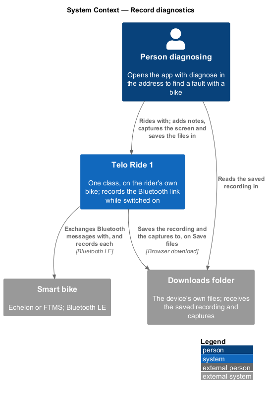
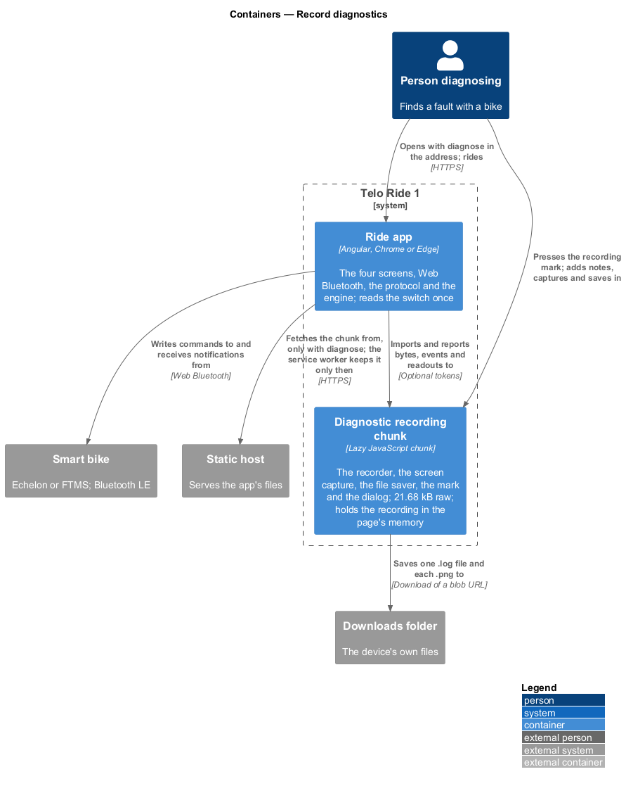
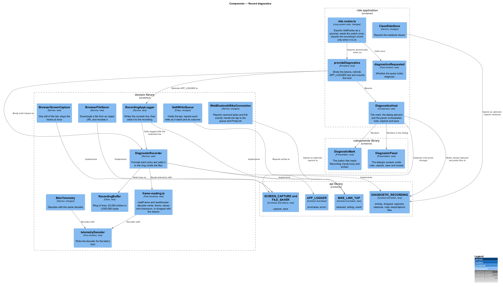
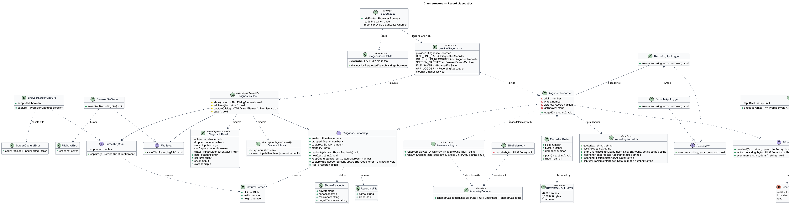
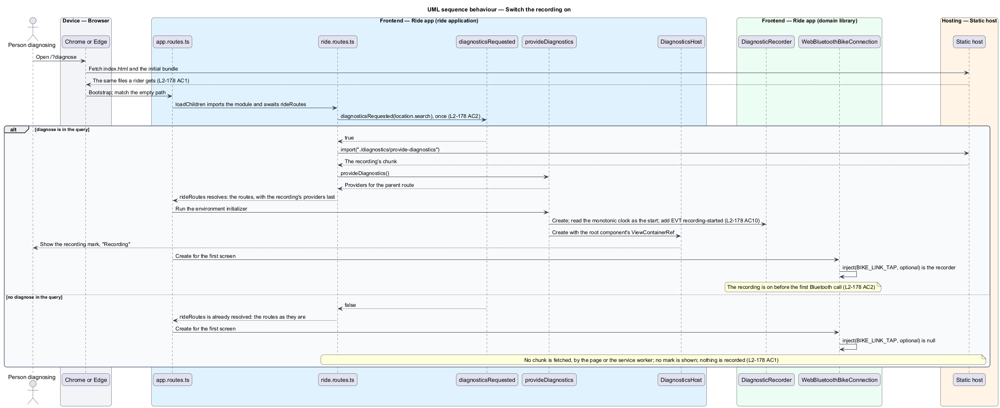
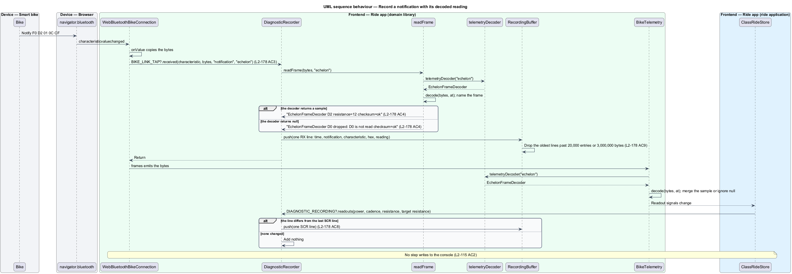
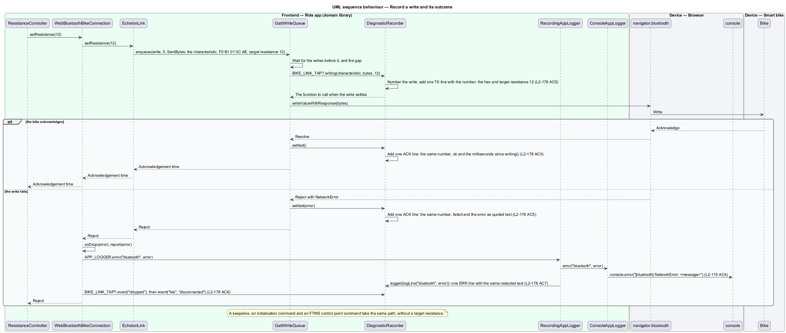
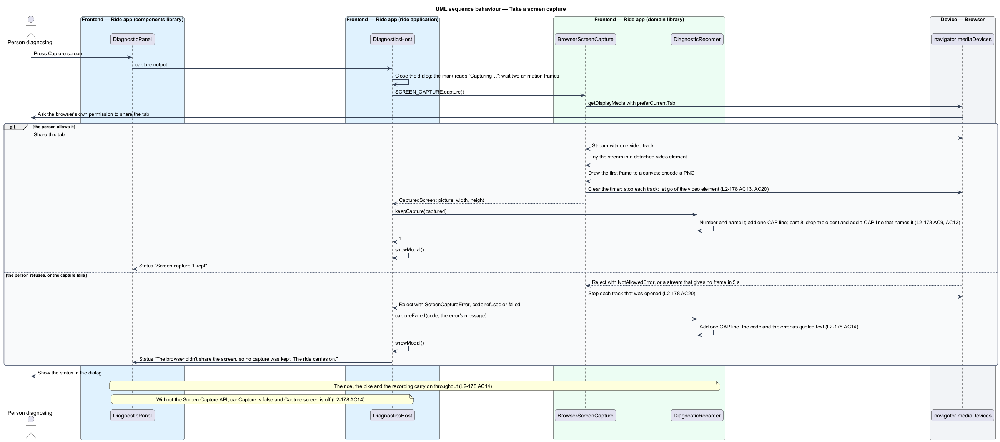
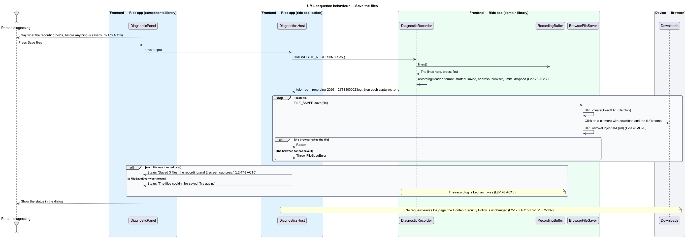

# Record diagnostics

## Overview

Telo Ride 1 is one class on the rider's own bike, run in Chrome or Edge with no account and no
backend. When a bike does not connect, does not report pedalling or does not take a target
resistance, nothing in a rider's app says what bytes the bike sent, what the decoder made of them
or what the screen showed. This feature adds a diagnostic recording that answers those questions
for any moment of a ride. It refines `L1-003`, and its decisions are recorded in ADR 0048.

The recording is a diagnostic aid and no part of the rider's app. It is off for every rider, adds
no screen and no menu, and none of its code is in the initial bundle or in what the service worker
keeps for a rider. The app opened at an address with `diagnose` in its query fetches one more
chunk, records the Bluetooth link from before the first Bluetooth call, and shows one button, the
recording mark, on every screen. The recording is held in the page's memory within a fixed limit
and leaves the device only as files the person diagnosing saves. The saved file's format is
specified in [`docs/protocol/diagnostic-recording.md`](../../../protocol/diagnostic-recording.md).

Local terms:

- **person diagnosing**: person who opens the app with `?diagnose` to find a fault with a bike; a rider, or someone beside the rider
- **recording**: timed, ordered list of what crossed the Bluetooth link and what the app made of it, held in the page while the visit lasts
- **entry**: one line of the recording, made of its time, its kind and its detail
- **switch**: `diagnose` in the query of the address the app is opened at
- **tap**: optional contract the Bluetooth code calls wherever bytes cross the link
- **recording mark**: button that reads "Recording", shown on every screen while the recording is on
- **screen capture**: one still picture of the app's tab, kept with the recording as a PNG
- **note**: text the person diagnosing types, of what the bike's own display reads
- **saved recording**: text file the browser saves when the person presses **Save files**
- **entry point**: import path of a library, such as `@telo/domain/diagnostics`, that the bundler follows to decide which chunk holds a file

Neighbouring features own the adjacent concerns:

- [Log to the console only](../log-to-the-console-only/README.md) owns the console line a logged
  error gets, which the recording copies and never replaces (`L2-115`).
- [Keep data on the device](../keep-data-on-the-device/README.md) and
  [Restrict third parties](../restrict-third-parties/README.md) own the rules that nothing is sent
  anywhere and that the Content Security Policy admits no further origin (`L2-132`, `L2-131`).
- [Treat device data as untrusted](../treat-device-data-as-untrusted/README.md) owns the rule that
  a device name and an error's text are text, never markup (`L2-129`).
- [Connect a bike](../../bike/connect-a-bike/README.md),
  [Keep the bike connected](../../bike/keep-the-bike-connected/README.md) and
  [Control resistance](../../bike/control-resistance/README.md) own the link, its events and its
  writes, which this feature observes and does not change (`L2-013`, `L2-014`, `L2-017`, `L2-025`).
- [Read bike telemetry](../../bike/read-bike-telemetry/README.md) owns the decoders, which the
  recording runs a second time on the same bytes (`L2-020`, `L2-021`).
- [Ride a simulated bike](../../bike/ride-a-simulated-bike/README.md) owns the simulated bike,
  which reports to the same tap (`L2-024`).
- [Stay smooth on long rides](../../performance/stay-smooth-on-long-rides/README.md) and
  [Meet performance budgets](../../performance/meet-performance-budgets/README.md) own the memory
  and bundle limits the recording stays within (`L2-138`, `L2-136`).
- [Test without hardware](../../platform/test-without-hardware/README.md) owns the fixtures and
  the page object the recording's specs use (`L2-148`).

## Description

### What existed before the recording

- **`AppLogger`**, **`APP_LOGGER`** and **`ConsoleAppLogger`** (`api`,
  `diagnostics/app-logger.ts`; `domain`, `diagnostics/console-app-logger.ts`).
  `provideBikeConnection()` binds the token on the lazy parent route.
- **`WebBluetoothBikeConnection`** (`domain`, `bluetooth/`). Its `onValue` listener receives each
  notification of either link's data characteristic and emits the bytes through `frames`. It owns
  one `GattWriteQueue`, opens `EchelonLink` or `FtmsLink` by the services the bike offers, and
  holds the `ble` state.
- **`EchelonFrameDecoder`** and **`IndoorBikeDataDecoder`** (`domain`, `protocol/`). Each is a
  pure `decode(bytes, at)` that returns a `TelemetrySample` or `null`.
- **`ClassRideStore`** (`ride`, `class-ride/class-ride-store.ts`). It maps the telemetry signals
  and the plan to the readouts Class Ride draws.

### The switch and the composition (`ride`, `app/diagnostics/`)

- **`diagnostic-switch.ts`**: exports `DIAGNOSE_PARAM` (`diagnose`) and
  `diagnosticsRequested(search = location.search)`, which returns whether the query holds the
  parameter. It is the one place that reads the switch, in a production and a development build
  alike (`L2-178` AC2).
- **`ride.routes.ts`**: exports `rideRoutes` as a `Promise<Routes>`. It calls
  `diagnosticsRequested()` once, when the module loads. With the switch on, the promise resolves
  after `import('./diagnostics/provide-diagnostics')` and spreads `provideDiagnostics()` last in
  the parent route's providers. With the switch off the promise is already resolved, with no
  further provider, and no import is made (`L2-178` AC1). An import that fails resolves to the
  plain routes. `app.routes.ts`, which is in the initial bundle, is not changed: its
  `loadChildren` returns the promise. A later navigation that drops the query keeps the
  recording, as `?simulate` keeps the simulated bike; a reload without the query is the plain
  app. Nothing about the switch is stored.
- **`provideDiagnostics()`** (`provide-diagnostics.ts`): provides one `DiagnosticRecorder` and
  binds `BIKE_LINK_TAP` and `DIAGNOSTIC_RECORDING` to it with `useExisting`. It binds
  `SCREEN_CAPTURE` to `BrowserScreenCapture`, `FILE_SAVER` to `BrowserFileSaver` and `APP_LOGGER`
  to `RecordingAppLogger`; coming last in the route's providers, that binding replaces the one
  `provideBikeConnection()` makes. An environment initializer injects the recording, so it starts
  with the route's injector and before any screen asks for the bike connection, and creates
  `DiagnosticsHost` with the root component's `ViewContainerRef`. The host is destroyed with the
  injector. `AppShell` and `app.config.ts` are not changed.
- **`DiagnosticsHost`** (`wz-diagnostics-host`): the orchestrating component of the recording's
  controls. Its template holds the recording mark and one `<dialog>` element; the
  `DiagnosticPanel` is drawn inside the dialog only while it is open. The host reads the current
  screen from the `Router` and passes `'the-class'`, `'class-ride'` or `null` to the mark, and
  passes the recording's `entries` and `dropped`, the start time as `since` ("18:00") and
  `SCREEN_CAPTURE.supported` to the panel. It handles the panel's four outputs:
  - `note`: calls `DiagnosticRecording.note(text)` and sets the status to "Note added" (AC12).
  - `capture`: closes the dialog, sets the mark to busy so that it reads "Capturing…", waits two
    animation frames so the dialog is off the screen, and awaits `ScreenCapture.capture()`. It
    then calls `keepCapture()` and says "Screen capture 1 kept", or calls `captureFailed()` with
    the error's code and says "The browser didn’t share the screen, so no capture was kept. The
    ride carries on." It opens the dialog again in both cases (AC13, AC14).
  - `save`: calls `files()` and hands each file to `FileSaver.save()`. It then says "Saved 1
    file: the recording." or "Saved 3 files: the recording and 2 screen captures.", or "The files
    couldn’t be saved. Try again." when a save throws (AC15).
  - `closed`: closes the dialog.
- **`diagnostic-words.ts`**: the pure helpers behind the host. `NOTE_ADDED`, `CAPTURE_NOT_KEPT`,
  `FILES_NOT_SAVED`, `captureKept(number)` and `filesSaved(files)` give each status the dialog
  says, and `screenAt(url)` names the screen at an address. `diagnostic-words.spec.ts` holds one
  case for each.
- **The dialog is the platform's `<dialog>` element**, not the CDK Dialog. `showModal()` gives the
  top layer, an inert page behind it, focus kept inside it, Escape to close, focus returned to the
  recording mark and the `dialog` role (AC11). ADR 0048 records the departure from `AGENTS.md` and
  its measured reason. The ride carries on behind the dialog: opening it pauses nothing.
- **`ClassRideStore`**: injects `DIAGNOSTIC_RECORDING` as optional. When it is bound, an `effect`
  reports the four readouts through `readouts()`: power and cadence as the strings the screen
  draws, and resistance and target resistance as the level or "—" (AC8).

### The contracts (`api`, `diagnostics/`)

- **`BikeLinkTap`** and **`BIKE_LINK_TAP`** (`bike-link-tap.ts`). Three methods:
  `received(from, bytes, how, bike)` for bytes from the bike, where `how` is `'notification'`,
  `'indication'` or `'read'` and `bike` is the `BikeKind` the app decodes telemetry by, or `null`;
  `writing(to, bytes, targetResistance?)` for bytes about to be written, which returns the
  `WriteSettled` function the caller calls when the write settles, with the error if it failed;
  and `event(name, detail?)` for a link event. Each caller holds the tap as optional and calls it
  behind `?.`, so a rider's app pays one `null` check for each message.
- **`DiagnosticRecording`** and **`DIAGNOSTIC_RECORDING`** (`diagnostic-recording.ts`). The
  signals `entries`, `dropped` and `captures`, the start time `startedAt`, and the methods
  `readouts(shown: ShownReadouts)`, `note(text)`, `keepCapture(captured)`, which returns the
  capture's number, `captureFailed(code, error?)` and `files(): RecordingFile[]`. A
  `RecordingFile` is a name and a `Blob`.
- **`ScreenCapture`**, **`ScreenCaptureError`** and **`SCREEN_CAPTURE`** (`screen-capture.ts`).
  `supported` says whether the browser has the Screen Capture API. `capture()` resolves a
  `CapturedScreen` (the picture and its width and height in pixels) or rejects with a
  `ScreenCaptureError` whose `code` is `'refused'`, `'failed'` or `'unsupported'`.
- **`FileSaver`**, **`FileSaveError`** and **`FILE_SAVER`** (`file-saver.ts`).
  `save(file: RecordingFile)` hands one file to the browser and throws a `FileSaveError` where it
  cannot.

### The recorder (`domain`, `diagnostics/recording/`)

- **`DiagnosticRecorder`** (`diagnostic-recorder.ts`): one instance implements `BikeLinkTap` and
  `DiagnosticRecording`. It reads `MONOTONIC_TIME`, or `performance.now()` where the token is not
  bound, when it is created, and stamps each entry with the milliseconds since then (AC10). Its
  first entry is the event `recording-started`. Each call formats one line with `entryLine()` and
  pushes it to the `RecordingBuffer`:
  - `received()` adds an `RX` entry: how the bytes came, the characteristic and each byte as hex
    (AC3). A notification's entry also holds what `readFrame(bytes, bike)` returns; an
    indication's or a read's holds what `readAnswer(from, bytes)` returns, when it returns
    anything (AC4).
  - `writing()` numbers the write, adds a `TX` entry with the number, the characteristic, the
    bytes and the target resistance when one is given, and returns a function that adds the `ACK`
    entry with the same number: `ok` and the milliseconds since `writing()` was called, or
    `failed` and the redacted error as quoted text (AC5).
  - `event()` adds an `EVT` entry (AC6).
  - `logged(line)` adds an `ERR` entry with the line quoted. It is not on a contract;
    `RecordingAppLogger` calls it (AC7).
  - `readouts()` adds an `SCR` entry only when its detail differs from the last one. The screen's
    "—" is written `"-"`, so the file stays ASCII (AC8).
  - `note()` adds a `NOTE` entry with the text quoted (AC12).
  - `keepCapture()` numbers the capture, names it with `captureFileName()`, keeps the picture and
    adds a `CAP` entry with the number, the file name and the size in pixels (AC13). At most 8
    pictures are kept; a ninth drops the oldest, and a further `CAP` entry names the one dropped
    (AC9).
  - `captureFailed()` adds a `CAP` entry with the code and the error as quoted text (AC14).
  - `files()` builds the header with `recordingHeader()`, joins it with the buffer's lines into a
    `text/plain` `Blob` named by `recordingFileName()`, and returns it first, then each kept
    picture (AC15). The address in the header is redacted as a logged line is.
- **`RecordingBuffer`** and **`RECORDING_LIMITS`** (`recording-buffer.ts`): a ring of formatted
  lines with `push(line)`, `lines()`, `size`, `bytes` and `dropped`. A line is ASCII, so its
  length is its size in bytes, and each counts one more for its line break. When a line would take
  the ring past 20,000 entries or 3,000,000 bytes, the oldest lines go and `dropped` rises.
  `RECORDING_LIMITS` also holds the limit of 8 captures. Nothing else of the recording grows with
  the ride's length (AC9, `L2-138` AC2).
- **`recording-format.ts`**: pure formatters. `quote(text)` gives JSON's quoting with each
  character outside printable ASCII escaped, and cuts a text longer than 400 characters;
  `ascii(text)` escapes without quoting; `entryLine(sinceStartMs, kind, detail)` builds one line;
  `recordingHeader(facts)` builds the `#` lines; `recordingFileName(startedAt)` and
  `captureFileName(startedAt, number)` build `telo-ride-1-recording-20261123T180000Z.log` and
  `telo-ride-1-capture-20261123T180000Z-1.png` (AC15, AC17).
- **`frame-reading.ts`**: `readFrame(bytes, kind)` returns the decoder's name
  (`EchelonFrameDecoder` or `IndoorBikeDataDecoder`), the frame it recognised (`D1`, `D2`, or
  Indoor Bike Data with its flags) and the cadence, resistance and power the sample carries, or
  `dropped:` with the reason. It takes the sample from `telemetryDecoder(kind)`, so the values in
  the recording are the app's own; only the frame's name and the reason for a drop are worked out
  here, so the decoders a rider loads do not grow. For an Echelon frame it adds `checksum=ok` or
  `checksum=bad`, which the app's decoder does not check. `readAnswer(characteristic, bytes)`
  reads an FTMS control point response and the FTMS resistance range. `frame-reading.spec.ts`
  holds the readings and the decoders together, frame by frame.
- **`RecordingAppLogger`** (`recording-app-logger.ts`): implements `AppLogger`. It calls a
  `ConsoleAppLogger` of its own, so the console line is what it is with the recording off, and
  then passes `logLine(area, error)`, the same redacted line, to `DiagnosticRecorder.logged()`
  (AC7, `L2-115` AC4). No other part of the recording writes to the console (`L2-115` AC2).

### The browser (`domain`, `browser/`)

- **`BrowserScreenCapture`** (`browser-screen-capture.ts`): `supported` is whether
  `navigator.mediaDevices.getDisplayMedia` exists. `capture()` calls it with `preferCurrentTab`,
  which makes the browser ask its own permission. It plays the stream in a `<video>` element that
  is never added to the page, draws the first frame to a canvas of the video's size and encodes
  the canvas as a PNG. A tab that gives no frame within `FIRST_FRAME_TIMEOUT_MS` (5000 ms) fails
  the capture. In a `finally` block it clears that timer, stops each track and lets go of the
  element, on success and on failure alike (AC13, AC20). A `NotAllowedError` rejects with code
  `refused`, a missing API with `unsupported` and anything else with `failed`.
- **`BrowserFileSaver`** (`browser-file-saver.ts`): `save()` creates an object URL for the file's
  `Blob`, clicks an `<a download>` element that is never added to the page, and revokes the URL in
  a `finally` block (AC20). A download of a `blob:` URL is not a connection: no request leaves the
  device, and the Content Security Policy is not changed (AC15).

### The taps (`domain`)

- **`telemetryDecoder(kind)`** (`protocol/telemetry-decoder.ts`): the one function that picks the
  decoder for a `BikeKind`. `BikeTelemetry` and `readFrame` both call it.
- **`GattWriteQueue`** (`bluetooth/gatt-write-queue.ts`): takes the tap in its constructor.
  `enqueue(write, minGapMs, sent?)` takes what is written as a `SentBytes` (`to`, `bytes` and an
  optional `targetResistance`). When the write's turn comes, after the gap, the queue calls
  `writing()`; it calls the returned function when the write settles, with the error if it
  failed. The acknowledgement time in an `ACK` entry therefore does not count the wait in the
  queue. Initialisation commands, keepalives, resistance commands and FTMS control point commands
  of both links are recorded in this one place (AC5, AC18).
- **`WebBluetoothBikeConnection`**: injects the tap as optional and hands it to the queue and to
  `FtmsLink`. `onValue` calls `received()` with the bike's kind before `frames` emits the bytes
  (AC3). Three private methods carry the events: `setBle(state)` is the one place `ble` changes
  and reports each change; `choose(bike)` reports the name, identifier and kind the app took the
  device for; `describe(services, tap)` lists each service's characteristics and what each can
  do. `describe` runs only with the tap bound and is the one call the recording adds to the
  link; a service that refuses is recorded and the bike connects as it would have (AC6).
- **Link events**: `chooser-opened`, `chooser-picked`, `chooser-closed`, `chooser-failed`,
  `remembered-bike`, `watching-advertisements`, `advertising`, `bike`, `service`, `link`
  (`echelon`, `ftms` or `simulated`), `ble`, `dropped`, `reconnect-attempt`, `reconnect-ok` and
  `reconnect-failed`. Their details are specified in
  [`docs/protocol/diagnostic-recording.md`](../../../protocol/diagnostic-recording.md).
- **`FtmsLink`**: takes the tap as its third constructor argument. It reports each control point
  indication and the resistance range it reads through `received()`, with `how` `'indication'`
  and `'read'` and `bike` `null` (AC4, AC18). Its control point writes go through the queue with
  their `SentBytes`. **`EchelonLink`** changes only in what it passes to `enqueue()`.
- **`SimulatedBikeConnection`**: injects the tap as optional. It reports the events `bike`,
  `link simulated` and `ble`, each `D1` and `D2` frame through `received()` before `frames` emits
  it, and each set-resistance command through `writing()`, which settles at once (AC18).

### The presentation (`components`, `diagnostics/`)

- **`DiagnosticMark`** (`button[wz-diagnostic-mark]`, block `diagnostic-mark`): the recording
  mark. It places itself, fixed at the foot of the screen at the left. Its inputs are `busy`,
  which sets `aria-busy` while a capture is taken, and `screen` (`'the-class'`, `'class-ride'` or
  `null`), which lifts it clear of The Class's pinned start button and Class Ride's bike panel
  (`L2.md` open question 36). Its word is its content: "Recording", or "Capturing…" while busy.
- **`DiagnosticPanel`** (`wz-diagnostic-panel`, block `diagnostic-panel`): the dialog's content.
  Its inputs are `entries`, `dropped`, `since`, `canCapture` and `status` (a `DiagnosticStatus`:
  the text and the tone `ok` or `warn`); its outputs are `note`, `capture`, `save` and `closed`.
  It injects nothing. The count line comes from the pure helper `entriesLine()`
  (`entries-line.ts`) and reads "1,284 entries since 18:00", or "20,000 entries · the oldest
  4,312 were dropped" once entries have gone. The note's field takes at most
  `NOTE_MAX_LENGTH` (200) characters, Enter adds the note, and **Add note** is off while the field
  is empty (AC12). With `canCapture` false, **Capture screen** is off and the panel reads "This
  browser can’t capture the screen. Notes and the recording still work." (AC14). The panel holds
  the privacy text of AC16.
- **Mocks**: `docs/mocks/dialogs/diagnostic-recording/*.html` draw the dialog in each of its
  states, and `docs/mocks/pages/<screen>/recording.html` draws the recording mark on each of the
  four screens. Every other mock is the app with the recording off. The words no criterion gives
  are listed in `L2.md` open question 38.

### Kept out of a rider's app (`L2-178` AC1)

- **Entry points of its own.** `DiagnosticRecorder`, `RECORDING_LIMITS`, `RecordingAppLogger`,
  `BrowserFileSaver` and `BrowserScreenCapture` are exported only from `@telo/domain/diagnostics`
  (`domain/src/diagnostics/public-api.ts`), and `DiagnosticMark` and `DiagnosticPanel` only from
  `@telo/components/diagnostics` (`components/src/diagnostics/public-api.ts`). The libraries' main
  entry points export none of them, so the bundler places them only in the chunk that
  `provide-diagnostics.ts` starts. The contracts and tokens stay in `@telo/api`.
- **`noDiagnostics`** (`frontend/eslint.config.js`): a restricted-import pattern,
  `@telo/*/diagnostics`, applied to each library. Only the `ride` application imports the two
  entry points, and only from its dynamically imported chunk.
- **The service worker**: the production build names its lazy chunks (`namedChunks`), and
  `frontend/projects/ride/ngsw-config.json` leaves `/provide-diagnostics-*.js` out of the
  prefetched `app` group and lists it in a lazy `diagnostics` group. The worker fetches and keeps
  the chunk only when a page opened with `?diagnose` asks for it.
- **Measured**: the initial chunk `main` is 243.06 kB raw, from 243.05 kB. The recording's chunk
  is 21.68 kB raw, 6.81 kB transferred. No budget in `angular.json` changed
  ([Meet performance budgets](../../performance/meet-performance-budgets/README.md)).

### The saved recording (`L2-178` AC17)

The saved recording is plain ASCII text, one entry a line: `#` header lines, then
`<milliseconds since started> <kind> <detail>` with the kinds `RX`, `TX`, `ACK`, `EVT`, `ERR`,
`SCR`, `NOTE` and `CAP`. Its header, each kind's detail, the link events and a worked example are
specified in [`docs/protocol/diagnostic-recording.md`](../../../protocol/diagnostic-recording.md),
which is the reference for a reader of a saved file.

### Proof

- **Unit tests**: `recording-buffer.spec.ts`, `recording-format.spec.ts`, `frame-reading.spec.ts`
  and `diagnostic-recorder.spec.ts` in `domain`, `entries-line.spec.ts` in `components`, and
  `diagnostic-switch.spec.ts` and `diagnostic-words.spec.ts` in `ride`.
- **Acceptance specs** (`frontend/e2e/`):
  - `diagnostic-recording.spec.ts`: off by default, the switch, the dialog and the saved file
    (AC1, AC2, AC11, AC15, AC16, AC17).
  - `diagnostic-recording-link.spec.ts`: bytes, decoded readings, dropped frames, writes and
    their outcomes (AC3, AC4, AC5).
  - `diagnostic-recording-events.spec.ts`: the chooser, the services, a drop and the reconnect,
    the logged error, and an FTMS bike (AC6, AC7, AC18).
  - `diagnostic-recording-capture.spec.ts`: a note, a capture kept, refused and unsupported, and
    the limit of 20,000 entries (AC9, AC12, AC13, AC14, AC20).
  - `diagnostic-recording-app-cache.spec.ts`: the service worker keeps none of the chunk for a
    rider (AC1, AC2).
  - `diagnostic-recording.development.spec.ts`: the simulated bike (AC18).
  - `long-ride-recording.spec.ts`: the class ridden to its end with the recording on (AC19).
- **`frontend/e2e/heap/recording.heap.ts`**: the 3-hour heap check with the recording on (AC19);
  it runs only when a person asks.
- The specs use the page object `e2e/pages/diagnostics.page.ts`, the fixture
  `e2e/fixtures/screen-capture.ts` and the fake `navigator.bluetooth`
  ([Test without hardware](../../platform/test-without-hardware/README.md)). The `guard` fixture
  proves that no request leaves for a recording, a note, a capture or a save.

### What is left out

The recording has no screen, no route and no menu entry. It has no viewer, no packet list on
screen, no connection history, no build version, no device check and no replay: a recording is
read in the file the person saves. It is not kept in `localStorage` or IndexedDB, so a reload, a
crash or a closed tab loses a recording that was not saved (`L2.md` open question 33). The screen
is not recorded continuously, and Chrome on Android, which has no Screen Capture API, has no
screen capture (open question 34). **Save files** saves each file as its own download; a person
who refuses the browser's question about more than one download gets the recording alone (open
question 35). A dropped screen capture is said in the recording only, not in the dialog (open
question 38). A bike whose name and services disagree is shown by the recording and not corrected
(open question 37).

## Requirements

The feature realizes the following level-2 (L2) requirement, which refines the level-1 (L1)
requirement cited beside it.

| L2 ID | Refines (L1) | Requirement |
|-------|--------------|-------------|
| `L2-178` | `L1-003` | The app opened at an address without `diagnose` in its query shall record nothing, shall show no control of the recording and shall fetch none of the recording's code, by the page or by the app's service worker, and the initial bundle shall be no larger. The app opened with `diagnose` in its query, in a production or a development build, shall fetch the recording's code, shall start the recording before the first Bluetooth call and shall show the recording mark, a button that reads "Recording", on every screen; the query shall be read once and in one place, and nothing about the recording shall be stored. One entry shall hold the bytes the bike sends (a notification, an indication or the answer to a read) before they are decoded: the time, the direction, the characteristic and every byte as hex. For a notification the app reads telemetry from, the same entry shall hold the decoder the app uses, the frame it recognised and the cadence, resistance and power it produced, or "dropped" with the reason; an Echelon frame's entry shall also say whether its checksum holds, and an FTMS bike's resistance range and control point answer shall be read on their entries. Each write to the bike shall have one entry with its number, characteristic and bytes when it is asked for, and a second with the same number and its outcome when it settles; a resistance command's entry shall also hold the target resistance. An entry shall be added for each link event: the chooser and its outcome, the device's name and identifier, each service with its characteristics, the link chosen, each `ble` state, a drop, each reconnect attempt and, for a remembered bike, that it was found without the chooser and that the app waited for it to advertise. Listing a service's characteristics shall be the one call the recording adds to the link. The line the console gets for a logged error shall be added to the recording, redacted as the console's is. On Class Ride, one entry shall hold the four readouts as the screen shows them each time one changes, with "—" written `"-"`. The recording shall hold at most 20,000 entries and 3,000,000 bytes of text, dropping the oldest first and counting the dropped, and at most 8 screen captures. Each entry's time shall be milliseconds since the recording started, read from the monotonic clock, and entries shall be in the order they happened. The recording mark shall open a modal dialog titled "Diagnostic recording", over a ride that carries on, with the number of entries, a note field, **Add note**, **Capture screen**, what a saved recording holds, **Save files** and **Close**. A note of at most 200 characters shall become one entry. **Capture screen** shall keep one still picture of the tab with an entry that names it, and the browser's sharing shall end as soon as the picture is taken; a refusal, a failure or a browser without the Screen Capture API shall keep nothing, say so and leave the ride alone. **Save files** shall save the recording as `telo-ride-1-recording-<UTC time>.log` and each screen capture as a PNG; no request shall leave the device, and the Content Security Policy shall not be changed. The dialog shall say what the recording holds before anything is saved. A saved recording shall be plain ASCII text, one entry a line, with `#` header lines and the kinds `RX`, `TX`, `ACK`, `EVT`, `ERR`, `SCR`, `NOTE` and `CAP`; text from the bike or the person shall be quoted and escaped. The simulated bike and an FTMS bike shall be recorded as an Echelon is. A ride with the recording on shall stay within `L2-134`, `L2-136` AC3 and `L2-138` AC1. Each stream, track, timer, listener and object URL the recording takes shall be released when a capture ends or the tab is closed. |

## Diagrams

### System context

The person diagnosing opens Telo Ride 1 with `?diagnose` and rides or watches the bike. The smart
bike is the source of the bytes. The saved files go to the device's own downloads folder; no other
system receives anything.

### Containers

The Ride app is the rider's app, unchanged. The recording is one lazy chunk the static host
serves, and the service worker keeps, only when the app is opened with `?diagnose`. The recording
itself stays in the page's memory and leaves as downloads.

### Components

`ride.routes.ts` reads the switch and imports `provideDiagnostics()`, which binds the tokens to
`DiagnosticRecorder`, `BrowserScreenCapture`, `BrowserFileSaver` and `RecordingAppLogger` and
mounts `DiagnosticsHost`. The Bluetooth code and `ClassRideStore` reach the recorder only through
the optional tokens in `api`.

### Class structure

`DiagnosticRecorder` realizes `BikeLinkTap` and `DiagnosticRecording` and composes one
`RecordingBuffer`. `RecordingAppLogger` wraps `ConsoleAppLogger` and calls `logged()`.
`GattWriteQueue` holds the tap and takes a `SentBytes` with each write. `DiagnosticsHost` depends
on the three contracts it orchestrates and renders `DiagnosticMark` and `DiagnosticPanel`.

### Behaviour: switch the recording on

`ride.routes.ts` reads the query once. With `diagnose`, `rideRoutes` resolves after the
recording's chunk is fetched, with its providers last in the parent route, and the host is
mounted before any screen loads. Without it the promise is already resolved, nothing is fetched
and no token is bound (`L2-178` AC1, AC2).

### Behaviour: record a notification with its decoded reading

`onValue` hands the bytes to the tap before `frames` emits them. The recorder decodes them with
the decoder `telemetryDecoder(kind)` picks, the same one `BikeTelemetry` then uses, and adds one
`RX` entry; a frame the decoder drops is recorded with the reason. A readout that changes adds an
`SCR` entry. No step writes to the console (`L2-178` AC3, AC4, AC8; `L2-115` AC2).

### Behaviour: record a write and its outcome

When a write's turn comes, `GattWriteQueue` tells the tap what is written and receives the
function to call when the write settles. The recorder adds a `TX` entry with the write's number
and target resistance, then an `ACK` entry with the same number and the acknowledgement time or
the error. A failed write is also logged, and the redacted line is added as an `ERR` entry
(`L2-178` AC5, AC7).

### Behaviour: take a screen capture

The dialog closes and the mark reads "Capturing…". The browser asks its own permission, and
`BrowserScreenCapture` draws one frame and stops the tracks. A granted capture is kept with a
`CAP` entry; a refused or failed one keeps nothing and is recorded. The dialog opens again and
says which. The ride carries on throughout (`L2-178` AC13, AC14, AC20).

### Behaviour: save the files

**Save files** asks the recorder for its files and hands each to `BrowserFileSaver`, which
downloads it from an object URL and revokes the URL. No request leaves the page. A file the
browser cannot save leaves the recording as it was (`L2-178` AC15, AC17).

