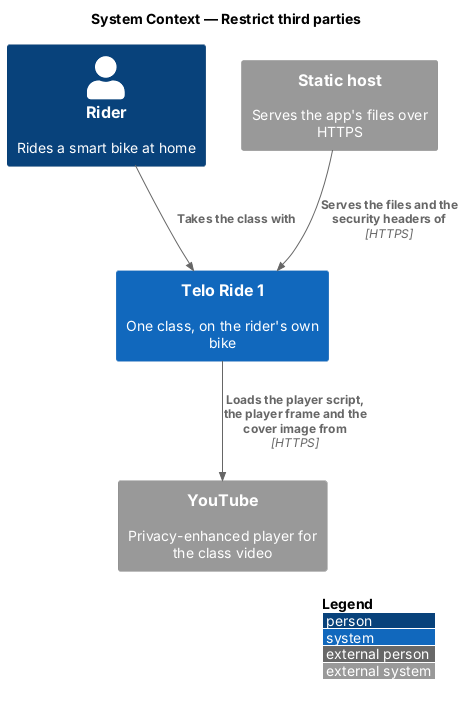
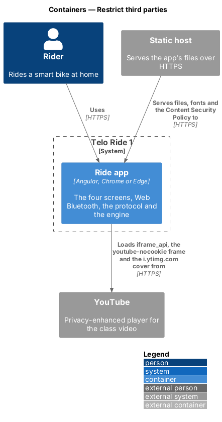
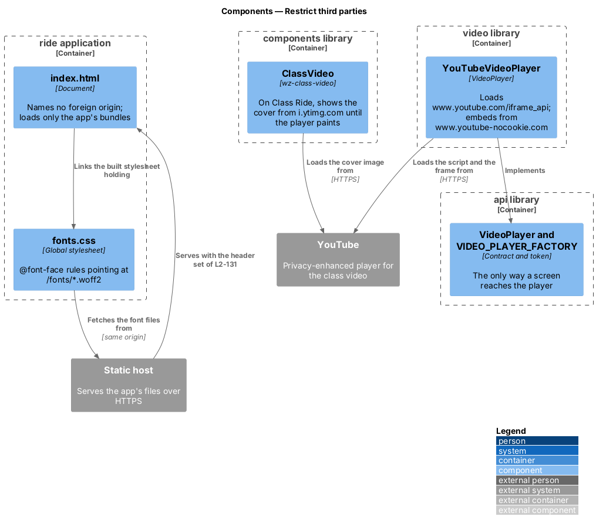
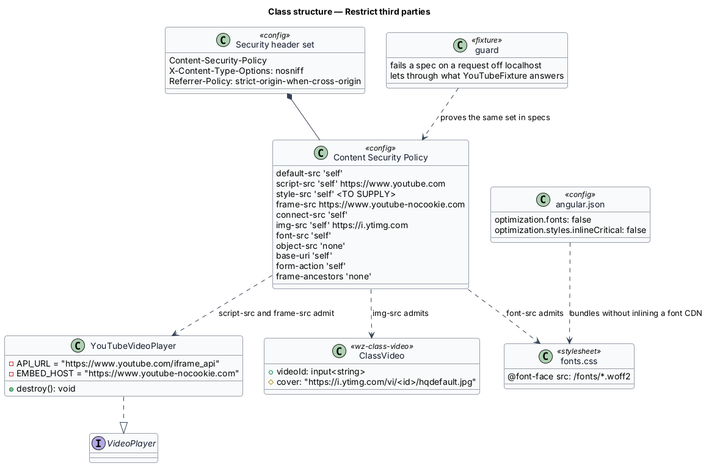
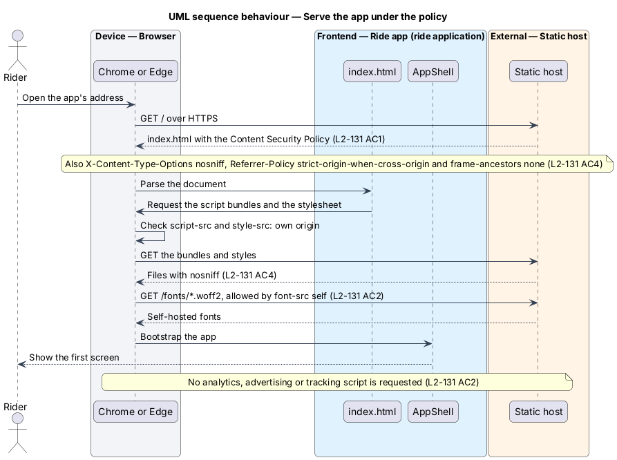
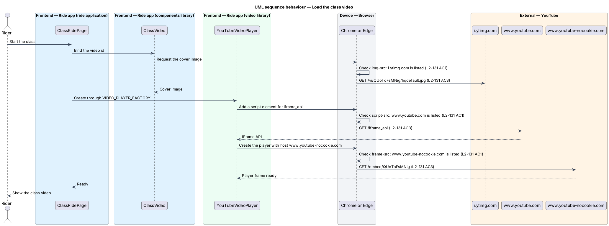
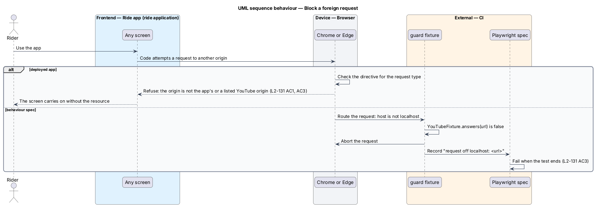

# Restrict third parties

## Overview

Telo Ride 1 collects nothing about the rider (`L1-021`). The only party other than the app's own
origin that the browser contacts is YouTube, which supplies the class video. This feature fixes
that boundary in two places. A Content Security Policy sent with every response tells the browser
which origins the page may load from and connect to. The app itself is built so that it asks for
nothing outside that list: no analytics, advertising or tracking script, and fonts served from its
own origin.

Local terms:

- **Content Security Policy**: response header that lists, per resource type, the origins a page may load from or connect to
- **directive**: one entry of the policy, naming a resource type and its allowed sources
- **third party**: origin other than the one that serves the app
- **privacy-enhanced player**: YouTube embed served from `www.youtube-nocookie.com`
- **header set**: the Content Security Policy together with `X-Content-Type-Options` and `Referrer-Policy`, sent on every response

Neighbouring features own the adjacent concerns:

- [Host and deliver](../../platform/host-and-deliver/README.md) owns the static host that sends
  the header set (`L2-149` AC1).
- [Show The Class](../../the-class/show-the-class/README.md) and
  [Ride the class](../../class-ride/ride-the-class/README.md) own the video on The Class and its
  sync on Class Ride (`L2-084`, `L2-088`).
- [Keep data on the device](../keep-data-on-the-device/README.md) owns the rule that the record
  and the remembered bike are never sent anywhere (`L2-132`).
- [Log to the console only](../log-to-the-console-only/README.md) owns the absence of a remote
  logging service (`L2-115`).
- [Test without hardware](../../platform/test-without-hardware/README.md) owns the fixture that
  fails a spec on a request off localhost (`L2-148` AC1).
- [Meet performance budgets](../../performance/meet-performance-budgets/README.md) owns loading
  the player's code only on a screen that shows the video (`L2-136` AC1).

## Description

### The header set

The policy below is the value the static host sends for Telo Ride 1.

| Directive | Value | Reason |
|-----------|-------|--------|
| `default-src` | `'self'` | Anything not listed falls back to the app's own origin. |
| `script-src` | `'self' https://www.youtube.com` | The app's bundles and the YouTube IFrame API (`L2-131` AC1). |
| `style-src` | `'self'` plus the allowance for Angular's component styles, `<TO SUPPLY>` | See *Component styles*. |
| `frame-src` | `https://www.youtube-nocookie.com` | The player frame only (`L2-131` AC1). |
| `connect-src` | `'self'` | No `fetch`, WebSocket or beacon to another origin (`L2-131` AC1). |
| `img-src` | `'self' https://i.ytimg.com` | The app's images and the class cover (`L2-131` AC1). |
| `font-src` | `'self'` | Self-hosted fonts (`L2-131` AC2). |
| `object-src` | `'none'` | No plug-in content. |
| `base-uri` | `'self'` | The `<base href="/">` of `index.html` cannot be redirected. |
| `form-action` | `'self'` | The app has no form that posts. |
| `frame-ancestors` | `'none'` | No site may frame the app (`L2-131` AC4). |

- **`X-Content-Type-Options: nosniff`** and **`Referrer-Policy: strict-origin-when-cross-origin`**:
  sent on every response, files as well as `index.html` (`L2-131` AC4).
- **Where the header set is written**: exists. It is the `globalHeaders` of
  `frontend/projects/ride/public/staticwebapp.config.json`, the configuration of the static host
  (Azure Static Web Apps, ADR 0043), which the build carries. The host and the file are owned by
  [Host and deliver](../../platform/host-and-deliver/README.md).
- **What exists today**: the policy in that file is the one the carried-over backend sent
  (ADR 0026), moved as it was by slice 28.8. It is wider than Telo Ride 1 allows: it adds
  `'wasm-unsafe-eval'` to `script-src`, `https://tile.googleapis.com` and `blob:` to `connect-src`
  and `img-src`, and `worker-src 'self' blob:`, all for Telo Ride's World rendering and map tiles.
  None of those is carried into the policy above; slice 35.1 narrows the file to it. The service
  worker's scripts carry a policy of their own in the same file, whose `connect-src` adds
  `https://www.youtube.com` and `https://i.ytimg.com`: once the worker controls the page it
  fetches the player and the class cover under its own policy (ADR 0043).
- **No `<meta>` policy**: `frame-ancestors` is ignored in a `<meta>` element (ADR 0018), so the
  policy is a response header. `index.html` carries no policy of its own.
- **Component styles**: Angular injects each component's styles as a `<style>` element at run
  time. `style-src 'self'` alone blocks those elements. The existing policy allows them with
  `'unsafe-inline'`, and ADR 0018 records that a static host cannot mint a per-response nonce for
  `ngCspNonce`. `L2-131` AC1 allows styles only from the app's own origin and the YouTube player,
  and `L2.md` lists no open question for the conflict. The allowance is therefore `<TO SUPPLY>`:
  either `'unsafe-inline'` for styles only, with the requirement amended, or a host that injects a
  nonce. Scripts are not affected by either choice.
- **Local spec server**: `frontend/scripts/serve-dist.mjs` exists. It reads
  `staticwebapp.config.json` from the build it serves and sends its headers, so a policy
  violation surfaces in the behaviour specs before it surfaces on the host.

### The app's own requests

- **`YouTubeVideoPlayer`** (`video`, `youtube-video-player.ts`): exists, behind the `VideoPlayer`
  contract and the `VIDEO_PLAYER_FACTORY` token in `api` (`video/video-player.ts`). Its constants
  `API_URL` (`https://www.youtube.com/iframe_api`) and `EMBED_HOST`
  (`https://www.youtube-nocookie.com`) are the only script and frame origins in the workspace
  other than the app's own.
- **`ClassVideo`** (`components`, `class-ride/class-video.ts`, selector `wz-class-video`): exists.
  It builds the cover address `https://i.ytimg.com/vi/<videoId>/hqdefault.jpg`, with the video id
  passed through `encodeURIComponent`. Class Ride uses it
  ([Ride the class](../../class-ride/ride-the-class/README.md)). Whether The Class reads its cover
  from `i.ytimg.com` or from a bundled image is `<TO SUPPLY>` in
  [Show The Class](../../the-class/show-the-class/README.md); `img-src` admits both.
- **Fonts**: exist. `projects/ride/src/styles/fonts.css` holds the `@font-face` rules, which point
  at the eight WOFF2 files in `projects/ride/public/fonts/` (ADR 0005). The production build sets
  `optimization.fonts` to `false` in `angular.json`, so the build inlines no font provider.
- **`index.html`** (`ride`): exists. It references the favicon and the built bundles and no other
  origin. No analytics, advertising or tracking snippet is added to it.
- **`frontend/package.json`**: exists. It holds no analytics, advertising or tracking package.
- **No other origin in code**: `connect-src 'self'` leaves the app no cross-origin `fetch`. The
  class ships with the app (ADR 0042), so nothing is fetched for it.

### The diagnostic recording changes nothing here

The diagnostic recording of [Record diagnostics](../record-diagnostics/README.md) (`L2-178`)
leaves the header set as it is. Its code is one more chunk from the app's own origin, admitted by
`script-src 'self'`. A saved file is a download of a `blob:` object URL, which is not a
connection, so no directive gains `blob:`. A screen capture is read from the browser's own
Screen Capture API and is fetched from nowhere. No origin is added and nothing is uploaded
(`L2-178` AC15, ADR 0048).

### What is left out

`class-start/class-sync.ts` in `components` builds a link to `youtube.com/watch`, and
`ride/src/app/classes/class-cover.ts` builds a second cover address. Both belong to Telo Ride's
class library and are not extended. Google's Map Tiles origin and the `MapTilesFixture` exception
belong to Telo Ride's maps and leave with them.

### The guard in the specs

- **`guard`** (`frontend/e2e/fixtures/test.ts`): exists, as an automatic fixture. It routes every
  request whose host is not `localhost` or `127.0.0.1`, lets through only what
  `YouTubeFixture.answers(url)` accepts (the IFrame API script and the `i.ytimg.com` covers), aborts
  the rest and fails the spec with `request off localhost: <url>`. For Telo Ride 1 the
  `MapTilesFixture.answers` exception is removed, so YouTube is the only foreign origin a spec can
  reach (`L2-131` AC3).

## Requirements

The feature realizes the following level-2 (L2) requirement, which refines the level-1 (L1)
requirement cited beside it.

| L2 ID | Refines (L1) | Requirement |
|-------|--------------|-------------|
| `L2-131` | `L1-021` | The app's pages shall be served with a Content Security Policy that allows scripts and styles only from the app's own origin and the YouTube player, frames only from `www.youtube-nocookie.com`, connections only to the app's own origin, and images only from the app's origin and `i.ytimg.com`. The app shall load no analytics, advertising or tracking script, and fonts shall be self-hosted. Any request to another origin shall be to YouTube. Responses shall carry `X-Content-Type-Options: nosniff`, `Referrer-Policy: strict-origin-when-cross-origin` and `frame-ancestors 'none'`. |

## Diagrams

### System context

The static host serves Telo Ride 1 and its header set. YouTube is the only other system the app
loads from.

### Containers

The Ride app receives its files, fonts and policy from the static host and loads three things from
YouTube: the IFrame API script, the player frame and the cover image.

### Components

`YouTubeVideoPlayer` and `ClassVideo` are the only components that name a foreign origin.
`index.html` and `fonts.css` reference the app's own origin only.

### Class structure

The header set holds the policy and two further headers. Each policy directive that admits a foreign
origin maps to one piece of code: `script-src` and `frame-src` to `YouTubeVideoPlayer`, `img-src`
to `ClassVideo`.

### Behaviour: serve the app under the policy

The static host answers the first request with `index.html` and the header set. The browser then
loads bundles, styles and fonts from the same origin and requests nothing else.

### Behaviour: load the class video

On Class Ride the cover comes from `i.ytimg.com`, the IFrame API from `www.youtube.com` and the
player frame from `www.youtube-nocookie.com`. The browser checks each against its directive before
the request.

### Behaviour: block a foreign request

In the deployed app the browser refuses a request to an origin the policy does not list. In a
behaviour spec the `guard` fixture aborts the same request and fails the spec.

