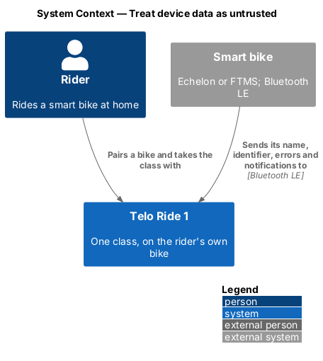
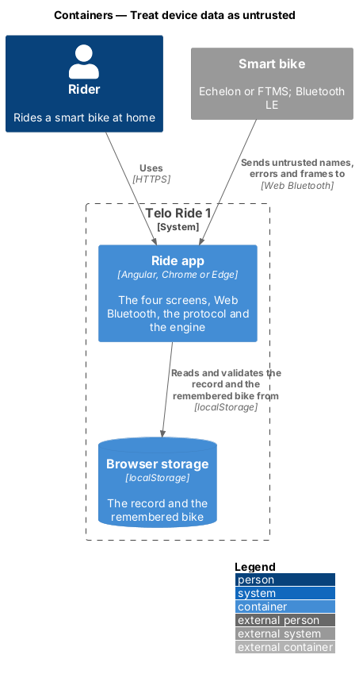
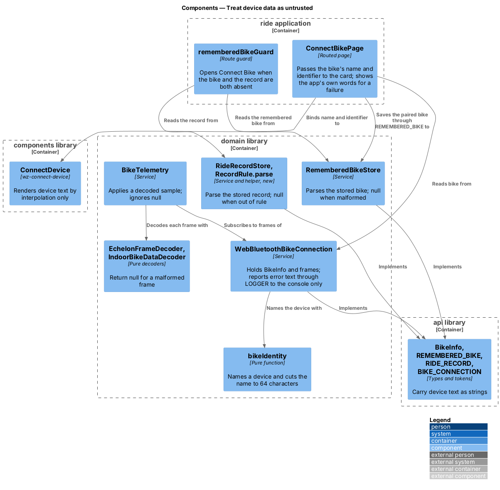
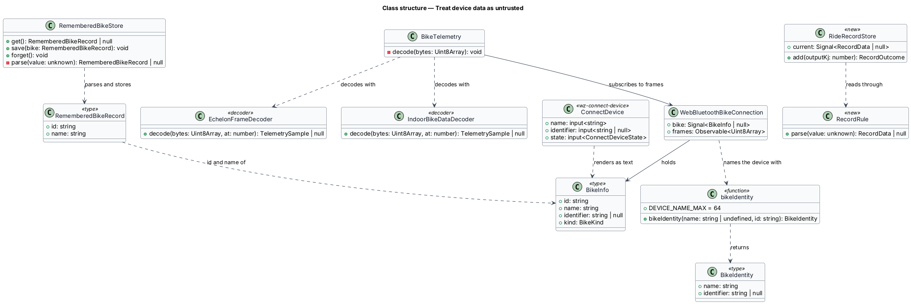
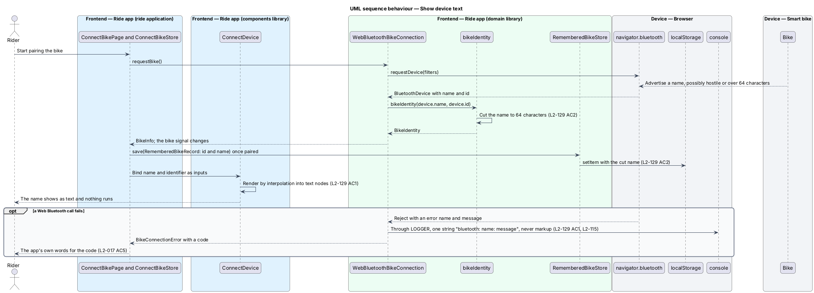
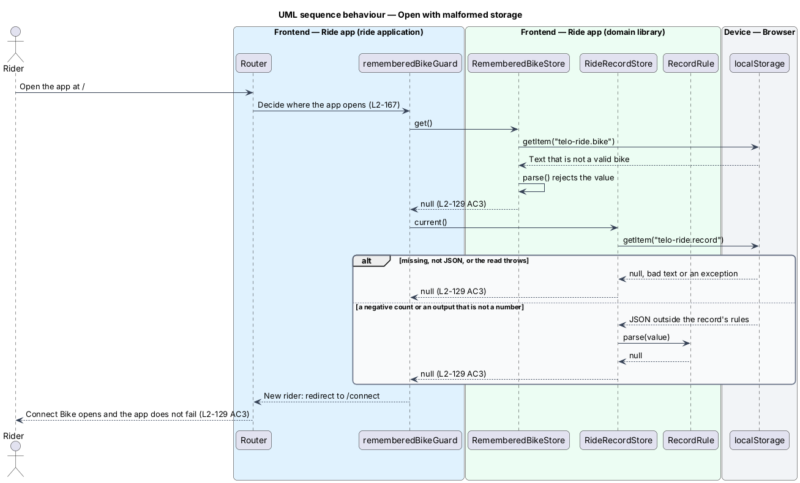
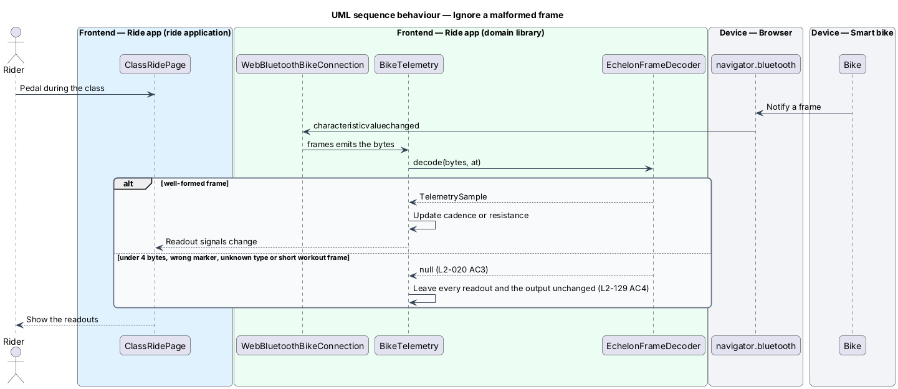

# Treat device data as untrusted

## Overview

Telo Ride 1 reads data it did not write: the name a bike advertises, the identifier the browser
gives it, the names and messages of Web Bluetooth errors, the frames the bike notifies, and
whatever sits in the browser's storage when the app opens. A bike's name is chosen by whoever set
up the device. Storage can be edited by the rider, by another version of the app or by a browser
extension. This feature states how each of those inputs is handled so that none of them runs as
code, breaks the app or changes a number on the screen. It refines `L1-021`.

Local terms:

- **device text**: string that originates from a bike or from Web Bluetooth, namely a device name, an identifier, an error name or an error message
- **untrusted data**: input whose content the app does not control and therefore validates before use
- **malformed frame**: Bluetooth notification that does not match the layout its protocol defines
- **absent**: state of a stored value that is missing, unreadable or outside its rules, handled as if it had never been written
- **new rider**: rider with no remembered bike and no finished rides (`L2-167`)

Neighbouring features own the adjacent concerns:

- [Connect a bike](../../bike/connect-a-bike/README.md) owns Connect Bike, the chooser and the card
  that shows the bike's name and identifier (`L2-011`, `L2-013`).
- [Keep the bike connected](../../bike/keep-the-bike-connected/README.md) owns what is remembered
  about the bike (`L2-015`) and the error shown after a drop (`L2-017`).
- [Read bike telemetry](../../bike/read-bike-telemetry/README.md) owns the decoding rules
  themselves (`L2-020` AC3, `L2-021` AC4).
- [Keep the record](../../class-done/keep-the-record/README.md) owns the record and its store
  (`L2-168`).
- [Open the app](../../the-class/open-the-app/README.md) owns the choice between Connect Bike and
  The Class (`L2-167`).
- [Log to the console only](../log-to-the-console-only/README.md) owns the console line for an
  error (`L2-115`).

## Description

### Device text shown as text (`L2-129` AC1)

- **Text bindings**: exists as a property of the codebase. Every template renders device text
  with interpolation (`{{ }}`), which writes a text node. No template in `frontend/projects/`
  binds `[innerHTML]` and no code calls a `DomSanitizer.bypassSecurityTrust*` method. The design
  keeps both at zero.
- **`ConnectDevice`** (`components`, `connect-device/`, selector `wz-connect-device`): exists. It
  takes the bike's `name` and `identifier` as inputs and renders them by interpolation. The
  states it shows are owned by [Connect a bike](../../bike/connect-a-bike/README.md).
- **Error names and messages**: `describeError` (`domain`, `bluetooth/describe-error.ts`) exists
  and renders a Web Bluetooth error as the string `name: message`. That string goes to the console
  as one text argument ([Log to the console only](../log-to-the-console-only/README.md)). The
  `BikeConnection.lastError` signal (`api`, `bike/bike-connection.ts`) exists and carries the same
  string; [Keep the bike connected](../../bike/keep-the-bike-connected/README.md) drops it, because
  the rider sees only the app's own message (`L2-017` AC5). A screen branches on
  `BikeConnectionError.code` (`blocked`, `failed`, `read-only`) and never parses or shows the
  message.
- **Content Security Policy**: the policy of
  [Restrict third parties](../restrict-third-parties/README.md) is the second line of defence. A
  script injected through device text would not be from the app's origin and would not run.

### Device names cut to 64 characters (`L2-129` AC2)

- **`bikeIdentity`** (`domain`, `bluetooth/bike-identity.ts`): exists. It maps
  `ECH-EX5S-141844` to the name "Echelon EX-5s" and the identifier `EX5S-141844`, and any other
  device to its trimmed advertised name or, when it has none, its browser id. Today it applies no
  length limit. For Telo Ride 1 it exports `DEVICE_NAME_MAX = 64` and cuts `name` to that length.
  The identifier is derived from the same advertised name and is cut to the same limit.
- **Single point of entry**: `WebBluetoothBikeConnection` builds `BikeInfo` only through
  `bikeIdentity`, and `ConnectBikeStore` passes its `id` and `name`, as a `RememberedBikeRecord`, to `RememberedBikeStore.save`. The
  cut name is therefore the one shown and the one stored.
- **`RememberedBikeStore.parse`**: exists. For Telo Ride 1 it also cuts a stored `name` to
  `DEVICE_NAME_MAX` on read, because the stored value is itself untrusted.

### Storage treated as absent when out of rule (`L2-129` AC3)

- **`RememberedBikeStore`** (`domain`, `storage/remembered-bike-store.ts`): exists, behind the
  `RememberedBike` contract and the `REMEMBERED_BIKE` token in `api`. `get()` reads the key
  `telo-ride.bike` inside a `try` block and passes the parsed JSON to `parse`, which returns `null`
  unless `id` is a non-empty string, `name` is a string, `identifier` is a string or `null`, and
  `kind` is `echelon` or `ftms`. A thrown `SecurityError`, a `JSON.parse` failure and a failed check
  all yield `null`. [Keep the bike connected](../../bike/keep-the-bike-connected/README.md)
  reduces the stored fields to `id` and `name` (`L2-015` AC4), and `parse` then checks those two.
- **`RideRecordStore`** (`domain`, `storage/ride-record-store.ts`) and **`RecordRule.parse`**
  (`domain`, `engine/record-rule.ts`): new, introduced by
  [Keep the record](../../class-done/keep-the-record/README.md) behind `RideRecord` and
  `RIDE_RECORD` in `api`. The store follows the same shape: a guarded read of the key
  `telo-ride.record`, then `RecordRule.parse`, which returns a `RecordData` only when `rides` is a
  whole number of at least 1 and both outputs are finite numbers of at least 0. Any other value is
  `null`.
- **`rememberedBikeGuard`** (`ride`, `bike/remembered-bike.guard.ts`): exists and reads
  `REMEMBERED_BIKE`. [Open the app](../../the-class/open-the-app/README.md) reshapes it to read
  `RIDE_RECORD.current()` as well. With both `null`, the rider is a new rider and Connect Bike
  opens.
- **No repair, no error screen**: an out-of-rule value is not rewritten or deleted on read. The
  next successful pairing or finished ride overwrites it.

### Malformed frames ignored (`L2-129` AC4)

- **`EchelonFrameDecoder.decode`** (`domain`, `protocol/echelon-frame-decoder.ts`): exists. It
  returns `null` for a frame under 4 bytes, a first byte other than `F0`, an unknown type and a
  `D1` frame under 13 bytes.
- **`IndoorBikeDataDecoder.decode`** (`domain`, `protocol/indoor-bike-data-decoder.ts`): exists. It
  returns `null` for a notification under 2 bytes and leaves undefined any field that runs past the
  end of the notification.
- **`BikeTelemetry`** (`domain`, `engine/bike-telemetry.ts`): exists. It subscribes to
  `BikeConnection.frames` and applies a sample only when the decoder returns one. A `null` leaves
  every readout unchanged. Output is summed from the readouts
  ([Read bike telemetry](../../bike/read-bike-telemetry/README.md), `L2-023`), so a malformed frame
  cannot change it.
- **No exception path**: neither decoder throws on any byte sequence, so a hostile notification
  cannot end the subscription.

## Requirements

The feature realizes the following level-2 (L2) requirement, which refines the level-1 (L1)
requirement cited beside it.

| L2 ID | Refines (L1) | Requirement |
|-------|--------------|-------------|
| `L2-129` | `L1-021` | Text from a bike or Bluetooth (device names, identifiers, error names and messages) shall be shown as text, and nothing in it shall run. A device name longer than 64 characters shall be cut to 64 where it is shown and where it is stored. A stored record or remembered bike that is missing, malformed, or holds values outside their rules (a negative count, an output that is not a number) shall be treated as absent when the app opens: the rider is a new rider, and the app shall not fail. A malformed Bluetooth frame shall be ignored when it is decoded (`L2-020` AC3, `L2-021` AC4) and shall never change a readout or the output. |

## Diagrams

### System context

The smart bike is the source of untrusted names, errors and notifications. The rider sees them only
after Telo Ride 1 has bounded and validated them.

### Containers

The Ride app receives untrusted data from two sides: the bike over Web Bluetooth and the browser's
storage on the device. It validates both before use.

### Components

`bikeIdentity` bounds the name before `WebBluetoothBikeConnection` exposes or stores it.
`RememberedBikeStore` and `RideRecordStore` parse what they read, and the two decoders return `null`
for a malformed frame.

### Class structure

`BikeInfo` is built only through `bikeIdentity`, and the `RememberedBikeRecord` is its `id` and `name`. Each store reads through a `parse` that returns
the value or `null`, and each decoder returns `TelemetrySample | null`.

### Behaviour: show device text

A device advertises a name that may be hostile or too long. `bikeIdentity` cuts it to 64 characters,
the store saves the cut name, and `ConnectDevice` renders it by interpolation. An error's name and
message go to the console as one string, through `LOGGER`, and the rider reads the app's own words.

### Behaviour: open with malformed storage

`rememberedBikeGuard` reads the remembered bike and the record. A missing key, unparsable text, a
thrown read and a value outside its rules all come back as `null`, and Connect Bike opens.

### Behaviour: ignore a malformed frame

`BikeTelemetry` hands each notification to the decoder. A well-formed frame updates a readout; a
malformed one returns `null` and changes nothing.

