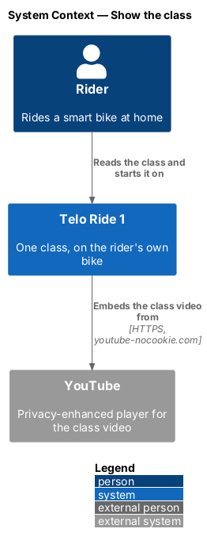
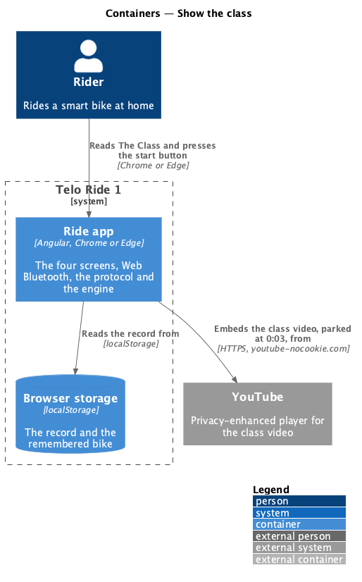
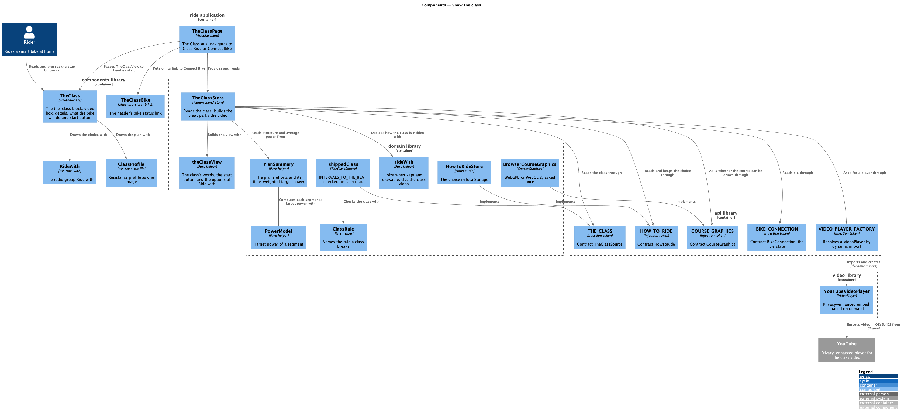
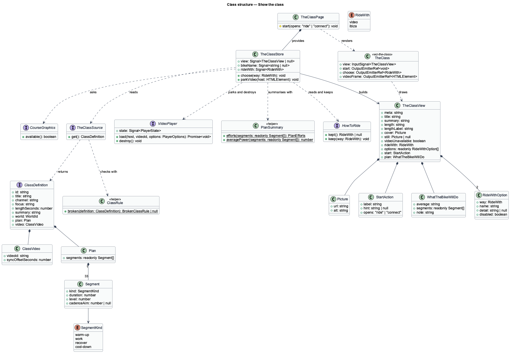
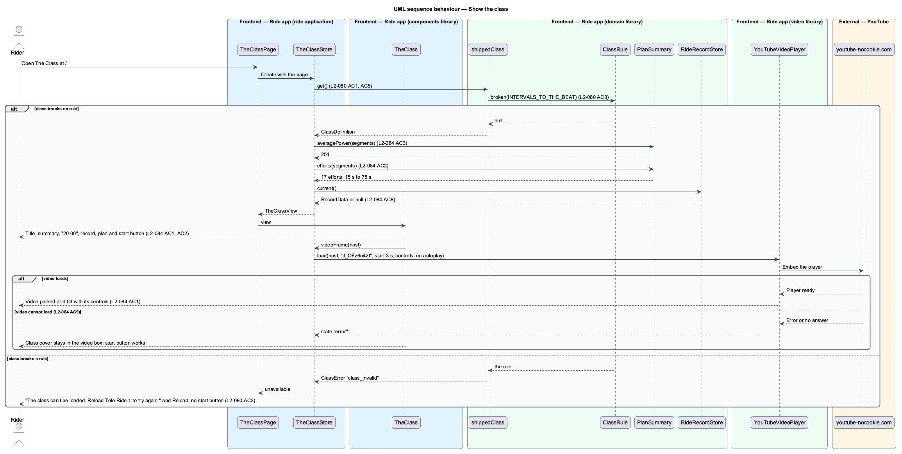
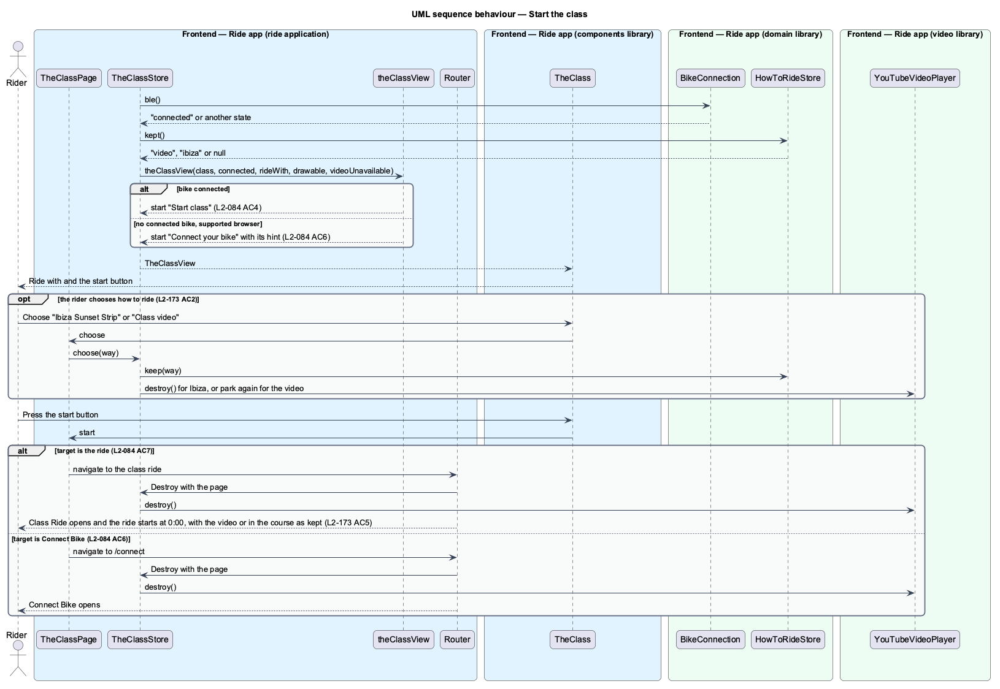

# Show the class

## Overview

Telo Ride 1 offers exactly one class, Intervals to the Beat by GCN Training, with the id
`intervals-to-the-beat`. It ships with the app (ADR 0037, ADR 0042). The Class is the home screen,
at `/`. It shows the class video, the title and length, the choice of how to ride, a chart of what the
bike will do, and one start button. A returning rider also sees the
ride count, the best output and the last output.

This feature defines the class and its plan, validates them, draws The Class and starts the ride.
There is no other class and no way to pick one; the one choice the rider has is how to ride it,
with the class video or in Ibiza Sunset Strip (L2-173, ADR 0044).

- **class**: timed workout the rider follows along to a video; Telo Ride 1 has one
- **plan**: timed segments the class follows, 33 in all and 20:00 long
- **segment**: part of the plan with a kind (warm-up, work, recover, cool-down), a duration, a
  level and a cadence aim
- **effort**: one of the plan's 17 work segments
- **level**: target resistance a segment asks of the bike, 1 to 32
- **cadence aim**: cadence in rpm a segment asks of the rider
- **target power**: power of a segment's cadence aim at its level, by the estimate of L2-023 AC3
- **sync offset**: video time at which ride 0:00 starts, 0:03.0 for this class
- **record**: rider's ride count, best output and last output, kept on the device
- **start button**: the one primary action of The Class, which reads "Start class", "Ride it
  again" or "Connect your bike"
- **ride with**: the rider's choice of how to ride, `'video'` or `'ibiza'`, kept on the device
- **still**: the picture of the course that stands in the video's box when the ride is in Ibiza

Neighbouring features own the adjacent concerns:

- [Open the app](../open-the-app/README.md) decides whether The Class or Connect Bike opens at `/`.
- [Keep the bike connected](../../bike/keep-the-bike-connected/README.md) owns the bike status link
  in the header (L2-019) and the `ble` state the start button follows.
- [Check bike and browser support](../../bike/check-bike-and-browser-support/README.md) owns the
  alerts under the header and the disabled start button of a blocked browser (L2-008, L2-009,
  L2-010).
- [Keep the record](../../class-done/keep-the-record/README.md) owns the record The Class reads.
- [Ride the class](../../class-ride/ride-the-class/README.md) owns Class Ride, which the start
  button opens.
- [Read bike telemetry](../../bike/read-bike-telemetry/README.md) owns the power estimate
  (L2-023) the target power uses.
- [Fit The Class to every form factor](../../ui/fit-the-class-to-every-form-factor/README.md) owns
  the one-screen and one-column layouts and the pinned start button (L2-171).
- [Show the wordmark](../../ui/show-the-wordmark/README.md) and
  [Switch theme and full screen](../../ui/switch-theme-and-full-screen/README.md) own the header's
  wordmark and Full screen button.
- [Restrict third parties](../../security/restrict-third-parties/README.md) owns the Content
  Security Policy that admits the YouTube player.

## Description

Slice 32.6 added the record (`L2-084` AC5, AC8, `L2-079` AC2, `L2-171` AC4; the mock `the-class/returning`):
`TheClassState.record` is the device's `RIDE_RECORD` snapshot, read when the view is drawn, so Done's return to The Class
shows the ride just counted. `theClassView.record` is `{rides, best, last}` as "6", "342 kJ" and "318 kJ", or `null` for
a rider with no finished ride; `wz-the-class` draws it as `the-class__stats` beside the length (wrapping under it on a
phone), and `startAction(connected, blocked, returning)` reads "Ride it again" with a connected bike and a finished ride.

Slice 30.2 built The Class in the place of Telo Ride's Class Start, which is gone with its
"Video link and sync" (`ClassSync`), `ClassStartVideo` and `AppHeaderBike`. Slice 30.1 built the
class definition. Slice 30.3 built "What the bike will do" as designed, in the place of the plan
chart carried over from Telo Ride (`ClassPlan`, which slice 37.1 removed with World loading). Slice 30.4 fitted the layout from lg to one screen. Slice 30.6
built the blocked browser: the alert under the header and the disabled start button, which
[Check bike and browser support](../../bike/check-bike-and-browser-support/README.md) owns. Still
to come on this screen: the record with "Ride it again" (32.6).

**The class definition**

- **`ClassDefinition`** (`api/src/classes/class-definition.ts`, built in slice 30.1): the class as
  the app holds it: `id`, `title`, `channel`, `focus`, `lengthSeconds`, `summary`, `world`, `plan`
  and `video`. It replaces Telo Ride's `ClassDto`, without `opensAtLevel` and `shelfId`.
- **`ClassVideo`** (same file): `videoId` (`il_OFz6o42I`) and `syncOffsetSeconds` (3.0).
- **`Plan`** and **`Segment`** (`api/src/workout/plan.ts`, exist): the plan and its segments.
  Every segment of the class has a cadence aim (L2-080 AC2).
- **`INTERVALS_TO_THE_BEAT`** (`domain/src/engine/intervals-to-the-beat.ts`, built in slice 30.1):
  the class, a typed constant: `intervals-to-the-beat`, "Intervals to the Beat", "GCN Training",
  "Intervals", 1200 s, the summary of L2-080 AC1, the world `ibiza`, and the plan of L2-080 AC2,
  which is the plan of `tools/blender/courses/ibiza.json` segment for segment:

  | Segment | `kind` | Starts | `duration` | `level` | `cadenceAim` |
  |---|---|---|---|---|---|
  | 1 | `warm-up` | 0:00 | 150 s | 14 | 80 |
  | 2 | `work` (effort 1) | 2:30 | 45 s | 19 | 70 |
  | 3 | `recover` | 3:15 | 30 s | 14 | 90 |
  | 4 | `work` (effort 2) | 3:45 | 75 s | 21 | 80 |
  | 5 | `recover` | 5:00 | 60 s | 13 | 90 |
  | 6, 8, 10 | `work` (efforts 3 to 5) | 6:00, 7:00, 8:00 | 30 s each | 21 | 74 |
  | 7, 9, 11 | `recover` | 6:30, 7:30, 8:30 | 30 s each | 13 | 90 |
  | 12, 14, 16 | `work` (efforts 6 to 8) | 9:00, 10:00, 11:00 | 30 s each | 22 | 65 |
  | 13, 15, 17 | `recover` | 9:30, 10:30, 11:30 | 30 s each | 11 | 90 |
  | 18 to 32 | the rest of L2-080 AC2's table, row for row | 12:00 to 18:15 | | | |
  | 33 | `cool-down` | 18:15 | 105 s | 12 | 81 |

  L2-080 AC2 holds every row; `intervals-to-the-beat.spec.ts` has one case per row of it.
- **`THE_CLASS`** and **`TheClassSource`** (`api/src/classes/the-class.ts`, built in slice 30.1):
  the contract the screens read the class through. `get()` answers the `ClassDefinition` at once,
  with no network (L2-080 AC5), and refuses with a `ClassError` (`api/src/classes/class-error.ts`)
  whose `code` is `class_invalid`. `shippedClass()` (`domain/src/engine/shipped-class.ts`)
  implements it over `INTERVALS_TO_THE_BEAT` and checks it with `ClassRule` on each read.
  `provideTheClass()` (`ride/src/app/classes/provide-the-class.ts`) binds the token on the lazy
  routes that read it, so the class's data is not in the initial bundle. It replaces `CLASSES_API`,
  `HttpClassesApi`, `CachedClassesApi` and `CatalogueCache`, which are removed (ADR 0042).
- **`THE_CLASS_ID`** (`ride/src/app/classes/the-class.ts`, exists): the constant
  `'intervals-to-the-beat'`, which the class ride's route is written from. No screen lists classes
  and no other id has a route, so no other class can be reached (L2-080 AC4).
- **`ClassRule`** (`domain/src/engine/class-rule.ts`, built in slice 30.1): pure helper with unit
  tests. `ClassRule.broken(definition)` names the first rule the class breaks, `'level'` (a level
  outside 1 to 32), `'cadence_aim'` (a segment with none), `'efforts'` (not exactly 17 `work`
  segments) or `'length'` (a segment under a second, or lengths that do not add up to
  `lengthSeconds`), or `null` (L2-080 AC3).
- **`theClassGuard`** (`ride/src/app/classes/the-class.guard.ts`, built in slice 30.1): sends the
  class ride's address to `/` when `get()` refuses, so a class that breaks a rule is never ridden.

**The screen**

- **`theClassRoutes`** (`ride/src/app/the-class/the-class.routes.ts`, built): the route of the
  empty path. It binds `provideTheClass()`, `provideClassVideo()` and `provideHowToRide()` (all in
  `ride/src/app/classes/`) and loads `TheClassPage` with `loadComponent`, so the class, the
  player's factory and the choice load with the screen.
- **`TheClassPage`** (`ride/src/app/the-class/the-class-page.ts`, `.html`, `.scss`, built;
  `wz-the-class-page`): the page. It provides `TheClassStore`, draws `ScreenHeader` with the bike
  status link (`a[wz-the-class-bike]`, `routerLink="/connect"`) and the Full screen button in its
  `[slot=end]`, passes the store's view to `wz-the-class`, and navigates on `start`: to Class Ride (`/ride`, since slice 31.1) for "Start class" (L2-084 AC7), to `/connect` for "Connect
  your bike" (AC6). When the store has no view it says "The class can’t be loaded. Reload
  Telo Ride 1 to try again." (`role="alert"`) with **Reload** (mock `the-class/cannot-load`,
  L2-080 AC3).
- **`TheClassStore`** (`ride/src/app/the-class/the-class-store.ts`, built): the page-scoped
  state. It reads the class from `THE_CLASS`, which has checked it with `ClassRule`, and exposes
  `view`, a computed signal over the class, `BIKE_CONNECTION.ble`, the choice of how to ride and
  whether the video can load; `view` is `null` for a class that breaks a rule. `bikeName` is the
  connected bike's name for the header link, or `null` (L2-019). `rideWith` is
  `rideWith(kept, drawable)`. `choose(way)` keeps the choice through `HOW_TO_RIDE` at once, and
  parks the player for `'video'` or destroys it for `'ibiza'` (L2-173 AC2 to AC4); it ignores
  Ibiza where the course cannot be drawn (AC6). `parkVideo(host)` takes the element the player
  embeds in and, when the ride is with the video, resolves a player from `VIDEO_PLAYER_FACTORY`
  and loads the video at `syncOffsetSeconds` with `controls: true` and `autoplay: false`
  (L2-084 AC1). A factory that rejects, or a player whose `state` is `'error'`, sets the view's
  `videoUnavailable` and changes nothing else (AC9). A counter of parks tells a player that
  arrives after the rider changed the choice that it is not wanted. The store destroys the player
  when the rider leaves the page.
- **`theClassView`**, **`startAction`** and **`rideWithOptions`**
  (`ride/src/app/the-class/the-class-view.ts`, built): pure helpers with unit tests, one case per
  row of the tables below. `theClassView` builds the `TheClassView`: the meta line
  "GCN Training · Intervals" from `channel` and `focus`, the length "20:00" with "start to finish",
  the cover, the still when the ride is in Ibiza, the options of "Ride with", the start action and
  `plan`, what the bike will do.
- **`whatTheBikeWillDo`** (`ride/src/app/the-class/the-class-view.ts`, built by slice 30.3): a
  pure helper with unit tests. From the plan's segments it gives the `WhatTheBikeWillDo` the card
  is drawn from (L2-084 AC2, AC3): `average`, "~" with `PlanSummary.averagePower(segments)` and
  " W average"; the `segments` themselves, for the profile; and `note`, from
  `PlanSummary.efforts(segments)`:

  | Efforts in the plan | Note |
  |---|---|
  | 17, from 0:15 to 1:15 (Intervals to the Beat) | "17 efforts · 0:15 to 1:15. Resistance changes on its own; you just pedal." |
  | Several of one length | "2 efforts · 0:30. Resistance changes on its own; you just pedal." |
  | One | "1 effort · 6:00. Resistance changes on its own; you just pedal." |
  | None | "Resistance changes on its own; you just pedal." |

  Only the first row is a class Telo Ride 1 ships; the others keep the helper honest for any plan.

  | `ble` | Finished rides | Browser | Label | Hint | Opens | Built |
  |---|---|---|---|---|---|---|
  | `connected` | 0 | supported | "Start class" | none | the class ride | 30.2 |
  | `connected` | 1 or more | supported | "Ride it again" | none | the class ride | 32.6 |
  | not `connected` | any | supported | "Connect your bike" | "The class needs the bike to set resistance." | `/connect` | 30.2 |
  | any | any | blocked | "Connect your bike", disabled | the same hint | nothing (L2-010 AC1) | 30.6 |

  The start button's words never follow the choice of how to ride (L2-173 AC5).

  | Option | Name | Line under it | Disabled |
  |---|---|---|---|
  | `video` | "Class video" | none | never |
  | `ibiza`, course can be drawn | "Ibiza Sunset Strip" | "8.4 km · 159 m of climbing" | no |
  | `ibiza`, course cannot be drawn | "Ibiza Sunset Strip" | "This browser can’t draw Ibiza." | yes |

  The record figures ("Rides", "Best output", "Last time"; L2-084 AC8) join the view with the
  record (slice 32.6).
- **`TheClassView`**, **`StartAction`**, **`RideWithOption`**, **`Picture`** and
  **`WhatTheBikeWillDo`** (`api/src/classes/the-class-view.ts`, built): the view types the page and the presentation
  components share, in `api` because `components` imports `api` for types only.
- **`HOW_TO_RIDE`**, **`HowToRide`**, **`RideWith`**, **`COURSE_GRAPHICS`** and
  **`CourseGraphics`** (`api/src/classes/how-to-ride.ts`, built): the contracts of the choice.
  `HowToRideStore` (`domain/src/storage/how-to-ride-store.ts`) keeps `'video'` or `'ibiza'` as one
  value in `localStorage` (`telo-ride.ride-with`); a value it does not know counts as never chosen.
  `BrowserCourseGraphics` (`domain/src/browser/browser-course-graphics.ts`) answers `true` where
  `navigator.gpu` exists or a WebGL 2 context can be made, asks once, and lets the context go.
  `rideWith(kept, drawable)` (`domain/src/engine/ride-with.ts`) is the rule, with a unit test per
  case: Ibiza only when it was kept and can be drawn, the class video otherwise (L2-173 AC1, AC6).
  `provideHowToRide()` binds both tokens on The Class's route and the class ride's.
- **`TheClass`** (`components/src/the-class/the-class.ts`, `.html`, `.scss`, built;
  `wz-the-class`): the presentation component of the design-system block `the-class`, with the
  mock's BEM classes (`the-class__video`, `the-class__title`, `the-class__duration`,
  `the-class__start`, `the-class__start-hint` and the rest). It takes `view`, emits `start`,
  `choose` and `videoFrame` (the element the player embeds in, `the-class__player`, once it is
  drawn). It draws "What the bike will do" (`section.the-class__plan`, named by its `h2`
  `the-class__plan-title`): `the-class__plan-watts` with the view's `plan.average`, `ClassProfile`
  (`the-class__profile`) with `plan.segments` and the label "Resistance profile", and
  `the-class__plan-note` with `plan.note` (L2-084 AC2, slice 30.3). It draws the video's box: the
  class cover (`photo photo--yt`, "Video: Intervals to the Beat, GCN Training") under the player,
  or the course's still (`photo`, "Ibiza Sunset Strip: a seafront road at sunset") when the view
  has one; when the video cannot load, the player's element is not rendered and the cover stands
  alone (AC9, mock `the-class/video-unavailable`). It renders the start button in the details
  column (`the-class__action`) and in the pinned footer (`the-class__footer`), of which the layout
  shows one (L2-171 AC5). From lg the block is one screen that does not scroll, the video's box
  taking the height left (slice 30.4,
  [Fit The Class to every form factor](../../ui/fit-the-class-to-every-form-factor/README.md)).
  The cover is YouTube's (`i.ytimg.com`, ADR 0014), which the service worker keeps
  once it has been seen; the app bundles no cover.
- **`TheClassBike`** (`components/src/the-class/the-class-bike.ts`, built;
  `a[wz-the-class-bike]`): the header link's content (element `the-class__bike`). The page puts
  it on its link to Connect Bike and projects the bike's name or "No bike"; it adds "connected"
  for a screen reader and "· Change", or "· Connect", with the Bluetooth or Bluetooth-off icon,
  hides the action from sight below 640 px and keeps the link 44 px tall (L2-019 AC1 to AC4).
- **`RideWith`** (`components/src/ride-with/ride-with.ts`, built; `wz-ride-with`): the radio
  group "Ride with" (design-system block `ride-with`, a WAI-ARIA radio group). It takes `options`
  and `chosen` and emits `choose`. The chosen option has `aria-checked="true"`, a filled mark and
  the tab stop; the arrow keys move the choice through `radioStep`
  (`components/src/ride-with/radio-step.ts`, a pure helper with unit tests), passing over an
  option that is `aria-disabled`; each option is at least 44 px tall (L2-173 AC7).
- **`ScreenHeader`** (`components/src/screen-header/`, built by renaming `ClassStartHeader`;
  `wz-screen-header`): the `class-header` block with the wordmark, owned by
  [Show the wordmark](../../ui/show-the-wordmark/README.md).
- **The class ride follows the choice** (`ride/src/app/class-ride/class-ride-page.ts`, ADR 0044).
  Either way it is Class Ride at once. With "Class video" the box is the class video. With
  "Ibiza Sunset Strip" the box is the course, with no video player (slice 37.1, ADR 0047;
  [ride the class](../../class-ride/ride-the-class/README.md)).
- **`ClassProfile`** (`components/src/the-class/class-profile.ts`, exists; `wz-class-profile`):
  the resistance profile as one inline SVG with `role="img"`, in a box as wide as the plan is long
  (`0 0 1200 32`): one bar a segment, as wide as the segment lasts and as tall as its level against
  the plan's highest. `TheClass` passes it the segments and the label "Resistance profile"
  (L2-084 AC2) and sets its height through `--class-profile-height`, which the profile's own
  stylesheet reads: 64 px, and 56 px from 1024 to 1279 px wide, as the mock draws it.
- **`PlanSummary`** (`domain/src/engine/plan-summary.ts`, exists): `averagePower(segments)` is the
  plan's time-weighted target power, rounded (L2-084 AC3): 253.55 W for this plan, so The Class
  shows "~254 W average" beside the heading "What the bike will do". `efforts(segments)` (slice
  30.3) counts the plan's work segments and gives the shortest and the longest in seconds: 17, 15
  and 75 for this plan, so the line under the profile reads "17 efforts · 0:15 to 1:15. Resistance
  changes on its own; you just pedal." (L2-084 AC2). `structure(segments)` and `outline(segments)`,
  which The Class no longer shows, went with World loading in slice 37.1.
- **`PowerModel`** (`domain/src/engine/power-model.ts`, exists): `target(cadenceAim, level)`, the
  target power of L2-023 AC3 that `PlanSummary.averagePower` weights by duration.
- **`VIDEO_PLAYER_FACTORY`**, **`VideoPlayer`** (`api/src/video/video-player.ts`, exist) and
  **`YouTubeVideoPlayer`** (`video/src/youtube-video-player.ts`, exists): the player contract and
  its YouTube implementation. `provideClassVideo()` binds the factory to a dynamic import of
  `@telo/video`, so the player's code loads only on a screen that shows the video.

The Playwright page object `the-class.page.ts` (`frontend/e2e/pages/`, built, replacing
`class-start.page.ts`) owns the selectors, the `youtube.ts` fixture answers the player's requests,
and `how-to-ride.ts` gives a spec a rider who chose on an earlier visit. `startClassRide`
(`fixtures/class-ride.ts`) starts a ride as a rider does, from The Class.

## Requirements

The feature realizes the following level-2 (L2) requirements. Each L2 requirement refines a
level-1 (L1) requirement, cited by identifier.

| L2 ID | Refines (L1) | Requirement |
|-------|--------------|-------------|
| `L2-080` | `L1-014` | The app shall define one class, with the id `intervals-to-the-beat`: "Intervals to the Beat" by "GCN Training", focus "Intervals", 20:00 long, with the summary "Seventeen efforts from 15 seconds to 1:15, ridden to the beat, with five fast sprints to finish.", the YouTube video `il_OFz6o42I` and a sync offset of 0:03.0, the video time at which ride 0:00 starts. Its plan shall be the 33 segments of L2-080 AC2, the plan Ibiza Sunset Strip was built from (`tools/blender/courses/ibiza.json`): 17 efforts, each segment with a level and a cadence aim. The app shall validate that every level is 1 to 32, that every segment has a cadence aim, that there are exactly 17 work segments and that the segment lengths add up to 20:00; it shall not offer an invalid class, and The Class shall then say "The class can’t be loaded. Reload Telo Ride 1 to try again." with **Reload**. No other class shall be reachable, and the class shall show without a network once the app has been opened on the device. |
| `L2-084` | `L1-014` | The Class, at `/`, shall show the header with the wordmark, the bike status (L2-019) and Full screen; the video player with its controls, parked at the sync offset (0:03); "GCN Training · Intervals", the title as the `h1`, and the summary; and "20:00" with "start to finish". "What the bike will do" shall read "~254 W average", a resistance profile of the plan (`role="img"`, "Resistance profile") and "17 efforts · 0:15 to 1:15. Resistance changes on its own; you just pedal.". The average shall be the plan's time-weighted target power (L2-023 AC3), rounded. With a connected bike the start button shall read "Start class" for a rider with no finished rides and "Ride it again" for a rider with at least one. With no connected bike in a supported browser it shall read "Connect your bike", be followed by "The class needs the bike to set resistance.", and open Connect Bike. When the rider presses "Start class" or "Ride it again" with the bike connected, Class Ride shall open and the ride shall start at 0:00. For a returning rider The Class shall read "Rides" with the ride count ("6"), "Best output" with the best ("342 kJ") and "Last time" with the last output ("318 kJ"); a rider with no finished rides shall see none of the three. When the video cannot load, the class cover shall stand in its box, and the rest of the screen, the start button included, shall work. |

| `L2-173` | `L1-028` | The Class shall offer a radio group named "Ride with" with "Class video" and "Ibiza Sunset Strip", "Class video" chosen for a rider who has never chosen, and shall keep the choice on the device. With "Ibiza Sunset Strip" chosen a still of the course shall stand in the video's box with the alternative text "Ibiza Sunset Strip: a seafront road at sunset", the choice shall read "8.4 km · 159 m of climbing", and neither the 3D renderer nor the course's model shall be loaded. The ride shall be in Ibiza or with the class video as chosen, and the start button's words shall not change with the choice. Where the browser cannot draw the course, "Ibiza Sunset Strip" shall be disabled and read "This browser can’t draw Ibiza.", and "Class video" shall be chosen whatever was kept. Each option shall be at least 44 px tall, the arrow keys shall move the choice, and the chosen one shall be told by `aria-checked` and a mark. Slice 30.2 builds AC1 to AC7; AC5's ride in Ibiza is the carried-over one until journey 37. |

## Diagrams

### System context

The rider reads the class on Telo Ride 1, which embeds the class video from YouTube's
privacy-enhanced domain. The video is the only part of the screen that leaves the device.

### Containers

The Ride app reads the record from browser storage and embeds the YouTube player. The class
definition is part of the app's own code (ADR 0042), so no container is drawn for it.

### Components

`TheClassPage` provides `TheClassStore`, which reads the class through `THE_CLASS`, whose
`shippedClass` checks it with `ClassRule`, reads the choice through `HOW_TO_RIDE` and
`COURSE_GRAPHICS`, builds the view with `theClassView`, and parks the video through
`VIDEO_PLAYER_FACTORY`. `TheClass` in the `components` library draws the view, with `RideWith`
for the choice.

### Class structure

`ClassDefinition` composes a `Plan` of 33 `Segment` values and a `ClassVideo`. `TheClassStore` turns it
into a `TheClassView`, whose `StartAction` carries the start button's label, hint and target.

### Behaviour: show the class

The store reads the class, which `shippedClass` checks, builds the view and parks the video at
0:03 (L2-084 AC1). A video that cannot load leaves the cover in place (AC9); a class that breaks a
rule leaves the screen with the message and **Reload**, and no start button (L2-080 AC3).

### Behaviour: start the class

The start button's label follows the `ble` state and the record (L2-084 AC4 to AC6). Pressing it
opens Class Ride when the bike is connected (AC7) and Connect Bike otherwise (AC6); either way the
store destroys the player as the page closes. Class Ride reads the kept choice and rides with
the class video alone or in the course (L2-173 AC5).

