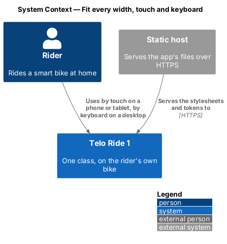
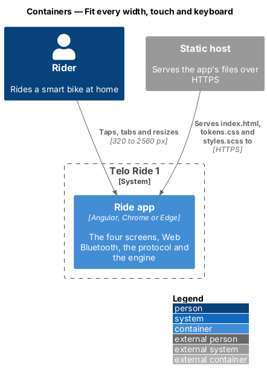
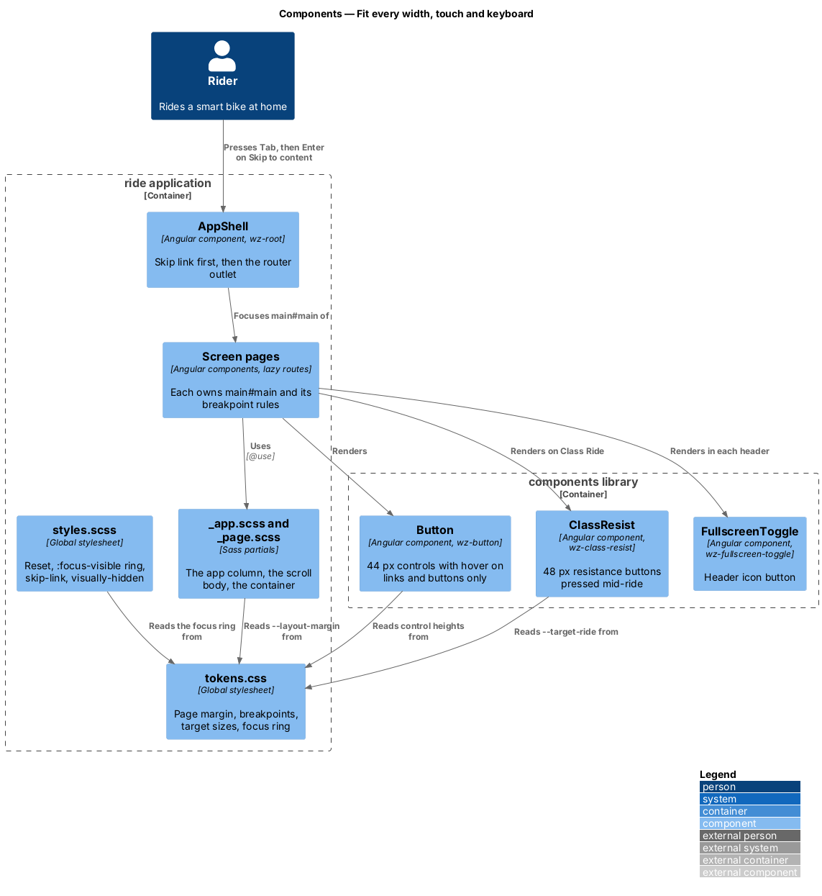
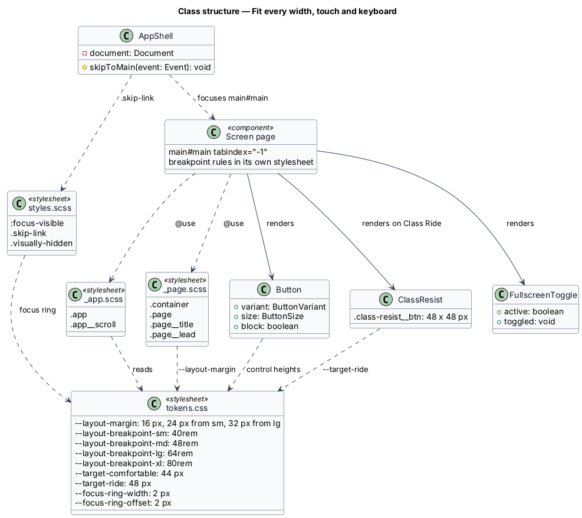
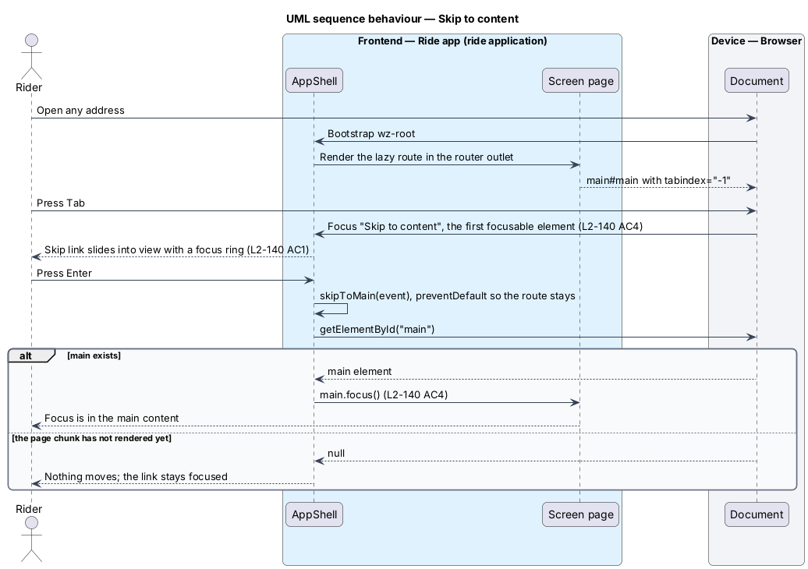
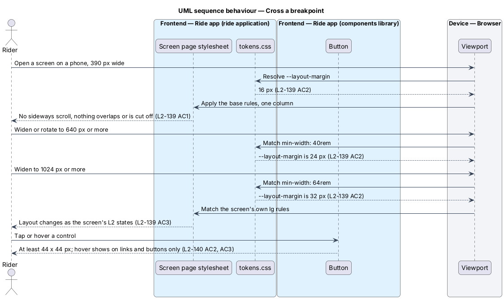

# Fit every width, touch and keyboard

## Overview

Telo Ride 1 is one class on the rider's own bike, shown on four screens: Connect Bike, The Class,
Class Ride and Class Done, plus Page not found. The rider opens it on a phone, a tablet in either
orientation, a laptop or a large screen, and reaches for it from the saddle. This feature covers
the rules every screen shares so that it fits any width from 320 to 2560 px and works by touch and
by keyboard: the page margin, the breakpoints, the size of every target, the focus ring, the hover
rule and the "Skip to content" link.

The feature is cross-cutting. It owns no screen. It owns the foundations each screen's stylesheet
reads and the one piece of shared behaviour, the skip link.

- **breakpoint**: viewport width at which a layout changes; **phone** below 640 px, **sm** from
  640 px, **md** from 768 px, **lg** from 1024 px, **xl** from 1280 px
- **page margin**: space between the edge of the viewport and a screen's content
- **target**: area of a control that accepts a tap or a click
- **ride target**: target pressed mid-ride, held to 48 × 48 px
- **focus ring**: outline a control shows while it holds keyboard focus
- **skip link**: first focusable element of every page, which moves focus to the main content
- **role token**: CSS custom property named for what a value is for, not for the value

Adjacent concerns belong to other features. The Class's two layouts belong to
[Fit The Class to every form factor](../fit-the-class-to-every-form-factor/README.md). Headings,
live regions, contrast and motion belong to
[Support screen readers and motion](../support-screen-readers-and-motion/README.md). The themes and
Full screen belong to [Switch theme and full screen](../switch-theme-and-full-screen/README.md). The
wordmark's narrow-screen rule belongs to [Show the wordmark](../show-the-wordmark/README.md). Each
screen's own responsive rules are stated by the feature that owns the screen:
[Connect a bike](../../bike/connect-a-bike/README.md),
[Show The Class](../../the-class/show-the-class/README.md),
[Ride the class](../../class-ride/ride-the-class/README.md) and
[Show Class Done](../../class-done/show-class-done/README.md). The resistance buttons' behaviour
belongs to [Control resistance](../../bike/control-resistance/README.md).

## Description

The slice is stylesheets and one component. Each block below is marked as existing in the code or
new.

- **`tokens.css`** (exists, `frontend/projects/ride/src/styles/tokens.css`): the app's copy of
  `docs/design-system/tokens/tokens.css`, listed first in the `styles` of `angular.json`. It holds
  `--layout-margin`, which is `--space-4` (16 px) on `:root`, `--space-6` (24 px) under
  `@media (min-width: 40rem)` and `--space-8` (32 px) under `@media (min-width: 64rem)`. It holds
  `--target-comfortable` (44 px), `--target-ride` (48 px), `--focus-ring-width` and
  `--focus-ring-offset` (2 px each), and the control heights `--control-height-sm` (36 px) to
  `--control-height-xl` (56 px). The breakpoints are recorded as `--layout-breakpoint-sm`, `-md`,
  `-lg` and `-xl` (40, 48, 64 and 80 rem). A media query cannot read a custom property, so each
  stylesheet writes the rem value. The app's copy predates the Telo Ride 1 tokens of the design
  system (`--the-class-aside-width`, `--duration-stagger` and others are absent from it); the first
  change that builds a Telo Ride 1 screen copies the design system's file again.
- **`styles.scss`** (exists, `frontend/projects/ride/src/styles/styles.scss`): the global
  foundations. Its reset sets `box-sizing: border-box` and `max-width: 100%` on images and video.
  Its `:focus-visible` rule draws the focus ring on every control from `--focus-ring-width`,
  `--focus-ring-offset` and `--color-focus-ring`. It defines `.skip-link`, which sits above the
  viewport (`translate: 0 -200%`) until focused, and `.visually-hidden`.
- **`_page.scss`** (exists, `frontend/projects/ride/src/styles/_page.scss`): Sass partial a page's
  stylesheet takes with `@use`. Its `.container` centres the content at `--layout-container-max`
  (1280 px) and pads it by `--layout-margin`; that is how the page margin reaches each screen. Its
  `.page:focus` removes the outline of a `main` focused by the skip link.
- **`_app.scss`** (new, `frontend/projects/ride/src/styles/_app.scss`): Sass partial holding the
  design system's `app` block: `.app`, a column `100dvh` tall, and `.app__scroll`, the body that
  scrolls under the header (`flex: 1; min-height: 0; overflow-y: auto`). Those rules live today in
  `main-shell.scss` of `MainShell`, Telo Ride's shell with the navigation bar. Telo Ride 1 has no
  navigation (L2-167 AC4), so `MainShell` goes and each page draws `.app` itself with its own
  header. Only the body scrolls, and only down, which keeps a screen from scrolling sideways.
- **`AppShell`** (exists, `wz-root`, `frontend/projects/ride/src/app/app-shell.ts`): the root
  component. Its template is the skip link followed by the router outlet, so the link is the first
  focusable element of every page. `skipToMain(event)` cancels the link's navigation, finds
  `#main` in the document and focuses it; a `#main` address would otherwise leave the route. It is
  unchanged.
- **Screen pages** (`ConnectBikePage` and `NotFoundPage` exist and are reshaped, `ClassRidePage`
  exists and is reshaped, `TheClassPage` and `ClassDonePage` are new): each page renders one
  `main` with `id="main"` and `tabindex="-1"`, the target of the skip link. Each page's own
  stylesheet holds its breakpoint rules, written mobile first with `min-width` queries at 40, 48,
  64 and 80 rem.
- **`Button`** (exists, `a[wz-button], button[wz-button]`, `components/src/button/`): the `btn`
  block. Its height comes from `--control-height-*` by `size`. The `sm` size is 36 px, below the
  44 px floor; each use of it in Telo Ride 1 shall extend its target to `--target-comfortable`.
  On Class Ride's header the mocks draw Pause and Leave at 36 px from sm (48 px below sm); L2-140
  AC2 asks for 44 px (`L2.md` open question 10), and this design follows the requirement.
- **`FullscreenToggle`** (exists, `wz-fullscreen-toggle`): an `icon-btn`, 36 × 36 px today. Its
  target shall grow to 44 × 44 px (`--target-comfortable`) on every header, for the same reason.
- **`ClassResist`** (exists, `wz-class-resist`, `components/src/class-ride/`): the resistance
  buttons on Class Ride. `class-resist.scss` sizes `.class-resist__btn` to `--target-ride`, 48 ×
  48 px, the ride target of L2-140 AC2.
- **Hover rule** (convention): a `:hover` style appears only in a rule whose subject is an `a` or
  a `button` (`.btn`, `.icon-btn`, `.the-class__bike`, `.class-resist__btn`). A panel, a stat, a
  bar of the efforts or the video has none. Hover transitions read `--duration-fast`.
- **Responsive sweep** (new): a Playwright sweep that opens each screen at 320, 390, 640, 768,
  834, 1024, 1194, 1280, 1440 and 2560 px and asserts that the document is no wider than the
  viewport. `AGENTS.md` keeps sweeps out of the default run and out of CI; a person asks for a
  run. The skip link is covered today by `frontend/e2e/app-shell.spec.ts`, which opens Telo
  Ride's Home and is reshaped to open The Class. Fixtures and page objects belong to
  [Test without hardware](../../platform/test-without-hardware/README.md).

The Class from lg fits without scrolling down to 1024 × 768, and a landscape window too short for
it scrolls rather than cut content off (slice 30.4, `L2.md` open question 23,
[Fit The Class to every form factor](../fit-the-class-to-every-form-factor/README.md)). The
minimum height at which Class Ride from md still fits without scrolling is `<TO SUPPLY>`: L2-139
AC1 forbids cut-off content and L2-087 AC5 forbids scrolling.

## Requirements

The feature realizes the following level-2 (L2) requirements. Each refines a level-1 (L1)
requirement, cited by identifier.

| L2 ID | Refines (L1) | Requirement |
|-------|--------------|-------------|
| `L2-139` | `L1-023` | Each screen shall show without sideways scrolling, and with nothing overlapping or cut off, at every width from 320 to 2560 px. The page margin shall be 16 px on a phone, 24 px from sm and 32 px from lg. When the viewport crosses a breakpoint, the layout shall change as each screen's responsive rules and L2-171 state. |
| `L2-140` | `L1-023` | Every interaction shall work by touch on a phone and by keyboard on a desktop, with a visible focus ring on every control. Every target shall be at least 44 × 44 px, and the resistance buttons pressed mid-ride shall be at least 48 × 48 px. Anything that is not a button or a link shall show no hover effect. On every page, a "Skip to content" link shall be the first focusable element and shall move focus to the main content. |

## Diagrams

### System context

The rider uses Telo Ride 1 by touch or by keyboard at any width; the static host serves the
stylesheets and tokens that carry the rules.

### Containers

The slice lives in the Ride app alone. The static host delivers `index.html`, `tokens.css` and
`styles.scss`; no storage is read.

### Components

`AppShell` places the skip link before the router outlet and focuses the page's `main`. The pages
take the app column and the container from the Sass partials, which read the page margin from
`tokens.css`; `Button`, `ClassResist` and `FullscreenToggle` read their target sizes from the same
file.

### Class structure

`tokens.css` is the single source of the page margin, the breakpoints, the target sizes and the
focus ring. Stylesheets are modelled as classes with the `stylesheet` stereotype; a dependency
arrow names the token a block reads.

### Behaviour: skip to content

The first Tab on any page focuses "Skip to content"; Enter moves focus to `main#main` without a
navigation (L2-140 AC4). Where the page's chunk has not rendered yet, nothing moves.

### Behaviour: cross a breakpoint

The page margin steps from 16 px to 24 px at 640 px and to 32 px at 1024 px (L2-139 AC2), and each
screen's own rules change its layout at the same widths (L2-139 AC3). Controls keep their target
size at every width (L2-140 AC2).

