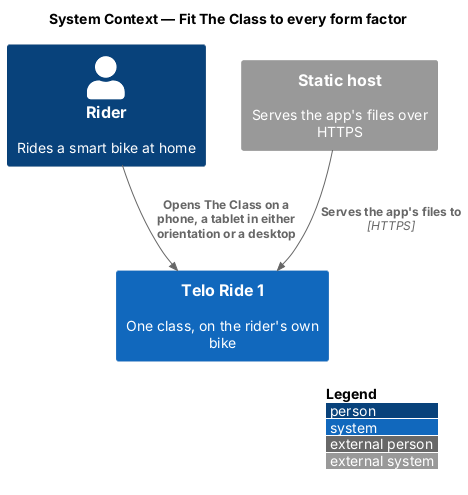
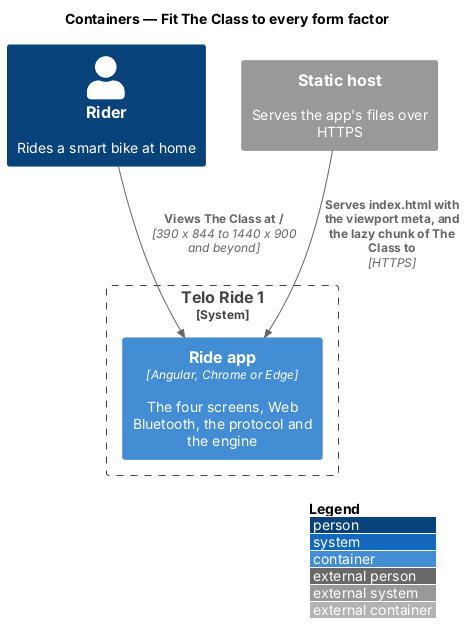
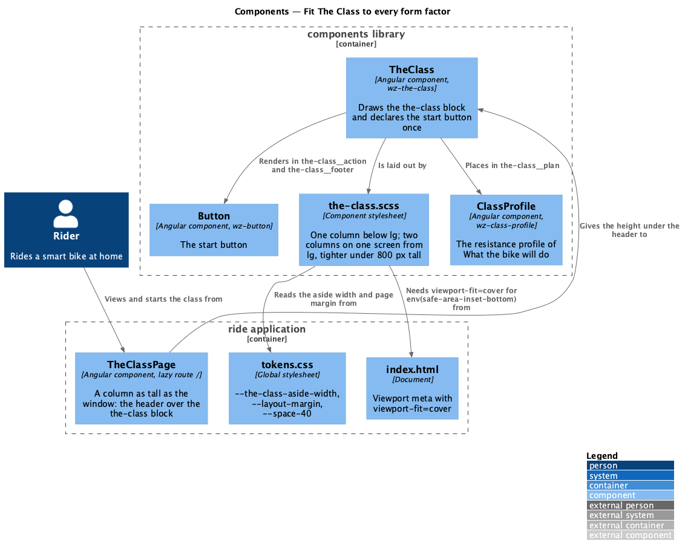
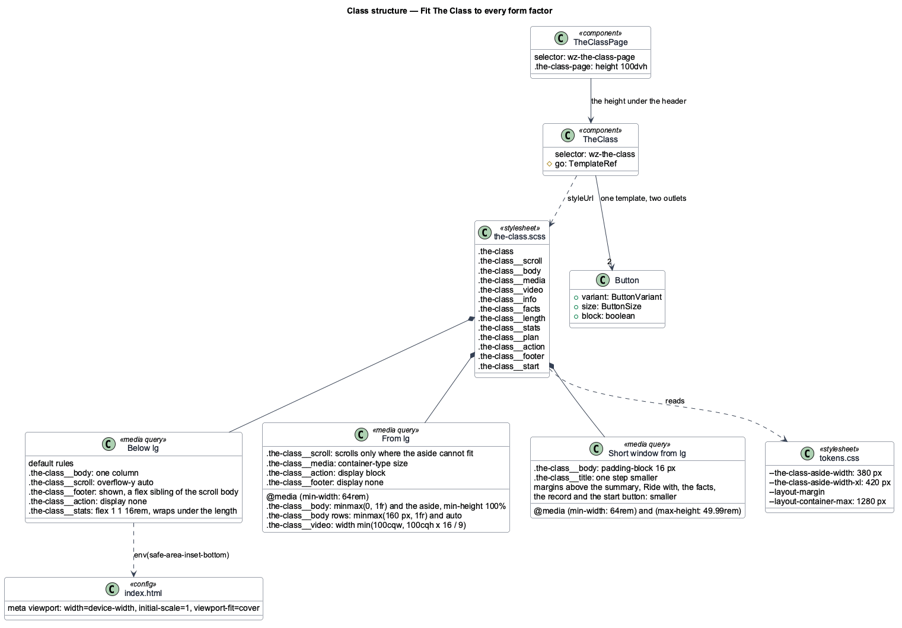
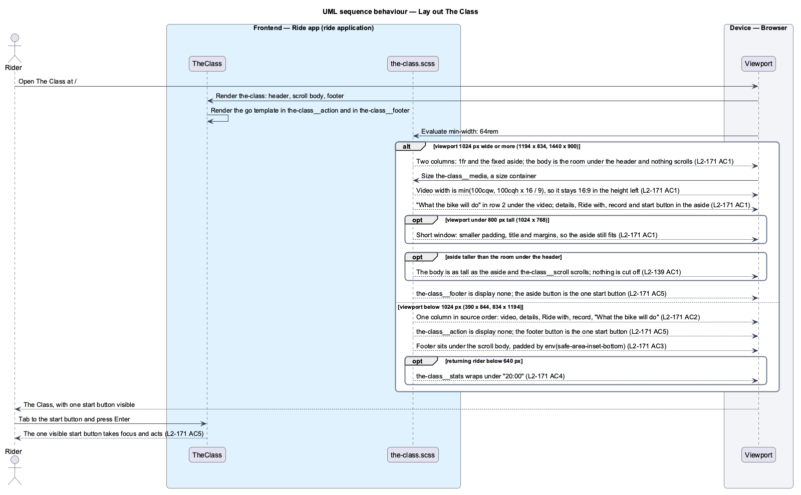
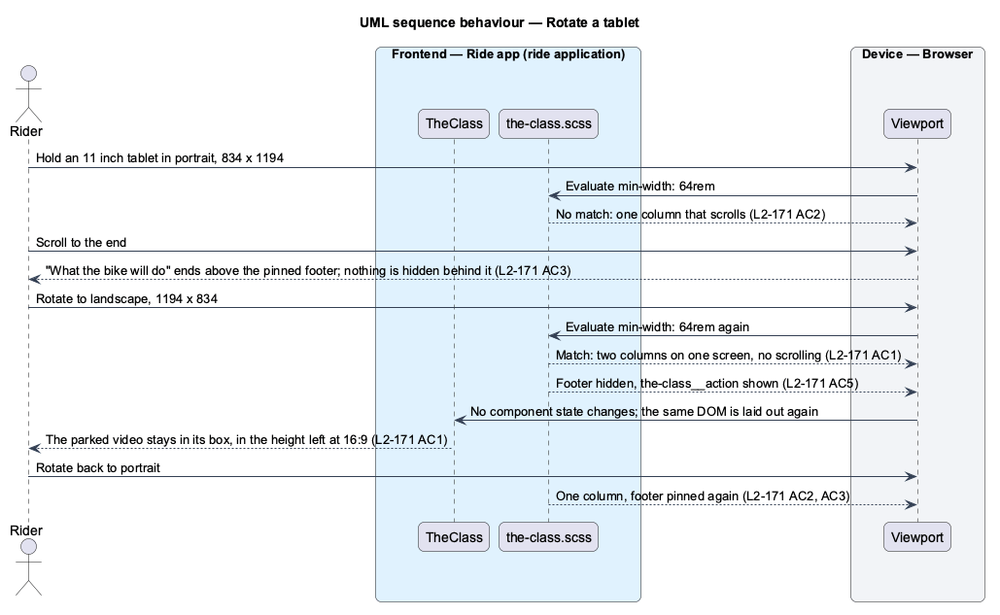

# Fit The Class to every form factor

Rewritten for Telo Ride 1 and brought in line with what slice 30.4 built.

## Overview

The Class is Telo Ride 1's home screen, at `/`: the class video or the course's still, the title
and length of Intervals to the Beat, the choice of how to ride, what the bike will do, and one
start button. The rider sees it on a tablet or laptop beside the bike, or on a phone. This feature
covers how that one screen is laid out on each of those devices, as the design's canvas *The
Class · Form Factors* draws it at 1194 × 834, 1440 × 900, 834 × 1194 and 390 × 844, and as the
mocks draw it at 1024 × 768.

The screen has two layouts and one set of content. The feature decides where each part sits; it
does not decide what the parts say.

- **form factor**: combination of viewport size and orientation a device presents
- **one-screen layout**: two-column layout from lg (1024 px) that fits the viewport without
  scrolling
- **one-column layout**: layout below lg in which the parts stack and the body scrolls
- **aside**: fixed-width right column of the one-screen layout, holding the class details, the
  choice of how to ride, the record and the start button
- **pinned footer**: bar under the scrolling body of the one-column layout that holds the start
  button
- **short window**: one-screen layout in a viewport under 800 px tall, drawn tighter
- **record**: rider's ride count, best output and last output
- **safe area**: part of the display not covered by the device's home bar

Adjacent concerns belong to other features. The content of The Class, the start button's label
and what it does belong to [Show The Class](../../the-class/show-the-class/README.md). The record's
values belong to [Keep the record](../../class-done/keep-the-record/README.md). The page margin,
the breakpoints and target sizes belong to
[Fit every width, touch and keyboard](../fit-every-width-touch-and-keyboard/README.md). The header's
wordmark belongs to [Show the wordmark](../show-the-wordmark/README.md) and its Full screen button
to [Switch theme and full screen](../switch-theme-and-full-screen/README.md). The alerts a blocked
browser shows under the header belong to
[Check bike and browser support](../../bike/check-bike-and-browser-support/README.md).

## Description

The layout is the `the-class` block of the design system (`docs/design-system/assets/components.css`),
transcribed in `docs/mocks/pages/the-class/`. Slice 30.2 built the block and its two places for
the start button; slice 30.4 built the one-screen layout, the short window and the viewport's
`viewport-fit=cover`. Slice 30.6 built the blocked browser's alert, which takes its 61 px from the room under the
header at every width from sm, and proved both blocked states in the five windows. The record
(slice 32.6) is still to come; the layout already leaves its room.

- **`TheClass`** (built, `wz-the-class`, `frontend/projects/components/src/the-class/`): the block
  under the header. Its template draws the parts in the mocks' order: `.the-class__scroll` holding
  `main#main.the-class__body` with `.the-class__media`, `.the-class__info` and `.the-class__plan`,
  then `.the-class__footer`. That source order is the one-column order of L2-171 AC2: video,
  details, the choice of how to ride, record, "What the bike will do". `.the-class__scroll` is the
  mocks' `.app__scroll`.
- **`TheClassPage`** (built, `wz-the-class-page`, `frontend/projects/ride/src/app/the-class/`): the
  page at `/`. It is a column as tall as the window (`100dvh`): the header, then `TheClass`, which
  takes the height left. The page itself never scrolls; only the block's body does.
- **`the-class.scss`** (built): the block's one encapsulated stylesheet, with the BEM names of the
  mocks. Every layout rule of this feature is in it.
- **One-column rules** (built, the default below 64 rem): `.the-class__body` is a one-column grid
  padded by `--layout-margin`. `.the-class__scroll` scrolls. `.the-class__footer` is a flex sibling
  of `.the-class__scroll` inside `.the-class`, not a fixed-position layer, so the body ends above
  it and no content lies behind it (L2-171 AC3). Its bottom padding is
  `max(var(--space-3), env(safe-area-inset-bottom))`. `.the-class__action` is `display: none`.
- **One-screen rules** (built by slice 30.4, `@media (min-width: 64rem)`): `.the-class__body` has
  `min-height: 100%`, columns `minmax(0, 1fr)` and `--the-class-aside-width` (380 px;
  `--the-class-aside-width-xl`, 420 px, from 80 rem) and rows `minmax(var(--space-40), 1fr) auto`.
  `.the-class__media` takes column 1, row 1; `.the-class__plan` takes column 1, row 2;
  `.the-class__info` spans both rows of column 2. `.the-class__action` shows at the foot of the
  aside (`margin-top: auto`) and `.the-class__footer` is `display: none`. While the aside fits the
  room under the header, the body is exactly that room, its rows share it, and nothing scrolls
  (L2-171 AC1).
- **Video box** (built by slice 30.4): `.the-class__video` has `aspect-ratio: 16 / 9` and full
  width below lg. From lg, `.the-class__media` is a size container (`container-type: size`) and the
  video's width is `min(100cqw, calc(100cqh * 16 / 9))`, so the box takes the height left and
  stays 16:9, centred in its place (L2-171 AC1). The cover, the player and the course's still
  inside it belong to Show The Class.
- **Short window** (built by slice 30.4, `@media (min-width: 64rem) and (max-height: 49.99rem)`):
  in a viewport under 800 px tall the same parts are drawn tighter. The body's block padding is
  `--space-4`, the title is one step smaller (`--font-size-4xl`; `--font-size-5xl` from 80 rem),
  and the margins above the summary, "Ride with", the facts, the record and the start button are
  each a step or two smaller. It is what lets every mock fit at 1024 × 768, the blocked browser's
  with its alert, the record and the start button's line included. 1194 × 834 and 1440 × 900 are
  drawn as the Form Factors canvas draws them.
- **A window too short to fit** (built by slice 30.4): `.the-class__scroll` keeps
  `overflow-y: auto` at every width, and the body's height is a minimum, never a fixed height.
  Where the aside is taller than the room under the header, the body is as tall as the aside, the
  video's row is the 160 px it is never under or more, and the body scrolls to the start button
  with its margin under it. Nothing is cut off (L2-139 AC1).
- **Record row** (to come, slice 32.6): `.the-class__facts` is a wrapping flex row;
  `.the-class__stats` has `flex: 1 1 16rem`, so on a phone its three figures wrap under "20:00" and
  on a portrait tablet they sit beside it (L2-171 AC4). From lg the facts stack in the aside. The
  short window's rule for `.the-class__stats` is in the design system and joins `the-class.scss`
  with the record.
- **Start button** (built, `Button`, `wz-button`): the mocks place the button twice, in
  `.the-class__action` and in `.the-class__footer`. `TheClass` declares it once in an
  `ng-template` (`go`) and renders it in both places with `ngTemplateOutlet`. Exactly one of the
  two containers is displayed at any width; the other is `display: none`, which removes its
  button from the tab order and from the accessibility tree (L2-171 AC5).
- **`tokens.css`** (built): `--the-class-aside-width`, `--the-class-aside-width-xl`, `--space-40`
  and the page margin, copied from the design system.
- **`index.html`** (built by slice 30.4, `frontend/projects/ride/src/index.html`): its viewport
  meta reads `width=device-width, initial-scale=1, viewport-fit=cover`. Without
  `viewport-fit=cover` a phone reports `env(safe-area-inset-bottom)` as 0 and the pinned footer is
  not kept clear of the home bar.
- **`ClassProfile`** (built, `wz-class-profile`): the chart of "What the bike will do". The layout
  sets its height through `--class-profile-height` (`--space-16`, `--space-14` from lg,
  `--space-16` from xl); the content belongs to Show The Class.
- **The class that cannot be loaded** (built by slice 30.1, mock `the-class/cannot-load`): the
  page draws the message over Reload in its own scrolling body in the block's place. It has no
  video, no aside and no start button, and fits every window this feature names.

Three points were open and are closed by slice 30.4 (`docs/specs/L2.md`, open question 23).
First, L2-171 AC1 speaks of a landscape viewport at lg or wider, and the rule keys on width alone
(`min-width: 64rem`), as the mocks' does: a portrait viewport 1024 px wide or more takes the
one-screen layout, which fits it with room to spare. Second, the one-screen layout fits without
scrolling down to 1024 × 768 in every state the mocks draw; a shorter window is drawn tighter, and
one too short even for that scrolls rather than cut content off. Third, the class that cannot be
loaded and the video that cannot load now have mocks (`the-class/cannot-load`,
`the-class/video-unavailable`) and are laid out as above.

The layout is proved by `frontend/e2e/the-class-form-factors.spec.ts`: each state at 1024 × 768,
1194 × 834 and 1440 × 900 does not scroll, with the video 16:9 in its place, the card under it and
the start button in the aside inside the window; a window too short for the video at its column's
width shrinks the video and still does not scroll; a window too short for the aside scrolls to the
start button; each state at 390 × 844 and 834 × 1194 is one column in order over the pinned
button, which a home bar 34 px tall lifts by 34 px; and one start button shows and takes Tab and
Enter in both layouts. A home bar is given to the page through the browser's own emulation
(`Emulation.setSafeAreaInsetsOverride`); the meta that makes a real phone report one is asserted
beside it.

## Requirements

The feature realizes the following level-2 (L2) requirement, which refines the level-1 (L1)
requirement cited.

| L2 ID | Refines (L1) | Requirement |
|-------|--------------|-------------|
| `L2-171` | `L1-023` | In a landscape viewport at lg or wider (an 11" tablet at 1194 × 834, a desktop at 1440 × 900), The Class shall fit on one screen with no scrolling: the video shall take the height left and stay 16:9, "What the bike will do" shall sit under it, and the class details, the choice of how to ride, the record and the start button shall sit in a fixed column on the right. On a phone or a tablet in portrait (390 × 844, 834 × 1194), The Class shall be one column that scrolls, in the order video, details, the choice of how to ride, record, "What the bike will do". In that one-column layout the start button shall stay pinned to the bottom of the screen, clear of the home bar (`env(safe-area-inset-bottom)`), and no content shall be hidden behind it at the end of the scroll. For a returning rider on a phone, the record's three figures shall wrap under "20:00" and shall not overlap it. In any layout, exactly one start button shall be visible and reachable by keyboard. |

## Diagrams

### System context

The rider opens The Class on any device; the static host serves the files. No other system takes
part in the layout.

### Containers

The Ride app lays the screen out in the browser. The host serves `index.html`, whose viewport meta
enables the safe-area inset, and the lazy chunk of The Class.

### Components

`TheClassPage` gives `TheClass` the height under the header, and the block's stylesheet places
the parts. The profile and the button are presentation components beside it in the components
library; the stylesheet reads the aside width and the page margin from `tokens.css`.

### Class structure

The stylesheet is composed of three rule sets: one below lg, one from lg, and one for a short
window from lg. The block renders one start-button template in two outlets, and each layout
displays exactly one of them.

### Behaviour: lay out The Class

One media query at 1024 px selects the layout. From lg the screen is two columns that do not
scroll (L2-171 AC1), drawn tighter under 800 px tall; below lg it is one column with the pinned
footer (L2-171 AC2, AC3, AC4). In both, one start button is displayed (L2-171 AC5).

### Behaviour: rotate a tablet

Rotating an 11" tablet crosses the lg breakpoint. The same DOM is laid out again; no component
state changes, so the parked video and the choice of how to ride are untouched.

