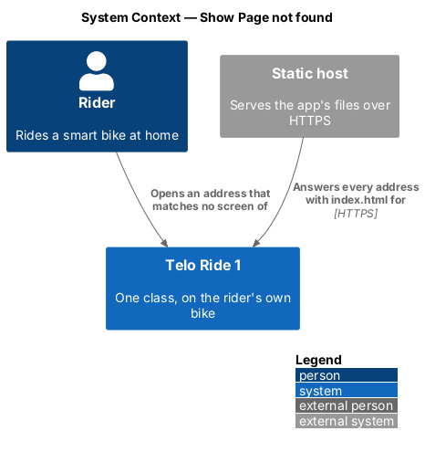
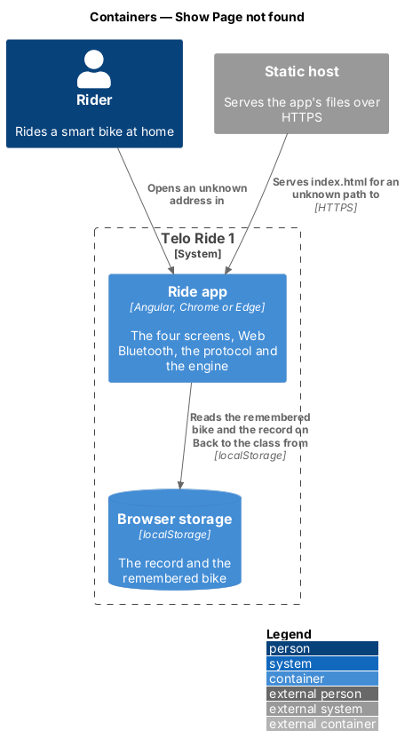
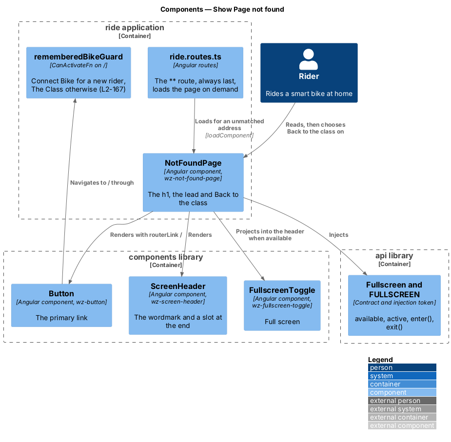
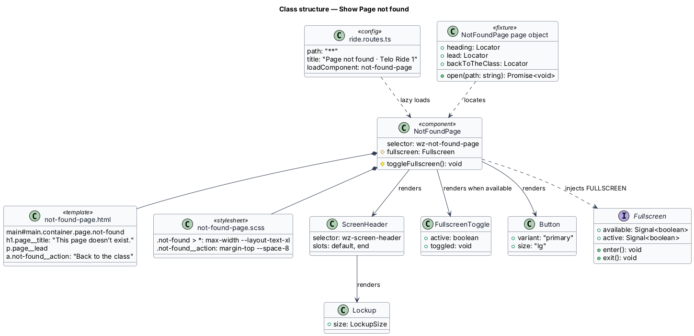
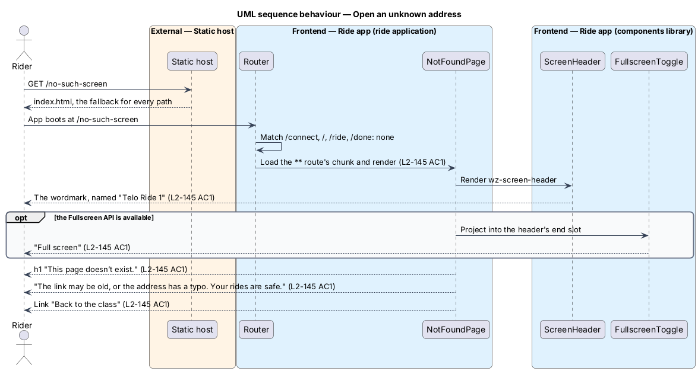
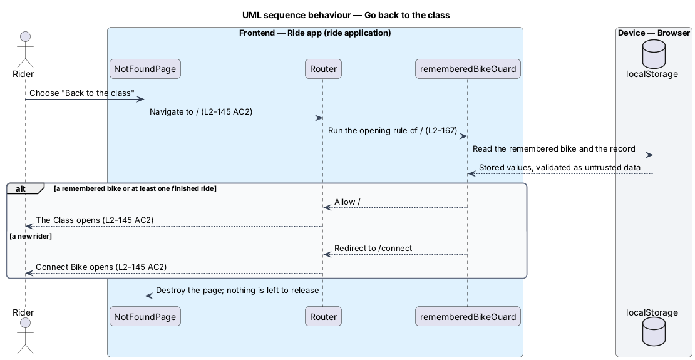

# Show Page not found

## Overview

Telo Ride 1 has four screens, at `/connect`, `/`, `/ride` and `/done`. A rider can still arrive at
an address that matches none of them: an old bookmark from Telo Ride, a mistyped link. This feature
covers the page that address shows. It says the page does not exist, reassures the rider that
their rides are untouched, and offers one way on, back to the class.

The page is static. It loads nothing, stores nothing and has one state.

- **unknown address**: path that matches none of the app's routes
- **wildcard route**: last route of the app, with path `**`, which matches every unknown address
- **opening rule**: rule of L2-167 that sends a new rider to Connect Bike and any other rider to
  The Class when the app opens at `/`
- **new rider**: rider with no remembered bike and no finished rides

Adjacent concerns belong to other features. Where "Back to the class" lands belongs to
[Open the app](../../the-class/open-the-app/README.md). The wordmark in the header belongs to
[Show the wordmark](../show-the-wordmark/README.md) and the Full screen button to
[Switch theme and full screen](../switch-theme-and-full-screen/README.md). The page margin and the
skip link belong to
[Fit every width, touch and keyboard](../fit-every-width-touch-and-keyboard/README.md). The host
answering an unknown path with the app's document belongs to
[Host and deliver](../../platform/host-and-deliver/README.md). The redirects of `/ride` and `/done`
when opened out of turn are those screens' own rules
([Ride the class](../../class-ride/ride-the-class/README.md),
[Show Class Done](../../class-done/show-class-done/README.md)); they are known addresses and never
reach this page.

## Description

The page exists in the code as Telo Ride's not-found page and is reshaped. Its mock is
`docs/mocks/pages/not-found/default.html`.

- **Wildcard route** (exists, `frontend/projects/ride/src/app/ride.routes.ts`): `{ path: '**',
  loadComponent: () => import('./not-found/not-found-page') }`, always the last route. Today it
  is a child of `MainShell`, so the page shows inside Telo Ride's app header with its navigation,
  and it sits under `authGuard`. For Telo Ride 1 the route shall be the last child of the lazy
  parent route itself, with no guard. Its `title` is "Page not found · Telo Ride 1" (L2-172 AC4,
  slice 28.7).
- **`NotFoundPage`** (exists, `wz-not-found-page`, default export of
  `frontend/projects/ride/src/app/not-found/not-found-page.ts`): a standalone `OnPush` component
  with no state. It changes in four ways. It draws the `.app` column itself, with a header and
  `.app__scroll`. Its header carries the wordmark and Full screen, with no navigation (L2-167
  AC4). Its lead reads "The link may be old, or the address has a typo. Your rides are safe."
  (today "Your rides and progress are safe."). Its action reads "Back to the class" (today "Back
  to Home"). It injects `FULLSCREEN` for the header's button.
- **`not-found-page.html`** (exists): `main#main.container.page.not-found` with `tabindex="-1"`,
  holding `h1.page__title` "This page doesn’t exist.", `p.page__lead`, and
  `a.not-found__action`, a `wz-button` with `variant="primary"`, `size="lg"`, a left arrow icon
  and `routerLink="/"`. The `h1` is the page's only one.
- **`not-found-page.scss`** (exists, unchanged): block `not-found`. It takes `.container` and
  `.page` from the `_page.scss` partial, holds the three children to `--layout-text-xl` so the
  text keeps a readable measure while the page stays aligned with the header, and spaces the
  action by `--space-8`. It gains the `_app.scss` partial for the column.
- **`ScreenHeader`** (new, `wz-screen-header`, `frontend/projects/components/src/screen-header/`):
  presentation component that draws the mocks' `class-header` block: `wz-lockup`, then a default
  slot, then a `[slot=end]` slot pushed to the right. This page projects only the Full screen
  button. The component is specified in [Show the wordmark](../show-the-wordmark/README.md).
- **`FullscreenToggle`** (exists, `wz-fullscreen-toggle`): rendered in the end slot inside
  `@if (fullscreen.available())`.
- **`Button`** (exists, `a[wz-button]`): the primary link. At `lg` it is 48 px tall
  (`--control-height-lg`).
- **Going back** (exists as a link; destination changes): the link navigates to `/`. The page
  holds no rule of its own about where the rider lands: the opening rule on `/` decides, exactly
  as when the app opens there. A returning rider gets The Class and a new rider gets Connect
  Bike. The guard on `/` is `rememberedBikeGuard`. Today it knows only the remembered bike;
  Open the app reshapes it to read the record as well.
- **`NotFoundPage` page object** and **`not-found.spec.ts`** (exist, `frontend/e2e/pages/`,
  `frontend/e2e/`): the page object owns the `heading`, `lead` and action locators and `open(path)`.
  Both are reshaped: `backHome` becomes `backToTheClass`, the `AppHeader` page object gives way to
  the screen header's, and the spec asserts the Telo Ride 1 copy and both landings of AC2.

The page releases nothing when it is destroyed, because it acquires nothing: no subscription, no
timer and no listener of its own.

## Requirements

The feature realizes the following level-2 (L2) requirement, which refines the level-1 (L1)
requirement cited.

| L2 ID | Refines (L1) | Requirement |
|-------|--------------|-------------|
| `L2-145` | `L1-023` | When an address that matches no screen opens, the header shall show the wordmark and Full screen, and the page shall read "This page doesn’t exist." and "The link may be old, or the address has a typo. Your rides are safe.", with "Back to the class". When "Back to the class" is chosen, the app shall open as in L2-167. |

## Diagrams

### System context

The rider opens an unknown address. The static host answers it with the app's document, and
Telo Ride 1 shows the page.

### Containers

The Ride app matches the address and renders the page. Browser storage is read only afterwards,
by the opening rule, when the rider goes back to the class.

### Components

The wildcard route loads `NotFoundPage` on demand. The page renders `ScreenHeader`,
`FullscreenToggle` and a `Button` link to `/`, where the opening rule takes over.

### Class structure

`NotFoundPage` is composed of its template and stylesheet, renders three presentation components
and depends on the `Fullscreen` contract. The route and the e2e page object are modelled with the
`config` and `fixture` stereotypes.

### Behaviour: open an unknown address

The router finds no screen for the address and loads the wildcard route. The page shows the
wordmark, Full screen where available, the heading, the lead and the link (L2-145 AC1).

### Behaviour: go back to the class

"Back to the class" navigates to `/`, and the opening rule of L2-167 sends a returning rider to
The Class and a new rider to Connect Bike (L2-145 AC2).

