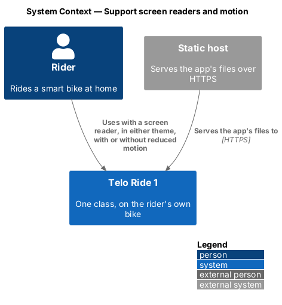
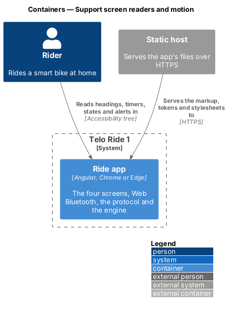
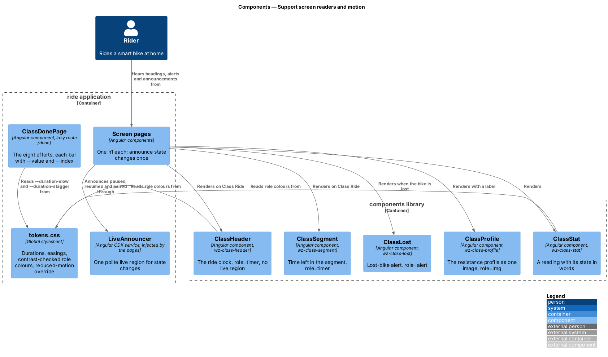
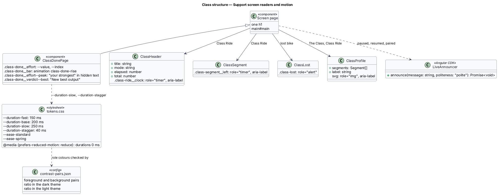
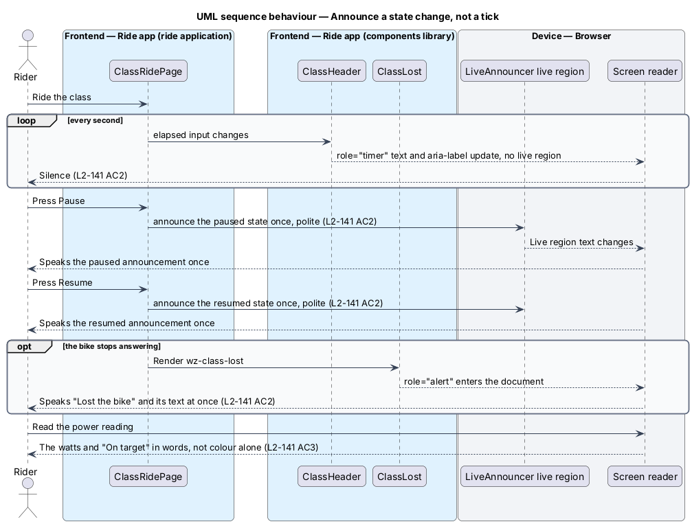
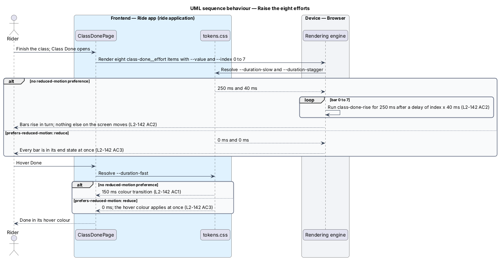

# Support screen readers and motion

## Overview

Telo Ride 1 is used beside a bike, sometimes by a rider who does not see the screen well, who uses
a screen reader, or who has asked the device to reduce motion. This feature covers what each screen
exposes to assistive technology and how the interface moves: one heading per screen, timers that
tick silently, state changes that are announced once, states carried by words as well as colour,
contrast in both themes, the resistance profile as one image, and motion that is short, rare and
absent under reduced motion. The target is WCAG 2.2 AA.

The feature is cross-cutting. Each rule is enforced in the markup or stylesheet of the component
that owns the element; this design states the rule once and names where it lands.

- **live region**: part of the page whose changes a screen reader speaks without the rider moving
  to it
- **timer**: element with `role="timer"`, whose text changes without being announced
- **alert**: element with `role="alert"`, announced at once when it enters the page
- **state change**: event the rider did not read off a ticking value; here a lost bike, a pause, a
  resume and a pairing
- **contrast ratio**: luminance ratio between a foreground and its background
- **reduced motion**: device setting exposed as `prefers-reduced-motion: reduce`
- **stagger**: delay between the starts of successive animations in a group
- **effort**: one of the plan's eight work segments

Adjacent concerns belong to other features. Target sizes, the focus ring and the skip link belong
to [Fit every width, touch and keyboard](../fit-every-width-touch-and-keyboard/README.md). The theme
that the contrast is measured in belongs to
[Switch theme and full screen](../switch-theme-and-full-screen/README.md). The wordmark's name for
a screen reader belongs to [Show the wordmark](../show-the-wordmark/README.md). The text of each
heading, alert and reading belongs to the feature that owns the screen:
[Connect a bike](../../bike/connect-a-bike/README.md),
[Show The Class](../../the-class/show-the-class/README.md),
[Ride the class](../../class-ride/ride-the-class/README.md),
[Pause, leave or finish the class](../../class-ride/pause-leave-or-finish-the-class/README.md),
[Wait for a lost bike](../../class-ride/wait-for-a-lost-bike/README.md),
[Show Class Done](../../class-done/show-class-done/README.md) and
[Show Page not found](../show-page-not-found/README.md).

## Description

Each block below is marked as existing in the code or new.

**Headings.** Each page renders exactly one `h1`:

| Screen | Page | `h1` |
|---|---|---|
| Connect Bike | `ConnectBikePage` (exists) | "Connect your bike" (`.connect__title`) |
| The Class | `TheClassPage` (new) | the class title (`.the-class__title`) |
| Class Ride | `ClassRidePage` (exists, reshaped) | visually hidden, L2-087 AC1 |
| Class Done | `ClassDonePage` (new) | the verdict of L2-077 (`.class-done__verdict`) |
| Page not found | `NotFoundPage` (exists) | "This page doesn’t exist." (`.page__title`) |

Section titles under it ("What the bike will do", "Your eight efforts, average watts",
"Works with") are `h2`. The `.visually-hidden` utility is in `styles.scss` (exists).

**Timers.** `ClassHeader` (exists, `wz-class-header`) renders the ride clock as
`.class-ride__clock` with `role="timer"` and an `aria-label`. `ClassSegment` (exists,
`wz-class-segment`) renders the time left in the segment the same way. Neither has `aria-live`,
and no ancestor of a value that changes every second is a live region. `role="timer"` carries an
implicit `aria-live` of `off`.

**Announcements.** Three state changes are announced, each once.

- A lost bike: `ClassLost` (exists, `wz-class-lost`) renders `.class-lost` with `role="alert"`
  when the bike stops answering. The alerts of a blocked browser and of Bluetooth being off use
  the same role.
- Paused and resumed, and paired: the mocks draw no live region for these (the "Paused" overlay
  and the disabled "Paired" button are plain text). They are announced through `ANNOUNCER`, the
  app's one polite live region (`LiveRegionAnnouncer`; `@angular/cdk` left with ADR 0040).
  Slice 31.2 built the first two: `ClassRideStore` announces "Ride paused" and "Ride resumed"
  as the rider presses Pause and Resume (`L2.md` open question 28). `ConnectBikePage`
  announces when pairing completes; its wording is `<TO SUPPLY>`: neither `L2.md` nor the mocks
  give it.
- Searching: "Looking for bikes nearby…" is a `role="status"` region, per L2-011.

**Colour is never alone.** Each state named by L2-141 AC3 has words beside its colour.

- On target: `ClassStat` (exists, `wz-class-stat`) renders the hint text "On target"
  (`.class-stat__hint--on`). The off-target wording is `<TO SUPPLY>` (`L2.md`, *Mock gaps*, power
  off target on Class Ride).
- Connected: the header's bike link names the bike or reads "No bike"; the icon's colour is
  decoration.
- A new best: the `h1` reads "New best output" (L2-077 AC4); the gold repeats it.
- The strongest effort: its `.class-done__watts` carries the visually hidden text
  ", your strongest"; the orange bar repeats it.

**Contrast.** Colours come from role tokens in `tokens.css` (exists). The design system records
every foreground and background pair the components rely on, with its ratio in both themes, in
`docs/design-system/tokens/contrast-pairs.json` (exists). Text shall reach 4.5 : 1, large numerals
3 : 1 and control boundaries 3 : 1. The design system raised `--palette-faint` and
`--palette-paper-faint` and added the `-fg` text variants (`--color-volt-fg`, `--color-gold-fg`,
`--color-heart-fg`) for that reason. `tokens.css` also answers `prefers-contrast: more` and
`forced-colors: active`.

**The resistance profile.** `ClassProfile` (exists, `wz-class-profile`,
`components/src/class-library/class-profile.ts`) renders one `svg` with `role="img"` and an
`aria-label` from its `label` input ("Resistance profile"). Its `rect` elements are not exposed
one by one. The Class and Class Ride both pass the label. The eight efforts on Class Done are a
different element, a list of eight values, and stay a list.

**Motion.** Every transition and animation reads a duration token from `tokens.css`:
`--duration-fast` (150 ms) for hover colour, `--duration-base` (200 ms) for a panel,
`--duration-slow` (250 ms) and `--duration-stagger` (40 ms) for the efforts. The app's copy of
`tokens.css` lacks `--duration-stagger`; the change that builds Class Done copies the design
system's file again.

- **The efforts** (new, in `ClassDonePage`'s stylesheet, block `class-done`): each
  `.class-done__effort` sets `--value` (its height as a share of the peak) and `--index` (0 to 7).
  `.class-done__bar` runs the `class-done-rise` keyframes for `--duration-slow` with
  `animation-delay: calc(var(--index) * var(--duration-stagger))` and `animation-fill-mode: both`.
  It is the only animation on Class Done. The two custom properties are set through a style
  binding on the element; the mocks write them as inline `style`, which `AGENTS.md` forbids in
  templates.
- **Reduced motion** (exists): under `@media (prefers-reduced-motion: reduce)`, `tokens.css` sets
  `--duration-fast`, `--duration-base`, `--duration-slow`, `--duration-stagger`, `--duration-loop`
  and `--duration-pulse` to 0 ms. An animation of 0 ms with a fill mode of `both` is in its end
  state on the first frame, so no blanket override is used. Two carried-over tokens are kept at
  full length by that rule, `--duration-fade` and `--duration-deliberate` (Telo Ride's unlock card
  and 3-2-1 countdown). A Telo Ride 1 block shall not read either.
- **The spinner** on Connect Bike reads `--duration-loop` and stands still under reduced motion;
  its `role="status"` text carries the state.

**Checks.** An accessibility sweep (new) runs axe on each screen in each theme and a contrast
check on the pairs file. `AGENTS.md` keeps sweeps out of the default run and out of CI. Behaviour
specs assert the `h1`, the timer roles and the alert through page objects; they belong to
[Test without hardware](../../platform/test-without-hardware/README.md).

## Requirements

The feature realizes the following level-2 (L2) requirements. Each refines a level-1 (L1)
requirement, cited by identifier.

| L2 ID | Refines (L1) | Requirement |
|-------|--------------|-------------|
| `L2-141` | `L1-023` | Each screen shall have one `h1`: "Connect your bike", the class title, the visually hidden heading on Class Ride (L2-087 AC1), the verdict on Class Done (L2-077) and "This page doesn’t exist.". Values that change every second shall not be announced every second: timers shall use `role="timer"` without a live region, and only state changes (lost bike, paused, paired) shall be announced. A state (on target, connected, a new best, the strongest effort) shall never be carried by colour alone. In either theme, text shall have a contrast of at least 4.5 : 1 (3 : 1 for large numerals) and control boundaries at least 3 : 1. The resistance profile shall be one image (`role="img"`) with a name, not a list of bars. |
| `L2-142` | `L1-023` | Hovers shall take 150 ms and panels 200 ms. When Class Done opens, the eight bars of the efforts shall rise in turn, 250 ms each and 40 ms apart, and nothing else on the screen shall move. Under `prefers-reduced-motion: reduce`, anything that would animate shall be in its end state. |

## Diagrams

### System context

The rider reads Telo Ride 1 through a screen reader or by sight, with or without reduced motion.
The static host serves the files; no other system takes part.

### Containers

The Ride app exposes headings, timers, alerts and announcements through the browser's
accessibility tree. No storage is read.

### Components

The pages hold the `h1` and announce state changes through `LiveAnnouncer`. The presentation
components carry the roles: `ClassHeader` and `ClassSegment` the timers, `ClassLost` the alert,
`ClassProfile` the image, `ClassStat` the state in words. `ClassDonePage` reads the two motion
tokens from `tokens.css`.

### Class structure

`tokens.css` holds the durations and their reduced-motion override, and its role colours are
checked by `contrast-pairs.json`. Each presentation component is shown with the role it carries.

### Behaviour: announce a state change, not a tick

The ride clock updates every second in silence. A pause, a resume and a lost bike are each spoken
once (L2-141 AC2), and the power reading states "On target" in words (L2-141 AC3).

### Behaviour: raise the eight efforts

On Class Done the eight bars rise in turn, 250 ms each and 40 ms apart (L2-142 AC2). Under reduced
motion the two tokens resolve to 0 ms and every bar is in its end state at once (L2-142 AC3). A
hover takes 150 ms, or none (L2-142 AC1, AC3).

