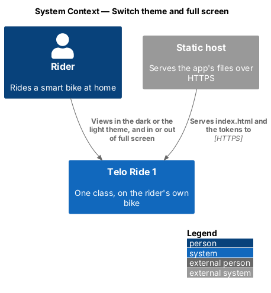
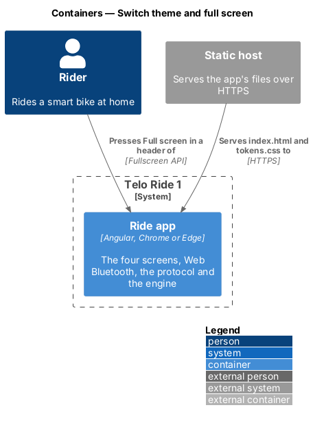
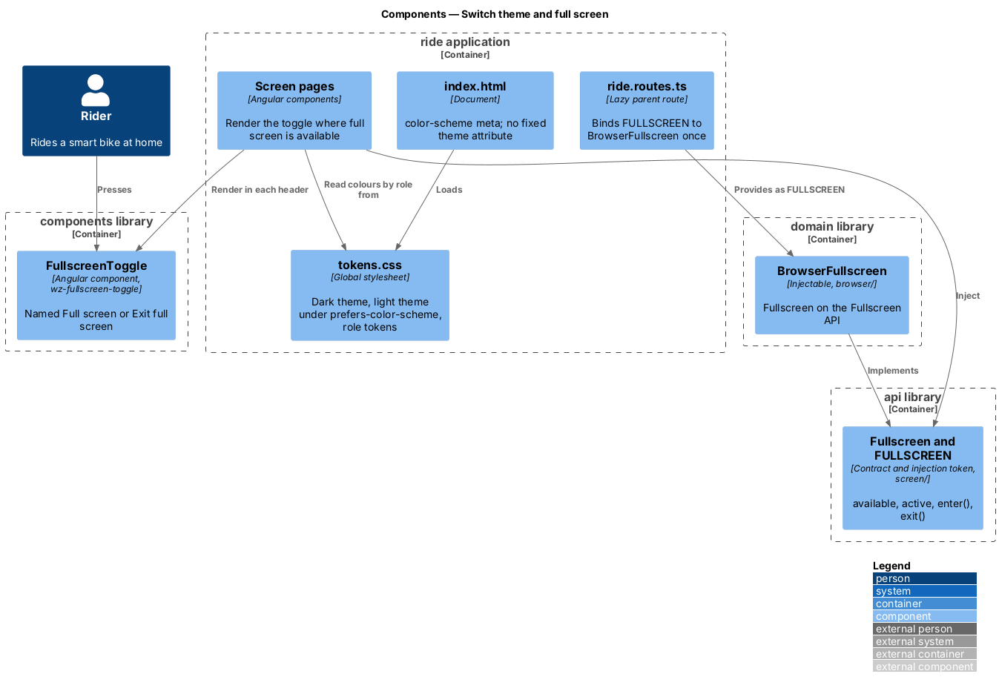
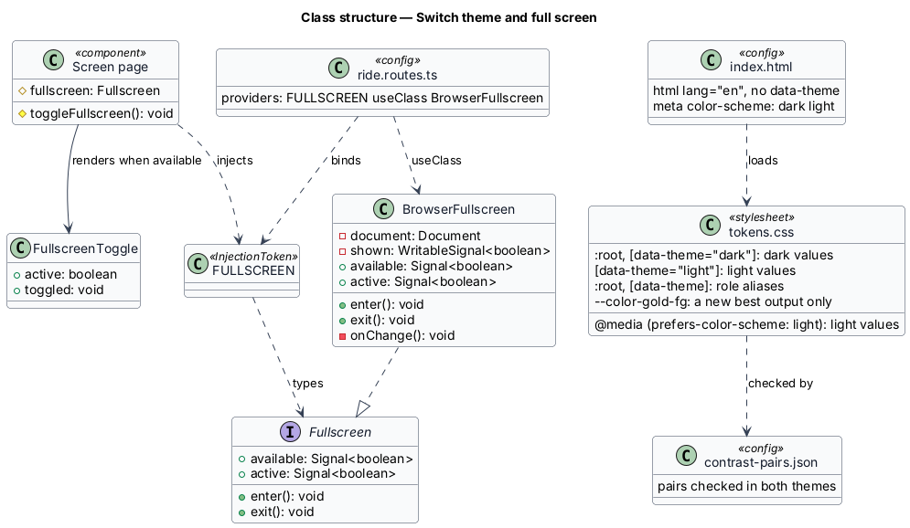
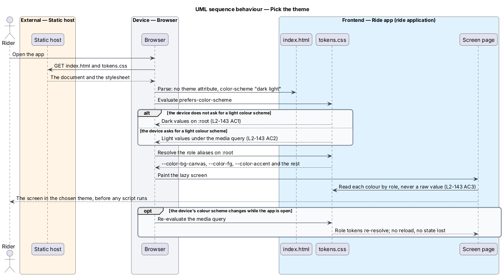
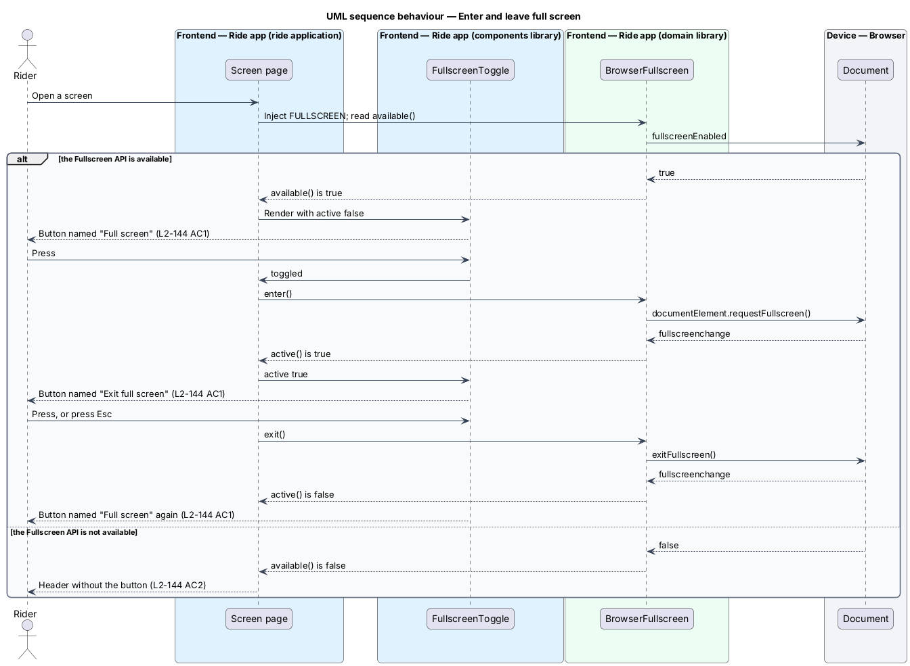

# Switch theme and full screen

## Overview

Telo Ride 1 is dark by default and has a light theme. It also offers to fill the display, which
suits a tablet propped on the handlebars. This feature covers both: which theme the app opens in
and where its colours come from, and the Full screen button in every screen's header.

Neither part has a setting. Telo Ride 1 has no settings screen and stores no preference: the
device's colour scheme picks the theme, and the browser holds the full-screen state.

- **theme**: complete set of colour values the interface is drawn in, dark or light
- **colour scheme**: device's stated preference for a light or dark interface, exposed as
  `prefers-color-scheme`
- **palette token**: CSS custom property holding a raw colour value (`--palette-signal`)
- **role token**: CSS custom property named for what a colour is for (`--color-fg`,
  `--color-bg-canvas`, `--color-accent`), resolved per theme
- **gold**: colour reserved for a new best output
- **full screen**: browser mode in which the page covers the whole display, entered through the
  Fullscreen API

Adjacent concerns belong to other features. The contrast each theme has to reach belongs to
[Support screen readers and motion](../support-screen-readers-and-motion/README.md). The size of
the Full screen button's target belongs to
[Fit every width, touch and keyboard](../fit-every-width-touch-and-keyboard/README.md). The
wordmark that shares the header belongs to [Show the wordmark](../show-the-wordmark/README.md).
The verdict that turns the output gold belongs to
[Show Class Done](../../class-done/show-class-done/README.md). The screen staying awake during a
ride, a separate browser API, belongs to
[Keep the ride clock true](../../performance/keep-the-ride-clock-true/README.md). That nothing
about the rider is stored belongs to
[Keep data on the device](../../security/keep-data-on-the-device/README.md).

## Description

Each block below is marked as existing in the code or new.

### Theme

- **`tokens.css`** (exists, `frontend/projects/ride/src/styles/tokens.css`, a copy of
  `docs/design-system/tokens/tokens.css`): palette tokens on `:root`; the light theme on
  `:root, [data-theme="light"]`; the dark theme on `[data-theme="dark"]` and again under
  `@media (prefers-color-scheme: dark)` on `:root:not([data-theme="light"])`; then the role
  aliases on `:root, [data-theme]`.
- **`index.html`** (exists, `frontend/projects/ride/src/index.html`): `<html data-theme="dark">`
  and `<meta name="color-scheme" content="dark light">`.

Today the fixed attribute makes the app dark on every device, so L2-143 AC2 is not met, and
without the attribute a browser that matches neither media query would fall to light, against
L2-143 AC1. The design changes both files, the design system first and the app's copy after it,
as the header of the app's `tokens.css` asks:

- `tokens.css` shall carry the dark values on `:root, [data-theme="dark"]`, and the light values
  on `[data-theme="light"]` and under `@media (prefers-color-scheme: light)` on
  `:root:not([data-theme="dark"])`. The two copies of each theme stay identical. The role aliases
  are unchanged.
- `index.html` shall drop `data-theme`. The `color-scheme` meta stays, so the browser's own
  surfaces (scroll bars, form controls) follow the same scheme.

The theme is then picked by the stylesheet before any script runs. There is no theme service, no
toggle and no stored preference, and a change of the device's colour scheme re-resolves the role
tokens without a reload. The `[data-theme]` selectors remain for a nested wrapper and for a test
that forces a theme.

One case is open. Current Chrome and Edge report `prefers-color-scheme: light` for a device that
has stated no preference, so the "no preference" of L2-143 AC1 and the "asks for light" of AC2
cannot be told apart there. Which theme such a device gets is `<TO SUPPLY>` (`L2.md` open question
9, the light theme the design never draws).

- **Role tokens** (exist): component stylesheets read `--color-*` role tokens and never a
  palette token or a raw value (L2-143 AC3). `AGENTS.md` states the same rule ("Read tokens by
  role, never hex").
- **Gold** (exists as a token; new use): `--color-gold-fg` is read in two rules of the
  `class-done` block only, `.class-done__verdict--best` and `.class-done__output--best
  .class-done__number`. No other Telo Ride 1 block reads `--color-gold`, `--color-gold-fg`,
  `--color-gold-subtle` or `--color-gold-border`. The design system's own comment still describes
  gold as "earned things only: XP, levels, stars, unlocks", Telo Ride's use; it is rewritten with
  the token change.
- **`contrast-pairs.json`** (exists, `docs/design-system/tokens/`): each pair's ratio in both
  themes, the evidence for L2-143 AC2.

### Full screen

- **`Fullscreen`** and **`FULLSCREEN`** (exist, `frontend/projects/api/src/screen/fullscreen.ts`):
  the contract and its injection token. `available` and `active` are signals; `enter()` and
  `exit()` return nothing.
- **`BrowserFullscreen`** (exists, `frontend/projects/domain/src/browser/browser-fullscreen.ts`):
  the contract on the Fullscreen API. `available` reads `document.fullscreenEnabled` once.
  `active` follows the `fullscreenchange` event, so it stays true to the browser when the rider
  leaves with Esc or the browser refuses a request. `enter()` calls
  `document.documentElement.requestFullscreen()` and `exit()` calls `document.exitFullscreen()`;
  both swallow a rejection. The listener is removed through `DestroyRef` when its owner is
  destroyed.
- **Binding** (changes): `FULLSCREEN` is bound today only on `MainShell`'s route in
  `ride.routes.ts`, and `MainShell` is its only consumer, so Connect Bike and the class ride have
  no Full screen button in the code. Telo Ride 1 drops `MainShell`. The token shall be bound
  once, to `BrowserFullscreen`, in the
  `providers` of the lazy parent route in `ride.routes.ts`. All five pages then share one
  instance, its code stays out of the initial bundle, and full screen survives a move from The
  Class to Class Ride to Class Done.
- **`FullscreenToggle`** (exists, `wz-fullscreen-toggle`, `components/src/fullscreen-toggle/`):
  presentation only. It takes `active` and emits `toggled`. Its `button` is named "Full screen"
  or "Exit full screen" by `aria-label` and swaps the expand and minimize corners. It sets no
  `aria-pressed`, because its name already changes with the state.
- **Pages** (`ConnectBikePage`, `ClassRidePage` and `NotFoundPage` exist; `TheClassPage` and
  `ClassDonePage` are new): each injects `FULLSCREEN`, renders the toggle at the end of its header
  inside `@if (fullscreen.available())`, and on `toggled` calls `exit()` when `active()` is true
  and `enter()` otherwise. That is the code `MainShell` holds today. Where the API is absent the
  button is not rendered at all (L2-144 AC2).
- **`withoutFullscreen`** (exists, `frontend/e2e/fixtures/fullscreen.ts`): Playwright fixture that
  makes `document.fullscreenEnabled` read false before the app starts, for the AC2 spec.

## Requirements

The feature realizes the following level-2 (L2) requirements. Each refines a level-1 (L1)
requirement, cited by identifier.

| L2 ID | Refines (L1) | Requirement |
|-------|--------------|-------------|
| `L2-143` | `L1-023` | When the app opens with no colour-scheme preference, it shall use the dark theme. When the device asks for a light colour scheme, the app shall use the light theme, with contrast meeting L2-141 AC4. Every colour used shall come from a role token, never a raw value. Gold shall be used only for a new best output. |
| `L2-144` | `L1-023` | Where the Fullscreen API is available, each screen's header shall offer "Full screen", which shall enter full screen. In full screen the button shall read "Exit full screen" and shall leave full screen. Where the Fullscreen API is not available, the button shall be absent from every header. |

## Diagrams

### System context

The rider views Telo Ride 1 in one of two themes and may fill the display with it. The static
host serves the document and the tokens that decide the theme.

### Containers

Both mechanisms live in the Ride app. Neither reads nor writes browser storage.

### Components

`index.html` loads `tokens.css`, which resolves the theme and the role tokens the pages read. The
lazy parent route binds `FULLSCREEN` to `BrowserFullscreen`; each page injects the token and
renders `FullscreenToggle`.

### Class structure

`BrowserFullscreen` realizes the `Fullscreen` contract behind the `FULLSCREEN` token. The theme
has no code type: `index.html` and `tokens.css` are modelled with the `config` and `stylesheet`
stereotypes.

### Behaviour: pick the theme

The stylesheet picks the theme from the device's colour scheme before any script runs: dark unless
the device asks for light (L2-143 AC1, AC2). Pages read colours by role (L2-143 AC3).

### Behaviour: enter and leave full screen

Where the API is available the header offers "Full screen"; the button's name follows the
browser's `fullscreenchange` event in both directions (L2-144 AC1). Where it is not, the header
has no button (L2-144 AC2).

